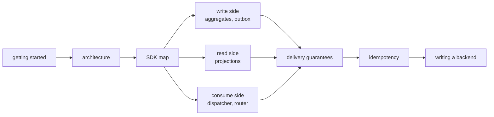

# edax documentation

edax is a toolkit for event-driven systems. It covers Command Query Responsibility Segregation
(CQRS) and event sourcing through Rust kernels and language software development kits (SDKs).
The kernels define shared decisions such as message encoding and idempotency. The SDKs connect
those decisions to storage and transports. Golden vectors test agreement across languages.

Start with [getting started](guides/getting-started.md) and [delivery
guarantees](guides/delivery-guarantees.md).

## Reading order

## Map

### Orientation

| Doc | What it answers |
|---|---|
| [Architecture](architecture.md) | why there is a kernel, how the crates fit, what the build pipeline generates |
| [Glossary](glossary.md) | every term this documentation uses, defined once |
| [Stability](stability.md) | what a version promises, which surfaces it covers, how a release is cut |

### Kernels — the shared decisions

| Doc | What it answers |
|---|---|
| [Kernels overview](kernels/README.md) | what the kernels own, and what they are forbidden to do |
| [edax-core](kernels/core.md) | `hash`, `key` (tenancy, the guard key), `backoff`, `clock`, `guid`, `version`, `names` (`closed_names!`), the `error` taxonomy; and the Rust-only runtime helpers `lock` and `TokenMint` |
| [filter](kernels/filter.md) | the filter abstract syntax tree (AST), its null rule, and the two build surfaces |
| [edax-event](kernels/event.md) | `message` (the messages, their payload, the ordering key), `codec`, `causation`, `partition`, `staleness`, `idempotency`, `sequence`, `upcast`, `retry`, `drain`, `saga` |
| [edax-cqrs](kernels/cqrs.md) | `canonical_json`, `command_hash`, `received_key`, `claim_key`, the idempotency `record`, the ledger fence (`complete_fence`, `release_fence`), the host values `Decimal` and `Instant`, `filter`, `query` |
| [edax-kafka](kernels/kafka.md) | `record` (the key, the header, the route, the dead-letter record), `partition` (broker placement), `offsets` (the watermark), `client` (`check_config`, `check_consumer`, `check_dead_sink`, `acks_warning`, `broker_error`) |
| [edax-redis](kernels/redis.md) | `ledger` (the key, the settings, the value layout, the claim handle, the reply outcomes), `scripts` (the five fence scripts, the reply verdict) |
| [Golden vectors](kernels/golden-vectors.md) | the cross-language contract, and when regenerating is legitimate |

### SDK — the wiring

| Doc | What it answers |
|---|---|
| [SDK map](sdk/README.md) | the seams and the orchestration around them |
| [Commands](sdk/commands.md) | `CommandBus`, the command message, idempotency keys and scopes, the three routes, `forget`, `retry` |
| [Idempotency](sdk/idempotency.md) | both guards, both modes, and every failure window |
| [Aggregates](sdk/aggregates.md) | `Aggregate`, `Repository`, `EventStore`, optimistic concurrency |
| [Outbox](sdk/outbox.md) | why a dual write cannot be atomic, the event and command outboxes, and what `Relay` does instead |
| [Transactions](sdk/transactions.md) | `Transactor`, the ambient handle, `joins_transaction` |
| [Consuming](sdk/consuming.md) | `KeyOrderedDispatcher`, `EventRouter`, settlement, dead-lettering |
| [Sagas](sdk/sagas.md) | cross-aggregate workflows without a distributed transaction |
| [Projections](sdk/projections.md) | read models, filters, sorting, the total order, keyset cursors |
| [Errors](sdk/errors.md) | the taxonomy, and every path that branches on it |
| [Observability](sdk/observability.md) | the `Observer`, `timing()`, the pull surface, the cardinality rule, the OTel mapping |
| [Go SDK](sdk/go.md) | source build, idiomatic Go APIs, transactions, consumption and sagas |
| [Rust parity](sdk/rust-parity.md) | the Rust reference model: what it holds to the kernels, and where it differs on purpose |

### Backends — bring your own

| Doc | What it answers |
|---|---|
| [Backends overview](backends/README.md) | the seam contracts, and a checklist for implementing one |
| [memory](backends/memory.md) | the in-memory stores and a transaction that is kept for real |
| [redis](backends/redis.md) | a ledger that does not join your transaction, its two expiry clocks, and fencing |
| [Go backends](backends/go.md) | Go memory, Redis and Kafka adapters and their client contracts |
| [kafka](backends/kafka.md) | the `Producer` and `Consumer` adapters, and what an ack must mean |

### Guides

| Doc | What it answers |
|---|---|
| [Getting started](guides/getting-started.md) | build it, then wire one command end to end |
| [Delivery guarantees](guides/delivery-guarantees.md) | what every hop of the pipeline promises |
| [Testing](guides/testing.md) | golden vectors, model tests, and testing your own backend |
| [Examples](guides/examples.md) | nineteen topics in Python and Go, in learning order |
| [Multi-tenancy](guides/multi-tenancy.md) | silo, pool and bridge mapped onto the seams, and what is not enforced |

## Three things to know before you build

1. **No durable event or projection store ships.** Implement these stores against your own
   database. Each seam's docstring is the specification; [backends](backends/README.md) is
   the index.
2. **edax never promises exactly-once.** See [delivery guarantees](guides/delivery-guarantees.md)
   for the one statement of what does hold.
3. **A golden vector wins over a disagreeing test.** If your change makes a vector fail, the change
   is wrong until you decide otherwise on purpose. See [golden vectors](kernels/golden-vectors.md).

## Also in the repository

- [`README.md`](../README.md) — the project overview and quickstart.
- [`AGENTS.md`](../AGENTS.md) — operational rules for working in this repository.
- [Python examples](../examples/py/README.md) and [Go examples](../crates/edax-go/examples/README.md) — nineteen topics in each language, with result checks.
