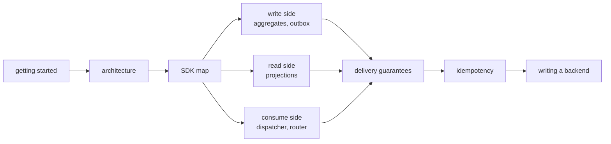

# edax documentation

edax is a toolkit for event-driven systems. It covers Command Query Responsibility Segregation
(CQRS) and event sourcing, with a Rust core and language software development kits (SDKs) that
cannot drift apart. The kernels decide what every service must agree on. The SDK wires those
decisions to your storage and transports. Golden vectors make drift fail the build.

New here? Read [getting started](guides/getting-started.md), then [delivery
guarantees](guides/delivery-guarantees.md). Those two answer most questions.

## Reading order

## Map

### Orientation

| Doc | What it answers |
|---|---|
| [Architecture](architecture.md) | why there is a kernel, how the crates fit, what the build pipeline generates |
| [Glossary](glossary.md) | every term this documentation uses, defined once |
| [Stability](stability.md) | what a version promises, which surfaces it covers, how a release is cut |

### Kernels — the shared decisions

| Doc | What it answers |
|---|---|
| [Kernels overview](kernels/README.md) | what the kernels own, and what they are forbidden to do |
| [edax-core](kernels/core.md) | hashing, backoff, the clock, id generation, error codes |
| [filter](kernels/filter.md) | the filter abstract syntax tree (AST), its null rule, and the two build surfaces |
| [edax-event](kernels/event.md) | partition, codec, upcast, causation, dedup, sequence |
| [edax-cqrs](kernels/cqrs.md) | canonical JSON, the command hash, the idempotency record and decision |
| [edax-kafka](kernels/kafka.md) | the record key and headers, the media types, the token-settled offset watermark |
| [edax-redis](kernels/redis.md) | the idempotency ledger's value layout, its owner token, and the fence scripts |
| [Golden vectors](kernels/golden-vectors.md) | the cross-language contract, and when regenerating is legitimate |

### SDK — the wiring

| Doc | What it answers |
|---|---|
| [SDK map](sdk/README.md) | the seams and the orchestration around them |
| [Commands](sdk/commands.md) | `CommandBus`, the middleware chain, `retry` |
| [Idempotency](sdk/idempotency.md) | both guards, both modes, and every failure window |
| [Aggregates](sdk/aggregates.md) | `Aggregate`, `Repository`, `EventStore`, optimistic concurrency |
| [Outbox](sdk/outbox.md) | why a dual write cannot be atomic, and what `Relay` does instead |
| [Transactions](sdk/transactions.md) | `Transactor`, the ambient handle, `joins_transaction` |
| [Consuming](sdk/consuming.md) | `KeyOrderedDispatcher`, `EventRouter`, settlement, dead-lettering |
| [Sagas](sdk/sagas.md) | cross-aggregate workflows without a distributed transaction |
| [Projections](sdk/projections.md) | read models, filters, sorting, the total order, keyset cursors |
| [Errors](sdk/errors.md) | the taxonomy, and every path that branches on it |
| [Observability](sdk/observability.md) | the `Observer`, `timing()`, the pull surface, the cardinality rule, the OTel mapping |
| [Rust parity](sdk/rust-parity.md) | the Rust reference model: what it holds to the kernels, and where it differs on purpose |

### Backends — bring your own

| Doc | What it answers |
|---|---|
| [Backends overview](backends/README.md) | the seam contracts, and a checklist for implementing one |
| [memory](backends/memory.md) | the in-memory stores and a transaction that is kept for real |
| [redis](backends/redis.md) | a ledger that does not join your transaction, its two expiry clocks, and fencing |
| [kafka](backends/kafka.md) | the `Producer` and `Consumer` adapters, and what an ack must mean |

### Guides

| Doc | What it answers |
|---|---|
| [Getting started](guides/getting-started.md) | build it, then wire one command end to end |
| [Delivery guarantees](guides/delivery-guarantees.md) | what every hop of the pipeline promises |
| [Testing](guides/testing.md) | golden vectors, model tests, and testing your own backend |
| [Examples](guides/examples.md) | a tour of the seven runnable walkthroughs in `examples/py` |

## Three things to know before you build

1. **No durable store ships.** You implement `EventStore`, `ProjectionStore` and the rest against
   your own database. Each seam's docstring is the specification; [backends](backends/README.md) is
   the index.
2. **edax never promises exactly-once.** See [delivery guarantees](guides/delivery-guarantees.md)
   for the one statement of what does hold.
3. **A golden vector wins over a disagreeing test.** If your change makes a vector fail, the change
   is wrong until you decide otherwise on purpose. See [golden vectors](kernels/golden-vectors.md).

## Also in the repository

- [`README.md`](../README.md) — the project overview and quickstart.
- [`AGENTS.md`](../AGENTS.md) — operational rules for working in this repository.
- [`examples/py`](../examples/py) — seven runnable walkthroughs, each ending in asserts.
