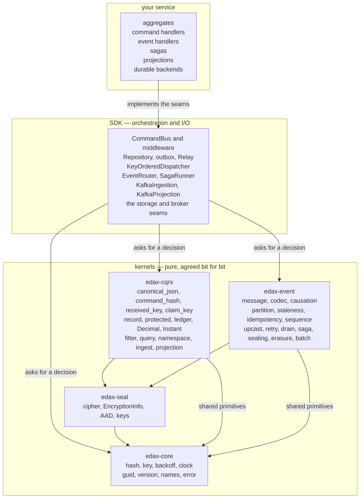
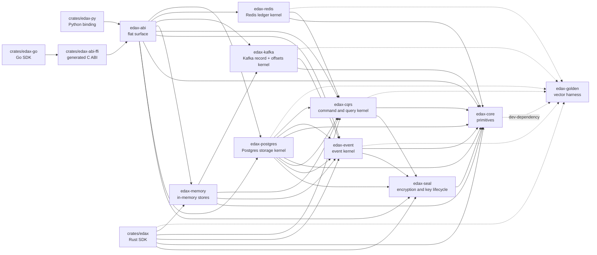
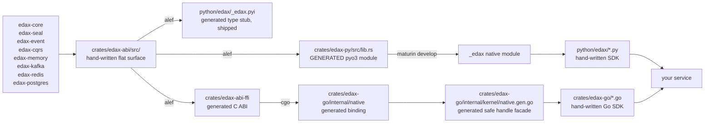
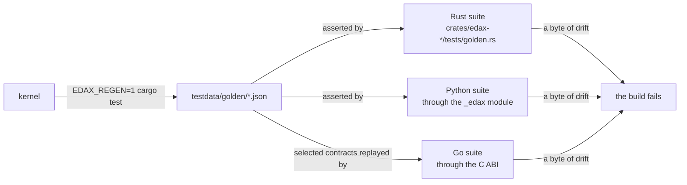

# Architecture

edax puts shared decisions in Rust kernels: partition placement, message bytes, duplicate detection
and query ordering. Each language's software development kit (SDK) connects those decisions to
storage and transports. Golden vectors test that the SDKs agree.

## The three layers

| Layer | Owns | Never does |
|---|---|---|
| your service | business rules, durable backends, transforms | re-derive a kernel decision |
| SDK | transactions, threads, retries, transports, ergonomics | decide a hash, a partition, a match verdict |
| kernel | the decisions every service must share | I/O, threads, callbacks, business rules |

## Why a kernel at all

Different implementations of a shared decision can drop rows or apply an operation twice.
Two examples explain why the kernels own these decisions:

- Canonical JSON. Python's `json.dumps(ensure_ascii=True)` does not agree with serde on non-ASCII,
  so two services hashing "the same" command would reach different idempotency keys.
  Canonicalization happens inside `edax-cqrs`, so neither SDK picks the bytes.
- A filter leaf over a missing path. Making it true in one service and false in another silently
  changes which rows a page returns. The `edax-cqrs` evaluator pins the verdict
  (`crates/edax-cqrs/src/filter.rs`).

Kernel decisions are synchronous and need no database or broker. Most are pure functions of their
arguments. Clock, identifier and cryptographic randomness generation have explicit exceptions; native handles also keep
caller-owned state. See [kernel constraints](kernels/README.md#purity-constraints).

## The crate graph

Each kernel row lists its crate's modules; the table at the top of its page under `docs/kernels/` says
what each one owns.

| Crate | What |
|---|---|
| `edax-core` | `hash`, `key` (tenancy, the guard key), `backoff`, `clock`, `guid`, `version`, `names` (`closed_names!`), the `error` taxonomy; and the Rust-only runtime helpers `lock` and `TokenMint` |
| `edax-seal` | cipher and encryption records, authenticated context, encryption, fingerprints, randomness, `keys` lifecycle and usage accounting |
| `edax-event` | `message` (the messages, their payload, the ordering key), `codec`, `causation`, `partition`, `staleness`, `idempotency`, `sequence`, `upcast`, `retry`, `drain`, `saga`, `sealing`, `erasure`, `batch` |
| `edax-cqrs` | `canonical_json`, `command_hash`, `received_key`, `claim_key`, the idempotency `record`, `protected` fingerprints and results, the ledger fence (`complete_fence`, `release_fence`), the host values `Decimal` and `Instant`, `filter`, `query`, `namespace`, `ingest`, `projection` |
| `edax-memory` | in-memory event, projection, idempotency and saga stores and a command outbox behind one transaction boundary, and a partitioned broker log that carries events and commands, and `ingest` (the atomic ingestion reference sink) and `projection_state` (ordered projection transactions), written once and shared by the Rust, Python and Go SDKs |
| `edax-kafka` | `record` (the key, the header, the route, the dead-letter record), `partition` (broker placement), `offsets` (the watermark), `client` (`check_config`, `check_consumer`, `check_dead_sink`, `acks_warning`, `broker_error`) |
| `edax-redis` | `ledger` (the key, the settings, the value layout, the claim handle, the reply outcomes), `scripts` (the five fence scripts, the reply verdict) |
| `edax-postgres` | `config`, `error`, `schema`, `statements`, `rows`, `documents`, `query`, `ledger`, `erasure`, `ingest`, `projection` |
| `edax-abi` | a flat, plain-Rust surface that forwards to the kernels and backends, holding no logic of its own |
| `edax` | the reference Rust SDK |
| `edax-py` | the Python SDK: a generated native module plus a hand-written package |
| `edax-abi-ffi` | alef-generated C ABI used by the Go binding |
| `crates/edax-go` | the Go SDK: generated cgo binding and handle facade, plus hand-written orchestration |
| `edax-golden` | the golden-vector harness, one writer and one reader for every kernel |

The storage and transport crates follow one rule. A backend's bytes, its names
and its state decisions live in a kernel crate named `edax-<tech>`, pinned by golden vectors. Each
SDK then ships only the client calls around that crate. Call it a protocol module in Rust and an
input and output (I/O) shell per SDK.

The base Rust, Python and Go in-memory backends are views over `edax-memory`. Their
staging, optimistic-concurrency checks and transaction boundary share one implementation.
The Python memory projection state store stages the writes returned by `edax-cqrs::projection` through
`edax-memory::projection_state`, which checks read versions at atomic commit.
`edax-kafka` owns the record a published message becomes and the offset watermark that settles it.
`edax-redis` owns the value stored under an idempotency key and the Lua a fenced write runs. Neither
crate links a client library, so the I/O stays in the SDK that has one. `edax-postgres` owns
table contracts, SQL and error verdicts for the base stores, ingestion and projection state.

## Ingestion and projection processing boundaries

Append and upsert consume complete values. Projection processing folds ordered changes into previous
state through an application reducer. All three maintain derived data; the application still owns its command
handlers and authoritative event history.

| Concern | Owner | SDK responsibility |
|---|---|---|
| Batch limits, flush thresholds and recovery actions | `edax-event::batch` | Track retained inputs, schedule partitions, wait and release capacity |
| Append identity and upsert ownership, version checks, deletion markers and durable rejection precedence | `edax-cqrs::ingest` | Supply original records and persist the returned plan atomically |
| Projection sequence checks, event/sequence receipts, checkpoint leases, source proof validation and effect cutoffs | `edax-cqrs::projection` | Load records, call the reducer for novel events and commit all returned writes together |
| Kafka record encoding, delivery tokens and commit generations | `edax-kafka::{record, offsets}` | Check assignment before booking, seek safely and retain unfinished client requests |
| PostgreSQL table contracts, locks, statements and recovery verdicts | `edax-postgres::{ingest, projection}` | Execute SQL inside an owned transaction |
| Mapping, reducing, source verification and effect delivery | Host application | Supply callbacks and destination deduplication |

Python's `edax.ingestion` and `edax.projection` define the application-facing values and storage contracts.
The Kafka runners live in `edax.backend.kafka_ingest` and `edax.backend.kafka_projection`. PostgreSQL
adapters live in `edax.backend.ingest_postgres` and `edax.backend.projection_postgres`.
`ProjectionStateStore` shares transaction orchestration between its PostgreSQL adapter and volatile
`MemoryProjectionStateStore`; both ask the same Rust kernel for state transitions.

The application reducer performs no I/O. The store reads previous state before calling it.
A projection transaction saves state, receipts, intents and its database checkpoint together. Kafka
append/upsert ingestion uses the broker's committed offset for recovery. Projection processing uses its database
checkpoint and a verified source proof. These recovery contracts require separate runners.

The generated Go bindings expose the same decisions for contract tests. They do not provide a
public Go ingestion or projection runtime. See [ingestion](backends/ingestion.md) and
[projection processing](sdk/projection-processing.md) for the Python APIs and operating requirements.

## The build pipeline

Alef generates the Python extension and the Go binding from one ABI surface. Each language has
a hand-written SDK around that binding.

- `crates/edax-py/src/lib.rs`, `crates/edax-py/python/edax/_edax.pyi` and everything under
  `crates/edax-py/.alef/` are generated. Never edit them. Change `crates/edax-abi/src/` and run
  `mise run bindings:generate`. It runs `alef generate` with `--clean`, because a plain incremental
  run deletes the generated files (the comment at the top of `alef.toml` explains why).
- `crates/edax-abi-ffi/`, `crates/edax-go/internal/native/` and `crates/edax-go/internal/kernel/native.gen.go` are
  generated too. The regeneration script runs alef for `python,ffi,go`, then generates the Go
  facade and refreshes the shipped Python stub.
- `crates/edax-py/python/edax/` is hand-written apart from its stub. Go orchestration lives in
  the non-generated files under `crates/edax-go/`.
- `mise run go:build` builds and installs the Rust static library for local cgo builds. See
  [Go setup](sdk/go.md#build-from-source).
- `pytest` does **not** rebuild the native module. Read [the stale native module
  trap](guides/getting-started.md#the-stale-native-module-trap).

## How drift is prevented

A golden vector always wins over a disagreeing test. See [golden vectors](kernels/golden-vectors.md)
for the file-by-file list and the regeneration rules.

## Binding responsibilities

The bindings convert types and expose kernel errors in each language. Every `edax-abi` function
is synchronous. Python's extension needs no async runtime. Go calls the generated C ABI through
cgo; its generated scaffold may include runtime dependencies even though edax exposes no async
ABI function.

Python messages cross as native classes. Go presents typed structs but alef serializes them as
JSON when converting through the C ABI. The Go facade wraps native handles with a mutex and
`Close`; it prevents calls from racing with a free. Each SDK owns orchestration: command and event
handlers, transactions, dispatchers, relays and sagas.

Neither layer may re-derive kernel logic. No duplicated validation, no re-implemented idempotency or
payload-hash decisions, no routing or partition placement, no business rules. If it must match
across versions or languages, it belongs in a kernel with a golden vector.

## Language differences that follow from the layering

| | Rust reference SDK | Python SDK | Go SDK |
|---|---|---|---|
| concurrency | synchronous; dispatcher workers are operating-system threads | `asyncio` tasks | synchronous context-aware calls; dispatcher workers are goroutines |
| transaction handle | explicit or obtained from a host provider | `contextvars`, keyed by database | `context.Context`, keyed by `UnitOfWork` |
| backends shipped | in-memory | in-memory, Redis, Kafka, Postgres | in-memory, Redis, Kafka client interfaces |
| ingestion and projection processing | kernel APIs and memory ingestion store | append/upsert sinks, projection state stores, Kafka runners and outbox delivery | generated kernel bindings; no public ingestion/projection runner or store |
| guard that owns the transaction | not implemented | `unit_of_work=` on both guards | `IdempotentOptions.UnitOfWork` on both guards |

None of these differences reaches the kernels. All three SDKs call the same kernel functions, so a
filter built in Python and a filter built in Rust reach the same verdict, and a vector proves it.

## See also

- [Kernels](kernels/README.md) — what each kernel owns, decision by decision.
- [SDK map](sdk/README.md) — the seams and the orchestration over them.
- [Delivery guarantees](guides/delivery-guarantees.md) — what each hop of the pipeline promises.
- [Glossary](glossary.md) — every term used here, defined once.
