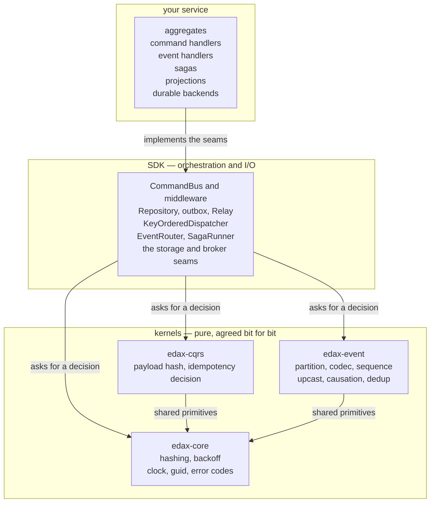
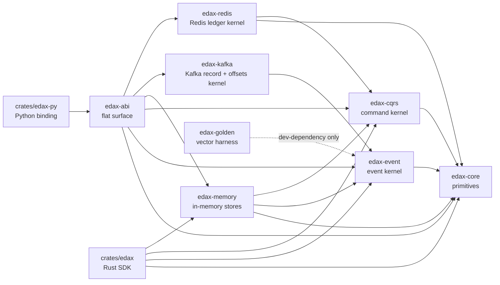
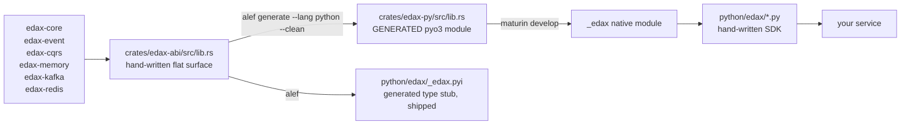
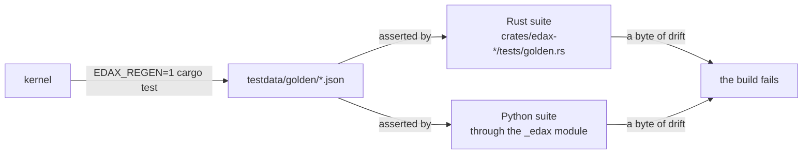

# Architecture

How edax is layered, why the layering exists, and what the build pipeline turns each layer into.

Event-driven services stay consistent only while every service agrees on a small set of decisions,
bit for bit. Which partition an aggregate routes to. What bytes an envelope serializes to. Whether a
redelivered command is a duplicate. How a filtered page is ordered. edax puts exactly those
decisions in pure Rust kernels, wraps them in an software development kit (SDK) per language, and
pins the result with golden vectors.

**The SDK wires. The kernel decides.** Neither layer re-derives the other's job.

## The three layers

| Layer | Owns | Never does |
|---|---|---|
| your service | business rules, durable backends, transforms | re-derive a kernel decision |
| SDK | transactions, threads, retries, transports, ergonomics | decide a hash, a partition, a match verdict |
| kernel | the decisions every service must share | I/O, threads, callbacks, business rules |

## Why a kernel at all

Get one shared decision subtly wrong in one service, or in one language, and the bug surfaces months
later as a dropped row or a double-charged customer. Two examples the kernel removes:

- Canonical JSON. Python's `json.dumps(ensure_ascii=True)` does not agree with serde on non-ASCII,
  so two services hashing "the same" command would reach different idempotency keys.
  Canonicalization happens inside `edax-cqrs`, so neither SDK picks the bytes.
- A filter leaf over a missing path. Making it true in one service and false in another silently
  changes which rows a page returns. `edax-core`'s evaluator pins the verdict
  (`crates/edax-cqrs/src/filter.rs`).

The kernels are pure, synchronous, and free of I/O, threads and callbacks. That is what makes them
portable, testable without a harness, and cheap to pin with a vector file.

## The crate graph

| Crate | What |
|---|---|
| `edax-core` | hashing, backoff, the error taxonomy, `guid`, `current_timestamp` |
| `edax-event` | partition, codec, upcast, causation, dedup, sequence, the envelope shape |
| `edax-cqrs` | canonical JSON, payload hash, command hash, the idempotency record and decision |
| `edax-memory` | in-memory event, projection, idempotency and saga stores behind one transaction boundary, written once and shared by both SDKs |
| `edax-kafka` | the Kafka record: the key rule, the `content-type` header, broker placement (Java murmur2), the media types, the poison id, and the token-settled offset watermark |
| `edax-redis` | the Redis ledger: the stored value layout, the owner token that fences it, and the two compare-and-write Lua scripts |
| `edax-abi` | a flat, plain-Rust surface that forwards to the kernels and backends, holding no logic of its own |
| `edax` | the reference Rust SDK |
| `edax-py` | the Python SDK: a generated native module plus a hand-written package |
| `edax-golden` | the golden-vector harness, one writer and one reader for every kernel |

The `edax-memory`, `edax-kafka` and `edax-redis` rows follow one rule, the same one each time. A
backend's bytes, its names and its state decisions live in a kernel crate named `edax-<tech>`,
pinned by golden vectors. Each SDK then ships only the client calls around that crate. The pattern
has a name: **a protocol module in Rust, an input and output (I/O) shell per SDK.**

Read the three crates that way. Both SDKs' in-memory backends are views over `edax-memory`, so the
staging, the optimistic-concurrency checks and the transaction boundary are one implementation.
`edax-kafka` owns the record a published envelope becomes and the offset watermark that settles it.
`edax-redis` owns the value stored under an idempotency key and the Lua a fenced write runs. Neither
crate links a client library, so the I/O stays in the SDK that has one.

## The build pipeline

The Python native module is generated. The Python package is not.

What this means in practice:

- `crates/edax-py/src/lib.rs` and everything under `crates/edax-py/.alef/` are generated. Never edit
  them. Change `crates/edax-abi/src/lib.rs` and regenerate with `--clean` only — a plain incremental
  `alef generate` is destructive here (`alef.toml:14-17`).
- `crates/edax-py/python/edax/` is hand-written and is yours to edit.
- `pytest` does **not** rebuild the native module. Read [the stale native module
  trap](guides/getting-started.md#the-stale-native-module-trap).

## How drift is prevented

A golden vector always wins over a disagreeing test. See [golden vectors](kernels/golden-vectors.md)
for the file-by-file list and the regeneration rules.

## Binding responsibilities

The binding crate does only type conversion, error-to-exception mapping, Python-idiomatic
configuration, and async-runtime integration. The SDK package owns orchestration: `CommandBus` with
its middleware, `EventRouter`, the dispatcher, `Saga`, and the store and transactor seams.

Neither layer may re-derive kernel logic. No duplicated validation, no re-implemented idempotency or
payload-hash decisions, no routing or partition placement, no business rules. If it must match
across versions or languages, it belongs in a kernel with a golden vector.

## Language differences that follow from the layering

| | Rust SDK | Python SDK |
|---|---|---|
| concurrency | synchronous, dispatcher workers are operating-system threads | `asyncio`, workers are tasks |
| transaction handle | passed explicitly, or published by the host through a `Fn() -> Tx` provider | ambient, found through `current_tx(transactor)` in a `contextvars` map keyed by database |
| backends shipped | in-memory only; the `edax-kafka` and `edax-redis` kernels ship with no client shell over them | in-memory, Redis, Kafka |
| guard that owns the transaction | not implemented | `unit_of_work=` on both guards |

Neither difference is a feature gap in the kernels. Both SDKs call the same kernel functions, so a
filter built in Python and a filter built in Rust reach the same verdict, and a vector proves it.

## See also

- [Kernels](kernels/README.md) — what each kernel owns, decision by decision.
- [SDK map](sdk/README.md) — the seams and the orchestration over them.
- [Delivery guarantees](guides/delivery-guarantees.md) — what each hop of the pipeline promises.
- [Glossary](glossary.md) — every term used here, defined once.
