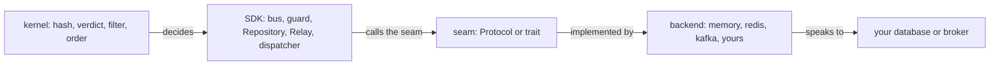
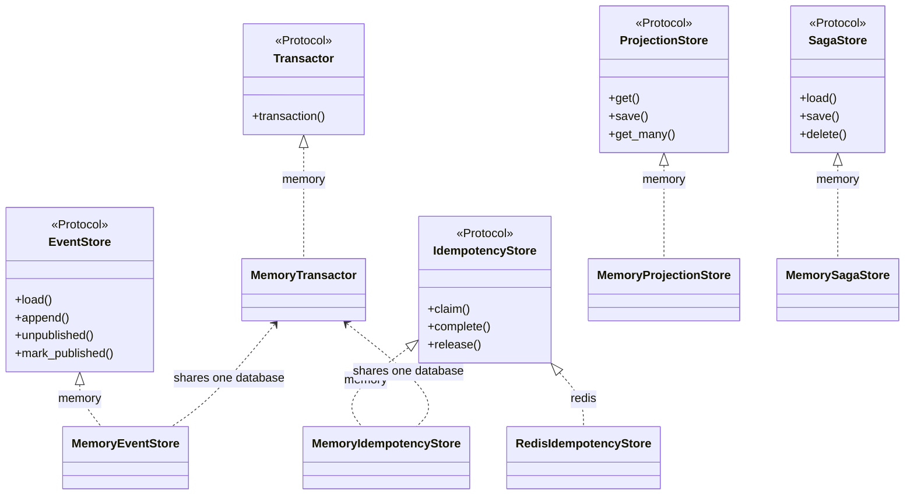
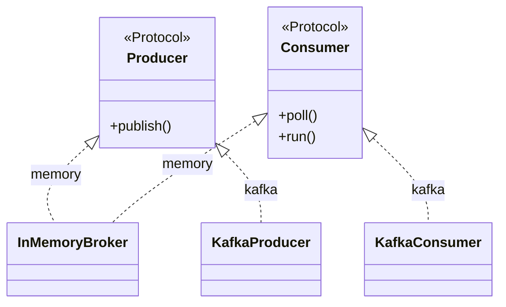

# Backends

How to plug your own database or broker into edax, and what each seam demands in return.

No durable store ships; you bring one. Every seam is a `Protocol` in the Python software development
kit (SDK) and a trait in the Rust SDK. That docstring is the specification. This page indexes the
seams and adds the checklist for writing one. A backend supplies the I/O and nothing else; the
decisions stay in the [kernels](../kernels/README.md).



## The seam contracts

Each row is a summary. The specification is the docstring in the "Specification" column; read it
before you implement, and prefer it over this table wherever the two read differently.

### `Transactor`

Specification: `edax.store.Transactor`.

- `transaction()` is an async context manager.
- A clean exit commits. An exception rolls back and re-raises.
- One handle every participant store accepts, atomic as a set.
- A participant handed the same handle reads its own uncommitted writes.
- The SDK never nests, so you need no savepoints.
- One asyncio task at a time.

### `EventStore`

Specification: `edax.store.EventStore`.

- `append` is a compare-and-set on the version, enforced in the database.
- On a mismatch it raises `ConcurrencyError` and writes nothing.
- Event rows and outbox rows commit together in the caller's `tx`.
- `load` returns `sequence > after`, ascending and gap-free.
- `load` includes the current transaction's own appends.
- `load_snapshot` may lag the stream. It must never lead it.
- `unpublished` returns committed, unmarked rows, oldest first.
- Rows stay unmarked until `mark_published`, which is idempotent and durable.
- Both outbox methods run outside any `tx`.
- Lease or lock the rows `unpublished` returns when you run more than one relay.

### `IdempotencyStore`

Specification: `edax.command.IdempotencyStore`.

- `claim` is an atomic insert-if-absent, linearizable across every process sharing the ledger.
- Exactly one concurrent claimant returns `None`. Every other returns the existing record.
- Never a read then a write.
- The inserted record carries `pending=True` and the given `payload_hash`, returned faithfully.
- `complete` and `release` are idempotent.
- `complete` and `release` refuse a key another open transaction holds.
- Retention outlives the longest redelivery window.
- `payload_hash` round-trips as an unsigned 64-bit integer.

### `ProjectionStore`

Specification: `edax.projection.ProjectionStore`.

- `save` is a compare-and-set on `entity.version`, enforced in the database.
- On success it advances `entity.version`. Otherwise it raises `ConcurrencyError`.
- `get` returns the committed row plus the transaction's own writes.
- `get_many` is optional.
- Implemented to the kernel's semantics, `get_many` pages identically across services.
- Documents need a unique `"id"` field for tie-free paging.
- Nothing in the SDK calls this store. Only your handlers do.

### `SagaStore`

Specification: `edax.saga.SagaStore`.

- `load` returns the stored instance, state plus version, or `None`.
- `save` persists at `version + 1` only if the store is still at `version`.
- `delete` removes at `version`. An absent instance is a no-op.
- A durable backend enlists in `tx` or in the ambient `current_tx()`.

### `Producer`

Specification: `edax.broker.Producer`.

- `publish` returns only after the broker has durably accepted the message.
- `publish` raises on failure, so the relay leaves the whole batch unmarked.
- A dispatcher `submit` is not a valid `publish`. It only enqueues.
- The message key is the aggregate id, which preserves per-aggregate order.
- Delivery is at-least-once.
- One relay calls it serially, so it need not be thread-safe.

### `Consumer`

Specification: `edax.broker.Consumer`.

- `poll` returns the next `Delivery`, or `None` at end of stream.
- Per-key order holds. Across keys, any order.
- `ack` settles only that message.
- On an offset broker that means a per-partition watermark, never "commit the current position".
- `nack` returns the message for another attempt.
- Every delivery is settled exactly once, by ack or by nack, possibly from another worker task.
- Overall semantics are at-least-once.

Two more rules cut across the table.

- **Errors are part of the contract.** `ConcurrencyError` is for a version mismatch and nothing
  else. A marshal failure is `CodecError`. Everything else is `StoreError`. See
  [errors](#3-map-your-clients-errors-onto-the-taxonomy).
- **Transaction enlistment is uniform.** A store method given `tx=None` reads
  `edax.store.current_tx()` and joins the ambient unit of work; with no handle and no ambient one it
  runs standalone.

### Rust parity

The Rust SDK declares the same seams as traits: `Transactor`, `EventStore: Transactor`,
`IdempotencyStore<O>`, `ProjectionStore`, `SagaStore`. Two differences matter to a backend author.

- Enlistment is typed, not declared. A Rust store names its handle as an associated `type Tx`, and a
  store that needs none uses `()`. Python has no such type, so a ledger declares `joins_transaction`
  instead.
- There is no `Producer` / `Consumer` trait in Rust. The broker seam is the Python SDK's; the Rust
  SDK ships only `InMemoryBroker` for dev and tests.

## The seams and the backends that implement them today





`memory` covers every seam and is the reference implementation — see [memory](./memory.md). `redis`
covers the ledger only, as the worked example of a store that cannot join your transaction — see
[redis](./redis.md). `kafka` covers the broker seam — see [kafka](./kafka.md). The base package
depends on no broker or database library; `redis` and `kafka` wrap a client you own and construct.

## Writing a backend

### 1. Get the atomicity from the database, not from your code

Every compare-and-set in the table above must hold across processes on separate connections. A read
followed by a write in Python holds only until two writers interleave.

| Operation | What the database must do | A SQL shape that does it |
|---|---|---|
| `EventStore.append` | reject the write when the stored version moved | unique constraint on `(aggregate_id, sequence)`, or a row lock on the stream |
| `IdempotencyStore.claim` | insert only if absent, and tell the loser it lost | `INSERT ... ON CONFLICT DO NOTHING`, then read the existing row |
| `ProjectionStore.save` | write at `version + 1` only from `version` | `UPDATE ... WHERE version = ?`, checking the row count; a unique insert for version 1 |
| `SagaStore.save` / `delete` | the same compare-and-set on the instance version | as above |
| `EventStore.unpublished` with N relays | hand each row to one relay | `SELECT ... WHERE published_at IS NULL FOR UPDATE SKIP LOCKED`, or a `leased_until` column |

The last row is a choice, not a requirement. The polling contract does not lease rows, so **run one
relay per store** unless you add leasing; two unleased relays return the same rows and publish them
twice. The alternative is change data capture: `append` already wrote the outbox row inside the
transaction, so a write-ahead-log consumer sees it exactly when it commits. Feed those envelopes to
`edax.store.pump` and let your change data capture (CDC) client's committed position be the
acknowledgement.

### 2. Decide how you join a transaction

`EventStore` takes the handle first and required, because nothing it does is meaningful outside a
unit of work except the two outbox methods, which take none. `ProjectionStore`, `IdempotencyStore`
and `SagaStore` take `tx` last and optional. Resolve an optional one in this order, and only this
order:

1. the `tx` the caller passed.
2. `edax.store.current_tx()`, the innermost active `transaction`.
3. no transaction — auto-commit.

Refuse a handle that is not yours. Enlisting "anyway" silently drops the atomicity the caller asked
for. The in-memory backend raises `BadHandle` on a foreign handle.
`test_transactor.py::test_a_memory_store_refuses_a_foreign_tx` asserts it.

A `Repository` inside `async with transaction(store)` joins the ambient transaction rather than opening
a nested one, so a backend never needs savepoints.

### 3. Map your client's errors onto the taxonomy

The SDK branches on the *kind* of failure, never on message text. `terminal` is the kernel's verdict
per code, read at class-definition time.

| Your client reports | Raise | Kind | What the SDK then does |
|---|---|---|---|
| the stored version did not match | `ConcurrencyError` | transient | the caller reloads the aggregate and retries |
| connection reset, timeout, deadlock, serialization failure | `StoreError` | transient | the guard releases the claim; the dispatcher nacks and the broker redelivers |
| a value will not marshal or a stored record will not decode | `CodecError` | terminal | the guard caches the failure; the dispatcher dead-letters instead of retrying |

Three traps are worth naming.

- **Never swallow a failed claim.** Report it — `raise StoreError` in Python,
  `Err(Error::Store(..))` from `IdempotencyStore::claim` in Rust. Do not fold a failure into a prior
  record. The guard reads that as a cached failure, which is terminal. The cause is then lost and a
  transient fault is never retried. A loser inside a transaction reaches one of two outcomes: it
  blocks on the winner's uncommitted row and then reads it, or it fails. A failure must be raised as
  `StoreError`. Swallowing it and then reading under a stale snapshot finds no row, reports a win,
  and runs the handler twice. Which outcome your database gives depends on its isolation level;
  establishing that is your job as the backend author.
- **Bound the blocking wait.** A claim is a remote call. Give it a lock or statement timeout and
  surface the expiry as `StoreError`.
- **Keep the hash lossless.** `payload_hash` is an unsigned 64-bit number. A signed `BIGINT` column
  reads every value at or above `2**63` back as negative, and the SDK rejects that as a terminal
  `CodecError` rather than looping forever.

A backend over a native module can reuse `edax.errors.mapped()`, which re-raises a `"<code>:
<message>"` `RuntimeError` as the matching class. A backend over a Python client wraps its calls
instead; `edax.backend.redis._as_store_error` is the pattern.

### 4. Declare `joins_transaction` if you are a ledger

Only `IdempotencyStore` needs this. The guard branches on it and cannot detect it, so declare it as
a `ClassVar[bool]`:

[Idempotency](../sdk/idempotency.md#the-two-modes) is the one home for the two guard modes, their
orderings and the guarantee each one buys.

`False` is the safe side. A needless compensation costs one no-op delete. A skipped one leaves a
`done` record for work that rolled back. Declaring `True` obliges you to refuse a handle from
another database rather than quietly auto-commit. `MemoryIdempotencyStore` declares `True`.
`RedisIdempotencyStore` declares `False`.

### 5. Run the packaged conformance suite against it

`edax.testing` ships the seam contracts as executable suites. Subclass one per seam you implement,
give it a fixture, and the clauses on this page become your acceptance tests:

```python
import pytest
from edax.testing import EventStoreContract, IdempotencyStoreContract


class TestPostgresEventStore(EventStoreContract):
    @pytest.fixture
    async def event_store(self, pool):
        await truncate(pool)
        return PostgresEventStore(pool)


class TestRedisLedger(IdempotencyStoreContract):
    joins_transaction = False  # a ledger of its own, so no rollback frees the claim

    @pytest.fixture
    async def idempotency_store(self, conn):
        return RedisIdempotencyStore(conn, prefix="test:idem:")
```

Install with `pip install edax[test]` and set `asyncio_mode = "auto"` in your pytest configuration.
Name the subclass `Test...` so pytest collects it; the `*Contract` bases are not collected.

| Contract | Fixture | Covers |
|---|---|---|
| `EventStoreContract` | `event_store` | versions from an empty stream, compare-and-set in both directions, a refused append writing nothing, `load` reading its own transaction's appends, rollback, snapshots that never lead the stream, and the outbox: committed rows only, an idempotent `mark_published`, an honoured `limit`, and the backlog count when `supports_unpublished_count` is on |
| `ProjectionStoreContract` | `projection_store`, plus `transactor` unless `supports_transactions = False` | round trip, compare-and-set on `version`, the version advancing in place on success and *not* advancing on a conflict, independence per id |
| `SagaStoreContract` | `saga_store` | an unknown correlation reading `None`, state round trip, compare-and-set on concurrent folds, a versioned delete |
| `IdempotencyStoreContract` | `idempotency_store`, plus `event_store` on the same transactor unless `joins_transaction = False` | a free key won, a second claim losing and reading the winner's record, a completed result and a cached failure replaying, release freeing the key, releasing an absent key, the payload hash surviving as unsigned 64-bit, and a rollback freeing the claim when the ledger joins |

Backends differ legitimately, so each contract carries capability flags and skips the clauses that
cannot apply: `supports_rollback`, `supports_snapshots`, `supports_outbox`, `joins_transaction`,
`supports_kernel_queries`, `supports_unpublished_count`. The defaults describe a transactional SQL
backend, the strictest case.
Loosen them deliberately: every flag you turn off is a guarantee your callers lose.

`edax.testing.faults` wraps any store to inject the failure a dict cannot fake. `LostResponse` lets
the write **land** and then raises as though the reply never arrived. `Refusing` fails without
writing. Both delegate rather than subclass, so they work over your store as well as the in-tree
ones.

The suite is not exhaustive, and one clause it cannot reach matters. Compare-and-set done by reading
in Python and then writing passes every single-threaded test here. It loses updates under real
concurrency. Get it from the database, per step 1.

#### Beyond the packaged suite

These in-tree suites go further than the package does, and are worth reading rather than running:

| Suite | What it executes | Rust mirror |
|---|---|---|
| `test_broker_contract.py` | the `Producer` / `Consumer` contract over every in-tree adapter, parameterized by a rig fixture | — |
| `test_model.py` (`P2`) | the `claim` / `complete` / `release` contract over random operation histories against a pure reference model | `crates/edax/tests/model.rs` |
| `test_unit_of_work.py` | both guard orderings, one case per failure window | `crates/edax/tests/unit_of_work.rs` |

`test_redis.py` and `test_kafka.py` are backend-specific by design: they cover what only that
technology can get wrong (the fence, the commit watermark), and defer the seam contract to the
suites above.

## What a backend must never do

**Never re-derive a kernel decision.** The kernel owns the payload hash and the idempotency verdict.
It owns the record's wire shape, the filter semantics, the total order over JSON values and the
error taxonomy. A backend may sort its own JSON keys, compute its own hash, or decide for itself
that a record counts as a replay. It will agree with the other SDK until the first non-ASCII field
name, and then stop. Read the record with `edax.command.decode_record`, write it with
`encode_record`, and hand the prior record back to the guard unjudged. See
[kernels](../kernels/README.md).

Three smaller prohibitions follow from the same rule.

- **Never renumber.** `Repository` assigns `sequence = expected_version + 1 .. + n`; a store stores
  what it is given.
- **Never mask `pending`.** The guard distinguishes an in-flight claim from a completed `None`
  result by that field alone.
- **Never invent retention.** A record must outlive the longest redelivery window. Expiry inside it
  turns a replay into a re-run, which is a correctness change made by a configuration value.

## See also

- [memory](./memory.md) — the reference backend for every seam, and the transaction it keeps for
  real.
- [redis](./redis.md) — a ledger that cannot join your transaction, and the fence that follows.
- [kafka](./kafka.md) — the broker seam over a client you own.
- [kernels](../kernels/README.md) — what a backend must never re-decide.
- [transactions](../sdk/transactions.md) — `Transactor`, `current_tx`, `transaction`,
  `joins_transaction`.
- [idempotency](../sdk/idempotency.md) — both guards, both modes, every failure window.
- [errors](../sdk/errors.md) — the taxonomy your client's errors map onto.
- [delivery guarantees](../guides/delivery-guarantees.md) — what the seam choices add up to end to
  end.
