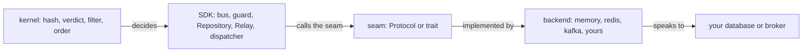
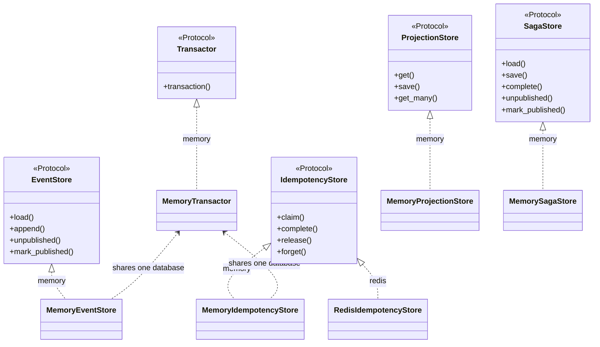
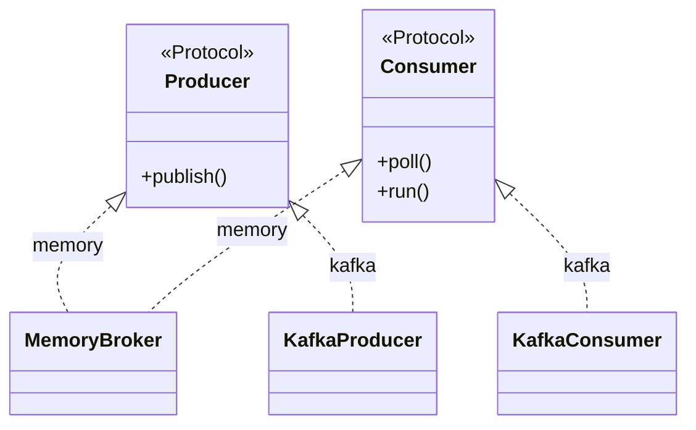

# Backends

How to plug your own database or broker into edax, and what each seam demands in return.

No durable store ships; you bring one. Every seam is a `Protocol` in the Python software development
kit (SDK) and a trait in the Rust SDK. That docstring is the specification. This page indexes the
seams and adds the checklist for writing one. A backend supplies the I/O and nothing else; the
decisions stay in the [kernels](../kernels/README.md).



## The seam contracts

Each list is a summary. The specification is the docstring each one names; read it before you
implement, and trust it over this page wherever the two differ.

### `Transactor`

Specification: `edax.store.Transactor`.

- `transaction()` is an async context manager.
- A clean exit commits. An exception rolls back and re-raises.
- One handle every participant store accepts, atomic as a set.
- A participant handed the same handle reads its own uncommitted writes.
- The SDK never nests, so you need no savepoints.
- One asyncio task at a time.

### `EventStore`

Specification: `edax.store.EventStore`.

- The stream is named by the `aggregate_id` argument of `append`, `load` and `load_snapshot`, and by
  the snapshot's `aggregate_id` for `save_snapshot`, never by a draft's own `aggregate_id`. Under
  `Tenancy.POOL` the argument is the id composed with the tenant while the drafts keep the bare id.
- `append` is a compare-and-set on the version, enforced in the database.
- On a mismatch it raises `ConcurrencyError` and writes nothing.
- Event rows and outbox rows commit together in the caller's `tx`.
- `append` takes `EventDraft`s and returns the stored `EventMessage`s, in order. It stamps every
  draft's `recorded_at` with its own clock, a database's `now()`. `load` and `unpublished` return
  the same value.
- A stored event keeps every draft field: `occurred_at`, `correlation_id`, `causation_id`,
  `extensions` and `metadata` included. Give each one a column.
- An event id is unique store-wide: an `append` carrying an id already stored raises `CodecError`.
- `load` returns `sequence > after`, ascending and gap-free. The repository checks it and fails the load
  on a gap or a repeat.
- `load` includes the current transaction's own appends.
- `load_snapshot` may lag the stream. It must never lead it: `save_snapshot` refuses one past the
  stream's version with `CodecError`, and an older snapshot never replaces a newer one.
- `unpublished` returns committed, unmarked rows, oldest first.
- Rows stay unmarked until `mark_published`, which is idempotent and durable.
- Both outbox methods run outside any `tx`.
- Lease or lock the rows `unpublished` returns when you run more than one relay.

### `IdempotencyStore`

Specification: `edax.command.IdempotencyStore`.

- `claim` is an atomic insert-if-absent, linearizable across every process sharing the ledger.
- Exactly one concurrent claimant returns `Won(handle)`. Every other returns the existing record.
- Never a read then a write.
- The inserted record carries `pending=True` and the given `payload_hash`, returned faithfully.
- `complete` and `release` take the claim's handle and are idempotent.
- If claims can lapse, both write only while the key still holds that exact claim. A release after
  the claim's own `complete` landed deletes nothing.
- `forget(key, tx=None)` deletes a settled record, so a re-driven message runs its handler again.
  The kernel's [`forget`](../kernels/cqrs.md#forget--deleting-a-settled-record) decides from the
  record. A store whose keys can be taken over deletes only while the key holds the value it read.
- A `joins_transaction` store never settles a key another open transaction holds: `complete` and
  `release` raise a transient `ConcurrencyError` and write nothing. Clause:
  `test_a_key_another_open_transaction_holds_is_never_settled_over_it`.
- A `joins_transaction` store raises the terminal `BadHandle` for a `tx` of another database. Clause:
  `test_a_handle_of_another_database_is_refused`.
- Retention outlives the longest redelivery window.
- `payload_hash` round-trips as an unsigned 64-bit integer.

### `ProjectionStore`

Specification: `edax.projection.ProjectionStore`.

- `save` is a compare-and-set on `entity.version`, enforced in the database.
- On success it advances `entity.version`. Otherwise it raises `ConcurrencyError`.
- `get` returns the committed row plus the transaction's own writes.
- `get_many` is optional.
- Implemented to the kernel's semantics, `get_many` pages identically across services.
- Documents need a unique `"id"` field for tie-free paging.
- Nothing in the SDK calls this store. Only your handlers do.

### `SagaStore`

Specification: `edax.saga.SagaStore`.

- `load` returns the stored instance (state, version and `folded` marks, or a completed tombstone),
  or `None`.
- `save` keeps the `folded` marks exactly as written: opaque text the runner skips a redelivered
  event by.
- `save` and `complete` write at `version + 1` only if the store is still at `version`.
- `complete` writes a tombstone; it never deletes the row. A completed instance takes no write at all.
- The step's commands are written in the same write as the state: the saga outbox. A refused or
  rolled-back write enqueues none. Each command is a `CommandMessage` whose id is
  `saga_command_id(instance, version + 1, index)`; key the outbox on it.
- `unpublished` and `mark_published` are the saga outbox's read side, as for the event outbox.

### `CommandOutbox`

Specification: `edax.store.CommandOutbox`. Optional.

A command outbox holds the commands a unit of work decided, so they commit with its events. Build the
repository with it, `Repository(..., commands=outbox)`. Then `save(..., commands=[...])` calls
`enqueue(tx, commands)` under the save's transaction.

- `enqueue` writes the messages under `tx` as unpublished rows keyed by message id. A rollback
  stages nothing.
- `tx` is the event store's. An outbox over another database refuses it with the terminal
  `BadHandle`, because the two writes would not commit together.
- A command id is unique among the rows waiting. A second row under one id raises `CodecError`,
  because the relay marks rows by id.
- `unpublished` and `mark_published` are its read side, run outside any `tx`, as for the event
  outbox. A `Relay` drains it.
- `MemoryCommandOutbox` is the memory one.
- A durable backend enlists in `tx` or in the ambient `current_tx` of its transactor, and
  `mark_published` prunes the rows it acknowledges.

### `Relay`

Not a seam: the SDK's drain over any outbox. A row whose `publish` fails stops the batch; the rows
published before it are marked. The kernel's retry policy dead-letters a terminal failure, or a
transient one at `max_attempts`, through `on_dead`. So one poison row cannot stall the outbox. Any
other failure is handed back after a growing backoff step. See [outbox](../sdk/outbox.md).

### `Producer`

Specification: `edax.broker.Producer`.

- `publish` returns only after every in-sync replica has the message (Kafka `acks="all"`), not the
  leader alone.
- `publish` raises on failure, so the relay hands that row back (or dead-letters it).
- A dispatcher `submit` is not a valid `publish`. It only enqueues.
- `publish` takes an `EventMessage` or a `CommandMessage`.
- The message key is the kernel's [ordering key](../kernels/event.md#the-ordering-key), which keeps
  per-aggregate order.
- Delivery is at-least-once.
- One relay calls it serially, so it need not be thread-safe.

### `Consumer`

Specification: `edax.broker.Consumer`.

- `poll` returns the next `Delivery`, or `None` at end of stream.
- Per-key order holds. Across keys, any order.
- `ack` settles only that message.
- On an offset broker that means a per-partition watermark, never "commit the current position".
- `nack` returns the message for another attempt without reordering its key. A log rewinds the
  partition and retires the deliveries of it already handed out (`Delivery.live`).
- Nothing redelivers a delivery left unsettled while the consumer lives, so every one is settled.
- Every delivery is settled at most once, by ack or by nack, possibly from another worker task. A
  retired one is not settled at all.
- Overall semantics are at-least-once.

`edax.testing.BrokerContract` makes these clauses executable against your adapter, given a
`broker_rig` (a `BrokerRig`). It checks per-key order, a nack that keeps the key's order, redelivery
from the commit after a crash, and consumer groups.

Two more rules cut across the table.

- **Errors are part of the contract.** `ConcurrencyError` is for a version mismatch and nothing
  else. A marshal failure is `CodecError`. Everything else is `StoreError`. See
  [errors](#3-map-your-clients-errors-onto-the-taxonomy).
- **Transaction enlistment is uniform.** A store method given `tx=None` reads
  `edax.store.current_tx(transactor)` for its own transactor and joins that ambient unit of work.
  With no handle and no ambient one, it runs standalone.

### Rust parity

The Rust SDK declares the same store seams as traits. A Rust store names its handle as an associated
`type Tx` (`()` when it needs none), so it declares no `joins_transaction`. Rust has no `Producer` or
`Consumer` trait. [Rust parity](../sdk/rust-parity.md) lists the rest.

## The seams and the backends that implement them today





`memory` covers every seam and is the reference implementation; see [memory](./memory.md). `redis`
covers the ledger only, as the worked example of a store that cannot join your transaction; see
[redis](./redis.md). `kafka` covers the broker seam; see [kafka](./kafka.md). The base package
depends on no broker or database library; `redis` and `kafka` wrap a client you own and construct.

## Adding a backend

Adding support for a new technology takes four decisions. Writing a backend, below, is the
seam-by-seam checklist that follows.

1. **Put every decision a second SDK must match in a kernel crate `edax-<tech>`, with a golden
   vector.** That means bytes, names, and any state machine two processes settle against.
   `edax-kafka` holds the Kafka record and the offset watermark. `edax-redis` holds the ledger key,
   value and scripts, and the verdict on a Redis reply. A decision left in one SDK is one the next
   SDK copies by hand, and then drifts from.
2. **Write the SDK adapter as an input and output (I/O) shell.** It calls the client and the kernel,
   and decides nothing in between. Keep only the I/O there: time to live (TTL) values and their
   defaults, deadlines, and the client seam itself. `edax.backend.redis.RedisConn` is that seam for
   Redis: one `eval` that runs a kernel script.
3. **Hold it to the contract tests.** The packaged suites in `edax.testing` cover the store seams.
   `crates/edax-py/tests/test_broker_contract.py` is the pattern for a broker: one rig fixture per
   adapter, one contract run over every rig. A technology-specific test then covers only what that
   technology can get wrong.
4. **Ship it as its own wheel when it needs its own release cadence.** Until then the base package
   ships the module, and an extra installs the client. `edax[kafka]` and `edax[redis]` work that way
   today. At the split the base wheel drops the module and `edax/backend/__init__.py` together.
   That leaves `edax.backend` a namespace package, so the import path `edax.backend.<tech>` survives
   the move. A namespace package buys nothing before that point, while one wheel ships both halves.

## Writing a backend

### 1. Get the atomicity from the database, not from your code

Every compare-and-set in the table above must hold across processes on separate connections. A read
followed by a write in Python holds only until two writers interleave.

| Operation | What the database must do | A SQL shape that does it |
|---|---|---|
| `EventStore.append` | reject the write when the stored version moved | unique constraint on `(aggregate_id, sequence)`, or a row lock on the stream |
| `IdempotencyStore.claim` | insert only if absent, and tell the loser it lost | `INSERT ... ON CONFLICT DO NOTHING`, then read the existing row |
| `ProjectionStore.save` | write at `version + 1` only from `version` | `UPDATE ... WHERE version = ?`, checking the row count; a unique insert for version 1 |
| `SagaStore.save` / `complete` | the same compare-and-set on the instance version, refusing a tombstone, with the commands inserted in the same transaction | as above, plus an outbox table keyed by the command id |
| `EventStore.unpublished` with N relays | hand each row to one relay | `SELECT ... WHERE published_at IS NULL FOR UPDATE SKIP LOCKED`, or a `leased_until` column |

The last row is a choice, not a requirement. The polling contract does not lease rows, so run one
relay per store unless you add leasing; two unleased relays return the same rows and publish them
twice. The alternative is change data capture: `append` already wrote the outbox row inside the
transaction, so a write-ahead-log consumer sees it when it commits. Feed those event messages to
`edax.store.pump` and let your change data capture (CDC) client's committed position be the
acknowledgement.

### 2. Decide how you join a transaction

`EventStore` takes the handle first and required, because nothing it does is meaningful outside a
unit of work except the two outbox methods, which take none. `ProjectionStore`, `IdempotencyStore`
and `SagaStore` take `tx` last and optional. Resolve an optional one in this order, and only this
order:

1. the `tx` the caller passed.
2. `edax.store.current_tx(self.transactor)`, the open `transaction` over this store's database.
3. no transaction: auto-commit.

Refuse a handle that is not yours. Enlisting anyway drops the atomicity the caller asked for without
an error. The in-memory backend raises `BadHandle` on a foreign handle.
`test_transactor.py::test_a_memory_store_refuses_a_foreign_tx` asserts it.

The ambient transaction is keyed by database, so step 2 names one. A store that is also the
transactor (an `EventStore` that owns its pool) passes itself. A store whose transactions come from a
shared transactor exposes it as its `transactor` attribute and passes that, so `transaction(store)`
and `transaction(transactor)` open the same unit of work. Get this wrong and the store auto-commits
inside the host's unit of work; the contract kit's ambient clauses catch it. See
[transactions](../sdk/transactions.md#the-contract-in-full).

### 3. Map your client's errors onto the taxonomy

The SDK branches on the kind of failure, never on message text. `terminal` is the kernel's verdict
per code, read at class-definition time.

| Your client reports | Raise | Kind | What the SDK then does |
|---|---|---|---|
| the stored version did not match | `ConcurrencyError` | transient | the caller reloads the aggregate and retries |
| connection reset, timeout, deadlock, serialization failure | `StoreError` | transient | the guard releases the claim; the dispatcher nacks after a backoff step and the broker redelivers |
| a value will not marshal | `CodecError` | terminal | the guard caches the failure; the dispatcher dead-letters instead of retrying |
| a stored record will not decode | nothing: return `decode_prior`'s record | terminal, as a cached `codec` failure | the guard replays `CachedFailure`; the handler never runs again for the key |

Three traps:

- **Never swallow a failed claim.** Report it: `raise StoreError` in Python,
  `Err(Error::store(..))` from `IdempotencyStore::claim` in Rust. Do not fold a failure into a prior
  record. The guard reads that as a cached failure, which is terminal, so the cause is lost and a
  transient fault is never retried. A loser inside a transaction has two correct outcomes and one
  bug; see [idempotency](../sdk/idempotency.md#rules-and-constraints).
- **Bound the blocking wait.** A claim is a remote call. Give it a lock or statement timeout and
  surface the expiry as `StoreError`.
- **Keep the hash lossless.** `payload_hash` is an unsigned 64-bit number. A signed `BIGINT` column
  reads every value at or above `2**63` back as negative, and the SDK rejects that as a terminal
  `CodecError` rather than looping forever.

A backend over a native module can reuse `edax.errors.mapped()`, which re-raises a `"<code>:
<message>"` `RuntimeError` as the matching class. A backend over a Python client wraps its calls
instead; `edax.backend.redis.AsyncRedisClient.eval` and `RedisIdempotencyStore._eval` are the pattern.

### 4. Declare `joins_transaction` if you are a ledger

Only `IdempotencyStore` needs this. The guard branches on it and cannot detect it, so declare it as
a `ClassVar[bool]`:

```python
class PostgresLedger:
    joins_transaction: ClassVar[bool] = True  # claim, complete and release enlist in the caller's tx
```

Absent means `False`, the safe side. Declaring `True` obliges you to refuse a handle from another
database instead of auto-committing. `MemoryIdempotencyStore` declares `True`;
`RedisIdempotencyStore` declares `False`. [Transactions](../sdk/transactions.md#joins_transaction)
explains the default, and [idempotency](../sdk/idempotency.md#the-two-modes) the ordering each value
selects.

### 5. Run the packaged conformance suite against it

`edax.testing` ships the seam contracts as executable suites. Subclass one per seam you implement,
give it a fixture, and the clauses on this page become your acceptance tests:

```python
import pytest
from edax.testing import EventStoreContract, IdempotencyStoreContract


class TestPostgresEventStore(EventStoreContract):
    @pytest.fixture
    async def event_store(self, pool):
        await truncate(pool)
        return PostgresEventStore(pool)


REDIS = redis.asyncio.Redis()  # the test server


class TestRedisLedger(IdempotencyStoreContract):
    # The suite reads `joins_transaction` from the store, as the guard does. Redis declares False:
    # a ledger of its own, so the rollback clauses skip. Its claims expire, so the takeover clauses run.
    # It stores the kernel's record JSON, so the unreadable-record clause runs.
    claims_expire = True
    stores_raw_records = True

    @pytest.fixture
    async def idempotency_store(self):
        return RedisIdempotencyStore(AsyncRedisClient(REDIS), prefix="test:idem:")

    async def expire_claim(self, idempotency_store, key):
        await REDIS.delete(f"test:idem:{key}")  # what the claim TTL does when it runs out

    async def put_raw_record(self, idempotency_store, key, raw):
        await REDIS.set(f"test:idem:{key}", b"1" + b"0" * 32 + raw.encode())  # a torn row, unchecked
```

Install with `pip install edax[test]` and set `asyncio_mode = "auto"` in your pytest configuration.
Name the subclass `Test...` so pytest collects it; the `*Contract` bases are not collected.

| Contract | Fixture | Covers |
|---|---|---|
| `EventStoreContract` | `event_store` | versions from an empty stream, the stream named by the key `append` and `load` are called with rather than the draft's aggregate id, compare-and-set in both directions, a refused append writing nothing, `load` reading its own transaction's appends, rollback, snapshots that never lead the stream, and the outbox: committed rows only, an idempotent `mark_published`, a `limit` that decides the page, the backlog count when `supports_unpublished_count` is on, two writers at one version landing exactly one append, and a staged append invisible to another transaction |
| `ProjectionStoreContract` | `projection_store`, plus `transactor` unless `supports_transactions = False` | round trip, compare-and-set on `version`, the version advancing in place on success and not advancing on a conflict, independence per id, a save with no `tx` joining the ambient transaction, two writers at one version landing exactly one save, a staged row invisible to another transaction, and, when `supports_kernel_queries` is on, kernel paging plus the row key coming back as each document's `id` |
| `SagaStoreContract` | `saga_store`, plus `transactor` unless `supports_transactions = False` | an unknown instance reading `None`, state round trip, the `folded` marks round trip, compare-and-set on concurrent folds, the completion tombstone, the step's commands committing with its state and every field, the tenant included, a save with no `tx` joining the ambient transaction, two steps at one version landing exactly one write, and a staged step invisible to another transaction |
| `CommandOutboxContract` | `command_outbox`, plus `event_store` on the same transactor | commands committing and rolling back with the events and coming back whole, the tenant included, a `tx` of another database refused with `BadHandle`, an id already waiting refused with `CodecError`, `unpublished` oldest commit first under its `limit`, and an idempotent `mark_published` |
| `IdempotencyStoreContract` | `idempotency_store`, plus `event_store` on the same transactor when the store declares `joins_transaction = True` | a free key won, a second claim losing and reading the winner's record, eight concurrent claims with exactly one winner, a completed result and a cached failure replaying, release freeing the key, releasing an absent key (a retry then wins it), the payload hash surviving as unsigned 64-bit, and, when the ledger joins, a rollback freeing the claim whether the claim was given `tx` or joined the ambient one, a claim staged in an open transaction never won by another, and a release with nothing committed leaving a concurrent winner's record, a handle of another database refused with `BadHandle`, and a key another open transaction holds never settled over. With `claims_expire` and an `expire_claim` hook: a lapsed claim's handle settling nothing after a takeover, a release after `complete` keeping the record, and a lapsed record freeing the key. With `stores_raw_records` and a `put_raw_record` hook: a record no reader can decode read as the kernel's cached `codec` failure, keeping the stored hash where it reads |

Backends differ legitimately, so each contract carries capability flags and skips the clauses that
cannot apply. The flags are `supports_rollback`, `supports_snapshots`, `supports_outbox`,
`supports_transactions`, `supports_kernel_queries`, `supports_unpublished_count`, `claims_expire`
and `stores_raw_records`. The defaults describe a transactional SQL backend, the strictest case.
The suite takes no `joins_transaction` flag. It reads the store's own declaration, the one the guard
acts on, so a wrong declaration fails the clauses it governs instead of being restated beside them.

Each seam with an optional `tx` has a clause for the ambient path too. The guards and the saga runner
call a store with no `tx` inside `transaction(...)`, so that is the path production runs. A store
that joins an explicit `tx` and auto-commits without one passes every explicit clause.
Loosen them deliberately: every flag you turn off is a guarantee your callers lose.

`edax.testing.faults` wraps any store to inject the failure a dict cannot fake, such as a write
that lands and loses its reply. The race clauses force the interleaving a read-then-write store
loses, and need an async driver. A store that passes them can still lose under contention they do
not produce, so get compare-and-set from the database anyway, per step 1.
[Testing](../guides/testing.md#the-packaged-conformance-suite) covers the fault wrappers, the race
and isolation clauses, and the in-tree suites a host can point at its own backend.

## What a backend must never do

**Never re-derive a kernel decision.** The kernel owns the payload hash and the idempotency verdict.
It owns the record's wire shape, the filter semantics, the total order over JSON values and the
error taxonomy. A backend may sort its own JSON keys, compute its own hash, or decide for itself
that a record counts as a replay. It will agree with the other SDK until the first non-ASCII field
name, and then stop. Read the record that holds a key with `edax.command.decode_prior`, write it with
`encode_record`, and hand the prior record back to the guard unjudged. `decode_prior` never raises: a
record no reader can decode comes back as the kernel's cached `codec` failure, the same one every SDK
replays. See [kernels](../kernels/README.md).

Three smaller prohibitions follow from the same rule.

- **Never renumber.** `Repository` assigns `sequence = expected_version + 1 .. + n`; a store stores
  what it is given.
- **Never mask `pending`.** The guard distinguishes an in-flight claim from a completed `None`
  result by that field alone.
- **Never invent retention.** A record must outlive the longest redelivery window. Expiry inside it
  turns a replay into a re-run, which is a correctness change made by a configuration value.

## See also

- [memory](./memory.md) — the reference backend for every seam, and the transaction it keeps for
  real.
- [redis](./redis.md) — a ledger that cannot join your transaction, and the fence that follows.
- [kafka](./kafka.md) — the broker seam over a client you own.
- [kernels](../kernels/README.md) — what a backend must never re-decide.
- [transactions](../sdk/transactions.md) — `Transactor`, `current_tx`, `transaction`,
  `joins_transaction`.
- [idempotency](../sdk/idempotency.md) — both guards, both modes, every failure window.
- [errors](../sdk/errors.md) — the taxonomy your client's errors map onto.
- [delivery guarantees](../guides/delivery-guarantees.md) — what the seam choices add up to end to
  end.
