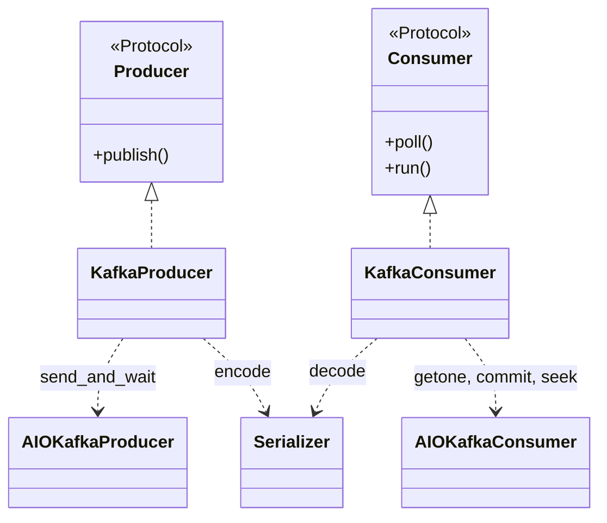
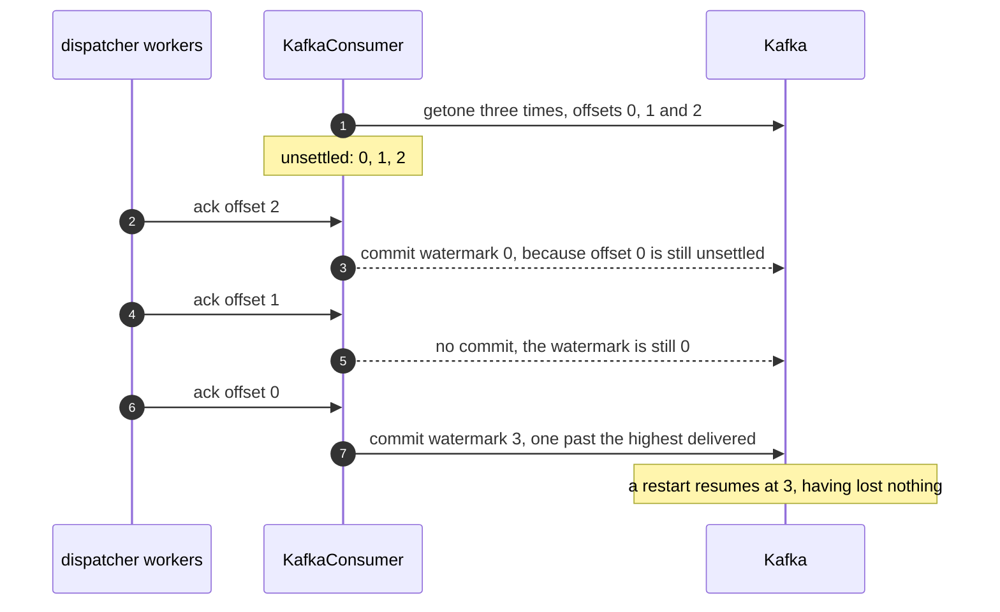
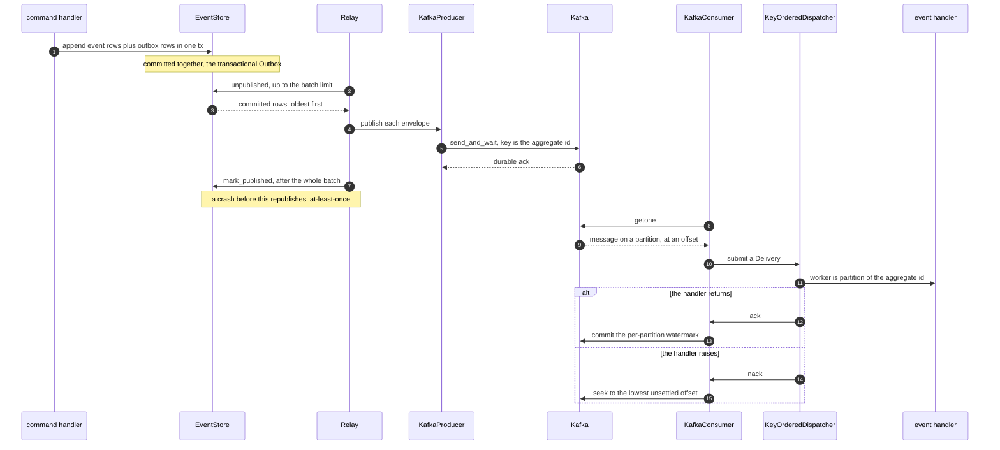

# The Kafka backend

`KafkaProducer` and `KafkaConsumer`: the broker seam over a caller-owned `aiokafka` client, and the
per-partition commit watermark that makes an offset broker safe to ack out of order.

Kafka backs the two broker seams. The adapters bridge a client you construct and start to
`edax.broker.Producer` and `edax.broker.Consumer` — nothing more, so the base package imports no
broker library. Install with `pip install edax[kafka]`. The broker seam is the Python software
development kit (SDK)'s; the Rust SDK ships no `Producer` / `Consumer` trait.



## The `Producer` contract

Four promises, and each has a failure mode behind it.

| Promise | Why | In the adapter |
|---|---|---|
| `publish` returns only after the broker has **durably accepted** the message — leader ack or stronger | returning early lets the relay mark the outbox row published before the message exists: a lost event | `await client.send_and_wait(...)`, never fire-and-forget |
| On failure `publish` **raises** | the relay then leaves the whole batch unmarked and retries it next drain | the client's exception propagates unchanged; nothing is swallowed |
| The message key is the **aggregate id** | a broker that orders per key delivers one aggregate's events in `sequence` order | `key=self._key(env).encode()`, defaulting to `_aggregate_key` |
| Delivery is **at-least-once** | a crash between publish and `mark_published` republishes the same envelope; consumers dedup by `env.id` | inherent to the outbox; see [outbox](../sdk/outbox.md) |

`publish` is called serially by one relay, so it need not be thread-safe or reentrant.

The key is what preserves order, and it is the only thing that does. Kafka orders within a
partition, and the key chooses the partition, so one aggregate's events stay in one partition and
arrive in the order they were published. Override it with `key=` if your partitioning differs, a
tenant id for instance. Per-aggregate order then holds only if that key is still a function of the
aggregate id.

The durable-ack rule is asserted by a fake client whose `send` raises `"publish must await the
broker ack (send_and_wait), not fire and forget"`. How strong that ack is remains the client's
`acks` setting, and therefore yours.

## The `Consumer` contract

| Promise | What it means |
|---|---|
| `poll` returns the next `Delivery`, or `None` at end of stream | `Delivery.attempt` is the broker's own redelivery count if it keeps one, else `0` |
| **Per-key order** | messages for one `aggregate_id` arrive in publish order. Across keys, any order. |
| **`ack` means exactly this message** | the dispatcher acks out of order, so an offset broker must track a per-partition watermark |
| **`nack` means redeliver** | the message goes back for another attempt. Redelivery may reorder it behind later same-key messages already acked; whether that is acceptable is the handler's problem |
| every delivery is settled **exactly once**, by ack *or* nack | `ack` and `nack` may be called from any worker task on the same loop, concurrently across keys |
| overall semantics are **at-least-once** | a crash after the handler runs but before `ack` redelivers. Handlers must be idempotent. |

Read the `Consumer` seam in `edax.broker`. `run` submits deliveries to the dispatcher until
cancelled or `poll` returns `None`; the `_ConsumerLoop` mixin provides it, so an adapter only writes
`poll`.

Kafka keeps no per-message redelivery count, so `KafkaConsumer` leaves `Delivery.attempt` at its
default of `0`. The dispatcher's dead-letter ceiling then rests on an in-process counter, which
resets on restart.

## The offset-broker subtlety

**On an offset broker an ack is a per-partition watermark. It is never "commit the current
position."**

The bug that rule prevents is concrete. `KeyOrderedDispatcher` routes by `partition(aggregate_id,
workers)`, so several workers handle one partition's messages concurrently. Worker A may finish
offset 7 before worker B finishes 5. A bare `client.commit()` commits the *current fetch position*,
which is past 7 — and therefore past 5, which is still running. The broker now believes 5 was
handled. Restart the consumer and 5 is never redelivered. The message is lost, silently, and only
under concurrency.

The adapter commits the lowest unsettled offset instead, or one past the highest delivered when none
remain:

```python
watermark = min(inflight) if inflight else self._max_delivered[tp] + 1
if watermark > self._committed.get(tp, -1):
    await self._client.commit({tp: watermark})
```

Three pieces of bookkeeping per `TopicPartition` make that work: the offsets delivered but
unsettled, the highest offset delivered, and the last committed watermark. The last one is a
monotonic guard — a commit reordered under asyncio at worst re-commits a lower safe watermark rather
than moving backwards.



`test_kafka.py::test_out_of_order_ack_commits_watermark_only` asserts this.
`test_watermark_is_tracked_per_partition` asserts it per partition. One partition's progress must
never settle another's.

`nack` is the mirror image. It seeks the partition back, and it seeks to the **lowest** unsettled
offset, not to this one. `seek` sets the partition's single fetch position, so nacking 5 and then 7
would move it to 7 and 5 would never come back. Re-reading acked offsets above the lowest is
at-least-once, not loss. The nacked offset also stays unsettled until its redelivered copy acks, so
a later ack of a higher offset cannot commit past it.

## End to end



The relay marks the batch published only after every row in it was published. That ordering is what
makes the gap at-least-once rather than lossy.

## What the adapter needs, and what it leaves to you

It needs five things from the client library:

| Call | Used for |
|---|---|
| `await client.send_and_wait(topic, value=, key=)` | `publish`, with the broker's ack awaited |
| `await client.getone()` | `poll`; the message must expose `topic`, `partition`, `offset`, `value` |
| `await client.commit({tp: offset})` | committing a watermark for one `TopicPartition` |
| `client.seek(tp, offset)` | redelivery on `nack`; synchronous |
| `aiokafka.TopicPartition` | the bookkeeping key, imported lazily inside `poll` so the base package pulls no broker library |

It deliberately leaves the rest to the host:

- **The client itself.** Construct, configure, start, subscribe and stop an `AIOKafkaProducer` or
  `AIOKafkaConsumer` yourself. The adapters take an already-started, already-subscribed client.
- **Durability.** The `acks` setting decides how strong the ack that `send_and_wait` waits for is.
  The `Producer` contract asks for leader ack or stronger; configure it.
- **Committing.** The adapter issues its own commits. If the client also commits on a timer, it
  commits the fetch position, which is the exact bug the watermark exists to avoid.
- **Timeouts.** `getone` blocks until a message arrives, by design. Per-request deadlines are the
  client's `request_timeout_ms`.
- **Rebalance.** The watermark bookkeeping holds only while the partition is assigned. A partition
  revoked while offsets are unsettled leaves them unsettled in the adapter. The new owner redelivers
  them from the last committed watermark, which is at-least-once. A late `commit` for that partition
  fails rather than acking. Attach a rebalance listener to the client if you need the state dropped.
- **Topics and partitions.** Naming, partition count and retention are yours. Partition count bounds
  real parallelism; `workers` on the dispatcher is local parallelism only.
- **The wire format.** Pass any `edax.aggregate.Serializer`. `edax.kernel()` is the kernel's
  envelope format, `"json"` or `"msgpack"`.
- **Dead-lettering.** `KeyOrderedDispatcher`'s `max_attempts` and `on_dead` own that; a producer's
  `publish` fits `on_dead` directly. A sink that raises leaves the message unsettled and the consumer
  running, the same outcome the dispatcher route gives. The broker redelivers on its session timeout
  or a restart, so the sink gets another try. Until then the commit watermark stays pinned at that
  offset, because `ack` commits the lowest unsettled one.

## Testing it

The seam contract runs over every in-tree adapter, in-memory and Kafka alike, in
`crates/edax-py/tests/test_broker_contract.py`: per-key order through `Relay.drain()`, nack
redelivers, ack settles, plus a Hypothesis property over random drain histories. Kafka-only
semantics — the commit watermark, the producer's key and topic — live in
`crates/edax-py/tests/test_kafka.py`. Both run against a fake client, so they prove the adapter's
own code, not Kafka's own semantics. Rebalance reordering and key-shared behavior stay out of the
tree.

## See also

- [outbox](../sdk/outbox.md) — outbox rows, `Relay`, `pump`, and where `publish` is called from.
- [consuming](../sdk/consuming.md) — `KeyOrderedDispatcher`, `EventRouter`, and who calls `ack`.
- [backends index](./README.md) — the seam contracts and the checklist for writing one.
- [memory](./memory.md) — `InMemoryBroker`, the same seams with no infrastructure.
- [delivery guarantees](../guides/delivery-guarantees.md) — the end-to-end guarantee matrix.
