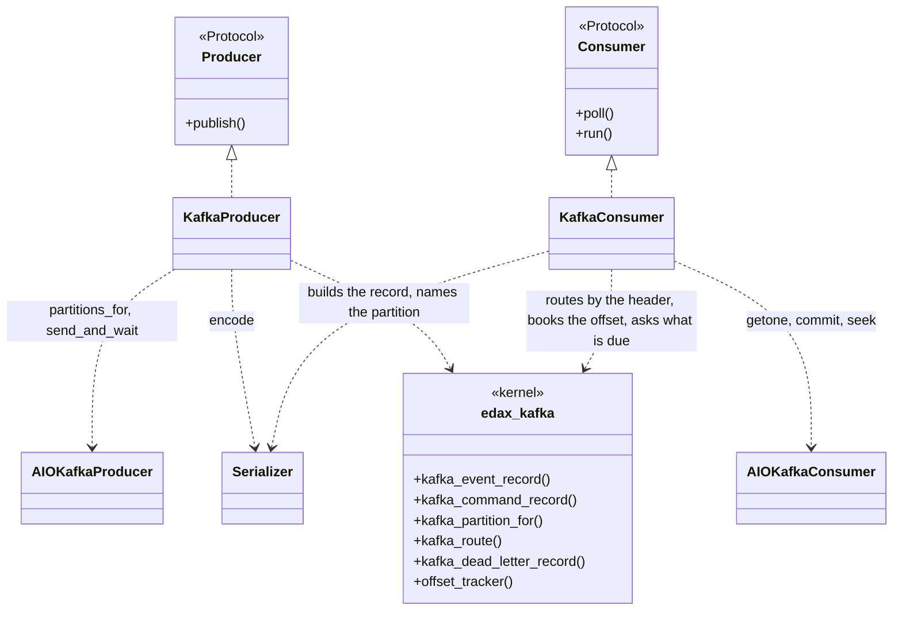
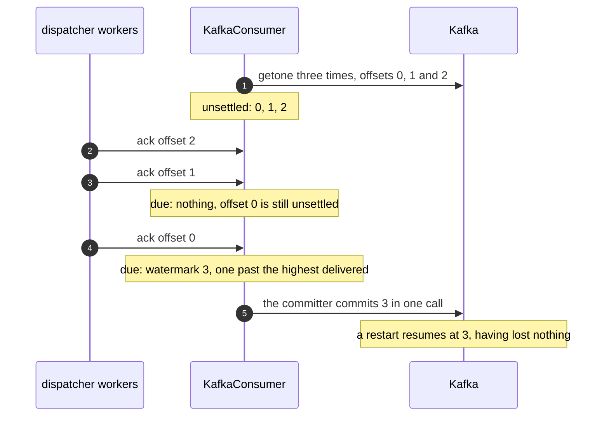
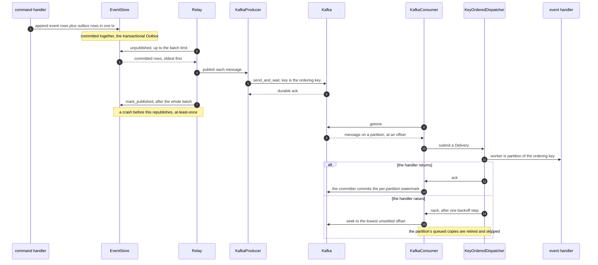

# The Kafka backend

`KafkaProducer` and `KafkaConsumer`: the broker seam over a caller-owned `aiokafka` client. The
per-partition commit watermark makes an offset broker safe to ack out of order, and the rewind keeps
a key in order through a nack.

Kafka backs the two broker seams. The adapters bridge a client you construct and start to
`edax.broker.Producer` and `edax.broker.Consumer`, and do nothing more, so the base package imports
no broker library. Install with `pip install edax[kafka]`. The broker seam is the Python software
development kit (SDK)'s; the Rust SDK ships no `Producer` / `Consumer` trait.

The adapters decide nothing about the wire. The record's key, its `content-type` header, the media
type naming the value, the partition it lands on, and the offset watermark all live in the
`edax-kafka` kernel. Golden vectors pin them. This page is the client half;
[kernels/kafka.md](../kernels/kafka.md) covers the decisions.



## Constructing them

```
KafkaProducer(client, topic, *, serializer=None, command_serializer=None, key=None, middleware=(),
              tenancy=Tenancy.SILO, publish_timeout_s=30.0)
KafkaConsumer(client, *, serializer=None, serializers=(), middleware=(),
              commit_interval_s=1.0, commit_timeout_s=10.0)
KafkaDeadLetterSink(client, topic, *, publish_timeout_s=30.0)
consumer.rebalance_listener(drain_timeout_s=30.0)
```

`client` is an already-started `AIOKafkaProducer` or an already-started, already-subscribed
`AIOKafkaConsumer`, or any client with the same calls: the `ProducerClient` and `ConsumerClient`
protocols in `edax.backend.kafka` list them. A serializer encodes one kind of message. On the
producer, `serializer` encodes events and `command_serializer` commands. They default to
`edax.KernelSerializer("json")` and `edax.KernelSerializer("json", "command")`, and a serializer of the
other kind raises the fatal `BadHandle` at wiring. On the consumer, `serializer` defaults to the JSON event
serializer. It is also the default for a record that carries no `content-type` header.
Everything after the `*` is keyword-only, so adding an argument later cannot shift a positional one.

Building an adapter checks the client's settings that lose data, by the kernel's rules
(`edax_kafka::check_consumer`, `check_dead_sink`, `acks_warning`). A consumer that auto-commits, or has no `group_id`,
raises the fatal `BadHandle`. So does `run` over a client subscribed without
`rebalance_listener()`, or with a dispatcher that has no `on_dead`. A producer that acks on the leader alone warns. The probes
read private `aiokafka` attributes, so a client of another library is not judged.

The kernel checks every duration when the adapter is built (`edax_kafka::check_config`). One under a
millisecond, or one that is no finite number of seconds, raises the terminal `BadHandle` naming it. A
zero `commit_interval_s` would spin the event loop. A zero deadline would fail every send or commit.
A zero `drain_timeout_s` would hand a running key to the new owner on every revoke.

```python
import edax
from aiokafka import AIOKafkaConsumer, AIOKafkaProducer
from edax.backend.kafka import KafkaConsumer, KafkaDeadLetterSink, KafkaProducer

producer = AIOKafkaProducer(bootstrap_servers="localhost:9092", enable_idempotence=True)
await producer.start()
publisher = KafkaProducer(producer, "orders")

client = AIOKafkaConsumer(
    bootstrap_servers="localhost:9092",
    group_id="billing",
    enable_auto_commit=False,  # the adapter commits the watermark; a timer would commit ahead of it
    auto_offset_reset="earliest",
)
consumer = KafkaConsumer(client)
client.subscribe(["orders"], listener=consumer.rebalance_listener())
await client.start()

dispatcher = edax.KeyOrderedDispatcher(
    workers=8, handler=handle, on_dead=KafkaDeadLetterSink(producer, "orders.dlq")
)
dispatcher.start()
await consumer.run(dispatcher)
```

## The `Producer` contract

Five promises, and each has a failure mode behind it.

| Promise | Why | In the adapter |
|---|---|---|
| `publish` returns only after every in-sync replica has the message (`acks="all"`) | the relay marks the outbox row published once `publish` returns; a leader that fails before a follower copied the record takes it along, and the row says it was sent | `await client.send_and_wait(...)`, never fire-and-forget; a client that acks on the leader alone warns |
| On failure `publish` raises | the relay marks the rows before it and hands that row and the rest back to the next drain | the client's exception propagates unchanged; nothing is swallowed |
| The message key is the kernel's [ordering key](../kernels/event.md#the-ordering-key), composed with the tenant under a pool | a broker that orders per key delivers one aggregate's messages in publish order | `_edax.kafka_event_record` / `_edax.kafka_command_record` decide the key from the message and the producer's `tenancy`, or take the `key=` override verbatim, and build the record under it |
| The partition is Java's murmur2 of the key | a second producer, in another language or on another client library, must put one key on the same partition | `_edax.kafka_partition_for(key, len(await client.partitions_for(topic)))`, passed as `partition=` |
| Delivery is at-least-once | a crash between publish and `mark_published` republishes the same message; consumers dedup by `msg.id` | inherent to the outbox; see [outbox](../sdk/outbox.md) |

`publish` is called serially by one relay, so it need not be thread-safe or reentrant.

The key is what preserves order. Kafka orders within a partition, and the key chooses the
partition, so one aggregate's messages stay in one partition and arrive in the order they were
published. A command that targets an aggregate shares its partition with that aggregate's events. Pass `tenancy=Tenancy.POOL` where one topic serves every tenant, and the key is that ordering key
composed with the message's `tenant`. Override the rule outright with `key=` if your partitioning
differs, and then composing it is yours to do. An exception your `key` function raises propagates
unchanged, so a bug in it is not mistaken for a poison message.
Per-aggregate order then holds only if that key is still a function of the aggregate id. With no
`key=` the adapter passes no override at all, so the default is the kernel's own rule and
`testdata/golden/kafka_record.json` is what pins it.

Which partition a key chooses is not left to the client library. Client libraries disagree:
aiokafka and every Java client use murmur2, while librdkafka (`confluent-kafka`, `rdkafka`) defaults
to CRC32. Two producers on one topic would then put one aggregate on two partitions, and its order
would break with no error. So the adapter asks the kernel, `partition_for` (Java's rule over the record's
final key, after the middleware ran), and passes the answer as `partition=`. Every edax shell does
the same, and `testdata/golden/kafka_partition.json` pins it, Kafka's own Java test vectors
included. The partition count comes from `client.partitions_for(topic)`, so adding partitions to a
topic moves keys, as it does for a Java producer.

The durable-ack rule is asserted by a fake client whose `send` raises `"publish must await the
broker ack (send_and_wait), not fire and forget"`. How strong that ack is remains the client's
setting. Build the producer with `enable_idempotence=True`. It implies `acks="all"`, and a retried
send after a lost ack then writes no duplicate. `aiokafka` defaults to `acks=1` with no idempotence,
so the adapter warns on any `acks` but `"all"`. On the broker, keep `min.insync.replicas` at 2 or more
and unclean leader election off, or `acks="all"` waits for one replica only.

## Headers

Every record the adapter publishes carries one header, `content-type`, whatever serializer wrote
the value. The kernel writes it; the adapter only hands it to the client. The kernel's
[one header](../kernels/kafka.md#the-one-header) section says why no other header lands. Add a header
of your own with record middleware, below. The name is exported as
`edax.backend.kafka.CONTENT_TYPE`, read from the kernel.

## The `Consumer` contract

| Promise | What it means |
|---|---|
| `poll` returns the next `Delivery`, an `Undecodable` for a record that will not decode, or `None` at end of stream | `Delivery.attempt` is the broker's own redelivery count if it keeps one, else `0` |
| Per-key order | messages for one ordering key arrive in publish order. Across keys, any order. |
| `ack` means exactly this message | the dispatcher acks out of order, so an offset broker must track a per-partition watermark |
| `nack` rewinds the partition | the nacked message and every later one of its partition come back, in order, acked or not. The deliveries already handed out are retired (`Delivery.live` is `False`), so the dispatcher skips them and a key never runs ahead of itself |
| every delivery is settled at most once, by ack or nack | `ack` and `nack` may be called from any worker task on the same loop, concurrently across keys; a retired delivery is not settled at all |
| nothing comes back on its own | a delivery left unsettled is never redelivered while the consumer lives, so the loop settles every one |
| overall semantics are at-least-once | a crash after the handler runs but before the commit redelivers. Handlers must be idempotent. |

Read the `Consumer` seam in `edax.broker`. `consume(consumer, dispatcher)` submits deliveries to the
dispatcher until cancelled or `poll` returns `None`, so an adapter only writes `poll`.
`KafkaConsumer.run` runs it beside the commit loop. A poll that raises does not end the loop: it waits one backoff step and polls again. The
kernel counts the failed polls in a row (`Streak`), so the step grows while the broker stays down. A
fatal error (`is_fatal`, a wiring fault such as a refused credential) ends the loop, as it ends a
relay. `KafkaConsumer.run` also refuses a dispatcher without `on_dead`.
On Kafka a nack rewinds, so a message that fails for good with nowhere to go would stall its
partition forever. It ends when the client is stopped, and commits what settled on the way out.

Kafka keeps no per-message redelivery count, so `KafkaConsumer` leaves `Delivery.attempt` at its
default of `0`. The dispatcher's dead-letter ceiling then rests on an in-process counter, which
resets on restart.

## Custom serializers

A `Serializer` names the media type it writes, as `media_type`, and the kind it encodes, as `kind`.
The producer puts that media type in the `content-type` header; the consumer reads the header back
and routes the record to the serializer registered under it. A media type names a format and a kind,
so register one serializer per kind the topic carries.

```python
import edax
from edax.backend.kafka import KafkaConsumer

consumer = KafkaConsumer(
    client,
    serializer=edax.KernelSerializer("json"),
    serializers=[edax.KernelSerializer("json", "command"), ProtoSerializer()],
)
```

`serializer` is the default and claims its own media type like any other. `serializers` are the
extra ones. Four rules follow, and each one has a failure behind it.

- **Register the same media type in every SDK that reads the topic.** A custom format is a
  cross-language agreement, and the media type is its name. Only the name is shared; the code that
  encodes it stays per SDK.
- **A media type no serializer claims is poison.** The consumer raises `CodecError` and the delivery
  dead-letters. It never falls back to the default, because decoding msgpack bytes as the host's own
  format is how a wrong message reaches a handler instead of the dead-letter sink. An empty
  `content-type` is a media type nobody claims, and a null one crosses as empty, so both are poison.
- **A record with no `content-type` header uses the default, as an event.** Under a command default
  it is poison instead; the kernel's [`route`](../kernels/kafka.md#route-which-serializer-the-record-names)
  says why. A command consumer passes `serializer=edax.KernelSerializer("json", "command")`.
- **The delivery carries what the serializer decoded.** It is an `EventMessage` or a
  `CommandMessage`. A command consumer's handler passes it on with
  `bus.dispatch_message(msg)`, decoded by the bus's codec; see [commands](../sdk/commands.md).

The rule is the kernel's `route`, given the headers, the registered media types and the default
serializer's kind. So every SDK sends one record to the same serializer.
`testdata/golden/kafka_route.json` pins it.

## Record middleware

A middleware rewrites a record on its way to or from the broker. It is synchronous, and it takes
bytes to bytes.

<!-- doclint: check -->
```python
from edax.backend.kafka import KafkaHeader, KafkaRecord


class SourceService:
    """Stamps the publishing service on every record, for tools that read headers only."""

    def __init__(self, service: str) -> None:
        self._value: bytes = service.encode()

    def on_publish(self, record: KafkaRecord) -> KafkaRecord:
        headers = [*record.headers, KafkaHeader("source-service", self._value)]
        return KafkaRecord(record.key, record.value, headers)

    def on_poll(self, record: KafkaRecord) -> KafkaRecord:
        return record
```

Pass instances as `middleware=` to either adapter. `on_publish` runs in order, after the kernel has
built the record and before the send. `on_poll` runs in reverse, after the fetch and before the
content-type lookup. A pair of middlewares therefore wraps the record like an onion, and one that
compresses or encrypts the value on the way out unwraps it on the way in. Rewrite `content-type`
(`CONTENT_TYPE`) when you do, and restore it on the way in, so the consumer still routes to the
serializer that wrote the bytes. A middleware may also rewrite the key; the producer places the
record by the key it ends with.

Failures split the way the rest of the SDK splits them, by the kernel's reading of the error's code.
A middleware that raises a terminal error on poll (`CodecError`, `Rejected`, or a host exception that
declares `terminal = True`) marks the message poison, so it dead-letters. A fatal one (`BadHandle`)
ends `run`. Any other exception is transient: the poll seeks back to the record and raises, and the
loop waits one backoff step and polls again. Hooks are
synchronous, so a hook cannot await a key-management call.

Trace context needs no middleware. A `traceparent` rides in the message's `extensions`, inside the
value, so it survives every hop and every SDK. See
[observability](../sdk/observability.md#traces-via-extensions-and-where-request-scoped-values-go).

## The offset-broker subtlety

On an offset broker an ack is a per-partition watermark, never "commit the current position".

`KeyOrderedDispatcher` routes by `partition(ordering_key, workers)`, so several workers handle one
partition's messages concurrently. Worker A may finish offset 7 before worker B finishes 5. A bare
`client.commit()` commits the current fetch position, which is past 7 and therefore past 5, which is
still running. The broker now believes 5 was handled. Restart the consumer and 5 is never
redelivered. The message is lost, with no error, and only under concurrency.

The consumer commits the lowest unsettled offset instead, or one past the highest delivered when none
remain. That state machine is the kernel's, not the adapter's: `edax-kafka` keeps the
bookkeeping and answers with a decision, and the adapter performs it.

```python
token = tracker.book(msg.topic, msg.partition, msg.offset)  # before decoding
...
tracker.ack(token)  # settles; never waits on the broker
...
due = tracker.due()  # the committer, every commit_interval_s
await asyncio.wait_for(client.commit({tp(d): d.offset for d in due}), commit_timeout_s)
for d in due:
    tracker.committed(d.topic, d.partition, d.offset)
```

Two properties follow from that shape.

**Settlement is by token.** `book` returns a token naming one delivery, and `ack` and `nack` take
that token, not a `(partition, offset)` pair. A token retires when its delivery settles, when a
redelivery re-books the same offset, when a nack rewinds its partition, and when `revoke` or `reset`
drops its partition. That closes the stale-settle hole coordinates leave open. Revoke a partition from
your rebalance listener, get the partition assigned back, and re-book offset 5. The pre-revoke ack for 5 then
arrives and settles nothing, so it cannot discard the fresh booking.

**Commits are batched, off the ack path.** An ack only settles. One committer task, started by `run`,
commits every partition `due` names in one call every `commit_interval_s`, and once more when `run`
ends. Each commit runs under `commit_timeout_s`: `aiokafka` retries a commit while the coordinator is
away, without end, and the deadline stops that from hanging the consumer. `flush()` commits
on demand; call it after `dispatcher.stop()` to commit the drained work before closing the client.

**A commit is recorded only after the client confirms it.** A commit that raised or timed out is
never recorded as done, so the same watermark is due again. The monotonic guard lives in the kernel
too: two commits that returned out of order leave the higher one recorded. `stats()` exposes the
whole record per `TopicPartition`: unsettled count, how many are still live, highest offset
delivered, and last committed watermark.



`test_kafka.py::test_out_of_order_ack_commits_watermark_only` asserts this.
`test_watermark_is_tracked_per_partition` asserts it per partition. One partition's progress must
never settle another's.

`nack` is the mirror image. It seeks the partition back, and it seeks to the lowest unsettled
offset, not to this one. `seek` sets the partition's single fetch position, so nacking 5 and then 7
would move it to 7 and 5 would never come back. Every offset from there on is fetched again, so the
nack retires every token of the partition. The copies already queued in the dispatcher are skipped
(`Delivery.live`), and a later event of a key never runs before the redelivered earlier one.
Re-reading acked offsets is at-least-once, not loss. The nacked offset also stays unsettled until its
redelivered copy acks, so no commit passes it.

## End to end



The relay marks a row published only after its publish returned. That ordering makes the gap
at-least-once rather than lossy.

## What the adapter needs, and what it leaves to you

It needs seven things from the client library:

| Call | Used for |
|---|---|
| `await client.partitions_for(topic)` | the topic's partition count, for the kernel's placement; aiokafka answers from cached metadata |
| `await client.send_and_wait(topic, value=, key=, partition=, headers=)` | `publish`, with the broker's ack awaited; `headers` is a list of `(name, bytes)` pairs |
| `await client.getone()` | `poll`; the message must expose `topic`, `partition`, `offset`, `value`, `key` and `headers`, and may expose `timestamp` and `timestamp_type` |
| `await client.commit({tp: offset, ...})` | committing every due watermark in one call, under the commit deadline |
| `client.seek(tp, offset)` | redelivery on `nack`; synchronous |
| `aiokafka.TopicPartition` | the bookkeeping key, imported lazily so the base package pulls no broker library |
| `aiokafka.ConsumerRebalanceListener` | the base of `rebalance_listener()`, imported when you ask for one |

It leaves the rest to the host:

- **The client itself.** Construct, configure, start, subscribe and stop an `AIOKafkaProducer` or
  `AIOKafkaConsumer` yourself. The adapters take an already-started, already-subscribed client.
- **Durability.** The `acks` setting decides how strong the ack that `send_and_wait` waits for is.
  The `Producer` contract asks for every in-sync replica: build the producer with
  `enable_idempotence=True`, as in the example above.
- **Committing.** The adapter issues its own commits, and the consumer it is handed must not issue
  any of its own. `aiokafka` commits on a timer by default. `enable_auto_commit` defaults to `True`,
  and it commits the fetch position, which runs ahead of what has been handled. That is the bug the
  watermark exists to avoid: an offset still on a worker is reported as done, and a restart
  never redelivers it. So `KafkaConsumer` refuses a client that auto-commits, and one with no
  `group_id`, whose every commit would fail.
- **Timeouts.** `getone` blocks until a message arrives, by design. The client does not bound a
  send. With `enable_idempotence=True`, `aiokafka` never expires a batch and never raises
  `RequestTimedOutError`, so a send to a broker that stopped answering waits forever. The adapter
  bounds each send with `publish_timeout_s`. At the deadline the producer and the dead-letter sink
  raise the transient `StoreError` ("no reply within N ms"), the one timeout error every edax backend
  raises. The outcome of that send is unknown. The batch stays in the client and may still land, so
  the retry can write a second copy, which consumers dedup by `msg.id`. The client does not bound a
  commit either, so the adapter bounds it with `commit_timeout_s`, and a commit past it raises the same
  `StoreError`.
- **Broker errors.** The kernel's `broker_error` classifies every client call by its Kafka protocol
  error code (`errno`): the send, the metadata lookup, the fetch and the commit. A record the broker
  refuses (too large, invalid) raises the terminal `CodecError`, so the relay dead-letters that row
  and the next one goes out. A client the broker refuses raises the fatal `BadHandle`. That is an
  authorization or SASL failure, an invalid topic, an unsupported version or format, a fenced producer
  epoch, or a refused timestamp. edax sets no record timestamp, so the broker refuses one only
  when the producer host's clock is skewed, which fails every record. `Relay.run` and
  `KafkaConsumer.run` end on it rather than dead-letter every message after it. A refused commit ends
  the run too. Any other code is a transient `StoreError`, a corrupt message (a checksum failure in
  transit) among them. A failure with no protocol code, `KafkaTimeoutError` or a lost connection,
  stays unclassified, which is transient. aiokafka's own `retriable` flag is not read: it calls its own
  timeout final.
- **Codes aiokafka does not know.** aiokafka maps a broker code it has no error class for to
  `UnknownError`, whose `errno` is `-1`. `INVALID_RECORD` (87) and `PRODUCER_FENCED` (90) are two of
  them. The adapter can only pass `-1` on, so the kernel answers the transient `StoreError`. So under
  aiokafka a record the broker refuses as invalid is retried on its key. A client that reports 87
  dead-letters it instead. This is a client limit, not an edax rule.
- **Rebalance.** The watermark bookkeeping holds only while the partition is assigned. Pass
  `consumer.rebalance_listener()` to `subscribe`. On revoke the kernel's `revoke` hands back each
  revoked partition's last due watermark as it drops the partition, so the queued deliveries are
  skipped. The listener commits those watermarks and waits for the handlers still running,
  up to `drain_timeout_s`. The new owner starts from the commit, so the skipped work runs there:
  at-least-once. Keep `drain_timeout_s` above the slowest handler and below the client's
  `max_poll_interval_ms`. The wait makes overlap rare, not impossible. A handler still running at the
  deadline overlaps the new owner, which `revoke_overrun` reports. A member the group evicts (a pause
  past the session timeout or `max_poll_interval_ms`) loses its partitions before its listener runs,
  so the wait cannot cover it. In both cases one key can run on two members at once; the consume
  guard keeps duplicate database effects out, but per-key order is broken for that window. Without the listener, a revoked partition
  keeps its stale bookkeeping, and its queued work runs alongside the new owner. Once its watermark
  is due, the client refuses every commit that names it, so no partition commits again. `run`
  therefore raises `BadHandle` for an `AIOKafkaConsumer` subscribed to topics with no listener. A
  client assigned its partitions by hand (`assign`) has no rebalance and needs none.
- **Threads.** `KafkaConsumer` keeps its offset bookkeeping in native state bound to the thread that
  built it. Build the consumer on the thread that runs its event loop. A consumer built on the main
  thread and run in `threading.Thread(target=asyncio.run, ...)` raises the terminal `BadHandle` on
  its first booking.
- **Topics and partitions.** Naming, partition count and retention are yours. Partition count bounds
  real parallelism; `workers` on the dispatcher is local parallelism only.
- **The wire format.** Pass any `edax.serializer.Serializer`. `edax.KernelSerializer(fmt, kind)` is
  the kernel's message format, `"json"` or `"msgpack"`, for `"event"` or `"command"`. The value bytes are the serializer's. The key, the partition, the
  header and the media type in `content-type` stay the kernel's, so a custom format keeps the same
  record shape. Two serializers claiming one media type are refused with `AlreadyRegistered`: one
  topic would otherwise decode two ways.
- **Dead-lettering.** `KeyOrderedDispatcher`'s `max_attempts` and `on_dead` own that, and
  `KafkaConsumer.run` requires `on_dead`. `KafkaDeadLetterSink(producer, topic)` is a ready sink. It
  publishes the fetched key and value, before any middleware. It retains headers except prior
  `edax-dlq-error` values, then adds `edax-dlq-topic`, `edax-dlq-partition`, `edax-dlq-offset` and
  a new `edax-dlq-error`. That error header contains only the failure's code, such as `codec`, or
  `unclassified` when no code is available. It never stores exception text or an exception class.
  A republish to the source topic after the fix routes and decodes as the original did. The record
  rides on `Delivery.origin` as a `KafkaFetched`, so a sink of your own calls
  `delivery.origin.dead_letter(error)` for it. `KafkaFetched` also carries the broker facts a
  message never holds: `timestamp`, in Unix milliseconds, and `timestamp_type`, `0` for the
  producer's `CreateTime` and `1` for the broker's `LogAppendTime`. Both are `None` when the client
  reports none. The kernel's `dead_letter_record` builds it, and its
  `dead_letter_source` reads the coordinates back. A payload that will not decode reaches the
  sink with the stand-in id `topic/partition/offset`. A sink that raises nacks the message after one
  backoff step, so the redelivery gives it another try. If the sink then sees one offset twice, the
  coordinates are the dedup key. The four headers can push a record past the dead-letter topic's size
  limit. The sink then sends the kernel's stub instead (`dead_letter_stub`). The stub drops the value,
  keeps every header, and adds `edax-dlq-dropped` naming how many bytes went. The coordinates point at the
  value, which the source topic holds until its retention passes. Without it the sink would raise on
  every try and the partition would rewind to that record forever.

## Testing it

The seam contract, `edax.testing.BrokerContract`, runs over every in-tree adapter, in-memory and
Kafka alike, in `crates/edax-py/tests/test_broker_contract.py`. Its clauses: per-key order, a nack
that keeps the key's order, redelivery from the commit after a crash, and consumer groups.
`test_broker_model.py` drives both under random publishes, failures, commits and crashes. Kafka-only semantics live in
`crates/edax-py/tests/test_kafka.py`: the watermark and the committer, the producer's key, topic and
durability probe, the registry, the middleware, the dead-letter record, and the loop under faults.

Those run on a Kafka-shaped fake in `tests/conftest.py`. It holds partitioned logs and a group's
commits, and it redelivers only on a seek, a rebalance or a restart. It revokes eagerly through the
listener, refuses a seek or a commit on a partition the member does not hold, and can freeze its
commits.
`crates/edax-py/tests/test_kafka_live.py` runs the same faults against a real broker when
`EDAX_KAFKA_BOOTSTRAP` is set, and `EDAX_KAFKA_CONTAINER` adds a frozen broker and a restart.

The kernel's own contract is replayed in `crates/edax-py/tests/test_edax.py`. Five tests read
`testdata/golden/` through `_edax`: `test_golden_kafka_record`, `test_golden_kafka_decode` (through
a real `KafkaConsumer`), `test_golden_kafka_route`, `test_golden_kafka_dead_letter` and
`test_golden_kafka_offsets`. `test_kafka.py` replays every `kafka_partition.json` row through a real
`KafkaProducer`. Those prove this SDK and a second one agree on the record, the partition and the
watermark.

## See also

- [outbox](../sdk/outbox.md) — outbox rows, `Relay`, `pump`, and where `publish` is called from.
- [consuming](../sdk/consuming.md) — `KeyOrderedDispatcher`, `EventRouter`, and who calls `ack`.
- [backends index](./README.md) — the seam contracts and the checklist for writing one.
- [kernels/kafka.md](../kernels/kafka.md) — the record, the header, placement, the media types and
  the offset state machine, decision by decision.
- [memory](./memory.md) — `MemoryBroker`, the same seams with no infrastructure.
- `examples/py/17_kafka.py` — the outbox relay into `KafkaProducer`, a `KafkaConsumer` with a
  `KafkaDeadLetterSink`, against a real broker when `EDAX_KAFKA_BOOTSTRAP` is set.
- [delivery guarantees](../guides/delivery-guarantees.md) — the end-to-end guarantee matrix.
