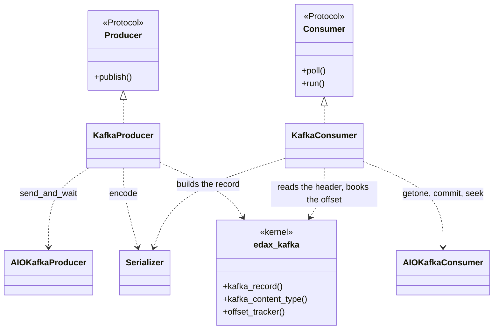
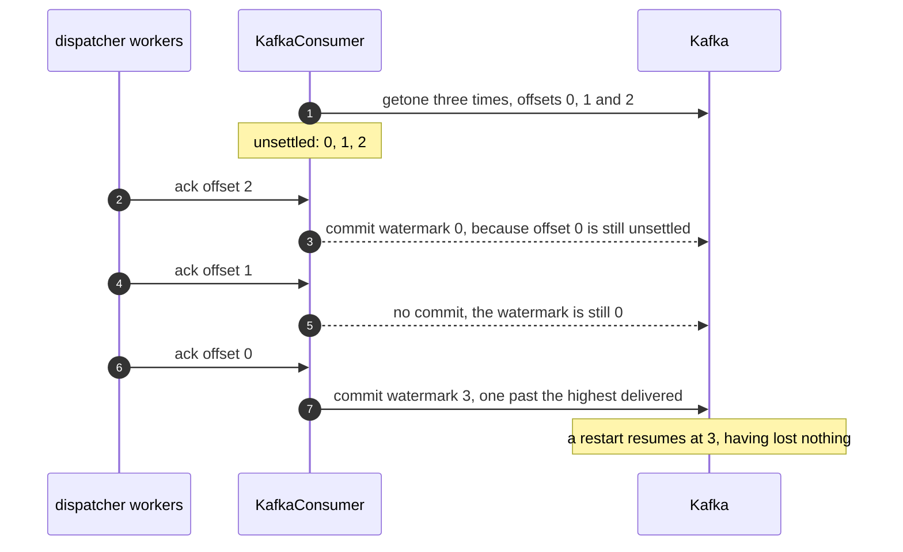
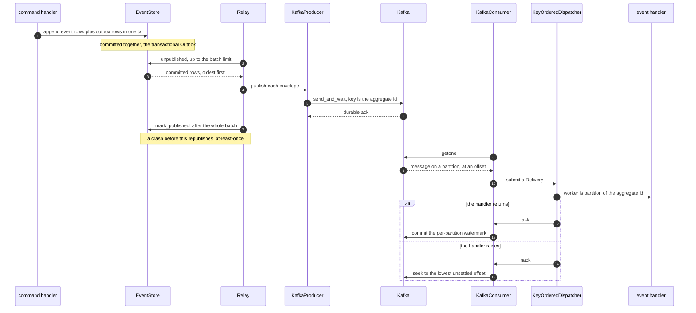

# The Kafka backend

`KafkaProducer` and `KafkaConsumer`: the broker seam over a caller-owned `aiokafka` client, and the
per-partition commit watermark that makes an offset broker safe to ack out of order.

Kafka backs the two broker seams. The adapters bridge a client you construct and start to
`edax.broker.Producer` and `edax.broker.Consumer` — nothing more, so the base package imports no
broker library. Install with `pip install edax[kafka]`. The broker seam is the Python software
development kit (SDK)'s; the Rust SDK ships no `Producer` / `Consumer` trait.

The adapters decide nothing about the wire. The record's key, its four headers, the media type
naming the value, and the offset watermark all live in the `edax-kafka` kernel. Golden vectors pin
them. This page is the client half; [kernels/kafka.md](../kernels/kafka.md) is the decisions
themselves.



## Constructing them

```
KafkaProducer(client, topic, *, serializer=None, key=None, middleware=())
KafkaConsumer(client, *, serializer=None, serializers=(), middleware=())
```

`client` is an already-started `AIOKafkaProducer` or an already-started, already-subscribed
`AIOKafkaConsumer`. `serializer` defaults to `edax.kernel("json")` on both sides, and on the
consumer it is also the default for a record that carries no `content-type` header. Everything after
the `*` is keyword-only, so adding an argument later cannot shift a positional one.

## The `Producer` contract

Four promises, and each has a failure mode behind it.

| Promise | Why | In the adapter |
|---|---|---|
| `publish` returns only after the broker has **durably accepted** the message — leader ack or stronger | returning early lets the relay mark the outbox row published before the message exists: a lost event | `await client.send_and_wait(...)`, never fire-and-forget |
| On failure `publish` **raises** | the relay then leaves the whole batch unmarked and retries it next drain | the client's exception propagates unchanged; nothing is swallowed |
| The message key is the **aggregate id** | a broker that orders per key delivers one aggregate's events in `sequence` order | the kernel's key rule, applied inside `_edax.kafka_record`; the adapter passes `None` unless you gave it `key=` |
| Delivery is **at-least-once** | a crash between publish and `mark_published` republishes the same envelope; consumers dedup by `env.id` | inherent to the outbox; see [outbox](../sdk/outbox.md) |

`publish` is called serially by one relay, so it need not be thread-safe or reentrant.

The key is what preserves order, and it is the only thing that does. Kafka orders within a
partition, and the key chooses the partition, so one aggregate's events stay in one partition and
arrive in the order they were published. Override it with `key=` if your partitioning differs, a
tenant id for instance. Per-aggregate order then holds only if that key is still a function of the
aggregate id. With no `key=` the adapter passes no override at all, so the default is the kernel's
own rule and `testdata/golden/kafka_record.json` is what pins it.

The durable-ack rule is asserted by a fake client whose `send` raises `"publish must await the
broker ack (send_and_wait), not fire and forget"`. How strong that ack is remains the client's
`acks` setting, and therefore yours.

## Headers

Every record the adapter publishes carries the same four headers, whatever serializer wrote the
value. The kernel writes them; the adapter only hands them to the client.

| Header | Value | A reader uses it to |
|---|---|---|
| `content-type` | the media type of the value bytes, for example `application/vnd.edax.envelope+json` | pick the serializer that decodes the value |
| `edax-id` | the envelope id | dedup or trace without decoding the value |
| `edax-event` | the event name | filter or route without decoding the value |
| `edax-event-version` | the event version as ASCII decimal | plan an upcast without decoding the value |

The set is closed. The aggregate id is the key already, the sequence is inside the value, and trace
context is the host's own `traceparent`. Add a header of your own with record middleware, below.
`testdata/golden/kafka_record.json` pins the four, so a consumer in another language reads the same
names and the same bytes.

## The `Consumer` contract

| Promise | What it means |
|---|---|
| `poll` returns the next `Delivery`, or `None` at end of stream | `Delivery.attempt` is the broker's own redelivery count if it keeps one, else `0` |
| **Per-key order** | messages for one `aggregate_id` arrive in publish order. Across keys, any order. |
| **`ack` means exactly this message** | the dispatcher acks out of order, so an offset broker must track a per-partition watermark |
| **`nack` means redeliver** | the message goes back for another attempt. Redelivery may reorder it behind later same-key messages already acked; whether that is acceptable is the handler's problem |
| every delivery is settled **exactly once**, by ack *or* nack | `ack` and `nack` may be called from any worker task on the same loop, concurrently across keys |
| overall semantics are **at-least-once** | a crash after the handler runs but before `ack` redelivers. Handlers must be idempotent. |

Read the `Consumer` seam in `edax.broker`. `run` submits deliveries to the dispatcher until
cancelled or `poll` returns `None`; the `_ConsumerLoop` mixin provides it, so an adapter only writes
`poll`.

Kafka keeps no per-message redelivery count, so `KafkaConsumer` leaves `Delivery.attempt` at its
default of `0`. The dispatcher's dead-letter ceiling then rests on an in-process counter, which
resets on restart.

## Custom serializers

A `Serializer` names the media type it writes, as `content_type`. The producer puts that media type
in the `content-type` header; the consumer reads the header back and routes the record to the
serializer registered under it.

```python
import edax
from edax.backend.kafka import KafkaConsumer

consumer = KafkaConsumer(client, serializer=edax.kernel("json"), serializers=[ProtoSerializer()])
```

`serializer` is the default and claims its own media type like any other. `serializers` are the
extra ones. Three rules follow, and each one has a failure behind it.

- **Register the same media type in every SDK that reads the topic.** A custom format is a
  cross-language agreement, and the media type is its name. Only the name is shared; the code that
  encodes it stays per SDK.
- **A media type no serializer claims is poison.** The consumer raises `CodecError` and the delivery
  dead-letters. It never falls back to the default, because decoding msgpack bytes as the host's own
  format is how a wrong envelope reaches a handler instead of the dead-letter sink.
- **A record with no `content-type` header uses the default.** Anything published before this
  kernel, or by a client that drops headers, still decodes.

## Record middleware

A middleware rewrites a record on its way to or from the broker. It is synchronous, and it takes
bytes to bytes.

<!-- doclint: check -->
```python
from edax.backend.kafka import KafkaHeader, KafkaRecord


class Traceparent:
    """Stamps one trace context on every published record."""

    def __init__(self, traceparent: str) -> None:
        self._value: bytes = traceparent.encode()

    def on_publish(self, record: KafkaRecord) -> KafkaRecord:
        headers = [*record.headers, KafkaHeader("traceparent", self._value)]
        return KafkaRecord(record.key, record.value, headers)

    def on_poll(self, record: KafkaRecord) -> KafkaRecord:
        return record
```

Pass instances as `middleware=` to either adapter. `on_publish` runs in order, after the kernel has
built the record and before the send. `on_poll` runs in reverse, after the fetch and before the
content-type lookup. A pair of middlewares therefore wraps the record like an onion, and one that
compresses or encrypts the value on the way out unwraps it on the way in. Rewrite `content-type`
when you do, and restore it on the way in, so the consumer still routes to the serializer that wrote
the bytes.

Failures split the way the rest of the SDK splits them. A middleware that raises `CodecError` on
poll marks the message poison, so it dead-letters. Any other exception propagates as transient and
the message redelivers. An async hook, a key-management call for instance, is a later addition if a
host asks for one.

## The offset-broker subtlety

**On an offset broker an ack is a per-partition watermark. It is never "commit the current
position."**

The bug that rule prevents is concrete. `KeyOrderedDispatcher` routes by `partition(aggregate_id,
workers)`, so several workers handle one partition's messages concurrently. Worker A may finish
offset 7 before worker B finishes 5. A bare `client.commit()` commits the *current fetch position*,
which is past 7 — and therefore past 5, which is still running. The broker now believes 5 was
handled. Restart the consumer and 5 is never redelivered. The message is lost, silently, and only
under concurrency.

The consumer commits the lowest unsettled offset instead, or one past the highest delivered when none
remain. **That state machine is the kernel's**, not the adapter's: `edax-kafka` keeps the
bookkeeping and answers with a decision, and the adapter performs it.

```python
token = tracker.book(msg.topic, msg.partition, msg.offset)  # before decoding
...
decision = tracker.ack(token)
if decision.commit:
    await client.commit({tp: decision.offset})
    tracker.committed(msg.topic, msg.partition, decision.offset)
```

Two properties follow from that shape.

**Settlement is by token.** `book` returns a token naming one delivery, and `ack` and `nack` take
that token, not a `(partition, offset)` pair. A token retires when its delivery settles, when a
redelivery re-books the same offset, and when `reset` drops its partition. That closes the
stale-settle hole coordinates leave open. Revoke a partition, call `reset(tp)` from your rebalance
listener, get the partition assigned back, and re-book offset 5. The pre-revoke ack for 5 then
arrives and settles nothing, so it cannot discard the fresh booking.

**A commit is recorded only after the client confirms it.** `ack` returns the watermark; the adapter
commits it and then calls `committed`. A commit that raised is therefore never recorded as done, and
the next attempt at that offset is not refused. The monotonic guard lives in the kernel too: a
commit reordered under asyncio at worst re-commits a lower safe watermark rather than moving
backwards. `stats()` exposes the whole record per `TopicPartition`: unsettled count, highest offset
delivered, and last committed watermark.



`test_kafka.py::test_out_of_order_ack_commits_watermark_only` asserts this.
`test_watermark_is_tracked_per_partition` asserts it per partition. One partition's progress must
never settle another's.

`nack` is the mirror image. It seeks the partition back, and it seeks to the **lowest** unsettled
offset, not to this one. `seek` sets the partition's single fetch position, so nacking 5 and then 7
would move it to 7 and 5 would never come back. Re-reading acked offsets above the lowest is
at-least-once, not loss. The nacked offset also stays unsettled until its redelivered copy acks, so
a later ack of a higher offset cannot commit past it.

## End to end



The relay marks the batch published only after every row in it was published. That ordering is what
makes the gap at-least-once rather than lossy.

## What the adapter needs, and what it leaves to you

It needs five things from the client library:

| Call | Used for |
|---|---|
| `await client.send_and_wait(topic, value=, key=, headers=)` | `publish`, with the broker's ack awaited; `headers` is a list of `(name, bytes)` pairs |
| `await client.getone()` | `poll`; the message must expose `topic`, `partition`, `offset`, `value`, `key` and `headers` |
| `await client.commit({tp: offset})` | committing a watermark for one `TopicPartition` |
| `client.seek(tp, offset)` | redelivery on `nack`; synchronous |
| `aiokafka.TopicPartition` | the bookkeeping key, imported lazily inside `poll` so the base package pulls no broker library |

It deliberately leaves the rest to the host:

- **The client itself.** Construct, configure, start, subscribe and stop an `AIOKafkaProducer` or
  `AIOKafkaConsumer` yourself. The adapters take an already-started, already-subscribed client.
- **Durability.** The `acks` setting decides how strong the ack that `send_and_wait` waits for is.
  The `Producer` contract asks for leader ack or stronger; configure it.
- **Committing.** The adapter issues its own commits, and the consumer it is handed must not issue
  any of its own. `aiokafka` commits on a timer by default, so this is the one setting you cannot
  leave alone. `enable_auto_commit` defaults to `True`, and it commits the *fetch* position, which
  runs ahead of what has been handled. That is the exact bug the watermark exists to avoid. An offset
  still on a worker is reported as done, and a restart never redelivers it.

  ```python
  from aiokafka import AIOKafkaConsumer

  consumer = AIOKafkaConsumer(
      "orders",
      bootstrap_servers="localhost:9092",
      group_id="billing",
      enable_auto_commit=False,  # the adapter commits the watermark; a timer would commit ahead of it
      auto_offset_reset="earliest",
  )
  await consumer.start()
  ```

  Pass the started consumer to `KafkaConsumer(consumer, serializer=...)`. Nothing in `edax` sets this
  for you, because the adapter never constructs your client.
- **Timeouts.** `getone` blocks until a message arrives, by design. Per-request deadlines are the
  client's `request_timeout_ms`.
- **Rebalance.** The watermark bookkeeping holds only while the partition is assigned. A partition
  revoked while offsets are unsettled leaves them unsettled in the adapter. The new owner redelivers
  them from the last committed watermark, which is at-least-once. A late `commit` for that partition
  fails rather than acking. Attach a rebalance listener that calls `consumer.reset(tp)`. That drops
  the partition's bookkeeping and retires its tokens.
- **Topics and partitions.** Naming, partition count and retention are yours. Partition count bounds
  real parallelism; `workers` on the dispatcher is local parallelism only.
- **The wire format.** Pass any `edax.aggregate.Serializer`. `edax.kernel()` is the kernel's envelope
  format, `"json"` or `"msgpack"`. The value bytes are the serializer's. The key, the four headers
  and the media type in `content-type` stay the kernel's, so a custom format keeps the same record
  shape.
- **Dead-lettering.** `KeyOrderedDispatcher`'s `max_attempts` and `on_dead` own that; a producer's
  `publish` fits `on_dead` directly. A payload that will not decode reaches the sink as a stand-in
  envelope whose id is `topic/partition/offset`. An offset alone repeats on every partition, so two
  poison messages would otherwise share one id. A sink that raises leaves the message unsettled and
  the consumer running, the same outcome the dispatcher route gives. The broker redelivers on its session timeout
  or a restart, so the sink gets another try. Until then the commit watermark stays pinned at that
  offset, because `ack` commits the lowest unsettled one.

## Testing it

The seam contract runs over every in-tree adapter, in-memory and Kafka alike, in
`crates/edax-py/tests/test_broker_contract.py`: per-key order through `Relay.drain()`, nack
redelivers, ack settles, plus a Hypothesis property over random drain histories. Kafka-only
semantics — the commit watermark, the producer's key and topic — live in
`crates/edax-py/tests/test_kafka.py`, alongside the serializer registry and the middleware order.
Both run against a fake client, so they prove the adapter's own code, not Kafka's own semantics.
Rebalance reordering and key-shared behavior stay out of the tree.

The kernel's own contract is replayed in `crates/edax-py/tests/test_edax.py`:
`test_golden_kafka_record`, `test_golden_kafka_decode` and `test_golden_kafka_offsets` read
`testdata/golden/` through `_edax`. Those three are what prove this SDK and a second one agree on
the record and on the watermark.

## See also

- [outbox](../sdk/outbox.md) — outbox rows, `Relay`, `pump`, and where `publish` is called from.
- [consuming](../sdk/consuming.md) — `KeyOrderedDispatcher`, `EventRouter`, and who calls `ack`.
- [backends index](./README.md) — the seam contracts and the checklist for writing one.
- [kernels/kafka.md](../kernels/kafka.md) — the record, the headers, the media types and the offset
  state machine, decision by decision.
- [memory](./memory.md) — `MemoryBroker`, the same seams with no infrastructure.
- [delivery guarantees](../guides/delivery-guarantees.md) — the end-to-end guarantee matrix.
