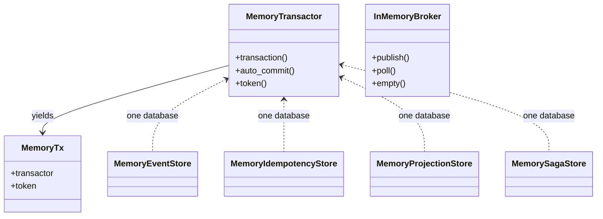
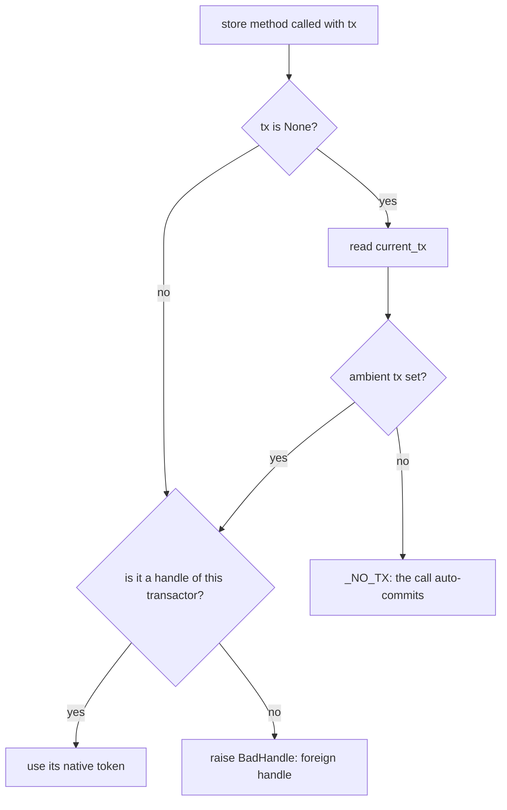

# The in-memory backend

Every seam, in one process, with a transaction that commits and rolls back for real.

`edax.backend.memory` is the reference backend: it is what the test suites run against, and what a
durable backend is compared to. One `MemoryTransactor` is one database; the stores built over it
share that database, so their writes under one `tx` land together or vanish together. It is for
development and tests. It is not durable.



## What it provides

| Class | Seam | Notes |
|---|---|---|
| `MemoryTransactor` | `Transactor` | the transaction boundary; `transaction()` yields a `MemoryTx` |
| `MemoryTx` | the handle | a frozen dataclass of the transactor plus the native token |
| `MemoryEventStore` | `EventStore` | events, snapshots and the outbox; is itself a `Transactor`, so `with_tx(store)` works |
| `MemoryIdempotencyStore` | `IdempotencyStore` | the atomic claim; declares `joins_transaction = True` |
| `MemoryProjectionStore` | `ProjectionStore` | `get_many` runs the kernel query, so it is the reference for how a durable backend must page |
| `MemorySagaStore` | `SagaStore` | per-correlation state with optimistic concurrency |
| `InMemoryBroker` | `Producer` **and** `Consumer` | `Relay(store, broker.publish)` and `broker.run(dispatcher)` with no infrastructure |

Only the waiting is Python's. The maps, the version checks, the outbox, the atomic claim, the
transaction journal and the broker's settlement accounting live in the native `edax-adapters` crate.
Every software development kit (SDK) shares them, so the two bindings cannot drift. The native
objects are `unsendable`: do not share one across operating-system threads.

The Rust SDK ships the same set over the same crate: `MemoryTransactor`, `MemoryTx`,
`MemoryEventStore`, `MemoryIdempotencyStore`, `MemoryProjectionStore`, `MemorySagaStore` and
`InMemoryBroker`. There `MemoryTx` is a plain `Copy` token and the no-transaction handle is
`MemoryTx::auto_commit()`, which is also its `Default`.

## The transaction is real

`MemoryTransactor` implements a real transaction. It stages every write made under a token, applies
them together on commit, and drops them on rollback, so a test can assert that a raise left nothing
behind. That is the point of it: the `Transactor` docstring names this backend as the one that keeps
the contract for real.


Cancellation is a rollback too. The boundary catches `BaseException`, not `Exception`, so a
`wait_for` timeout cannot leave half a unit of work committed.
`test_transactor.py::test_a_cancelled_unit_of_work_rolls_back` asserts it.

Four tests execute the contract against this backend. The Rust SDK runs the same four. A raise
leaves nothing behind. A rolled-back claim releases its key. A transaction reads its own writes that
nobody else sees. A commit makes every participant's write visible together.

## Handle resolution, and the foreign handle

Every store method resolves its handle the same way, through `MemoryTransactor.token`:



`tx`, else the ambient `current_tx()`, else `_NO_TX` — the token that names no transaction, under
which a write lands at once and a read sees committed state only.

A handle belonging to another transactor is **refused** with `BadHandle`, not silently
auto-committed:

```python
raise BadHandle(
    f"tx {tx!r} is not a transaction of this MemoryTransactor: build every memory store "
    "that must commit together over one MemoryTransactor"
)
```

The refusal is the point. A store cannot enlist in a unit of work its database knows nothing about,
and going on would silently drop the atomicity the caller asked for. It applies to an explicit
handle and to an ambient one alike, including a handle from a hand-written test `Transactor`.

`MemoryTransactor.auto_commit()` is the explicit no-transaction handle, for a reader that must look
*past* an open unit of work — a test probing what has actually landed.

## `joins_transaction = True`, and what it unlocks

`MemoryIdempotencyStore` declares `joins_transaction: ClassVar[bool] = True`. It is entitled to,
because `token` refuses a foreign handle with `BadHandle` — which is exactly the refusal the
contract demands of a store that declares it. The refusal is terminal, because no number of retries
rewires a store built over the wrong transactor.

The declaration changes the guard's ordering. [Idempotency](../sdk/idempotency.md#the-two-modes) is
the one home for the two guard modes and the guarantee each one buys. This store runs in
shared-ledger mode.

The practical effect is one test. A claim that rolls back with its events releases the key. The next
dispatch runs the handler again instead of replaying an outcome that never landed. It deposits once,
not twice. This is the Idempotent Consumer pattern: a dedup table beside the business change, in one
commit.

## Isolation by exclusion, and `masked_pending`

A durable store parks a second writer on a row lock. An in-memory store driven from one event loop
cannot park anyone without deadlocking the loop, so it reports the conflict instead. One open
transaction may stage an aggregate's stream, a projection id, an idempotency key or a correlation
id. That key is held until the transaction ends. A second writer gets `ConcurrencyError` at once.

For the ledger, that exclusion replaces the row lock. A claim on a held key does not block and does
not win: it loses, and reads back the holder's record **re-masked as pending**. The function is
`masked_pending`:

```rust
fn masked_pending(bytes: &[u8]) -> Vec<u8> {
    let Ok(record) = edax_cqrs::decode_record::<Value>(bytes) else { return bytes.to_vec() };
    edax_cqrs::encode_record(&edax_cqrs::Record::<Value>::pending(record.payload_hash)).unwrap_or_else(|_| bytes.to_vec())
}
```

It decodes the holder's staged record, keeps the `payload_hash`, and returns a fresh `pending`
record. Bytes that are not a kernel record cross unchanged. The reason is the holder may still roll
back, so whatever it has staged since is not an outcome to replay. The loser therefore sees
`pending`, and the guard raises `InProgress` — which the contract explicitly allows as the
alternative to blocking.

Two related rules live in the same `claim`. A staged release by another transaction does not hold
the key, because the holder then has nothing to replay and the committed record decides. A key
released inside your own transaction is free again for you.

This is the one effect an uncommitted transaction shows from outside. The contract test names it
`HELD`: nothing is visible, but the claim key is taken, so a probing claimant loses and reads
pending.

`InProgress` is exempt from the dispatcher's dead-letter count for this reason. See
[consuming](../sdk/consuming.md#inprogress-is-contention-not-a-failed-attempt).

## Diagnosing an abandoned token

`MemoryTransactor.open_count()` reports how many transactions are still unsettled. A count that
never returns to zero means a token was abandoned. Its keys are then a permanent conflict, not a
held key another writer can wait out. Rust's `with_tx` rolls back if the body panics, so a panicking
handler does not abandon a token.

## Limits

This is a development and test backend.

| Limit | Consequence |
|---|---|
| One process's heap | two workers, two containers or two test processes share nothing. Cross-process idempotency needs [redis](./redis.md) or your own durable ledger. |
| No durability | a restart loses every event, snapshot, outbox row, record, saga instance and queued message. |
| No retention policy | records are kept for the process lifetime. Nothing expires unless a store implements expiry, and none of these do. |
| No blocking | a second writer conflicts immediately rather than waiting; a claimant gets `InProgress` where a durable store would block until the winner's transaction resolves and then read its record. |
| An abandoned token is a permanent conflict | a token neither committed nor rolled back is not a held key you can wait out. Its keys conflict for the process lifetime. Every SDK's scoped unit of work guarantees a commit or a rollback runs. |
| `unsendable` native objects | keep one transactor's stores on one thread. |

`InMemoryBroker` has matching limits. `publish` returns once the envelope is queued, not once it is
durable. First in, first out (FIFO) gives per-key order. `nack` re-queues at the tail, possibly
behind later same-key messages, which the `Consumer` contract permits. `empty()` is true only when
nothing is queued *and* every polled delivery has been settled, which is the same "nothing left to
do" a durable broker reports.

## See also

- [backends index](./README.md) — the seam contracts and the checklist for writing one.
- [redis](./redis.md) — the cross-process ledger, and what changes when it cannot join your
  transaction.
- [kafka](./kafka.md) — the broker seam over a real broker.
- [transactions](../sdk/transactions.md) — `Transactor`, `current_tx`, `with_tx`,
  `joins_transaction`.
- [idempotency](../sdk/idempotency.md) — both guards, both modes, every failure window.
- [testing](../guides/testing.md) — golden vectors, model tests, proptest and Hypothesis.
