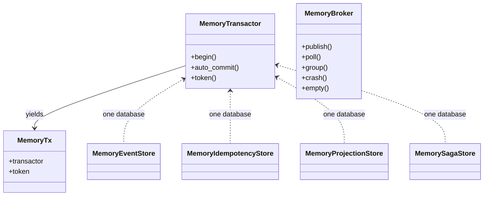
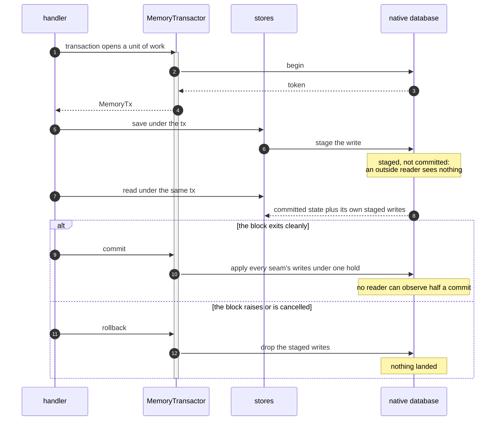
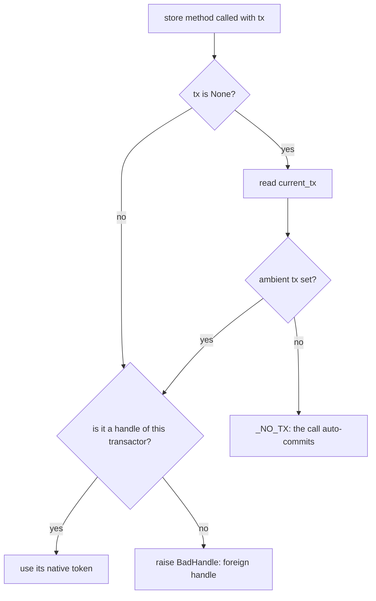

# The in-memory backend

Every seam, in one process, with a transaction that commits and rolls back for real.

`edax.backend.memory` is the reference backend: it is what the test suites run against, and what a
durable backend is compared to. One `MemoryTransactor` is one database; the stores built over it
share that database, so their writes under one `tx` land together or vanish together. It is for
development and tests. It is not durable.



## What it provides

| Class | Seam | Notes |
|---|---|---|
| `MemoryTransactor` | `Transactor` | the transaction boundary; `begin()` yields a `MemoryTx` to `edax.transaction` |
| `MemoryTx` | the handle | a frozen dataclass of the transactor plus the native token |
| `MemoryEventStore` | `EventStore` | events, snapshots and the outbox; is itself a `Transactor`, so `transaction(store)` works; `append` stamps `recorded_at` from `now=` (default: the kernel clock) |
| `MemoryIdempotencyStore` | `IdempotencyStore` | the atomic claim over the transactor's database; declares `joins_transaction = True`; `complete` and `release` are fenced on the claim's handle, `forget(key)` deletes a settled record, `expire(key)` lapses a key, and `put_raw(key, raw)` stores unchecked bytes |
| `MemoryLedger` | `IdempotencyStore` | wraps a `MemoryIdempotencyStore` on a database of its own: ignores `tx`, lands every call at once, declares `joins_transaction = False`, the ordering a Redis ledger has; `expire` and `put_raw` forward to the store it wraps |
| `MemoryProjectionStore` | `ProjectionStore`, `ProjectionQuery` | one read model, named by the required `projection=`; read models over one transactor share no row, as the Postgres table keys `(projection, id)`; `get_many` runs the kernel query, so it is the reference for how a durable backend must page; every read carries the row key as `"id"` |
| `MemorySagaStore` | `SagaStore` | per-instance state with optimistic concurrency, a tombstone on completion, and each saga's outbox of `CommandMessage`s, all keyed by the saga's name; `unpublished_count(saga)` counts one saga's backlog |
| `MemoryCommandOutbox` | command outbox | the commands a unit of work decided, staged under its transaction and drained by a `Relay` |
| `MemoryBroker` | `Producer` and `Consumer` | `Relay(store, broker.publish)` and `broker.run(dispatcher)` with no infrastructure; a partitioned log of events and commands that behaves like a Kafka topic |

Only the waiting is Python's. The maps, the version checks, the outbox, the atomic claim, the
transaction journal and the broker's settlement accounting live in the native `edax-memory` crate.
Every software development kit (SDK) shares them, so the two bindings cannot drift. Each native
object is bound to the operating-system thread that built it: a call from another thread raises the
terminal `BadHandle`, rather than the binding's own panic.

The Rust reference model ships the same set over the same crate: `MemoryTransactor`, `MemoryTx`,
`MemoryEventStore`, `MemoryIdempotencyStore`, `MemoryLedger` (`Tx = ()`), `MemoryProjectionStore`,
`MemorySagaStore`, `MemoryCommandOutbox` and `MemoryBroker`. There `MemoryTx` is the crate's own typed
token, `edax_memory::Tx`, a plain `Copy` value, and the no-transaction handle is
`MemoryTx::auto_commit()`, which is also its `Default`. A binding crosses the token as the number its
host holds and converts it at the boundary.

## The transaction is real

`MemoryTransactor` implements a real transaction. It stages every write made under a token, applies
them together on commit, and drops them on rollback, so a test can assert that a raise left nothing
behind. The `Transactor` docstring names this backend for that reason.



Cancellation is a rollback too. The boundary catches `BaseException`, not `Exception`, so a
`wait_for` timeout cannot leave half a unit of work committed.
`test_transactor.py::test_a_cancelled_unit_of_work_rolls_back` asserts it.

Four tests execute the contract against this backend. The Rust SDK runs the same four. A raise
leaves nothing behind. A rolled-back claim releases its key. A transaction reads its own writes that
nobody else sees. A commit makes every participant's write visible together.

## Handle resolution, and the foreign handle

Every store method resolves its handle the same way, through `MemoryTransactor.token`:



`tx`, else the ambient `current_tx(self)` of its own database, else `_NO_TX`. That is the token that
names no transaction: under it a write lands at once and a read sees committed state only.

A handle belonging to another transactor is refused with `BadHandle`, never auto-committed:

```python
raise BadHandle(
    f"tx {tx!r} is not a transaction of this MemoryTransactor: build every memory store "
    "that must commit together over one MemoryTransactor"
)
```

A store cannot enlist in a unit of work its database knows nothing about. Going on would drop the
atomicity the caller asked for, with no error. The refusal applies to any explicit
handle, including one from a hand-written test `Transactor`. Another database's ambient unit of work is
never this store's to see: `current_tx(self)` reads only this database's. A store called inside a
`transaction` over another database therefore runs outside any unit of work of its own.

`MemoryTransactor.auto_commit()` is the explicit no-transaction handle, for a reader that must look
past an open unit of work, such as a test probing what has landed.

## `joins_transaction = True`, and what it unlocks

`MemoryIdempotencyStore` declares `joins_transaction: ClassVar[bool] = True`. It may, because
`token` refuses a foreign handle with `BadHandle`, the refusal the contract demands of a store that
declares it. The refusal is terminal, because no number of retries
rewires a store built over the wrong transactor.

The declaration selects the guard's shared-ledger ordering; see
[idempotency](../sdk/idempotency.md#the-two-modes). A claim that rolls back with its events
releases the key. The next
dispatch runs the handler again instead of replaying an outcome that never landed. It deposits once,
not twice. This is the Idempotent Consumer pattern: a dedup table beside the business change, in one
commit.

## Test on the ordering you deploy: `MemoryLedger`

The guard has two orderings, and they behave differently where it matters
([idempotency](../sdk/idempotency.md#the-two-modes)). A ledger that joins your transaction runs
`begin; claim; run; complete; commit`. A terminal failure rolls back with the work and is not
cached, so a redelivery runs the handler again. A ledger of its own, such as Redis, runs `claim;
begin; run; commit; complete`. There a terminal failure is cached, so a redelivery raises
`CachedFailure`. A claim
can lapse while the handler runs. A `complete` whose reply is lost leaves a settled record, and the
guard's release must not delete it.

`MemoryLedger()` is that second shape in memory, so a suite rehearses it without Redis:

```python
from edax.backend.memory import MemoryLedger

ledger = MemoryLedger()  # a database of its own; ignores tx; joins_transaction = False
bus = CommandBus(idempotent(ledger, scope="accounts", tenancy=Tenancy.SILO, unit_of_work=db))
```

**Claims are fenced, as Redis fences them.** `claim` returns a handle naming that claim. `complete` writes
only while the key still holds the claim the handle names, or already holds the same record that same
claim settled. The same bytes another claimant settled are its record, not this one's. Otherwise it
raises `StoreError`. `release` deletes only that claim, and is a no-op otherwise. So a release after a
`complete` whose reply was lost keeps the record. Both memory stores share the fence: it is the native
store's.

**`expire(key)` is the lease running out.** It lapses whatever the key holds in committed state: a claim
or a settled record. A test can then force the takeover a claim TTL produces. Worker A's claim lapses
mid-handler. Worker B claims and runs. A's late `complete` is refused, and B's outcome stands. A claim
staged by an open unit of work is not committed, so it does not lapse. A delete staged by an open unit of
work goes with the lapse. What it deletes is gone, and its commit must not erase the claim that took over. The same contract clauses run over
`MemoryLedger` and the Redis store (`test_contract_memory.py`, `test_redis.py`). `test_memory_ledger.py`
drives each scenario through the guard over both and asserts the same outcome.
`examples/py/15_lease_takeover.py` walks through the takeover one step at a time.

**`put_raw(key, raw)` is another writer's damage.** It stores bytes as the key's settled record in
committed state, unchecked: a torn write, another layout, a field of the wrong type. The next claim reads
them as the kernel does, a cached `codec` failure, so a test can rehearse a corrupted ledger row. A key an
open unit of work holds is refused with `ConcurrencyError`. It is one write under the database's lock, so
no claim can land between the lapse and the overwrite. Rust has the same hook on both memory stores; both
call `edax-memory`'s one `put_raw`.

**`forget(key)` is the re-drive.** It deletes a settled record, so the next claim of the key wins and
the handler runs again. The kernel's
[forget decision](../kernels/cqrs.md#forget--deleting-a-settled-record) says which records it
deletes. Under an open transaction the delete is staged, and holds the key
until the transaction ends. A key another open transaction
holds reads as pending, as it does for a claimant.

## Isolation by exclusion, and `masked_pending`

A durable store parks a second writer on a row lock. An in-memory store driven from one event loop
cannot park anyone without deadlocking the loop, so it reports the conflict instead. One open
transaction may stage an aggregate's stream, a projection id, an idempotency key or a saga
instance id. That key is held until the transaction ends. A second writer gets `ConcurrencyError` at once.

For the ledger, that exclusion replaces the row lock. A claim on a held key does not block and does
not win: it loses, and reads back the holder's record re-masked as pending. The function is
`masked_pending`:

```rust
fn masked_pending(bytes: &[u8], claimant_hash: u64) -> Result<Vec<u8>, Error> {
    let held = edax_cqrs::decode_prior::<Value>(bytes, claimant_hash);
    edax_cqrs::encode_record(&edax_cqrs::Record::<Value>::pending(held.payload_hash))
}
```

It reads the holder's staged record as the kernel does, keeps its `payload_hash`, and returns a fresh
`pending` record. Bytes no reader can decode are masked too, under the hash `decode_prior` reads from
them. The holder may still roll back, so whatever it has staged is not an outcome to replay, not even
as a cached failure. The loser sees `pending`, and the guard raises `InProgress`, which the contract
allows as the alternative to blocking.

Two related rules live in `release`, which only ever drops the claim its handle names. With nothing
committed for the key, a release drops the transaction's own staged claim and stages nothing. There is no
row to delete, so nothing is held. A winner that commits meanwhile keeps its record. Over a committed
claim, a release stages a delete. That delete holds the key until the transaction ends, as a row lock
would. A claimant reads it as `pending`, and a second writer conflicts. Either way, a key released inside
your own transaction is free again for you. A settled record is nobody's claim, so no release deletes it.

This is the one effect an uncommitted transaction shows from outside. The contract test names it
`HELD`: nothing is visible, but the claim key is taken, so a probing claimant loses and reads
pending.

`InProgress` is exempt from the dispatcher's dead-letter count for this reason. See
[consuming](../sdk/consuming.md#inprogress-is-contention-not-a-failed-attempt).

## Diagnosing an abandoned token

`MemoryTransactor.open_count()` reports how many transactions are still unsettled
(`MemoryEventStore.unpublished_count()` is the outbox's backlog, counted natively). A count that
never returns to zero means a token was abandoned. Its keys are then a permanent conflict, not a
held key another writer can wait out. Rust's `transaction` rolls back if the body panics, so a
panicking handler does not abandon a token.

## The broker is a log

`MemoryBroker(partitions=1, *, tenancy=Tenancy.SILO)` is a partitioned, append-only log, settled through the Kafka kernel's
`OffsetTracker`. It does to a handler what Kafka does, so a handler that only survives a queue fails
here first and not in production.

- **A nack rewinds the partition.** The nacked message and every later one of its partition come
  back, in order, acked or not. Nack `a-1` after `a-2` was acked, and both come back. The deliveries
  of the partition already handed out are retired (`Delivery.live` is `False`), so the dispatcher
  skips them and a key never runs ahead of itself.
- **`crash()` is a consumer that died.** Every delivery the group holds is retired, and every message
  above its committed watermark is fetched again. Use it to prove a handler survives a restart or a
  rebalance.
- **`group(name)` is another consumer group.** It reads the same log, gets every message, starts at
  the beginning and settles on its own. A projection and a saga on one broker each get their own
  group, as they would on Kafka, instead of competing for each message.
- **Order holds per key, not across keys,** once there is more than one partition. A key lands on
  Kafka's partition for it. The key is the one `KafkaProducer` writes: the kernel's
  [ordering key](../kernels/event.md#the-ordering-key), composed with the message's tenant where
  `tenancy` composes keys. A command lands beside the events of the aggregate it targets, and two
  tenants' same-named aggregates under a pool take the partitions Kafka gives them. A pooled message
  with no tenant raises `CodecError`, as on Kafka.
- **A delivery carries either kind.** `publish` takes an `EventMessage` or a `CommandMessage`, and
  `Delivery.message` hands back what was published.

A group commits on every ack that moves its watermark, because a commit costs nothing here.
`empty()` is true only when the group has committed past every message: nothing queued, nothing in
flight, which is the same "nothing left to do" a durable broker reports. `edax.testing.BrokerContract`
holds this broker and the Kafka adapter to the same clauses.

## Limits

This is a development and test backend.

| Limit | Consequence |
|---|---|
| One process's heap | two workers, two containers or two test processes share nothing. Cross-process idempotency needs [redis](./redis.md) or your own durable ledger. |
| No durability | a restart loses every event, snapshot, outbox row, record, saga instance and queued message. |
| No retention policy | records are kept for the process lifetime. Nothing expires by itself; `expire(key)` lapses a key on demand, so a test decides when a lease or a retention TTL runs out. |
| No blocking | a second writer conflicts immediately rather than waiting; a claimant gets `InProgress` where a durable store would block until the winner's transaction resolves and then read its record. |
| An abandoned token is a permanent conflict | a token neither committed nor rolled back is not a held key you can wait out. Its keys conflict for the process lifetime. Every SDK's scoped unit of work guarantees a commit or a rollback runs. |
| thread-bound native objects | build and use one transactor's stores on one thread; any other thread gets `BadHandle`. |

`MemoryBroker` has matching limits. `publish` returns once the message is in the log, not once it is
durable. Nothing is ever deleted from the log, which suits a test and not a long-running process. A
group has one consumer: there is no partition assignment between several members of one group.

## See also

- [backends index](./README.md) — the seam contracts and the checklist for writing one.
- [redis](./redis.md) — the cross-process ledger, and what changes when it cannot join your
  transaction.
- [kafka](./kafka.md) — the broker seam over a real broker.
- [transactions](../sdk/transactions.md) — `Transactor`, `current_tx`, `transaction`,
  `joins_transaction`.
- [idempotency](../sdk/idempotency.md) — both guards, both modes, every failure window.
- [testing](../guides/testing.md) — golden vectors, model tests, proptest and Hypothesis.

## Ingestion reference

`edax.ingestion.MemoryIngestionSink` uses the kernel's independent `MemoryIngest` database.
It binds the immutable target contract and atomically applies the same append/upsert plans and
rejection records as PostgreSQL. Keep the sink instance across runner restarts when testing replay.
It is separate from `MemoryTransactor`; ingestion commits own their transaction boundary.
See [microbatch ingestion](ingestion.md) for the API and recovery contract.

## Projection state reference

`edax.projection.MemoryProjectionStateStore` keeps its records and effect intents in the kernel's
`MemoryProjectionState` database. Its transactions take no lock, so none spans the reducer. A commit
instead checks that every record it read still has the version it read, absent ones included. A
racing commit fails with `concurrency` and the runner retries, as a Postgres insert race does.
Delivery pages each partition's oldest eligible intent in turn, the order the Postgres `pending`
statement uses. See [projection processing](../sdk/projection-processing.md) for the API.
