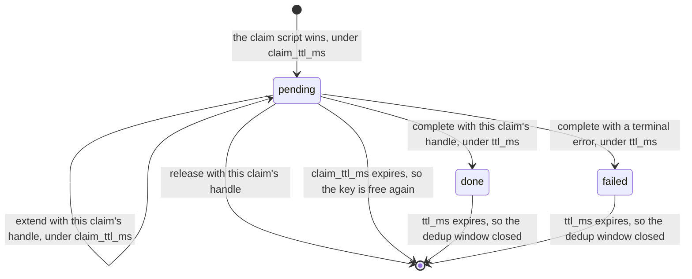
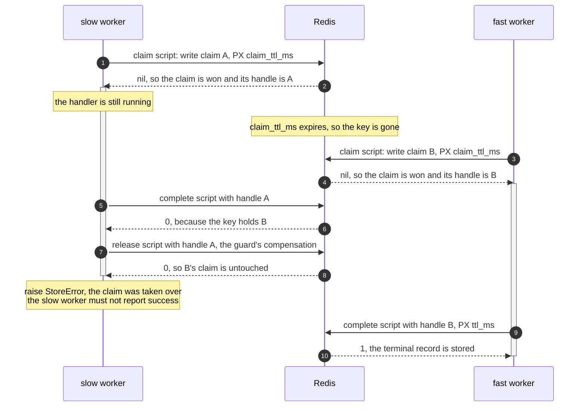

# The Redis backend

`RedisIdempotencyStore`: a cross-process ledger, the two time-to-live values (TTLs) it needs, and
the claim handle that keeps a lapsed worker from overwriting its successor.

Redis backs one seam, `IdempotencyStore`. It is the worked example of a ledger that cannot join the
caller's transaction, and everything below follows from that. The guard must compensate by hand. The guarantee drops to at-least-once with a dedup window. A claim that can expire needs a
fence. Install with `pip install edax[redis]`; the client is yours to construct, with redis-py 8 or
later.



## A ledger of its own

`tx` is accepted and ignored. Redis cannot enlist in another database's transaction, so the store
declares `joins_transaction: ClassVar[bool] = False` and the guard picks the split ordering:

```
claim; begin; run; commit; complete
```

That ordering is what `idempotent(..., unit_of_work=)` runs. Pass no `unit_of_work` and the middle
is just the handler. The host then owns any commit. The claim still lands on its own, so the
compensation below is the same.

Two independent commits, which no ordering can make atomic. The guarantee is therefore
at-least-once over an idempotent handler, with a dedup window the width of `ttl_ms`. This store runs
the own-ledger mode of [idempotency](../sdk/idempotency.md#the-two-modes), which explains why
`complete` runs after the commit. Every failure up to and including the commit releases the claim.

A claim that raises is not compensated. It returned no handle, so
there is nothing to release with. A claim whose reply was lost for good is settled by its claim TTL
instead.

## The key prefix

Every key the store writes is the kernel's `ledger_key(prefix, key)`: `{prefix}{key}` as UTF-8
bytes. `prefix` is required, and an empty one is refused: no default is right for every store,
service and environment. Two services sharing one Redis under one prefix share a key space, and a
bare request id that both use is one claim.

The collision is loud: the two commands hash differently, so the loser gets a terminal
`PayloadMismatch` and dead-letters. It dead-letters an event that was never wrong, though, and
nothing in the guard can tell that apart from a real key reuse. So the parameter has no default: the
decision belongs at wiring time, where the service and the environment are known.

```python
ledger = RedisIdempotencyStore(conn, prefix="billing:prod:idem:")
```

Two pitfalls follow from plain concatenation:

- No separator is added, and concatenation is not injective. Prefix `billing:` with key
  `prod:idem:x` is the same key as prefix `billing:prod:idem:` with key `x`. Give distinct services
  prefixes neither of which starts with the other.
- A `{...}` hash tag in the prefix pins every ledger key to one Redis Cluster slot. That slot's
  shard then serves the whole ledger.

Give each service and environment its own prefix. Within one prefix, each guard's `scope` keeps
guards apart: a command guard claims `claim_key(scope, key)` and an event guard the event id under
its scope, never the raw key. See
[commands.md](../sdk/commands.md#scope-names-the-guard).

## Two TTLs

One shared value cannot bound both states. A pending claim and a terminal record fail in opposite
directions. Too long a pending claim blocks a key nobody is working on. Too short a terminal record
turns a replay into a re-run.

### `claim_ttl_ms`

- Default `300_000`, five minutes.
- It bounds how long a pending claim blocks its key.
- Too small, with no heartbeat: a second worker takes over a claim whose holder is still working.
- Those two runs then overlap.
- Too large: a worker that dies during the handler blocks that key until the claim lapses.
- Every redelivery meanwhile raises `InProgress`.

### `ttl_ms`

- Default `86_400_000`, twenty-four hours.
- It bounds the dedup window for a terminal record.
- Too small: a redelivery inside the window re-runs the handler instead of replaying.
- Too large: records accumulate. See [Durability](#durability) for sizing.

Both are whole milliseconds from 1 to 2^53 - 1, checked by the kernel's `check_config` when the store
is built. A zero, negative or fractional TTL raises the terminal `BadHandle` there, rather than failing
every write on the server.

`claim` writes the pending record under `claim_ttl_ms`; `complete` writes the terminal record under
`ttl_ms`. Retention starts at completion, not at the claim: `complete` issues a fresh `SET ...
PX ttl_ms`, so the dedup window is measured from the moment the outcome was recorded. A completed
record therefore outlives the claim TTL. `test_redis.py::test_complete_branches` asserts both TTLs.

Past the record TTL the key is gone and the same command wins a fresh claim and re-runs; size
`ttl_ms` past the longest redelivery window.

## Lease renewal

One number cannot both exceed the slowest handler run and free a crashed worker's key quickly. So
the store can renew a claim while it is held:

```python
ledger = RedisIdempotencyStore(conn, prefix="billing:prod:idem:", claim_ttl_ms=30_000, heartbeat=True)
```

With `heartbeat=True` the store renews each won claim every `claim_ttl_ms / 3` through the kernel's
extend script, until `complete` or `release` settles it. `op_timeout_ms` must then be under
`claim_ttl_ms / 3`, or the store raises `BadHandle` when built. A renewal that stalls for the whole
deadline delays the next one by that long, and the next must still land before the claim lapses.
With the default `op_timeout_ms=5_000`, that means a `claim_ttl_ms` above 15 000.
A crashed worker stops renewing, so its key frees within `claim_ttl_ms`. `extend(key, handle)` is the same renewal, for a caller that schedules
its own.

A renewal carries the claim's handle like every other write. Once another worker holds the key, the
old owner's renewal is refused: the store logs that the claim was lost and stops renewing. A
transient failure is retried on the next beat; a terminal one stops the renewal.

Renewal narrows the window; it does not close it. A worker paused longer than `claim_ttl_ms` (a
garbage-collection pause, a frozen virtual machine) learns nothing until it wakes, and by then the
key may be another worker's. Checking the lease with the local clock is unsafe across such a pause.
Only a check by the downstream resource closes the gap (see [the limit](#the-limit-this-fences-the-ledger-only)).

## The claim handle

A claim that can expire can be taken over. When the lapsed worker finally finishes, its `complete`
must not overwrite the new holder's claim, and its `release` must not delete it.

### The value and the handle

Each claim writes one value under one key, `{prefix}{key}`:

```
idem:order-7  ->  "1" + "<32 hex chars of owner token>" + "<kernel record JSON>"
```

The first byte is the layout version, `1`. A reader refuses any other version by name rather than
splitting it at the wrong place. The owner token is a universally unique identifier (UUID) version 7
in its simple form: 32 lowercase hexadecimal characters, no hyphens, minted fresh for every claim.

That layout is the `edax-redis` kernel's, not this adapter's, and
`testdata/golden/redis_value.json` pins it. A second software development kit (SDK)'s Redis store
must match it byte for byte to share a ledger. The store therefore calls the kernel for every byte:
`redis_new_claim`, `redis_settled_value`, `redis_claim_outcome`. See
[kernels/redis.md](../kernels/redis.md).

The claim value is the handle. `claim` returns `Won(handle)`, and `handle` is the exact value
the claim wrote. `complete`, `release` and `extend` each send it, and each script writes only while
the key still holds that exact value. Nothing is kept in the store instance. Two claims on one key
in one process are two handles, so a takeover inside one process is fenced like one across two.

One key, not two, because a sibling key holding the token would have an expiry clock of its own.
The two clocks drift apart. A claimant can then win the record while losing the owner. It holds a
claim it can never complete or release. One key, one TTL, one atomic write.

### The scripts

Every write is one script, so the compare and the write are one atomic step. A `GET` followed by a
`SET` from the client leaves the gap the fence exists to close.

The five bodies are the kernel's, and `testdata/golden/redis_scripts.json` is the source of truth for
them byte for byte. A client registers each source once and sends `EVALSHA` after, so an SDK that
reformatted a script would cache a second digest for one fence.
`testdata/golden/redis_fence.json` pins what each one does, row by row, and `test_redis.py` replays
those rows against fakeredis and against a live server.

| Script | Arguments | Writes | Replies |
|---|---|---|---|
| claim | the claim value, the claim TTL | the claim, if the key is free | nil when it wrote, else the value the key holds |
| complete | the handle, the settled value, the record TTL | the settled value, if the key holds the handle or already holds the settled value | `1` when it wrote, `0` otherwise |
| release | the handle | deletes the key, if it holds the handle | `1` when it deleted, `0` otherwise |
| forget | the value read | deletes the key, if it still holds that value | `1` when it deleted, `0` otherwise |
| extend | the handle, the claim TTL | resets the TTL, if the key holds the handle | `1` when it renewed, `0` otherwise |

Every script is idempotent, so a client that sends one again after a lost reply gets the answer the
first send would have had. Each touches one key, so each is safe on Redis Cluster.

### What each operation does with it

#### `claim`

- The kernel's `claim_outcome` reads the reply. Nil means won.
- A reply equal to the caller's own claim value also means won. The first send landed, its
  reply was lost, and redis-py's default retry sent the script again.
- Any other value is the record that holds the key: pending (`InProgress`), or settled (a replay).

#### `complete`

- Writes the settled value under `ttl_ms` while the key holds the handle.
- A re-sent complete finds its own settled value and writes it again, so it succeeds.
- A `0` reply raises `StoreError`: the claim lapsed, and the key is free or another worker's. The
  outcome was not recorded, so the caller must not report success.

#### `release`

- Deletes the key while it holds the handle, and nothing else.
- A release after the claim's own `complete` landed finds the settled value, not the handle, so it
  deletes nothing. That is the guard's compensation after a lost `complete` reply: the record of
  committed work survives, and the redelivery replays it instead of re-running the handler.
- A release after a takeover finds the new holder's claim and deletes nothing.

#### `forget`

- Deletes a settled record, so a re-driven message runs its handler again. An operator calls it
  for a command taken back from a dead-letter queue.
- The store reads the key with `RedisConn.get`, then runs the kernel's
  [read, decide and delete loop](../kernels/redis.md#the-forget-outcome). A key that keeps changing
  raises transient `StoreError` after a few rounds.

#### Malformed handles

- `complete`, `release` and `extend` refuse a handle the kernel never minted before any I/O: empty,
  truncated, a bare token, an upper-case token, a settled value. Each is a terminal `CodecError`.
- `test_redis.py::test_a_handle_the_kernel_never_minted_is_refused_before_any_io` asserts every one.

### Two workers racing a claim TTL expiry



The same holds when both workers are tasks of one process on one store instance.
`test_redis.py::test_two_dispatches_on_one_bus_settle_only_the_live_claim` asserts it through the
guard.

## The limit: this fences the ledger only

A lease cannot protect a resource that does not check the token itself. The fence guards the Redis
key and nothing else.

- **edax's own stores are protected**, because the version compare-and-set is that check.
  `EventStore.append` rejects a write whose expected version moved, and `ProjectionStore.save`
  rejects a write whose entity version moved. The lapsed worker's write fails with
  `ConcurrencyError` rather than landing.
- **Unversioned side effects are not protected.** The fence has no say over a charge to a payment
  gateway. Nor over an email, nor a write to a table with no version column. Give those their own
  idempotency key in the remote system, or their own compare-and-set.

A monotonic fencing token, one the downstream resource could compare, needs a counter that outlives
the expiring key. The store keeps none: no caller needs one, and the handle already fences the
ledger. Sizing `claim_ttl_ms` above the longest handler run, or renewing the lease, is what keeps
the window from opening at all. The fence is the second line, not the first.

## Durability

The ledger is only as durable as the Redis behind it. Four things can drop or shorten a claim or a
record without any error reaching the store: a failover, a restart, eviction and the server clock.

- **Failover.** Redis replicates asynchronously. A claim or a `done` record the primary acknowledged
  can be missing on the replica promoted after it fails. A second worker then wins the key, or a
  redelivery re-runs the handler. Treat failover as one more at-least-once window.
  `test_redis.py::test_an_acknowledged_claim_lost_in_a_failover_is_one_more_at_least_once_window`
  shows the ledger stays consistent through it. Sending `WAIT` after a write makes the loss less
  likely. It does not make Redis a strongly consistent store, so the store does not send it.
- **Restart.** By default Redis acknowledges a write before it reaches the disk. A restart reloads
  what was persisted, and the writes after that are gone. With AOF and the default
  `appendfsync everysec`, that is up to one second of claims and `done` records. With RDB snapshots
  alone, it is every write since the last snapshot, often minutes. With no persistence, it is the
  whole ledger. Treat a restart like a failover: one more at-least-once window. `appendfsync always`
  syncs the file before it replies, so an acknowledged write survives a restart, at a cost in
  throughput.
- **Eviction.** Every ledger key carries a TTL, so the `volatile-*` and `allkeys-*` eviction policies
  may evict live claims and records under memory pressure. Dedup is then lost with no error. Run the
  ledger's database with `maxmemory-policy noeviction`, where a full database refuses writes with a
  transient `OOM` error instead.
- **The server clock.** The TTL is relative on the wire, so client clock skew does not matter. Redis
  stores the expiry as an absolute time and checks it against the server's own clock. A forward step
  of that clock expires every pending claim at once, and a promoted replica applies its own clock.
  Keep NTP slewing, not stepping, on the Redis hosts.

**Sizing.** The number of keys is bounded by `ttl_ms` times the dispatch rate. At 1,000 dispatches
per second and the 24-hour default that is about 86 million keys. At roughly 200 bytes per key,
which is an estimate, that is about 17 GB.

## Errors

| Situation | Raised | Kind |
|---|---|---|
| a refused setting: an empty prefix, a TTL that is not a positive whole number, a sync client | `BadHandle`, when the store or adapter is built | terminal |
| a connection failure, a client timeout, a passing server state (`READONLY` during a failover, `LOADING`, `BUSY`, `OOM`) | `StoreError`, naming the operation and the key | transient: the claim is released and retried |
| no reply within `op_timeout_ms` | `StoreError`, "no reply within N ms" | transient |
| `WRONGTYPE`: something other than a ledger value under the key | `CodecError` | terminal |
| a refused command or credential (`ERR`, `NOPERM`, `NOAUTH`, `WRONGPASS`) | `BadHandle` | terminal |
| a stored value that will not decode, or is not UTF-8 | nothing on `claim`: it reads as the kernel's unreadable record, and the guard raises `CachedFailure` of code `codec` | terminal: the handler never runs again for the key, and the value stays until its TTL |
| a result the record codec cannot serialize | `CodecError`, raised before any write | terminal |
| a handle the kernel never minted | `CodecError`, raised before any write | terminal |

A Redis error reply is classified by the kernel's `reply_error`, from the reply's prefix, so every SDK
sharing a ledger gives it one verdict. `test_redis.py::test_a_client_failure_carries_the_kernels_verdict`
asserts each row.

`complete` encodes the record before it touches Redis. An unencodable result stays the terminal
`CodecError`. It is not retyped as a transient `StoreError` and redelivered forever.

### The deadline

`op_timeout_ms` (default `5_000`) bounds each script call, the client's own retries included. redis-py
8 sends a command up to eleven times on a connection error, each with a five-second socket timeout,
so one call could otherwise block for about a minute. Under the SDK's `retry` and a dispatcher's
redelivery those retries multiply. The deadline makes the store, not the client, own the bound.

A deadline that fires does not undo the call. The script may still run once the server answers, so a
timed-out `complete` can land after the caller saw `StoreError`. The guard's release then finds the
settled value and deletes nothing, and the redelivery replays it.
`test_redis_live.py::test_settlement_sent_into_a_frozen_server_never_loses_a_landed_record` asserts it
against a paused server.

## The `RedisConn` seam

The store is written against a two-method Protocol, not against a client:

```python
class RedisConn(Protocol):
    async def eval(self, script: str, keys: Sequence[bytes], args: Sequence[ScriptArg]) -> Any: ...
    async def get(self, key: bytes) -> Any: ...
```

`get` is a plain `GET` of one key, and only `forget` sends it. Every write is an `eval`. `script` is
one of the five kernel bodies, which the store passes as given. A connection sends it as
is, so every connection runs the kernel's bytes and none re-derives the fence. A connection may raise
an `EdaxError` for a failure it can classify; the store types anything else as transient
`StoreError`.

`AsyncRedisClient` adapts a caller-owned `redis.asyncio.Redis` or `RedisCluster` (redis-py 8 or
later). It registers each script on first use, so every call sends a digest. It refuses a sync client
when built. It hands a Redis error reply, prefix included, to the kernel's `reply_error`. redis-py
strips a known prefix from the message and keeps it in `status_code`, which is why redis-py 8 is
the floor.

The fast test suite runs this store against fakeredis, which runs each script in an embedded Lua
interpreter, so no test re-implements the fence. With `EDAX_REDIS_URL` set the same tests also run
against that server. `test_redis_live.py` then adds the faults only a real server has: a reply
dropped on the wire, real-time lease expiry, a paused container. The claim, complete and release
contract also runs under `P2` of `test_model.py`, parameterized over `["memory", "redis"]`.

## See also

- [backends index](./README.md) — the seam contracts and the checklist for writing one.
- [kernels/redis.md](../kernels/redis.md) — the key, the value, the handle, the scripts and the reply
  verdicts, decision by decision.
- [memory](./memory.md) — the ledger that does join the transaction, and what that changes.
- `examples/py/16_redis_ledger.py` — the guard over this store, against a real Redis when
  `EDAX_REDIS_URL` is set.
- [idempotency](../sdk/idempotency.md) — both guards, both modes, every failure window.
- [transactions](../sdk/transactions.md) — `joins_transaction` and the two guard orderings.
- [errors](../sdk/errors.md) — why `CodecError` is terminal and `StoreError` is not.
- [delivery guarantees](../guides/delivery-guarantees.md) — where the dedup window sits end to end.
