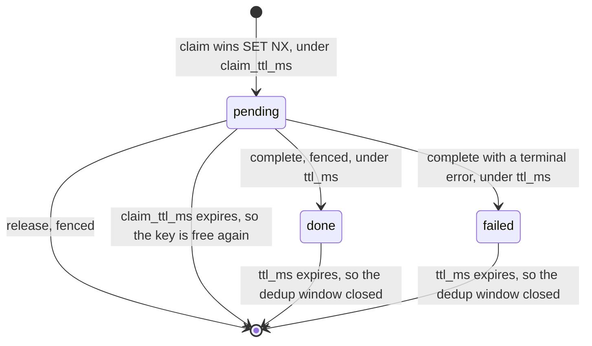
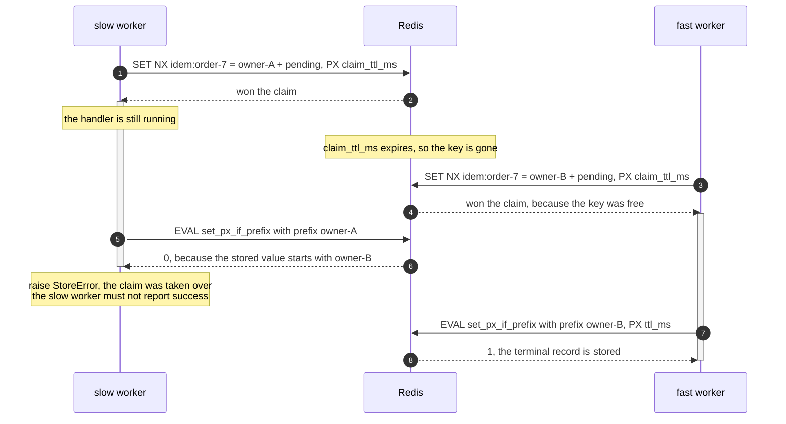

# The Redis backend

`RedisIdempotencyStore`: a cross-process ledger, the two time-to-live values (TTLs) it needs, and
the fence that keeps a lapsed worker from overwriting its successor.

Redis backs one seam, `IdempotencyStore`. It is the worked example of a ledger that **cannot** join
the caller's transaction. Everything below follows from that one fact. The guard must compensate by
hand. The guarantee drops to at-least-once with a dedup window. A claim that can expire needs a
fence. Install with `pip install edax[redis]`; the client is yours to construct.



## A ledger of its own

`tx` is accepted and ignored. Redis cannot enlist in another database's transaction, so the store
declares `joins_transaction: ClassVar[bool] = False` and the guard picks the split ordering:

```
claim; begin; run; commit; complete
```

That ordering is what `idempotent(..., unit_of_work=)` runs. Pass no `unit_of_work` and the middle
is just the handler. The host then owns any commit. The claim still lands on its own, so the
compensation below is the same.

Two independent commits, which no ordering can make atomic. The guarantee is therefore
**at-least-once over an idempotent handler, with a dedup window the width of `ttl_ms`**. This store
runs the own-ledger mode of [idempotency](../sdk/idempotency.md#the-two-modes).

`complete` runs **after** the commit deliberately. Before it, a crash in between would leave a
`done` record for work that never landed, which is silent loss. After it, the worst case is a re-run
on redelivery. Every failure up to and including the commit releases the claim.

One asymmetry is worth knowing: a claim that *raises* is deliberately not compensated. The guard
cannot tell a lost insert response from another claimant holding this key. Releasing in the second
case would delete the winner's live claim. A claim whose response was lost is settled by retention
instead.


## The key prefix

Every key the store writes is `{prefix}{key}`, and `prefix` is required: there is no default,
because no default is right for every store, service and environment. Two services sharing one
Redis under one prefix share a key space, and a bare request id that both use is one claim.

The collision is loud rather than silent: the two commands hash differently, so the loser gets a
terminal `PayloadMismatch` and dead-letters. It dead-letters an event that was never wrong, though,
and nothing in the guard can tell that apart from a genuine key reuse. That is why the parameter
has no default: the decision belongs at wiring time, where the service and the environment are
known.

```python
ledger = RedisIdempotencyStore(conn, prefix="billing:prod:idem:")
```

Give each service and environment its own prefix. Namespacing the *key* by command type is a
separate job and belongs to your key function — see
[commands.md](../sdk/commands.md#the-key-namespace-is-yours).

## Two TTLs

One shared value cannot bound both states. A pending claim and a terminal record fail in opposite
directions. Too long a pending claim blocks a key nobody is working on. Too short a terminal record
turns a replay into a re-run.

### `claim_ttl_ms`

- Default `300_000`, five minutes.
- It bounds how long a pending claim blocks its key.
- Too small: a second worker takes over a claim whose holder is still working.
- Those two runs then overlap.
- Too large: a worker that dies during the handler blocks that key until the claim lapses.
- Every redelivery meanwhile raises `InProgress`.

### `ttl_ms`

- Default `86_400_000`, twenty-four hours.
- It bounds the dedup window for a terminal record.
- Too small: a redelivery inside the window re-runs the handler instead of replaying.
- Too large: records accumulate. That is all.

Read `RedisIdempotencyStore.__init__` for the defaults.

`claim` writes the pending record under `claim_ttl_ms`; `complete` writes the terminal record under
`ttl_ms`. **Retention starts at completion**, not at the claim: `complete` issues a fresh `SET ...
PX ttl_ms`, so the dedup window is measured from the moment the outcome was recorded. A completed
record therefore outlives the claim TTL.
`test_redis.py::test_a_completed_record_outlives_the_claim_ttl` asserts that.
`test_a_pending_claim_expires_on_the_claim_ttl_not_the_record_ttl` asserts the converse.

**`claim_ttl_ms` must exceed the longest handler run.** A handler that outruns it loses its claim
while still working. There is no lease extension. This store cannot renew a claim the way
`ChangeMessageVisibility` renews an Amazon Simple Queue Service (SQS) receipt. This setting is the
only defence. The default is a tuning value, not a constant. It is anchored to a broker's own poll
interval. Kafka's `max.poll.interval.ms` is also five minutes. A handler that outruns one outruns
the other too.

Past the record TTL the key is gone and the same command wins a fresh claim and re-runs; size
`ttl_ms` past the longest redelivery window.

## The fence

A claim that can expire can be taken over. When the lapsed worker finally finishes, its `complete`
must not overwrite the new holder's claim, and its `release` must not delete it.

### The owner token and the single-key layout

Each claim writes a fresh 32-character hex token, `secrets.token_hex(16)`, in front of the kernel's
record JSON, under one key `{prefix}{key}`:

```
idem:order-7  ->  "<32 hex chars of owner token><kernel record JSON>"
```

The store keeps the tokens for the claims *this instance* holds in `self._owned`, dropping each as
it is settled. A key absent from that map was never won by this caller, so it has nothing to settle.
Reading a prior record strips the first 32 characters, accepting `bytes`, `bytearray` or `str`
because a client built with `decode_responses=True` answers with `str`.

**Why one key and not two.** A sibling key holding the token would have an expiry clock of its own.
The two clocks drift apart. A claimant can then win the record while losing the owner. It holds a
claim it can never complete or release. One key, one TTL, one atomic write.

This layout is a **backend** convention, not a kernel one. It is what a second software development
kit (SDK)'s Redis store would have to match byte for byte to share a ledger. It lives in the backend
because no other binding ships one. When a second binding does ship one, the token belongs in the
kernel's record instead.

### The compare-and-write

Both fenced operations are one `EVAL`. A `GET` followed by a `SET` leaves exactly the gap the fence
exists to close. The claim can expire and be taken over between the two calls.

```lua
if redis.call('GETRANGE', KEYS[1], 0, #ARGV[1] - 1) == ARGV[1] then
  return redis.call('SET', KEYS[1], ARGV[2], 'PX', ARGV[3]) and 1 or 0
end
return 0
```

```lua
if redis.call('GETRANGE', KEYS[1], 0, #ARGV[1] - 1) == ARGV[1] then
  return redis.call('DEL', KEYS[1])
end
return 0
```

`GETRANGE` reads only the token's width, compares it to the caller's token, and writes only on a
match. Both return `0` when the key is absent or carries a different prefix, which is how a caller
learns its claim was taken over.

### What each operation does with it

#### `complete`

- Holding the claim: `set_px_if_prefix` under `ttl_ms`.
- On a `False` return it raises `StoreError`, and it keeps its token.
- A `False` return means the outcome was not recorded, so the caller must not report success.
- The token is kept because the guard answers a refused `complete` with `release`. That `release`
  must stay fenced, or its `DEL` would delete the claim that replaced this one.
- Holding no claim: a plain `SET ... PX ttl_ms` with a fresh token.
- That is a direct write, not a guarded dispatch. The seam's plain `complete` means exactly that.

#### `release`

- Holding the claim: `delete_if_prefix` deletes its own claim and nothing else.
- Holding no claim: a plain unconditional `DEL`.
- That is an out-of-band delete, or a cleanup after a `complete` that already landed.

`complete` refuses to overwrite a taken-over claim. The outcome it carries belongs to a run nobody
is waiting for any more. Erasing the new holder's claim would destroy an outcome another worker is
still producing. It raises on purpose.
`test_redis.py::test_a_worker_that_lost_its_claim_cannot_complete_over_the_new_holders` asserts it.

`release` is the path that silently loses work when it is unfenced. A bare `DEL` frees a key another
worker is actively holding. Two handlers then run for it. This is why a refused `complete` keeps its
token. The compensating `release` that follows is then fenced, and its `delete_if_prefix` is a
no-op against the new holder's prefix.
`test_redis.py::test_a_refused_complete_keeps_the_fence_for_the_compensating_release` asserts it.

### Two workers racing a claim TTL expiry



Without the fence, step 9 would overwrite the fast worker's live claim. The outcome it writes is one
nobody is waiting for. A later replay would return it.

## The limit: this fences the ledger only

A lease cannot protect a resource that does not check the token itself. The fence guards the Redis
key and nothing else.

- **edax's own stores are protected**, because the version compare-and-set *is* that check.
  `EventStore.append` rejects a write whose expected version moved, and `ProjectionStore.save`
  rejects a write whose entity version moved. The lapsed worker's write fails with
  `ConcurrencyError` rather than landing.
- **Unversioned side effects are not protected.** The fence has no say over a charge to a payment
  gateway. Nor over an email, nor a write to a table with no version column. Give those their own
  idempotency key in the remote system, or their own compare-and-set.

Sizing `claim_ttl_ms` above the longest handler run is what keeps the window from opening at all.
The fence is the second line, not the first.

## Errors

| Situation | Raised | Kind |
|---|---|---|
| any client failure — connection reset, timeout | `StoreError`, naming the operation and the key, chaining the client's exception | transient: the claim is released and retried |
| a stored record that will not decode | `CodecError` | terminal: retrying would loop until the TTL |
| a result the record codec cannot serialize | `CodecError`, raised **before** any write | terminal |
| the key vanishes between `SET NX` and `GET`, three times | `StoreError`, "record vanished on 3 attempts" | transient |

Client calls are wrapped by `_as_store_error`;
`test_redis.py::test_client_failure_maps_to_store_error` asserts the mapped cases.
`test_claim_of_an_unreadable_record_is_terminal` and
`test_complete_of_an_unencodable_result_is_terminal` assert the terminal ones.

`complete` encodes the record before it touches Redis. An unencodable result stays the terminal
`CodecError`. It is not retyped as a transient `StoreError` and redelivered forever.

The `SET NX` then `GET` retry exists because the winner's record can vanish between the two calls —
the TTL expiring, or a concurrent release. Treating a missing record as "no prior" would report a
win that never happened, so the claim retries instead. The loop is bounded by `_CLAIM_ATTEMPTS = 3`;
a key that never materializes fails fast rather than spinning the dispatch.

## The `RedisConn` seam

The store is written against a six-method Protocol, not against a client. Any async Redis client
fits, and the tests run against an in-memory fake with a settable clock:

```python
class RedisConn(Protocol):
    async def get(self, key: str) -> Optional[bytes]: ...
    async def set_px(self, key: str, value: bytes, ttl_ms: int) -> None: ...
    async def set_nx_px(self, key: str, value: bytes, ttl_ms: int) -> bool: ...
    async def delete(self, key: str) -> None: ...
    async def set_px_if_prefix(self, key: str, prefix: bytes, value: bytes, ttl_ms: int) -> bool: ...
    async def delete_if_prefix(self, key: str, prefix: bytes) -> bool: ...
```

`set_nx_px` is the atomic claim (`SET key value NX PX ttl`). `get`, `set_px` and `delete` are plain
`GET`, `SET ... PX ttl` and `DEL`. The two `*_if_prefix` operations **must be atomic**; a read
followed by a write is the race they exist to close.

`AsyncRedisClient` adapts a caller-owned `redis.asyncio.Redis`. Two details a reimplementation must
copy:

- redis-py returns `True` when `SET ... NX` stored the value and `None` when it did not, so
  `set_nx_px` coerces with `bool(...)`. Reading `None` as "won" would run every handler twice.
- The per-call timeout is the client's, not the adapter's. Construct the client with
  `socket_timeout` and `socket_connect_timeout` set, or a dispatch blocks on the claim for as long
  as the socket hangs.

The claim, complete and release contract runs against this store under `P2` of `test_model.py`. That
property is parameterized over `["memory", "redis"]`. The same random histories check both backends
against one reference model.

## See also

- [backends index](./README.md) — the seam contracts and the checklist for writing one.
- [memory](./memory.md) — the ledger that *does* join the transaction, and what that changes.
- [idempotency](../sdk/idempotency.md) — both guards, both modes, every failure window.
- [transactions](../sdk/transactions.md) — `joins_transaction` and the two guard orderings.
- [errors](../sdk/errors.md) — why `CodecError` is terminal and `StoreError` is not.
- [delivery guarantees](../guides/delivery-guarantees.md) — where the dedup window sits end to end.
