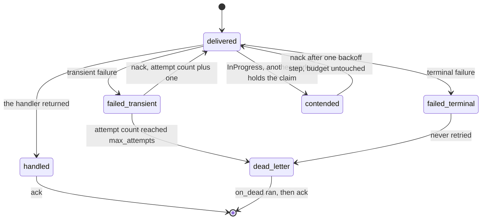

# Delivery guarantees

What guarantee holds at every hop from a caller's request to a read model. What makes each one hold.
What a host must do to claim effectively-once for its own database state.

Nothing in this pipeline is exactly-once, and `edax` never promises it. Each hop is either atomic
(one transaction) or at-least-once with something downstream that removes the duplicate. Every
duplicate is detectable, and detection is a kernel decision, so two services reach the same verdict.

```mermaid
flowchart LR
    A["caller"] -->|"at-least-once: the caller may retry"| B["CommandBus"]
    B -->|"one claim per idempotency key"| C["handler"]
    C -->|"at-most-once per aggregate id and sequence"| D["EventStore"]
    D -->|"atomic: same transaction"| E["transactional Outbox"]
    E -->|"at-least-once: crash before mark_published re-publishes"| F["Relay"]
    F -->|"at-least-once, ordered per aggregate id"| G["broker"]
    G -->|"at-least-once, per-key order"| H["KeyOrderedDispatcher"]
    H -->|"at-least-once, bounded, then dead-letter"| I["event handler"]
    I -->|"one write per expected row version; guard deduplicates events"| J["ProjectionStore"]
```

## Hop by hop

### caller to `CommandBus`

- Delivery: at-least-once. The caller retries a lost response.
- Safe because the caller sends the same idempotency key on every retry of one intent:
  `dispatch(cmd, idempotency_key=...)`.
- The `idempotent` guard claims `claim_key(scope, key)` atomically.
- The kernel rules on the reuse: proceed, replay, or `PayloadMismatch`.
- Skip it and a retried submit runs the handler twice, so it deposits twice.

### `CommandBus` to handler

- Delivery: exactly one handler per command type. `retry` re-runs a whole unit of work.
- Safe because `retry` sits outside a guard given `unit_of_work`, so a failed attempt rolls back
  its claim and its writes together.
- The next attempt claims again in a fresh unit of work, from committed state.
- `retry` refuses to run inside an open transaction. A second attempt there would apply the first
  attempt's staged writes again, and one commit would land both.

### handler to `EventStore`

- Delivery: at-most-once per `(aggregate_id, sequence)`.
- Safe because `append` is a database-enforced compare-and-set on the version.
- It writes only if the stored version equals `expected_version`.
- Otherwise it raises `ConcurrencyError` and writes nothing.
- A read-then-write check in Python passes for two writers on separate connections, and the stream
  forks.

### `EventStore` to transactional Outbox

- Delivery: atomic.
- Safe because the event rows and their outbox rows commit together in the caller's `tx`.
- A rollback removes both.
- An outbox in a second store lets committed state and published events diverge.
- A publish inside the handler does the same.

### `Relay` to broker

- Delivery: at-least-once.
- Safe because `publish` returns only after every in-sync replica acked (Kafka `acks="all"`, which
  `enable_idempotence=True` implies). An ack from the leader alone is lost with the leader.
- Rows stay unmarked until `mark_published`, which is idempotent.
- Return before the ack and you mark a row published for a message that does not exist. That is a
  lost event.
- Two relays on a non-leasing `unpublished` double-publish. Overlapping drains of one relay take
  turns.
- Order is per key, the row's tenant and aggregate. A row whose publish fails holds back the rows
  behind it of its own key; the other keys go on, and every row the drain settled is marked. A second
  transient failure with no publish between them stops the batch: the broker is likely down.
- A poison row goes to `on_dead` (terminal, or at `max_attempts`) instead of stalling the outbox.
  Any other failure is handed back after a growing backoff step.
- A saga's commands ride the same relay from the saga outbox. They are written with the step's
  state and sent only once that write committed. A fold that lost a version race sends nothing.
- Commands a handler stages with `Repository.save(..., commands=[...])` ride a relay from the
  command outbox the same way. They commit with the events or not at all.

### broker to `KeyOrderedDispatcher`

- Delivery: at-least-once, per-key order.
- The key is the kernel's [ordering key](../kernels/event.md#the-ordering-key).
- `ack` settles only that message. On an offset broker that is a per-partition watermark below the
  lowest unacked offset.
- `nack` redelivers. On a log it rewinds the partition and retires the deliveries of it already handed
  out, so the key keeps its order. Every delivery is settled at most once; a retired one not at all.
- A bare "commit the current position" acks unsettled messages and loses them on restart.
- Nothing redelivers a delivery left unsettled while the consumer lives. A raising dead-letter sink
  and a poison message therefore nack, after a backoff step.
- A rebalance commits, resets the revoked partitions and waits for the running handlers, so no key
  runs on two members at once.

### `KeyOrderedDispatcher` to handler

- Delivery: at-least-once, bounded, then dead-letter.
- The worker is `partition(ordering_key, workers)`, so one aggregate stays first in, first out
  (FIFO) on one worker.
- Per-key order holds through a nack on a broker that rewinds: the worker skips a delivery that is no
  longer live. On a broker that requeues behind later messages, it holds for successful deliveries
  only.
- `max_attempts` plus `on_dead` bound redelivery. A terminal error dead-letters on the first
  failure.
- Without `on_dead` a raising handler nacks forever and the broker redelivers forever, at the capped
  backoff. `KafkaConsumer.run` refuses that.
- A successful dead-letter sink acknowledges the failed event, so later events can advance the key
  past a gap. The relay also advances after a successful dead-letter.
  A later redrive can fall below a saga or projector's sequence watermark and be skipped.
  Strict processing order requires stopping before acknowledgement and resolving the gap before
  resuming; there is no durable per-key parking mode. Kafka rewinds affect the whole partition.

### handler to `ProjectionStore`

- Concurrency: one successful write per expected row version.
- `save` is a database-enforced compare-and-set on `entity.version`.
- A redelivery can reload the new version and fold again; the version check alone does not deduplicate events.

The consume path gets its deduplication from `idempotent_by_id`, which claims `msg.id` under the
consumer's `scope` in the same ledger and reaches the same kernel verdict the command bus does.
The guard's settlement and projection write must share a transaction to close the crash window
between writing the document and recording completion.

The `Relay` hop has a second shape. Change data capture reads the write-ahead log, through logical
replication or a Debezium outbox router. The outbox row is already written in the same transaction,
so the consumer sees it when the transaction commits. Feed the decoded event messages to `pump`
instead; there is no `mark_published`, because the stream position is the ack, so commit that
position only after `pump` has passed the row. The guarantee is the same: at-least-once, resumed
from the last committed position.

A delivery's whole lifecycle is at-least-once with exactly two terminal states:

`InProgress` is exempt from the attempt budget. See
[consuming](../sdk/consuming.md#inprogress-is-contention-not-a-failed-attempt).

Without `on_dead` there is no `dead_letter` state at all. A failing delivery nacks forever, which
is loud, and nothing is dropped.

## Where the duplicates come from

| Duplicate source | What removes it | Where |
|---|---|---|
| the caller retries a submit | the guard's atomic claim plus the kernel's verdict on the reused key | `idempotent(store, scope=...)` with `dispatch(cmd, idempotency_key=...)` |
| `retry` re-runs the handler | the rollback of the failed attempt: its claim and its writes go together, and the next attempt starts from committed state | `retry` outside `idempotent(..., unit_of_work=db)` |
| two writers race on one aggregate | `append`'s version compare-and-set: the loser gets `ConcurrencyError` and writes nothing | `EventStore.append` |
| two writers race on one read model | `save`'s version compare-and-set | `ProjectionStore.save` |
| the relay re-publishes after a crash | the consumer's dedup: `idempotent_by_id` on `msg.id` under the consumer's scope | `edax.router.idempotent_by_id(store, scope=...)` |
| the broker redelivers a handled message | the same claim; a `done` record replays and the handler is skipped | the ledger |
| an out-of-order or stale redelivery | `is_stale(stored, incoming)` on the per-aggregate `sequence`, then `advance(stored, incoming)` for the new watermark | `edax.is_stale` / `edax.advance`, `edax::is_stale` / `edax::advance` |

`is_stale` compares strictly: an incoming sequence equal to the stored one is not stale and is
re-applied, so effect-idempotency on that boundary case stays the handler's job. It deduplicates
ordering, not identity: use it beside the guard, not instead of it. Store `advance`'s answer, not
the event's sequence: an unsequenced event would otherwise erase the watermark and let the next stale
redelivery through.

The guard's own claim/complete/release orderings and every failure window inside them are in
[../sdk/idempotency.md](../sdk/idempotency.md).

## The three atomicity facts

1. **One transaction across several stores is atomic.** `Transactor` owns the boundary and hands out
   one `tx`; `EventStore`, `ProjectionStore`, `IdempotencyStore` and `SagaStore` are pure
   participants. Events, snapshot, outbox rows, projection write and the idempotency record commit
   as one set or roll back as one set. This is the only place edax gets effectively-once.
2. **A database and a broker cannot be atomic.** The transactional Outbox exists for that reason. The row is written inside the database transaction. A separate `Relay` publishes it
   afterwards. Publishing from inside the handler instead loses events on a rollback and invents
   them on a failed commit.
3. **Two databases cannot be atomic without a distributed transaction, and edax does not use one.**
   No two-phase commit, no eXtended Architecture (XA). A ledger in Redis beside business state in
   your own database is two independent commits; no ordering makes them one. That mode is
   at-least-once with a dedup window the width of the record's retention. Never call it
   effectively-once.

The `IdempotencyStore` declares which case it is with `joins_transaction`, because the guard
branches on it and cannot detect it. Absent, the answer is `False`, the safe side.

## Ordering

Two placements keep one aggregate in order, and the kernel owns both.

- **Broker placement.** On Kafka, `edax_kafka::partition_for(key, partitions)` is Java's murmur2
  partitioner. Every edax producer passes it as the record's partition. So every producer on the
  topic puts one aggregate on one partition, whether it is a Python service, a Rust one, a Java
  service or Kafka Connect. The broker then keeps its order. Leaving it to the client library would
  not: aiokafka uses murmur2 and librdkafka CRC32.
- **Local fan-out.** `partition(key, w)` is `fnv1a32(key) % w`, over the message's ordering key. It is the worker
  a consumer's `KeyOrderedDispatcher` runs an aggregate on. Its events run on one worker in FIFO
  order, while other aggregates progress in parallel. `w` is local: the broker already routed the
  aggregate to this one consumer, so no sibling with a different `w` ever sees the same id.

**What they do not guarantee.**

- No order across aggregate ids. Two aggregates have no relative order at all.
- No stability when the count changes. Adding Kafka partitions moves keys, as it does for a Java
  producer, and `% w` remaps almost every id. Plan a partition change like a migration.
- Order after a nack only on a broker that rewinds. On a log the nacked message and every later one
  of its partition come back in order, acked or not, and the copies already queued are skipped. On a
  broker that requeues behind later messages, a nacked message comes back behind them; `is_stale`
  is how a handler skips what is older than its watermark.

**Never order on a wall clock.** `current_timestamp()` is Unix nanoseconds with a process-local
high-water mark: strictly increasing within one process, and nothing more. It does not span
restarts or machines. `guid()` is UUIDv7: roughly time-ordered and index-friendly, but with a random
suffix, so it is not an ordering key. A message's `occurred_at`, `recorded_at` and `issued_at` are
clock readings too, and so is a broker's record timestamp. Report them; never order by them. Order on
`sequence`, which the store assigns and the compare-and-set defends.

## Checklist: effectively-once for your database state

A host can claim effectively-once for state in one database when all of these hold.

- [ ] Every store that must commit together is built over one `Transactor`, and all of them join
  the same `tx` (explicitly, or via `current_tx` of their transactor).
- [ ] The `IdempotencyStore` lives in that same database and declares `joins_transaction:
  ClassVar[bool] = True`.
- [ ] The guard owns the transaction: `idempotent(..., unit_of_work=db)` or `idempotent_by_id(store,
  unit_of_work=db, scope=...)`. On the consume path this is required: a dispatcher worker clears the ambient
  transaction, so a handler that opens one internally opens it after the claim was taken.
- [ ] `retry` sits outside a guard that owns the transaction, and no transaction encloses the
  dispatch: `retry` refuses to run inside one. See
  [commands](../sdk/commands.md#where-retry-sits-relative-to-the-guard).
- [ ] `claim` is an atomic insert-if-absent, linearizable across processes: `INSERT ... ON CONFLICT
  DO NOTHING`, `SET NX`, or a unique-key insert. Never a read then a write.
- [ ] A losing claimant either blocks and then reads the winner's record, or fails with a
  `StoreError`. It never swallows the failure and reports a win. The blocking wait is bounded by a
  lock or statement timeout.
- [ ] Record retention outlives the longest redelivery window: broker retry plus client retry.
- [ ] `payload_hash` is persisted losslessly as an unsigned 64-bit value: an unsigned column,
  `NUMERIC`, or a string. A signed `BIGINT` reads every value at or above `2**63` back negative.
- [ ] `EventStore.append` enforces its version check in the database, and `ProjectionStore.save`
  does too.
- [ ] Exactly one `Relay` per store, unless `unpublished` leases rows (`SELECT ... FOR UPDATE SKIP
  LOCKED`, or a `leased_until` column).
- [ ] `Producer.publish` returns only after a durable broker ack and raises on failure.
- [ ] A delivery's `ack` settles only that message: a per-partition watermark on an offset broker.
- [ ] The error taxonomy is honored: `ConcurrencyError` only for a version conflict, `StoreError`
  for backend failures, `CodecError` for marshaling failures. The retry and dead-letter paths branch
  on it.

## What remains at-least-once, always

**External side effects.** Anything the handler does outside the transaction it commits in. A charge
on a payment gateway. An email. A webhook. A write to a second database. A message published
directly to a broker. The guard cannot roll those back, and the commit they sit beside is not
theirs.

The mitigations are the ordinary ones, and they are the caller's:

- Give the external call its own idempotency key derived from the command's idempotency key or the event id, and let the
  remote system deduplicate.
- Move the side effect behind the transactional Outbox, so it is triggered by a committed row
  instead of by a handler that may roll back.
- Accept the duplicate and make the effect commutative.

Also at-least-once by construction, whatever the host does:

- The relay's publish. A crash between the durable ack and `mark_published` republishes the
  message.
- The broker's delivery. A crash after the handler and before the ack redelivers it.
- Split-ledger mode. A commit that landed and lost its reply releases a claim over work that
  survived, so the redelivery re-runs it. The case
  `split_lost_commit_response_releases_a_claim_over_work_that_landed_so_it_runs_twice` in
  `test_unit_of_work.py` asserts it.

Each of those is caught downstream by a claim or by `is_stale`. None of them is removed at the
source, because none of them can be.

## See also

- [../sdk/idempotency.md](../sdk/idempotency.md) — both guards, both modes, every failure window
  inside the claim.
- [../sdk/transactions.md](../sdk/transactions.md) — `Transactor`, `current_tx`, `transaction`,
  `joins_transaction`.
- [../sdk/outbox.md](../sdk/outbox.md) — outbox rows, `Relay`, `pump`, and the change data capture
  (CDC) alternative.
- [../sdk/consuming.md](../sdk/consuming.md) — `KeyOrderedDispatcher` settlement and dead-letter
  routing.
- [../backends/README.md](../backends/README.md) — the seam contracts a backend must satisfy.
- [./testing.md](./testing.md) — the suite that proves the guarantee, and how to run it against your
  own backend.
