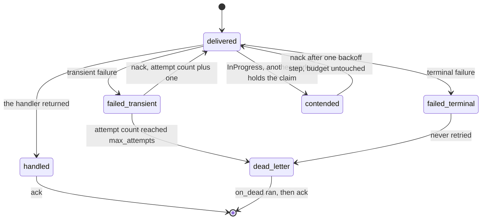
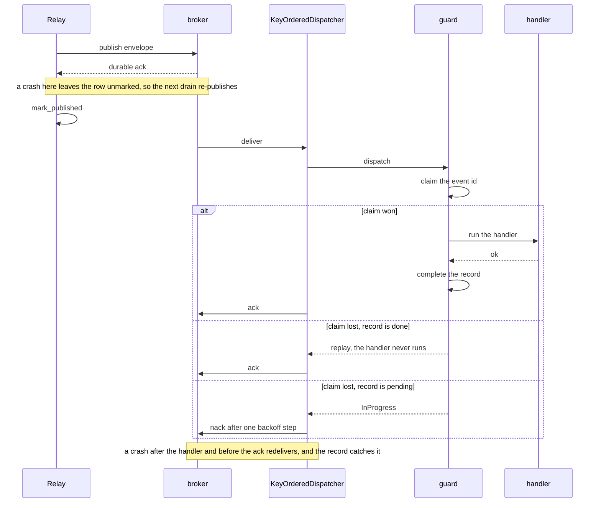

# Delivery guarantees

What guarantee holds at every hop from a caller's request to a read model. What makes each one hold.
What a host must do to claim effectively-once for its own database state.

Nothing in this pipeline is exactly-once, and `edax` never promises it. Each hop is either atomic
(one transaction) or at-least-once with something downstream that removes the duplicate. The whole
argument is: make every duplicate detectable, and make detection a kernel decision so two services
reach the same verdict.

```mermaid
flowchart LR
    A["caller"] -->|"at-least-once: the caller may retry"| B["CommandBus"]
    B -->|"one claim per idempotency key"| C["handler"]
    C -->|"at-most-once per aggregate id and sequence"| D["EventStore"]
    D -->|"atomic: same transaction"| E["transactional Outbox"]
    E -->|"at-least-once: crash before mark_published re-publishes"| F["Relay"]
    F -->|"at-least-once, ordered per aggregate id"| G["broker"]
    G -->|"at-least-once, per-key order"| H["KeyOrderedDispatcher"]
    H -->|"at-least-once, bounded, then dead-letter"| I["event handler"]
    I -->|"at-most-once per version"| J["ProjectionStore"]
```

## Hop by hop

### caller to `CommandBus`

- Delivery: at-least-once. The caller retries a lost response.
- Safe because the command carries an idempotency key.
- The `idempotent` guard claims that key atomically.
- The kernel rules on the reuse: proceed, replay, or `PayloadMismatch`.
- Skip it and a retried submit runs the handler twice, so it deposits twice.

### `CommandBus` to handler

- Delivery: exactly one handler per command type. `retry` re-runs it inside the one claim.
- Safe because `retry` sits inside the guard, so attempts share a claim.
- A transient failure therefore never takes a second claim.
- Put `retry` outside the guard and each attempt re-claims.
- With a guard-owned unit of work, every attempt also shares one aborted transaction.

### handler to `EventStore`

- Delivery: at-most-once per `(aggregate_id, sequence)`.
- Safe because `append` is a database-enforced compare-and-set on the version.
- It writes only if the stored version equals `expected_version`.
- Otherwise it raises `ConcurrencyError` and writes nothing.
- A read-then-write check in Python passes for two writers on separate connections, and the stream
  forks.

### `EventStore` to transactional Outbox

- Delivery: atomic.
- Safe because the event rows and their outbox rows commit together in the caller's `tx`.
- A rollback removes both.
- An outbox in a second store lets committed state and published events diverge.
- A publish inside the handler does the same.

### `Relay` to broker

- Delivery: at-least-once.
- Safe because `publish` returns only after a durable broker ack.
- Rows stay unmarked until `mark_published`, which is idempotent.
- Return before the ack and you mark a row published for a message that does not exist. That is a
  lost event.
- Two relays on a non-leasing `unpublished` double-publish.

### broker to `KeyOrderedDispatcher`

- Delivery: at-least-once, per-key order.
- The key is `aggregate_id`.
- `ack` settles only that message. On an offset broker that is a per-partition watermark below the
  lowest unacked offset.
- `nack` redelivers. Every delivery is settled once.
- A bare "commit the current position" acks unsettled messages and loses them on restart.

### `KeyOrderedDispatcher` to handler

- Delivery: at-least-once, bounded, then dead-letter.
- The worker is `partition(aggregate_id, workers)`, so one aggregate stays first in, first out
  (FIFO) on one worker.
- Per-key order holds for successful deliveries only.
- A nack requeues the delivery behind same-key deliveries already queued on that worker.
- `max_attempts` plus `on_dead` bound redelivery. A terminal error dead-letters on the first
  failure.
- Without `on_dead` a raising handler nacks forever and the broker redelivers forever.

### handler to `ProjectionStore`

- Delivery: at-most-once per version.
- Safe because `save` is a database-enforced compare-and-set on `entity.version`.
- Last-writer-wins lets a redelivery overwrite a newer document.

The consume path gets its deduplication from `idempotent_by_id`, which claims `env.id` in the same
ledger and reaches the same kernel verdict the command bus does.

The `Relay` hop has a second shape. Change data capture reads the write-ahead log, through logical
replication or a Debezium outbox router. The outbox row is already written in the same transaction,
so the consumer sees it exactly when the transaction commits. Feed the decoded envelopes to `pump`
instead; there is no `mark_published`, because the stream position is the ack, so commit that
position only after `pump` has passed the row. The guarantee is the same: at-least-once, resumed
from the last committed position.

A delivery's whole lifecycle is at-least-once with exactly two terminal states:

`InProgress` is exempt from the attempt budget. See
[consuming](../sdk/consuming.md#inprogress-is-contention-not-a-failed-attempt).

Without `on_dead` there is no `dead_letter` state at all. A failing delivery nacks forever. That is
a loud failure rather than a silent drop.

## Where the duplicates actually come from

| Duplicate source | What removes it | Where |
|---|---|---|
| the caller retries a submit | the guard's atomic claim plus the kernel's verdict on the reused key | `idempotent(store, key=...)` |
| `retry` re-runs the handler | nothing needs to: attempts share one claim, and `Repository.save` is a compare-and-set that only one attempt can win | `retry` inside `idempotent` |
| two writers race on one aggregate | `append`'s version compare-and-set — the loser gets `ConcurrencyError` and writes nothing | `EventStore.append` |
| two writers race on one read model | `save`'s version compare-and-set | `ProjectionStore.save` |
| the relay re-publishes after a crash | the consumer's dedup: `idempotent_by_id` on `env.id` | `edax.router.idempotent_by_id` |
| the broker redelivers a handled message | the same claim; a `done` record replays and the handler is skipped | the ledger |
| an out-of-order or stale redelivery | `should_apply(stored, incoming)` on the per-aggregate `sequence` | `edax.should_apply`, `edax::should_apply` |

`should_apply` compares strictly: an incoming sequence *equal* to the stored one is re-applied, so
effect-idempotency on that boundary case stays the handler's job. It deduplicates *ordering*, not
identity — use it beside the guard, not instead of it.

The guard's own claim/complete/release orderings and every failure window inside them are in
[../sdk/idempotency.md](../sdk/idempotency.md).

## The three atomicity facts

1. **One transaction across several stores is atomic.** `Transactor` owns the boundary and hands out
   one `tx`; `EventStore`, `ProjectionStore`, `IdempotencyStore` and `SagaStore` are pure
   participants. Events, snapshot, outbox rows, projection write and the idempotency record commit
   as one set or roll back as one set. This is the only place edax gets effectively-once.
2. **A database and a broker cannot be atomic.** That is the whole reason the transactional Outbox
   exists. The row is written inside the database transaction. A separate `Relay` publishes it
   afterwards. Publishing from inside the handler instead loses events on a rollback and invents
   them on a failed commit.
3. **Two databases cannot be atomic without a distributed transaction, and edax does not use one.**
   No two-phase commit, no eXtended Architecture (XA). A ledger in Redis beside business state in
   your own database is two independent commits; no ordering makes them one. That mode is
   **at-least-once with a dedup window** the width of the record's retention. Never call it
   effectively-once.

The `IdempotencyStore` declares which case it is with `joins_transaction`, because the guard
branches on it and cannot detect it. Absent, the answer is `False` — the safe side.

## Ordering

`partition(aggregate_id, n)` is `fnv1a32(aggregate_id) % n`, computed in the kernel so every
language agrees bit for bit.

**What it guarantees.** The same aggregate id always maps to the same bucket, for the same `n`, in
every service and every software development kit (SDK). In the dispatcher that means one aggregate's
events are serialized on one worker in FIFO order, while other aggregates progress in parallel.

**What it does not guarantee.**

- No order across aggregate ids. Two aggregates have no relative order at all.
- No stability when `n` changes: `% n` remaps almost every id. Use `rendezvous(aggregate_id, n)`
  when the count must grow — it remaps only the `~1/n` whose winner actually changed. Pick one per
  deployment and keep it fixed; the two are not interchangeable once a deployment is running.
- No ordering across the broker. Per-key order is the broker's contract, not the kernel's. A nacked
  message may come back *behind* later same-key messages that were already acked; whether that is
  acceptable is the handler's problem.
- The deployment-wide logical partition count `N` is not a consumer's local worker count `W`. The
  dispatcher may pass `W` directly only because the broker already routed the aggregate to this one
  consumer, so no sibling with a different `W` ever sees the same id.

**Never order on a wall clock.** `current_timestamp()` is Unix nanoseconds with a process-local
high-water mark: strictly increasing *within one process*, and nothing more. It does not span
restarts or machines. `guid()` is UUIDv7 — roughly time-ordered and index-friendly, but a random
suffix, not an ordering key. Order on `sequence`, which the store assigns and the compare-and-set
defends.

## Checklist: effectively-once for your database state

A host can claim effectively-once for state in one database when **all** of these hold.

- [ ] Every store that must commit together is built over **one** `Transactor`, and all of them join
  the same `tx` (explicitly, or via `current_tx()`).
- [ ] The `IdempotencyStore` lives in **that same database** and declares `joins_transaction:
  ClassVar[bool] = True`.
- [ ] The guard owns the transaction: `idempotent(..., unit_of_work=db)` or `idempotent_by_id(store,
  unit_of_work=db)`. On the consume path this is not optional — a dispatcher worker clears the
  ambient transaction, so a handler that opens one internally opens it *after* the claim was taken.
- [ ] `retry` sits **outside** a guard that owns the transaction. See
  [commands](../sdk/commands.md#retry-placement).
- [ ] `claim` is an atomic insert-if-absent, linearizable across processes: `INSERT ... ON CONFLICT
  DO NOTHING`, `SET NX`, or a unique-key insert. Never a read then a write.
- [ ] A losing claimant either blocks and then reads the winner's record, or fails with a
  `StoreError` — never swallows the failure and reports a win. The blocking wait is bounded by a
  lock or statement timeout.
- [ ] Record retention outlives the longest redelivery window: broker retry plus client retry.
- [ ] `payload_hash` is persisted losslessly as an **unsigned** 64-bit value — unsigned column,
  `NUMERIC`, or a string. A signed `BIGINT` reads every value at or above `2**63` back negative.
- [ ] `EventStore.append` enforces its version check **in the database**, and `ProjectionStore.save`
  does too.
- [ ] Exactly one `Relay` per store, unless `unpublished` leases rows (`SELECT ... FOR UPDATE SKIP
  LOCKED`, or a `leased_until` column).
- [ ] `Producer.publish` returns only after a durable broker ack and raises on failure.
- [ ] `Consumer.ack` settles only that message — a per-partition watermark on an offset broker.
- [ ] The error taxonomy is honored: `ConcurrencyError` only for a version conflict, `StoreError`
  for backend failures, `CodecError` for marshaling failures. The retry and dead-letter paths branch
  on it.

## What remains at-least-once, always

**External side effects.** Anything the handler does outside the transaction it commits in. A charge
on a payment gateway. An email. A webhook. A write to a second database. A message published
directly to a broker. The guard cannot roll those back, and the commit they sit beside is not
theirs.

The mitigations are the ordinary ones, and they are the caller's:

- Give the external call its own idempotency key derived from the command or event id, and let the
  remote system deduplicate.
- Move the side effect behind the transactional Outbox, so it is triggered by a committed row
  instead of by a handler that may roll back.
- Accept the duplicate and make the effect commutative.

Also at-least-once by construction, whatever the host does:

- The relay's publish. A crash between the durable ack and `mark_published` republishes the
  envelope.
- The broker's delivery. A crash after the handler and before the ack redelivers it.
- Split-ledger mode. A commit that landed and lost its reply releases a claim over work that
  survived, so the redelivery re-runs it. The case
  `split_lost_commit_response_releases_a_claim_over_work_that_landed_so_it_runs_twice` in
  `test_unit_of_work.py` asserts it.

Each of those is caught downstream by a claim or by `should_apply`. None of them is removed at the
source, because none of them can be.

## See also

- [../sdk/idempotency.md](../sdk/idempotency.md) — both guards, both modes, every failure window
  inside the claim.
- [../sdk/transactions.md](../sdk/transactions.md) — `Transactor`, `current_tx`, `transaction`,
  `joins_transaction`.
- [../sdk/outbox.md](../sdk/outbox.md) — outbox rows, `Relay`, `pump`, and the change data capture
  (CDC) alternative.
- [../sdk/consuming.md](../sdk/consuming.md) — `KeyOrderedDispatcher` settlement and dead-letter
  routing.
- [../backends/README.md](../backends/README.md) — the seam contracts a backend must satisfy.
- [./testing.md](./testing.md) — the suite that proves the guarantee, and how to run it against your
  own backend.
