# Examples

A tour of the seven runnable programs in `examples/py`: what each one proves, which seams it wires,
and what it prints.

Each example is a single file with a `main()`, an in-memory backend for every seam it needs, and
asserts at the end. There is no test framework and no expected-output file: the program either exits
`0` or raises. continuous integration (CI) runs all seven.

| Example | Proves | Doc |
|---|---|---|
| `command_handling` | one command applied once, its events drained through the outbox | [sdk/commands](../sdk/commands.md) |
| `event_handling` | per-aggregate ordering, ack on success, nack on failure, dedup on redelivery | [sdk/consuming](../sdk/consuming.md) |
| `event_idempotency` | the two guard modes and the guarantee each one buys | [sdk/idempotency](../sdk/idempotency.md) |
| `outbox` | consume, handle, append to the outbox, relay, consume again | [sdk/outbox](../sdk/outbox.md) |
| `saga` | committed events drive a process manager that emits commands | [sdk/sagas](../sdk/sagas.md) |
| `projection_query` | a read model filtered, ordered and keyset-paged | [sdk/projections](../sdk/projections.md) |
| `observability` | every Observer signal counted; handler latency timed; spans linked; gauges read | [sdk/observability](../sdk/observability.md) |

## Running them

Build the native extension first, then run any file:

```sh
maturin develop -m crates/edax-py/Cargo.toml
python examples/py/projection_query.py
```

The build step is not optional. Read [the stale native module
trap](./getting-started.md#the-stale-native-module-trap).

`outbox.py` documents a second route, from inside `examples/py` (`examples/py/outbox.py:13`):

```sh
cd examples/py && uv sync && uv run python outbox.py
```

`examples/py/pyproject.toml` installs the local software development kit (SDK) editable through
`[tool.uv.sources]`. It also pulls the `kafka` extra. So `uv sync` covers the maturin build and the
broker client in one step.

### A clean exit is the test

Every example ends in asserts that pin the values it printed — `assert ids2 == ["a3", "a6"], ids2`,
`assert published == ["e1", "e2"], published`. An assert that fires raises `AssertionError` and the
process exits non-zero. Nothing else checks the output.

CI relies on exactly that. The `Examples` step loops over `examples/py/*.py` and exits on the first
failure (`.github/workflows/python.yml:81`):

```yaml
- name: Examples
  run: |
    for f in examples/py/*.py; do
      echo "--- $f"
      crates/edax-py/.venv/bin/python "$f" || exit 1
    done
```

That step lives in the `pytest` job rather than beside the linters because it needs the extension
built by the `maturin develop --release` step above it (`.github/workflows/python.yml:72`). The
workflow itself is called from `.github/workflows/ci.yml:22`.

## What covers what

```mermaid
flowchart LR
    C["command in<br/>command_handling"] --> B["CommandBus with guard and retry<br/>command_handling, saga"]
    B --> R["Repository.save<br/>command_handling"]
    R --> ES[("EventStore plus outbox rows<br/>command_handling, outbox")]
    ES -->|"drain"| RL["Relay<br/>command_handling, outbox"]
    RL -->|"publish"| BR(["broker<br/>outbox"])
    BR -->|"poll as Delivery"| D["KeyOrderedDispatcher<br/>event_handling, outbox, saga"]
    D -->|"partition by aggregate id"| RT["EventRouter with guard<br/>event_handling, event_idempotency, saga"]
    RT -->|"fold the envelope"| PH["projection handler<br/>event_idempotency"]
    RT -->|"correlate"| SR["SagaRunner<br/>saga"]
    PH -->|"save, compare-and-set"| PS[("ProjectionStore rows<br/>projection_query, event_idempotency")]
    PS -->|"get_many with a cursor"| Q["paged read<br/>projection_query"]
    SR -->|"emit commands"| B
```



No single example runs the whole loop. `command_handling` covers command in through outbox drained,
`outbox` covers drained through consumed, and `projection_query` covers the read that follows.

```mermaid
flowchart LR
    A["command_handling<br/>write side and outbox"] -->|"then, for the consume half"| B["outbox<br/>drain, dispatch, read back"]
    B -->|"then, for settlement"| C["event_handling<br/>ack, nack, redelivery"]
    C -->|"then, for the guarantee"| D["event_idempotency<br/>two guard modes"]
    D -->|"then, for the read side"| E["projection_query<br/>filter, sort, cursor"]
    E -->|"then, for the loop back"| F["saga<br/>events become commands"]
```



## `command_handling`

The Command Query Responsibility Segregation (CQRS) write side end to end. A command is dispatched
through a bus and applied to an aggregate. Its events, snapshot and outbox rows commit in one unit
of work. A relay then drains them.

Seams wired: `Transactor` (`MemoryTransactor`), `EventStore` (`MemoryEventStore`),
`IdempotencyStore` (`MemoryIdempotencyStore`), `Aggregate` plus a snapshot codec through
`Repository`, the `CommandBus` middleware chain (`retry` outermost, `idempotent` inside it), and
`Relay`. Both stores are built over the one transactor. The guard is given `unit_of_work=db`, so each
attempt's idempotency record, events, snapshot and outbox rows commit or roll back together.

`request_id` is the idempotency key. The same key with the same body replays; the same key with a
different body raises `PayloadMismatch`.

```
req-A -> 100, req-A retry -> 100, req-B -> 150
drained ['e1', 'e3']

ok: idempotent command applied once, outbox drained
```

The assertion that carries it (`examples/py/command_handling.py:120`). `e2` is the event of the
`req-B` attempt that failed after its save: it rolled back with its claim, and the retry saved `e3`.

```python
assert published == ["e1", "e3"], published
```

Two events for three accepted dispatches plus one rejected one. The replayed `req-A` ran no handler
and appended nothing; the `PayloadMismatch` rolled its transaction back. If a replay had re-run the
handler, a third row would be here.

Read with [sdk/commands](../sdk/commands.md), [sdk/idempotency](../sdk/idempotency.md),
[sdk/aggregates](../sdk/aggregates.md), [sdk/outbox](../sdk/outbox.md) and
[sdk/transactions](../sdk/transactions.md).

## `event_handling`

The consume side: broker deliveries fan out across workers, route by event name, and get settled by
outcome.

Seams wired: `Delivery` carrying the envelope plus the broker's ack and nack handles,
`KeyOrderedDispatcher` with four workers, `EventRouter`, and the `idempotent_by_id` guard. The guard
runs over a `MemoryIdempotencyStore` of its own. There is no transactor, so this is dedup, not
atomicity. The stream replays two deliveries: one that succeeded and one that failed.

```
handled: ['acct-carol: opened', 'acct-alice: opened', 'acct-bob: opened', 'acct-carol: deposited', 'acct-alice: deposited', 'acct-alice: withdrawn']
acked [b'msg-0', b'msg-1', b'msg-2', b'msg-2', b'msg-3', b'msg-5', b'msg-6']
nacked [b'msg-4', b'msg-4']

ok: acct-alice handled in order; the succeeded redelivery skipped, the failed one re-run
```

The `handled:` list interleaves differently between runs, because different aggregate ids land on
different workers and run concurrently. Order *within* an aggregate id is fixed, and that is all the
example asserts.

The assertion that carries it (`examples/py/event_handling.py:92`):

```python
assert calls.count("acct-alice-Deposited") == 1, calls
```

`msg-2` was delivered twice and acked twice, yet the handler ran once: the guard found a `done`
record and replayed it. Its counterpart at line 95 is the other half — `acct-bob-Deposited` failed
transiently, so its claim was released and the redelivery really re-ran.

Read with [sdk/consuming](../sdk/consuming.md) and [sdk/idempotency](../sdk/idempotency.md).

## `event_idempotency`

The longest example, and the one that states a guarantee rather than a feature. It runs the same
guard twice: once with the ledger and the projection over one `MemoryTransactor`, once with the
ledger on a database of its own.

Seams wired: `IdempotencyStore`, `Transactor`, `ProjectionStore`, and `EventRouter` with
`idempotent_by_id(..., unit_of_work=...)`. Passing `unit_of_work` is what lets the guard open the
transaction itself, in the right place, so a failed commit releases the claim.

```
shared unit of work: handler ran 3x, balance 100
  committed event skipped on redelivery; a rolled-back one left no trace at all
ledger of its own:   handler ran 3x, balance 200
  a commit whose reply was lost released its claim, so the redelivery applied it again
```

The assertion that carries it (`examples/py/event_idempotency.py:186`):

```python
assert await balance(projections) == 200, "applied twice: at-least-once, not once"
```

`CommitLosesItsReply` models a commit that lands and then loses its acknowledgement. The guard
cannot tell that from a commit that never happened, so it releases the claim over work that
survived, and the redelivery applies the deposit a second time. No ordering of the two commits
changes that. See [guides/delivery-guarantees](./delivery-guarantees.md).

Read with [sdk/idempotency](../sdk/idempotency.md),
[guides/delivery-guarantees](./delivery-guarantees.md), [sdk/transactions](../sdk/transactions.md)
and [sdk/projections](../sdk/projections.md).

## `outbox`

The transactional outbox end to end on the in-memory broker. Consume an input topic and run the
operation. Append the domain event inside a transaction. Relay the outbox to an output topic. Read
that topic back to verify.

Seams wired: `Producer` and `Consumer` (`MemoryBroker` is both), `EventStore` with its outbox
(`MemoryEventStore`), `KeyOrderedDispatcher`, `transaction`, and `Relay`. The input delivery is acked
only after the append, which is what makes the pipeline at-least-once rather than lossy.

```
published 4 requests
  handled acct-a -> balance 100
  handled acct-b -> balance 50
  handled acct-a -> balance 125
  handled acct-b -> balance 60
drained 4 domain events

ok: input consumed -> domain events emitted via the outbox, per-aggregate order kept
```

The two `handled` streams can interleave differently between runs, for the same reason as in
`event_handling`.

The assertion that carries it (`examples/py/outbox.py:91`):

```python
assert seen["acct-a"] == [100, 125], seen["acct-a"]
```

The balances arrive in per-aggregate order after a full round trip through the outbox and the
broker. `100` then `125` means the second request read the first one's result — so the handler's
read-modify-write needed no lock, because `partition(aggregate_id)` pinned both to one worker.

Read with [sdk/outbox](../sdk/outbox.md), [sdk/consuming](../sdk/consuming.md) and
[backends/kafka](../backends/kafka.md).

## `saga`

A process manager reacting to committed events: correlate by id, load state, decide, emit commands,
complete.

Seams wired: `SagaStore` (`MemorySagaStore`), `SagaRunner`, `EventRouter`, `KeyOrderedDispatcher`,
and a `CommandBus` behind the `idempotent` guard. `OrderSaga` waits for `Paid`, emits `Fulfill`, and
returns `Completed`. `partition(aggregate_id)` pins each order to one worker, so `Created` lands
before `Paid` without a lock. The runner saves each step's state and commands in one write, and
`runner.relay(bus.dispatch)` sends the committed commands afterwards. The stream includes a
redelivered `Paid`: it finds the completed instance's tombstone and is ignored. `Fulfill` also carries the causation chain across the
hop, as [sdk/sagas](../sdk/sagas.md#carrying-the-chain-across-the-hop) describes.

```
fulfilled: [('order-2', 'corr-order-2', 'order-2-Paid'), ('order-1', 'corr-order-1', 'order-1-Paid')]

ok: saga fulfilled each order once (concurrent, redelivery tolerated), chain intact
```

The `fulfilled:` order varies between runs: the two orders are different aggregate ids and run on
different workers.

The assertion that carries it (`examples/py/saga.py:108`):

```python
assert sorted(fulfilled) == [
    ("order-1", "corr-order-1", "order-1-Paid"),
    ("order-2", "corr-order-2", "order-2-Paid"),
], fulfilled
```

`sorted` because cross-order arrival is unordered by design; the content is the point. Each order
was fulfilled exactly once across five events, one of which was a duplicate `Paid`. Two mechanisms
had to hold: the saga returns `Completed` with no commands for a `Paid` with no live instance, and
the bus is idempotent under `fulfill:{order_id}`. The two extra fields prove the third: the flow id
came from the `Paid` event's metadata, and the causation id is that event's own id.

Read with [sdk/sagas](../sdk/sagas.md), [sdk/commands](../sdk/commands.md) and
[sdk/consuming](../sdk/consuming.md).

## `projection_query`

The read side: six account documents saved, then filtered, sorted and paged with a keyset cursor.

Seams wired: `ProjectionStore` (`MemoryProjectionStore`), the `edax.filter` constructors, and
`edax.query`'s `sort_key` and `encode_cursor`. The sort is `balance` descending with `id` as
tiebreak, and the data ties `a2` with `a3` on `balance` so the page boundary falls inside the tie.

```
page 1: ['a1', 'a2']  cursor -> WzE1MCwiYTIiXQ==
page 2: ['a3', 'a6']
```

The cursor is stable across runs and across bindings: it is base64 of the JSON sort tuple `[150,
"a2"]`.

The assertion that carries it (`examples/py/projection_query.py:47`):

```python
assert ids2 == ["a3", "a6"], ids2  # resumed past the a2 tie
```

Page 2 resumes *strictly after* the cursor tuple, so the tied row `a3` appears once and `a2` does
not reappear. `a4` (balance below the filter) and `a5` (not active) never show up in either page.

Read with [sdk/projections](../sdk/projections.md), [kernels/filter](../kernels/filter.md) and
[kernels/event](../kernels/event.md).

## `observability`

The telemetry seams: an `Observer` counts every signal it can emit and a `timing` middleware
records handler latency. A stdlib tracer stand-in links each event to the `traceparent` its
producer saved. All of it is plain values with no exporter and no dependency.

Seams wired: `Observer` and `timing` (`edax.observe`) on a `CommandBus` with an `idempotent` guard,
and on a `Consumer` feeding a `KeyOrderedDispatcher` whose handler is an `EventRouter` with
`idempotent_by_id`, plus a `Relay`. One `Observer` subclass folds each signal into an in-memory
counter. The command run reaches every claim verdict and every settlement the memory store can
produce. The consume run reaches every delivery outcome, an ack that raises, a claim another worker
holds, and a poison message the consumer loop dead-letters itself. The outbox run commits one unit
of work, rolls one back, fails one drain, then drains.

```
commands:  3 claims lost, 3 settled (completed, cached, released); 6 dispatches timed
queued:    depth=[2, 3] in_flight=0 idle=False
drained:   depth=[0, 0] in_flight=0 attempts_tracked=1 contended_tracked=1 idle=True
delivery:  ack=1 dead=1 nack=1 in_progress=1 unsettled=1; 1 poison dead-lettered by the loop; slowest handler 0.344 ms, backoff excluded
relay:     1 drain failed (broker down), then published=1 lag=3.753 ms in 0.787 ms; transactions committed=1 rolled_back=1
```

The asserts pin every count and every span row. They also check that the reported `delivery`
duration excludes the backoff wait. The number the dispatcher hands the `Observer` is the handler
alone, so a slow retry schedule never inflates `messaging.process.duration`. The pull surface
(`stats()`, `idle()`, `Relay.last`) is read after the consumer queued its stream and again after
the dispatcher drains. The warnings on stderr are the log lines that carry the ids the metric
labels must not.

Read with [sdk/observability](../sdk/observability.md).

## Seams by example

| Example | Seams exercised | Backend used | Doc |
|---|---|---|---|
| `command_handling` | `Transactor`, `EventStore`, `IdempotencyStore`, `Aggregate` + `Repository`, `CommandBus` middleware, `Relay` | `memory` | [sdk/commands](../sdk/commands.md), [sdk/aggregates](../sdk/aggregates.md), [sdk/outbox](../sdk/outbox.md) |
| `event_handling` | `Delivery`, `KeyOrderedDispatcher`, `EventRouter`, `IdempotencyStore` | `memory` | [sdk/consuming](../sdk/consuming.md) |
| `event_idempotency` | `IdempotencyStore`, `Transactor`, `ProjectionStore`, `EventRouter` | `memory` | [sdk/idempotency](../sdk/idempotency.md) |
| `outbox` | `Producer`, `Consumer`, `EventStore` + outbox, `KeyOrderedDispatcher`, `Relay`, `Transactor` | `memory` | [sdk/outbox](../sdk/outbox.md) |
| `saga` | `SagaStore`, `EventRouter`, `KeyOrderedDispatcher`, `CommandBus`, `IdempotencyStore` | `memory` | [sdk/sagas](../sdk/sagas.md) |
| `projection_query` | `ProjectionStore` | `memory` | [sdk/projections](../sdk/projections.md) |
| `observability` | `Observer`, `timing`, `CommandBus`, `idempotent`, `Consumer`, `KeyOrderedDispatcher`, `EventRouter`, `idempotent_by_id`, `Relay` | `memory` | [sdk/observability](../sdk/observability.md) |

Every example runs on the `memory` backend, so none of them needs a broker or a database. The
durable backends are exercised by their own test suites, not from here.

## No broker example

There is no Kafka example, and nothing here needs a broker running. `outbox.py` runs the full
publish-and-consume shape over `MemoryBroker`, and notes that `edax.backend.kafka` over your own
client replaces it with no other change (`examples/py/outbox.py:10`). The adapters live at
`crates/edax-py/python/edax/backend/kafka.py` and are covered by
`crates/edax-py/tests/test_kafka.py` and the broker contract suite; see
[backends/kafka](../backends/kafka.md).

## See also

- [guides/getting-started](./getting-started.md) — install and build before running any of these.
- [guides/delivery-guarantees](./delivery-guarantees.md) — the matrix `event_idempotency`
  demonstrates.
- [guides/testing](./testing.md) — golden vectors and the suites these examples sit beside.
- [backends/memory](../backends/memory.md) — the backend every example runs on.
- [sdk/README](../sdk/README.md) — the SDK map, if an example names a seam you have not met.
