# Examples

The runnable examples live in `examples/py`. Its [README](../../examples/py/README.md) lists all
nineteen in learning order: what each one teaches, its key API, and the page to read next. This page
covers how to run them, how continuous integration (CI) checks them, and which part of the pipeline
each one covers.

Each example is one file with a `main()`, one idea, and numbered steps that print what happens. It
ends in asserts and a final `ok:` line. There is no test framework and no expected-output file: the
program either exits `0` or raises.

## Running them

From inside `examples/py`, `uv` builds the local software development kit (SDK) and runs a file:

```sh
cd examples/py && uv sync && uv run python 01_command_bus.py
```

`examples/py/pyproject.toml` installs the local SDK editable through `[tool.uv.sources]`. It also
pulls the `kafka`, `redis` and `test` extras. So `uv sync` covers the maturin build, the broker
clients and pytest in one step.

In a checkout with the development environment, build the native extension first, then run any
file:

```sh
maturin develop -m crates/edax-py/Cargo.toml
python examples/py/11_projection_query.py
```

The build step is not optional. Read [the stale native module
trap](./getting-started.md#the-stale-native-module-trap).

## A clean exit is the test

Every example ends in asserts that pin the values it printed, then prints `ok:`. An assert that fires
raises `AssertionError`, and the process exits non-zero.

CI relies on exactly that. The `Examples` step of `.github/workflows/python.yml` loops over
`examples/py/*.py` and stops on the first file that fails or prints no `ok:` line:

```yaml
- name: Examples
  run: |
    for f in examples/py/*.py; do
      echo "--- $f"
      out=$(crates/edax-py/.venv/bin/python "$f")
      echo "$out"
      echo "$out" | grep -q '^ok:' || { echo "FAILED: $f did not reach its ok: marker"; exit 1; }
    done
```

`crates/edax-py/tests/test_examples.py` runs every `main()` inside the test suite too. It also
checks that no example command declares `type` as a hashed instance field. Both checks find a new
file by its name, so a new example needs no registration.

## Real backends

Every example runs on the `memory` backend by default, so none needs a broker or a database. Two of
them switch to a real server when an environment variable names one:

| Example | Variable | Real backend | In-memory stand-in |
|---|---|---|---|
| `16_redis_ledger.py` | `EDAX_REDIS_URL` | `RedisIdempotencyStore` | `MemoryLedger` |
| `17_kafka.py` | `EDAX_KAFKA_BOOTSTRAP` | `KafkaProducer`, `KafkaConsumer`, `KafkaDeadLetterSink` | `MemoryBroker` |

The CI test job sets both variables for its Redis and Kafka services. So in CI these two run
against real servers, in the test suite and in the `Examples` step alike.

## What covers what

```mermaid
flowchart LR
    C["command in<br/>01, 05, 06"] --> B["CommandBus with guard and retry<br/>05, 06, 13, 15, 16"]
    B --> R["Repository.save<br/>02, 03, 04, 05, 12"]
    R --> ES[("EventStore plus outbox rows<br/>02, 07")]
    ES -->|"drain"| RL["Relay<br/>07, 14, 17"]
    RL -->|"publish"| BR(["broker<br/>08, 09, 17"])
    BR -->|"poll as Delivery"| D["KeyOrderedDispatcher<br/>08, 09, 17"]
    D -->|"partition by aggregate id"| RT["EventRouter with guard<br/>08, 10, 19"]
    RT -->|"fold the envelope"| PH["projection handler<br/>10, 19"]
    RT -->|"correlate"| SR["SagaRunner<br/>13"]
    PH -->|"save, compare-and-set"| PS[("ProjectionStore rows<br/>10, 11, 18")]
    PS -->|"get_many with a cursor"| Q["paged read<br/>11"]
    SR -->|"emit commands"| B
```



No single example runs the whole loop. Each one runs one hop, so a reader meets one new idea per
file. `14_observability.py` watches several hops at once through one `Observer`.

## See also

- [guides/getting-started](./getting-started.md) — install and build before running any of these.
- [guides/delivery-guarantees](./delivery-guarantees.md) — the guarantees `10_idempotent_events.py`,
  `15_lease_takeover.py` and `19_fault_injection.py` exercise.
- [guides/testing](./testing.md) — golden vectors and the suites these examples sit beside.
- [backends/memory](../backends/memory.md) — the backend every example runs on by default.
- [sdk/README](../sdk/README.md) — the SDK map, if an example names a seam you have not met.
