# Examples

The [Python examples](../../examples/py/README.md) and
[Go examples](../../crates/edax-go/examples/README.md) cover the same nineteen topics in learning order.
Their READMEs list what each example teaches. This page explains how to run them and how continuous
integration (CI) checks them.

Each program checks the behavior it demonstrates and prints a final `ok:` line. Python uses
assertions; Go returns an error on a failed check. The contract-kit examples use pytest and Go's
test runner to check backend contracts.

## Running them

From inside `examples/py`, `uv` builds the local software development kit (SDK) and runs a file:

```sh
cd examples/py && uv sync && uv run python 01_command_bus.py
```

`examples/py/pyproject.toml` installs the local SDK editable through `[tool.uv.sources]`. It also
pulls the `kafka`, `redis` and `test` extras. So `uv sync` covers the maturin build, the broker
clients and pytest in one step.

In a checkout with the development environment, build the native extension first, then run any
file:

```sh
maturin develop -m crates/edax-py/Cargo.toml
python examples/py/11_projection_query.py
```

The build step is not optional. Read [the stale native module
trap](./getting-started.md#the-stale-native-module-trap).

The Go examples live inside the Go module. Build the native library, then run a numbered directory:

```sh
mise run go:build
cd crates/edax-go
mise exec -- go run -race ./examples/11_projection_query
```

Example 18 is a test package. Run it with `mise exec -- go test -race -v ./examples/18_contract_kit`.

## Smoke tests

After building both native bindings, run these tasks from the repository root:

```sh
mise run examples:python
mise run examples:go
```

The tasks discover numbered examples. They stop on a nonzero exit or a missing `ok:` marker.
The Go task runs programs with the race detector and runs test packages with caching disabled.
Pass filenames to `examples:python` or directory names to `examples:go` to select examples.
The Python and Go workflows call these same tasks.

`crates/edax-py/tests/test_examples.py` runs every `main()` inside the test suite too. It also
checks that no example command declares `type` as a hashed instance field. Both checks find a new
file by its name, so a new example needs no registration.

## Real backends

Every example runs on the `memory` backend by default, so none needs a broker or a database. Two of
them switch to a real server when an environment variable names one:

| Example | Variable | Real backend | In-memory stand-in |
|---|---|---|---|
| `16_redis_ledger` in either language | `EDAX_REDIS_URL` | Redis idempotency ledger | A separate memory ledger |
| `17_kafka` in either language | `EDAX_KAFKA_BOOTSTRAP` | Kafka producer, consumer and dead-letter sink | Memory broker |

The Python CI test job sets both variables for its Redis and Kafka services. Go runs every example
in memory on Linux and macOS. A separate Linux job sets the variables and runs its two live examples.

## What covers what

```mermaid
flowchart LR
    C["command in<br/>01, 05, 06"] --> B["CommandBus with guard and retry<br/>05, 06, 13, 15, 16"]
    B --> R["Repository.save<br/>02, 03, 04, 05, 12"]
    R --> ES[("EventStore plus outbox rows<br/>02, 07")]
    ES -->|"drain"| RL["Relay<br/>07, 14, 17"]
    RL -->|"publish"| BR(["broker<br/>08, 09, 17"])
    BR -->|"poll as Delivery"| D["KeyOrderedDispatcher<br/>08, 09, 17"]
    D -->|"partition by aggregate id"| RT["EventRouter with guard<br/>08, 10, 19"]
    RT -->|"fold the event"| PH["projection handler<br/>10, 19"]
    RT -->|"correlate"| SR["SagaRunner<br/>13"]
    PH -->|"save, compare-and-set"| PS[("ProjectionStore rows<br/>10, 11, 18")]
    PS -->|"get_many with a cursor"| Q["paged read<br/>11"]
    SR -->|"emit commands"| B
```



No single example runs the whole loop. Each one runs one hop, so a reader meets one new idea per
file. `14_observability.py` watches several hops at once through one `Observer`.

## See also

- [guides/getting-started](./getting-started.md) — install and build before running any of these.
- [guides/delivery-guarantees](./delivery-guarantees.md) — the guarantees `10_idempotent_events.py`,
  `15_lease_takeover.py` and `19_fault_injection.py` exercise.
- [guides/testing](./testing.md) — golden vectors and the suites these examples sit beside.
- [backends/memory](../backends/memory.md) — the backend every example runs on by default.
- [sdk/README](../sdk/README.md) — the SDK map, if an example names a seam you have not met.
