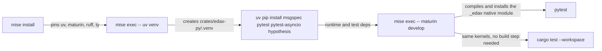
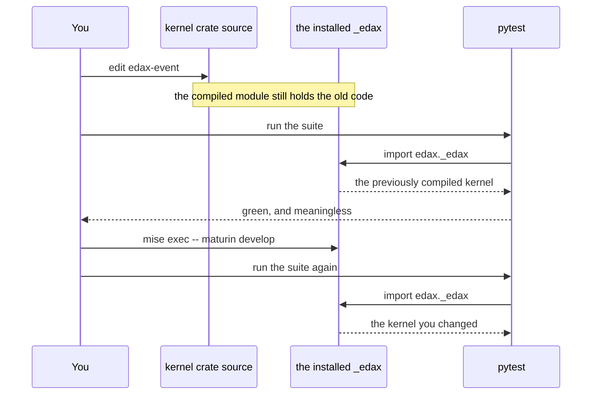
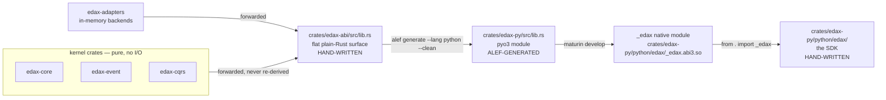

# Getting started

From a fresh checkout to a running service: install the toolchain, build the native module, run both
test suites, then wire a command-handling service in three steps.

The toolchain is pinned with [mise](https://mise.jdx.dev). `cargo`, `maturin` and `uv` are **not**
on your `PATH` — every invocation is prefixed with `mise exec --`. The Python software development
kit (SDK) imports a compiled Rust extension, so a build step sits between a kernel change and a
passing Python test.



## Install

```sh
mise install          # once per checkout; `mise trust` first if mise refuses the config
```

`mise.toml` pins `uv`, `maturin`, `ruff` and `ty`. The Rust channel is **not** pinned there — it
comes from the alef-generated `rust-toolchain.toml`, which mise reads as an idiomatic version file
(`mise.toml:1`). Pinning Rust in both places overrides that file and silently drops `clippy`.

## Build

```sh
cd crates/edax-py
mise exec -- uv venv && source .venv/bin/activate
mise exec -- uv pip install msgspec pytest pytest-asyncio hypothesis
mise exec -- maturin develop
```

That is the sequence in `AGENTS.md`. From the repository root, without the `cd`, the rebuild step
is:

```sh
mise exec -- maturin develop -m crates/edax-py/Cargo.toml
```

`maturin develop` installs into the virtual environment named by `VIRTUAL_ENV`, so either activate
the venv or export it (continuous integration (CI) exports it — `.github/workflows/python.yml:54`).

**Use `crates/edax-py/.venv/bin/python`.** It is the interpreter that has `edax` and `msgspec`
installed; the repo-root `.venv` lacks `msgspec` (`AGENTS.md`). Every command below names it
explicitly, so nothing depends on an activated shell.

## Test

```sh
# kernels + reference Rust SDK; the golden vectors run here
mise exec -- cargo test --workspace
mise exec -- cargo clippy --workspace --all-targets -- -D warnings

# Python SDK
crates/edax-py/.venv/bin/python -m pytest crates/edax-py/tests -q
```

Run **both**. `cargo test` alone misses binding regressions; `pytest` alone misses kernel ones.

## The stale native module trap

`pytest` never rebuilds `_edax`. It imports the `.so` that is already installed in the venv. Change
anything under `edax-core`, `edax-event`, `edax-cqrs`, `edax-adapters` or `edax-abi` and run
`pytest` without rebuilding, and the suite tests the *previously compiled* kernel: it passes green
and proves nothing.



Changes confined to `crates/edax-py/python/edax/` need no rebuild — that package is plain Python.

CI runs the steps in the right order, with the build step marked as required
(`.github/workflows/python.yml:69`).

## A first service

Three steps. Each one runs on its own; each adds one guarantee. The in-memory backend
(`edax.backend.memory`) keeps the real contracts, so a rollback in step 3 genuinely leaves nothing
behind.

### Step 1 — an aggregate and a `Repository`

An `Aggregate` folds events into state; a `Repository` rehydrates it from a snapshot plus the events
after it, and appends the pending events back under optimistic concurrency.

```python
import asyncio
from dataclasses import dataclass
from typing import Optional

from edax import Aggregate, Repository, json_codec
from edax.backend.memory import MemoryEventStore, MemoryTransactor


@dataclass
class Deposited:  # a domain event
    amount: int


class Account(Aggregate):
    def __init__(self, id: str, initial: int = 0) -> None:
        super().__init__(id, initial)
        self.balance = 0

    def transition(self, event: object) -> None:  # fold an event into state
        if isinstance(event, Deposited):
            self.balance += event.amount


class AccountCodec:  # how the aggregate snapshots
    type = "Account"

    def load(self, id: str, version: int, data: Optional[bytes]) -> Account:
        account = Account(id, version)
        if data is not None:
            account.balance = int(data)
        return account

    def dump(self, account: Account) -> bytes:
        return str(account.balance).encode()


async def main() -> None:
    db = MemoryTransactor()
    store = MemoryEventStore(db)
    repo = Repository(store, json_codec({"Deposited": Deposited}), AccountCodec())

    account = await repo.load("acct-1")
    account.apply(Deposited(100))
    await repo.save(account)

    reloaded = await repo.load("acct-1")
    print(reloaded.balance, reloaded.sequence.current)  # 100 1


asyncio.run(main())
```

`apply` both folds the event and queues it as pending; `save` appends the pending events at
`expected_version` and writes a fresh snapshot. Replay during `load` calls `transition` instead, so
a replayed event is never re-queued.

### Step 2 — a `CommandBus` with `idempotent` and `retry`

A command bus routes by command type through a middleware chain. `idempotent` is the guard: it
claims the idempotency key in a ledger, so the second dispatch of one key replays the first outcome
instead of running the handler again. `retry` sits inside it, so every attempt shares one claim.

```python
import asyncio
from dataclasses import dataclass
from typing import Any, ClassVar, Optional

from edax import Aggregate, Repository, json_codec
from edax.backend.memory import MemoryEventStore, MemoryIdempotencyStore, MemoryTransactor
from edax.command import CommandBus, idempotent, retry

# ... Deposited, Account and AccountCodec exactly as in step 1 ...


@dataclass
class Deposit:  # a command
    account_id: str
    amount: int
    request_id: str  # the idempotency key; hashed with the rest of the command
    type: ClassVar[str] = "Deposit"  # routing only: a class attribute stays out of the hash


def request_id_of(cmd: Any) -> str:
    return cmd.request_id


async def main() -> None:
    db = MemoryTransactor()
    store = MemoryEventStore(db)
    repo = Repository(store, json_codec({"Deposited": Deposited}), AccountCodec())

    async def deposit(cmd: Deposit) -> int:
        account = await repo.load(cmd.account_id)  # snapshot + replay
        account.apply(Deposited(cmd.amount))
        await repo.save(account)
        return account.balance

    # guard outermost (one claim per request), retry inside it (retries share that claim)
    bus = CommandBus(idempotent(MemoryIdempotencyStore(db), key=request_id_of), retry(3))
    bus.register("Deposit", deposit)

    first = await bus.dispatch(Deposit("acct-1", 100, "req-A"))
    second = await bus.dispatch(Deposit("acct-1", 100, "req-A"))
    print(first, second)  # 100 100 — the second call replayed, it did not deposit again


asyncio.run(main())
```

`type` is a `ClassVar`, so it stays out of the hash; the hash covers every instance field, including
the one the key was read from. Reuse the key with a different body and the guard raises
`PayloadMismatch`.

### Step 3 — one transaction around the dispatch

`with_tx` opens the unit of work and publishes it to `current_tx()`. The ledger, the events, the
snapshot and the outbox rows all enlist. They commit together, or they roll back together. The
`Relay` then drains the transactional Outbox, and sees exactly one row: the replay wrote nothing.

```python
import asyncio
from dataclasses import dataclass
from typing import Any, ClassVar, Optional

from edax import Aggregate, Relay, Repository, json_codec, with_tx
from edax.backend.memory import MemoryEventStore, MemoryIdempotencyStore, MemoryTransactor
from edax.command import CommandBus, idempotent, retry

# ... Deposited, Account, AccountCodec, Deposit and request_id_of exactly as above ...


async def main() -> None:
    db = MemoryTransactor()  # one database: every store below commits together
    store = MemoryEventStore(db)
    repo = Repository(store, json_codec({"Deposited": Deposited}), AccountCodec())

    async def deposit(cmd: Deposit) -> int:
        account = await repo.load(cmd.account_id)
        account.apply(Deposited(cmd.amount))
        await repo.save(account)  # joins the ambient unit of work via current_tx()
        return account.balance

    bus = CommandBus(idempotent(MemoryIdempotencyStore(db), key=request_id_of), retry(3))
    bus.register("Deposit", deposit)

    async def submit(cmd: Deposit) -> int:
        async with with_tx(db):  # claim, events, snapshot, outbox: one commit or one rollback
            return await bus.dispatch(cmd)

    first = await submit(Deposit("acct-1", 100, "req-A"))
    second = await submit(Deposit("acct-1", 100, "req-A"))

    published: list[str] = []
    n = await Relay(store, publish=lambda env: published.append(env.id)).drain()
    print(first, second, n)  # 100 100 1


asyncio.run(main())
```

The dispatch and the commit are now one boundary, which is what makes the write effectively-once for
state in that database. A ledger that lives in a *different* database cannot join this transaction,
and the guarantee drops to at-least-once with a dedup window — see
[delivery-guarantees.md](./delivery-guarantees.md).

`examples/py/command_handling.py` is the fuller version of this, with the `PayloadMismatch` case and
deterministic ids so its asserts hold.

## The build pipeline

The Python SDK is a chain with one generated link in the middle. Two boundaries matter: what the
kernels decide, and where alef's output stops and hand-written code begins.



| File | Owner | Rule |
|---|---|---|
| `crates/edax-abi/src/lib.rs` | you | change the binding surface here, then regenerate |
| `crates/edax-py/src/lib.rs` | alef | never hand-edit (`AGENTS.md`; header at line 1 of the file) |
| `crates/edax-py/.alef/` | alef | throwaway scaffold, gitignored; not shipped (`alef.toml`) |
| `crates/edax-py/python/edax/_edax.pyi` | alef, committed by hand | the one generated artefact that is committed, with alef's `# alef:hash:` header stripped so cleanup leaves it alone (`alef.toml`) |
| `crates/edax-py/python/edax/*.py` | you | the SDK: `CommandBus`, `Repository`, `Relay`, `KeyOrderedDispatcher`, `EventRouter`, `Saga`, and every seam |

Regenerate with `--clean` only:

```sh
alef generate --lang python --clean
```

A plain incremental `alef generate` is destructive here: on a cache hit it skips re-emitting
`src/lib.rs` and the stub but still runs cleanup, deleting them (`alef.toml`).

The binding crate does type conversion, error-to-exception mapping, Python-idiomatic config and
async-runtime integration — nothing else. Neither the binding nor the SDK may re-derive kernel
logic; if a rule must match across versions or languages, it belongs in a kernel with a golden
vector (`AGENTS.md`).

## What to read next, in order

1. [../architecture.md](../architecture.md) — the layers and why the kernels exist at all.
2. [../sdk/commands.md](../sdk/commands.md) — the middleware chain from step 2, and `retry`.
3. [../sdk/aggregates.md](../sdk/aggregates.md) — `Aggregate`, `Repository`, `EventStore`,
   optimistic concurrency.
4. [../sdk/transactions.md](../sdk/transactions.md) — `Transactor`, `current_tx`, `with_tx`,
   `joins_transaction`.
5. [../sdk/idempotency.md](../sdk/idempotency.md) — both guards, both modes, every failure window.
6. [./delivery-guarantees.md](./delivery-guarantees.md) — the end-to-end matrix once the pieces are
   in place.
7. [../backends/README.md](../backends/README.md) — writing a durable backend for a seam.

## See also

- [./examples.md](./examples.md) — a tour of `examples/py`, including `event_idempotency`, the one
  to read for guarantees.
- [./testing.md](./testing.md) — the three test layers and the commands to run them all.
- [../kernels/golden-vectors.md](../kernels/golden-vectors.md) — the cross-language contract and how
  to regenerate it.
- [../glossary.md](../glossary.md) — every term in one place.
