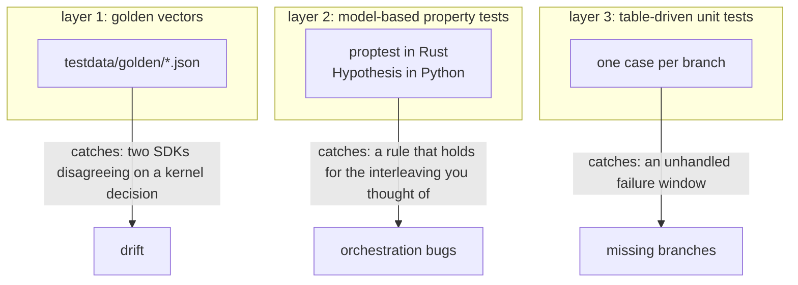
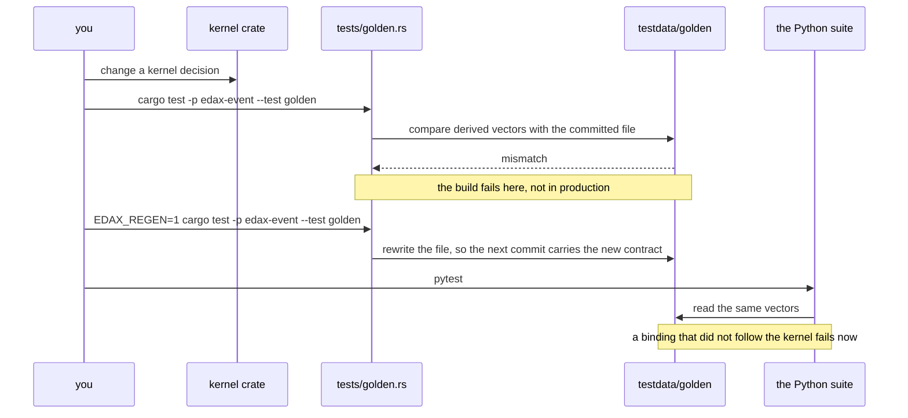
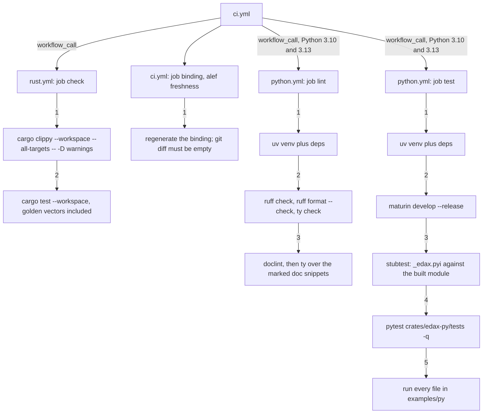

# Testing

How this repository proves itself (golden vectors, model-based property tests, table-driven unit
tests), and how a host reuses the same suites against its own backend.

The three layers answer different questions. Golden vectors ask "do two languages agree?". Model
tests ask "does the rule hold over thousands of histories?". Unit tests ask "is this one failure
window handled?". A bug that escapes all three is a bug in a seam no backend implements yet.



## Layer 1: golden vectors

`testdata/golden/*.json` is the cross-language contract. Every kernel derives its vectors in a
`tests/golden.rs` and hands them to one harness, `edax_golden::write_or_check`, which either
regenerates the file or asserts the committed one still matches. Both test suites then read the same
files: the Python suite (`crates/edax-py/tests/test_edax.py`, `test_command.py`, `test_kafka.py`,
`test_redis.py` and others) and the Rust `golden.rs` targets.

The list of vectors and what each covers is in
[../kernels/golden-vectors.md](../kernels/golden-vectors.md). The workflow is this:



Regenerate only when you mean to change the contract:

```sh
EDAX_REGEN=1 mise exec -- cargo test -p edax-event --test golden
EDAX_REGEN=1 mise exec -- cargo test -p edax-cqrs  --test golden
EDAX_REGEN=1 mise exec -- cargo test -p edax-core  --test golden
EDAX_REGEN=1 mise exec -- cargo test -p edax-kafka --test golden
EDAX_REGEN=1 mise exec -- cargo test -p edax-redis --test golden
```

A golden vector always wins over a disagreeing test (`AGENTS.md`). Presence of the environment
variable alone selects regeneration; the value is not read.

## Layer 2: model-based property tests

Both software development kits (SDKs) run the same six properties. Each replays a random operation
history against the shipped in-memory stores. It compares every observable against a trivial
reference model. That model is a `Vec` or `HashMap` in Rust, a `list` or `dict` in Python, simple
enough to have the intended semantics on sight. Where a hand-written test pins one interleaving,
these pin the rule over thousands of them, and the framework shrinks a failure to a minimal history.

The frameworks are `proptest` in Rust (`crates/edax/tests/model.rs`) and Hypothesis in Python
(`crates/edax-py/tests/test_model.py`).

| Property | Invariant asserted | Rust | Python |
|---|---|---|---|
| P1 event store + outbox | the `append` compare-and-set, the per-aggregate load window, and the outbox first in, first out (FIFO) match the model | `store_matches_model` | `test_store_matches_model` |
| P2 command bus | routing, the idempotency claim, replay of a completed record, and the `pending` state match the model | `idempotent_bus_matches_model` | `test_idempotent_bus_matches_model` |
| P3 dispatcher | per-aggregate FIFO under any worker count, and settlement by outcome (Python also covers dead-letter routing) | `dispatcher_keeps_per_aggregate_fifo` | `test_dispatcher_keeps_per_aggregate_fifo` |
| P4 `Repository` | save then load equals a pure fold of the events | `repository_matches_fold` | `test_repository_matches_fold` |
| P5 codecs | an envelope round-trips through JSON and MessagePack, and garbage is rejected as a terminal `CodecError` | `codecs_roundtrip`, `codecs_reject_garbage` | `test_kernel_serializer_roundtrip`, `test_kernel_serializer_rejects_garbage` |
| P6 projection store | optimistic concurrency on `version`, plus sort / offset / limit paging, match the model | `projection_matches_model` | `test_projection_matches_model` |

Rust adds one deterministic race. `concurrent_appends_one_winner` starts eight threads appending to
one aggregate at the same expected version. It asserts exactly one wins. The rest get a conflict
carrying the version that beat them. The stream gains exactly one event. It is a race, not a
history, so it is not a property.

**Scope.** These cover SDK orchestration only: the storage seam, the guard, the dispatcher, the
repository, the codecs, the projection seam. Kernel semantics (filter, query ordering, dedup,
partition, backoff) are pinned by layer 1 and not re-derived here.

Case counts are committed in the source: `cases: 128` for most Rust properties, `64` for the
dispatcher, `256` for the codecs; `max_examples=200` for most Python ones, `100` for the codecs. Raise them for a deeper
sweep:

```sh
PROPTEST_CASES=2000 mise exec -- cargo test -p edax --test model
crates/edax-py/.venv/bin/python -m pytest crates/edax-py/tests/test_model.py --hypothesis-seed=0
```

Python falsifying examples are cached under `.hypothesis/`, which is gitignored; reproduce a
reported failure from the printed example or with `--hypothesis-seed=<seed>`.

## Layer 3: table-driven unit tests

The ordinary layer: one test, one table, one case per branch. The guarantee suite is the one to
read.

### The guarantee suite

`crates/edax-py/tests/test_unit_of_work.py` and `crates/edax/tests/unit_of_work.rs` cover
what `unit_of_work=` guarantees in each ledger mode. They share one property:

> A done record never covers work that did not land.

A key that reads back as a completed success must have had its handler's write land at least once.
Its converse separates the two modes. With a shared ledger the count is exactly one, because the
claim and the write are one commit. With an own ledger it may be two. See [delivery
guarantees](./delivery-guarantees.md). The property is written once per SDK, because it belongs to
the seam, not to one binding.

The case table is one row per failure window. Each case asserts both halves, how many times the
handler ran and whether its write is visible, because either alone can look right while the other
is wrong.

| Case | Mode | Handler runs | Final balance | What it pins |
|---|---|---|---|---|
| `shared_success_replays_instead_of_rerunning` | shared | 1 | 100 | the second dispatch replays |
| `shared_transient_failure_rolls_back_claim_and_work_so_the_redelivery_reruns` | shared | 2 | 0 | the rollback is the release |
| `shared_terminal_failure_is_not_cached_because_the_rollback_would_erase_it` | shared | 2 | 0 | a terminal failure is not cached when the cache would roll back too |
| `shared_failed_commit_drops_the_claim_with_the_work` | shared | 2 | 0 | a failed commit leaves neither |
| `split_success_replays_instead_of_rerunning` | split | 1 | 100 | the dedup window works |
| `split_transient_failure_releases_the_claim_so_the_redelivery_reruns` | split | 2 | 0 | the hand-written compensation runs |
| `split_terminal_failure_is_cached_and_replays` | split | 1 | 0 | caching is what stops a broker redelivering forever |
| `split_failed_commit_releases_the_claim_so_the_work_is_not_lost` | split | 2 | 0 | the window the guard-owned transaction exists to close |
| `split_lost_commit_response_releases_a_claim_over_work_that_landed_so_it_runs_twice` | split | 2 | 200 | the irreducible at-least-once case |

Beside the table the same file drives the real dispatcher. Settlement is asserted from the broker's
view rather than from the guard's internals. A nack releases the claim and an ack keeps it.
`InProgress` nacks without spending the attempt budget. A terminal failure dead-letters on the first
attempt. A nested unit of work is refused.

### The transaction contract

`crates/edax/tests/transaction.rs` runs four tests, one per clause of the `Transactor` contract,
over the public application programming interface (API). `crates/edax-py/tests/test_transactor.py`
runs the same four under the same names with a `test_` prefix, because the contract is
cross-language:

- `a_raise_inside_a_transaction_leaves_nothing_behind`.
- `a_rolled_back_claim_releases_the_key_so_the_next_dispatch_reruns_the_handler`.
- `a_transaction_reads_its_own_uncommitted_writes_which_nobody_else_sees`.
- `a_commit_makes_every_participants_write_visible_together`.

### `*.proptest-regressions`

When `proptest` finds a failure it shrinks it and appends the seed to a file beside the test:

```
cc 48da9dbce3636bdab0830ca1d3bfa9c1ff90a1be712f8c70226118e1554c8749 # shrinks to history = [Append { agg: 0, delta: 0, n: 1, ns: 0, gap: true }]
```

Those files are checked in. `proptest` reads them first. It replays every recorded
case before it generates a novel one. A bug that was once found can never come back unnoticed, even
on a machine that would never have generated that seed. Delete a line only when you mean to stop
testing that case. `crates/edax/tests/model.proptest-regressions` carries two: a terminal dispatch
followed by a successful one on the same key, and an append batch with a gap in its sequences.

Hypothesis does the same thing in `.hypothesis/`, but that directory is gitignored, so a Python
regression is pinned by adding an explicit case to the table instead.

## The packaged conformance suite

`edax.testing` is the one layer aimed outward. Everything above tests `edax`; this tests the backend
you wrote, which neither this project nor its test suite has ever seen.

```python
import pytest
from edax.testing import EventStoreContract


class TestPostgresEventStore(EventStoreContract):
    @pytest.fixture
    async def event_store(self, pool):
        return PostgresEventStore(pool)
```

Install it with `pip install edax[test]`. Full seam-by-seam coverage, the capability flags, and the
fault wrappers are in [the backend guide](../backends/README.md). `examples/py/18_contract_kit.py`
runs `ProjectionStoreContract` over a dict-backed store in about forty lines. Know these properties
before you rely on it:

- **It is proved to discriminate.** `crates/edax-py/tests/test_contract_discriminates.py` breaks one
  clause per case, the way a real backend breaks it. A signed column for an unsigned hash, `>=` where
  the contract says `>`, a version advanced by a failed save. Each case asserts the suite catches it.
- **It runs against the in-tree backends too.** `test_contract_memory.py` holds the memory stores to
  the same clauses, so the suite cannot drift from the implementations it describes. `MemoryLedger` and
  the Redis store (`test_redis.py`) run the same `IdempotencyStoreContract`, takeover and
  unreadable-record clauses included.
- **It catches races, not only wrong answers.** Each seam has a race clause. Two units of work stage a
  write at one version before either commits, and exactly one may land. The order is forced, not left to
  timing. The second writer runs in a task of its own. The first commits after the second staged, or after
  a bounded wait when the store parks the second on a row lock. So a blocking SQL store does not deadlock
  the clause. A read-then-write store passes every one-call clause and fails this one: see
  `CheckThenActEventStore` in `test_contract_discriminates.py`.
- **It checks isolation.** A staged write must be invisible to another unit of work. A joining ledger
  gets two more clauses. A claim staged in an open transaction is never won by another. A release with
  nothing committed leaves a concurrent winner's record. These clauses need an async driver, because one
  that blocks the event loop deadlocks any asyncio code.
- **Its payloads are real.** Envelopes carry a `guid()` id, a `current_timestamp()` and a JSON body, as
  the SDK writes them. A store with an `id uuid` column then passes or fails for the right reason.
- **The discrimination test is strict.** `test_contract_discriminates.py` is one table, a row per
  mistake. A row counts as caught only when the clause fails with its own verdict: an assertion, a
  `pytest.raises` that did not fire, or a seam's typed error. The race and isolation rows also name the
  assertion that must fire. A store that crashes for an unrelated reason is not a catch. Positive controls
  run the same clauses over the same rigs without the mistake.

### Fault wrappers

`edax.testing.faults` wraps any store by delegation, so the same fault lands on Postgres, Redis or memory:

| Wrapper | Fault |
|---|---|
| `LostResponse(store)` | `arm("append")` lands the next `append`, then raises `StoreError`: a reply lost after the write. `arm("commit")` loses the reply of the next unit of work after it committed. Arming a method the store lacks raises `AttributeError` instead of never firing. |
| `Refusing(store, "complete", "release")` | refuses the named calls outright, writing nothing, and counts them in `refusals` |
| `BrokenCommit(transactor, arm)` | a commit that fails with nothing landed (`"nothing_landed"`) or after it landed (`"lost_response"`); its `transactor` is the wrapped one, so the stores over it join the units of work it opens |
| `LostReply(conn, script, resend)` | the Redis `eval` seam losing the reply to one script, with or without redis-py's re-send |

The in-tree suites use these and nothing else; `tests/test_faults.py` proves each one fires once where
armed. `MemoryLedger.expire(key)` and `MemoryIdempotencyStore.expire(key)` are the memory side of a TTL
running out, for takeover tests. `examples/py/15_lease_takeover.py` rehearses that takeover, and
`examples/py/19_fault_injection.py` drives a handler through `BrokenCommit(db, "lost_response")`.

## Contract suites a host can reuse

Four harnesses are written against the seam, not the backend, so pointing one at a new
implementation takes a factory and one list entry.

| Suite | Seam | How to point it at your backend |
|---|---|---|
| `edax.testing.BrokerContract` | `Producer` / `Consumer` | subclass it and give it a `broker_rig` fixture returning a `BrokerRig`: `publish`, `consumer(group)`, `commit(group)`, `crash(group)`, `drained(group)`; `test_broker_contract.py` has the memory and Kafka rigs, and `test_broker_model.py` runs both under random faults |
| `crates/edax-py/tests/test_model.py` P2 | `IdempotencyStore` | add a branch to `_idempotency_backend` returning `(store, lapse, put_raw)`: `lapse` is an async callable that makes every key's TTL run out, `put_raw` writes a raw record. Then add your name to `@pytest.mark.parametrize("backend", [...])` |
| `crates/edax/tests/model.rs` P1 | `EventStore` | call `check_event_store(YourStore::new, history)`; the generic bound is the contract |
| `crates/edax/tests/model.rs` P6 | `ProjectionStore` | call `check_projection_store(YourStore::new, history)` |

The second element of the P2 factory is how an `Expire` operation runs every TTL out: `FLUSHALL` on the
fakeredis client, `expire(key)` per key on memory. A store with a dedup window is then exercised across
record expiry. The oracle assumes the store fences on the claim handle, as every in-tree ledger does, so a
release after a landed `complete` keeps the record.

`test_redis.py` and `test_kafka.py` are not contract suites. They pin
adapter-specific behaviour that a different backend does not owe: Redis error typing, lease renewal
and lost replies, and Kafka's watermark-only commit. `test_redis.py` does run the
`IdempotencyStoreContract` too, takeover clauses included, against fakeredis and any live Redis
named by `EDAX_REDIS_URL`. fakeredis runs the kernel's Lua in an embedded interpreter, so no fake
re-implements the fence.

## Running everything

```sh
# kernels + reference Rust SDK; layer 1 and the Rust half of layers 2 and 3
mise exec -- cargo test --workspace
mise exec -- cargo clippy --workspace --all-targets -- -D warnings

# Python SDK; layer 1's Python half plus the Python halves of layers 2 and 3
crates/edax-py/.venv/bin/python -m pytest crates/edax-py/tests -q

# the examples: every one ends in asserts, so a clean exit is the test
for f in examples/py/*.py; do crates/edax-py/.venv/bin/python "$f" || break; done
```

`pytest` does not rebuild `_edax`. Read [the stale native module
trap](./getting-started.md#the-stale-native-module-trap).

### The order CI runs them in



The jobs run concurrently; the steps inside each are ordered. `lint` runs beside `test` rather than
gating it, so a style error does not wait on a release build of the kernel. In `test`, the
`maturin develop --release` step must stay before `pytest`; the comment above it in
`.github/workflows/python.yml` says why.

## See also

- [../kernels/golden-vectors.md](../kernels/golden-vectors.md) — the vector list and what each one
  pins.
- [./delivery-guarantees.md](./delivery-guarantees.md) — the guarantees the unit-of-work suite
  proves.
- [./getting-started.md](./getting-started.md) — the build order, and the stale native module trap.
- [../backends/README.md](../backends/README.md) — the seam contracts a reusable suite checks.
- [./examples.md](./examples.md) — `examples/py`, which continuous integration (CI) runs as tests.
