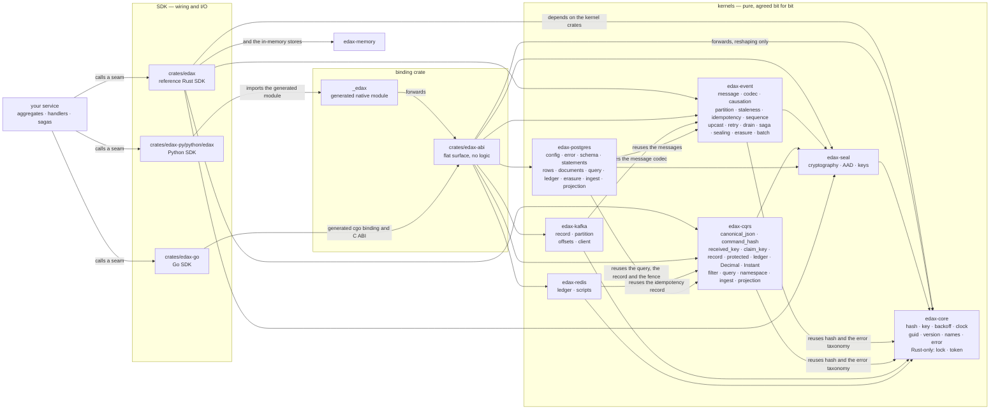
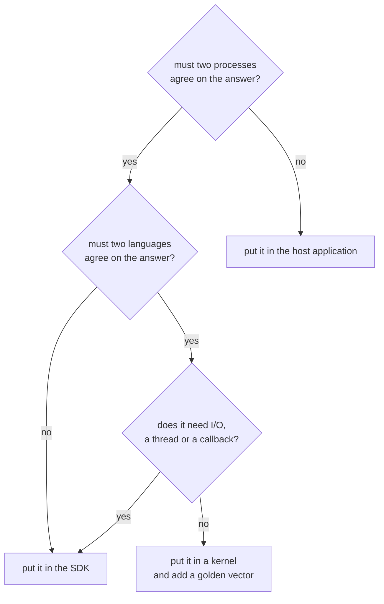

# The kernels

What the shared Rust kernels own, why the boundary sits exactly there, and how each software
development kit (SDK) reaches them.

The SDK wires; the kernel decides. A decision that must be identical in
every language and every process lives in a kernel. A golden vector in `testdata/golden/` pins it.
Everything else lives above it: transports, transactions, ergonomics and business rules.

Each node lists its crate's modules. The table at the top of each kernel's page ([core](./core.md),
[seal](./seal.md), [event](./event.md), [cqrs](./cqrs.md), [kafka](./kafka.md), [redis](./redis.md),
[postgres](./postgres.md)) is the one complete
description of what each module owns.

`edax-kafka`, `edax-redis` and `edax-postgres` are the three per-technology kernels. Each one owns the bytes, names and
state decisions a backend forces two SDKs to share, and each SDK ships only the client calls around
it. The [glossary](../glossary.md) calls this a protocol module in Rust with an input and output
(I/O) shell per SDK.

The Rust SDK depends on `edax-core`, `edax-event`, `edax-cqrs` and `edax-memory` directly
(`crates/edax/Cargo.toml`). The Python SDK reaches the same code through one extra hop.
`crates/edax-abi` holds a flat, plain-Rust surface with no logic of its own. Alef generates the
native `_edax` module from it. That generated module is never hand-edited. Both paths end at the
same function. Go reaches it through alef's generated C ABI and a cgo binding. Shared functions
keep filter verdicts and other kernel decisions consistent across these paths.

## The rule: the SDK wires, the kernel decides

Neither the SDK nor the binding crate may re-derive kernel logic (`AGENTS.md`, "Binding
responsibilities"). That forbids:

| Forbidden above the kernel | Why |
|---|---|
| Duplicated validation — filter null/missing rules, upcast gap detection, concurrency checks | Two evaluators drift on the edge cases, such as a null or missing path |
| A re-implemented idempotency, dedup or `payload_hash` decision | The SDK *wires* middleware; the kernel *decides*. A second implementation makes a shared ledger disagree with itself |
| Host-side canonicalization before hashing | Python's `json.dumps(ensure_ascii=True)` does not agree with serde on non-ASCII, so idempotency keys would stop matching across SDKs |
| Routing or partition placement | `ordering_key`, `partition_for` (broker) and `partition` (local workers) are the kernels', so two producers cannot split an aggregate across partitions and two consumers cannot disagree about a worker |
| Business rules | Those belong to the host application, not to a shared library |

The binding crate does only type conversion, error-to-exception mapping, and idiomatic config and
builders. Every `edax-abi` function is synchronous, so it has no async runtime to integrate.

Three places in the code follow the rule:

- The Python exception classes read their terminal/transient verdict from the kernel at class
  definition time and never state it themselves: `cls.terminal = _edax.error_verdict(code)`. A code
  the kernel does not know fails the import.
- The Rust SDK has no error type of its own. `edax::Error` is a re-export of `edax_core::Error`, so
  the verdict comes off the kernel's `ErrorCode`.
- Every closed set of names a decision crosses as, the kernel owns: a unit enum with `as_str` and
  `ALL`. The sets are `Tenancy`, `StateKind`, `OutcomeKind`, `SagaWriteKind`, `SagaAdmitKind`,
  `Failure`, `VerdictKind`, `RowFailedKind` and `Holder`. `edax_core::closed_names!` writes each enum,
  its `ALL` and its `as_str` from one row list. So no variant can miss the list, and no name can
  repeat. The ABI hands over each list a binding branches on: `tenancy_modes`, `idempotency_states`,
  `idempotency_outcomes`, `saga_write_actions`, `saga_admit_actions`, `retry_failures`,
  `retry_actions` and `drain_actions`. `Holder` crosses only in `idempotency_fence.json`. Python spells each as a `Literal`, so a type checker proves every branch, and
  checks it against the kernel's list at import. A name the kernel adds fails the import instead of
  landing in a neighbouring branch. The names cross as strings, not as alef enums, because alef binds
  a unit enum as a plain class that no type checker can prove a `match` over.

Three questions decide where a new decision goes.

## The decisions, and what each golden vector prevents

Every row is a decision the kernel owns. The vector is the cross-language contract: the Rust and Python suites
assert it, and a byte of drift fails the build.

| Decision | Kernel | Golden vector | Failure if two services disagreed |
|---|---|---|---|
| Does this document match this filter? | `edax-cqrs` | `filter.json` | One service returns a row the other hides — a read model that answers differently depending on which replica served it |
| How long until retry `n`? | `edax-core` | `backoff.json` | Workers retry on different rhythms; a shared broker sees a herd where the schedule was meant to spread it |
| Is this failure terminal or transient? | `edax-core` | `error_taxonomy.json` | One SDK caches a failure under the idempotency key that the other would release — a durable replay inconsistency in a shared ledger |
| Which local worker runs this ordering key? | `edax-event` | `partition.json` | Two dispatchers in one process run one aggregate on two workers, so its events race |
| Is a failed message retried, after how long, dead-lettered, or does the consumer stop? | `edax-event` | `retries.json`, `retry_failure.json` | One SDK retries a message the other dead-letters, so the same failure gets a different number of attempts; or one moves a whole topic into the dead-letter queue over a wiring fault the other stops on |
| Does a saga step fold this event, and what does it write? | `edax-event` | `saga.json` | A redelivered event folds twice in one SDK, or two SDKs mint different ids for the same outbox command |
| What bytes does this event or command serialize to? | `edax-event` | `envelopes.json` | A producer writes bytes a consumer in another language cannot decode, or decodes into a different message |
| What does a reader accept, ignore and refuse in a message? | `edax-event` | `envelope_decode.json` | A newer producer's added field makes every message poison for an older consumer, in one format only |
| Which extension keys may a message carry? | `edax-event` | `extensions.json` | One SDK writes a key another refuses, so every message it produces is poison downstream |
| Which key orders this message? | `edax-event` | `ordering_key.json` | A command lands on a different partition or worker in each SDK, so it overtakes the events of its aggregate |
| How is a filtered page ordered, where does the cursor cut, and which sort does it bind? | `edax-cqrs` | `query.json`, `cursor.json` | Page two skips or repeats rows; a cursor generated by one service is rejected or misread by another, or replayed under another sort |
| Which `v -> v+1` steps raise a stored event, and is there a gap? | `edax-event` | `upcast.json` | One service applies transforms in a different order or silently tolerates a missing step, producing a different payload |
| What lineage does a child of a message get? | `edax-event` | `causation.json` | A trace breaks at the language boundary, so a cross-service failure cannot be attributed |
| What lineage does a message no message caused start with? | `edax-event` | `causation_originate.json` | Roots of two traces are generated differently, so correlation cannot be joined |
| Is an incoming sequence older than the watermark, and what is the watermark after it applies? | `edax-event` | `staleness.json` | One consumer applies a redelivered event the other skips, or an unsequenced event erases the mark and a stale event lands |
| What is the stable hash of these bytes? | `edax-core` | `payload_hash.json` | Idempotency keys bind to different hashes, so a duplicate is not recognised as one |
| What are the canonical bytes of this JSON, and their hash? | `edax-cqrs` | `canonical_payload_hash.json` | The same logical command spelled with different key order or escaping hashes twice, defeating deduplication |
| *Which* bytes does a command's hash cover? | `edax-cqrs` | `command_hash.json` | One SDK includes a field or the name the other omits, so the same command looks like a payload mismatch |
| Which ledger key does a command guard claim? | `edax-cqrs` | `claim_key.json` | Two SDKs claim one intent under two keys, so a shared ledger runs it twice |
| What does the stored record look like, and what verdict does a losing claimant read from it? | `edax-cqrs` | `idempotency_record.json` | A record written by one SDK is unreadable or read with the wrong outcome by another sharing the ledger; a reused key runs twice in one service and replays in another |
| What key and header does a published event or command become on a topic? | `edax-kafka` | `kafka_record.json` | A consumer in another language cannot route the value to its serializer |
| Which broker partition does a record key land on? | `edax-kafka` | `kafka_partition.json` | A Python and a Rust (or Java) producer put one aggregate on two partitions, so its order breaks silently |
| Which serializer does a fetched record name, and what if nobody registered it? | `edax-kafka` | `kafka_decode.json` | A record is decoded with the wrong codec instead of dead-lettered, so a wrong message reaches a handler |
| Which offset may a consumer commit, and which token settles a delivery? | `edax-kafka` | `kafka_offsets.json` | A commit skips an offset still in flight, so a restart never redelivers it |
| Is a broker error one record's, the client's, or passing? | `edax-kafka` | `kafka_error.json` | One SDK dead-letters a record the broker refused while the other retries it forever, or one drains the outbox into the dead-letter queue over an ACL mistake |
| May a microbatch admit more input, flush, retry or isolate a failure? | `edax-event::batch` | `event_batch.json` | A runner exceeds retained budgets or rejects originals after an uncertain commit |
| Which originals may own or replace an ingestion row? | `edax-cqrs::ingest` | `ingest.json`, `ingestion_numbers.json` | A rejected original acquires ownership, stale state returns, or rounded numbers alias an identity |
| May a delta run, and which state, receipts, intents and checkpoint must commit together? | `edax-cqrs::projection` | `projection_state.json`, `projection_state_boundaries.json`, `ingestion_numbers.json` | Replay applies twice, a sequence gap passes, or an old owner changes current progress |
| Which SQL stores ingestion and projection state decisions atomically? | `edax-postgres::{ingest, projection}` | `postgres_ingest.json`, `postgres_projection_state.json` | A store omits a rejection, loses a fence, or delivers an effect a cutover made ineligible |
| What bytes sit under an idempotency key in Redis? | `edax-redis` | `redis_value.json` | A ledger written by one SDK is unreadable by another sharing it, so both run the same command |
| Which Lua does a fenced write or a forget run? | `edax-redis` | `redis_scripts.json` | Two SDKs cache two `EVALSHA` digests for one fence, so a lapsed worker overwrites its successor's claim |
| Which tables, statements and row layout does a Postgres store use? | `edax-postgres` | `postgres_contract.json`, `postgres_statements.json`, `postgres_rows.json` | One SDK writes a row the other cannot read, or appends events past the other's version check |
| What SQL does a read-model query become? | `edax-postgres` | `postgres_query.json` | A Postgres read model answers a filter or cuts a page differently from the memory store, so two services disagree on one row |
| What does a Postgres error mean? | `edax-postgres` | `postgres_error.json` | One SDK retries a reused id forever while the other refuses it, or counts a held claim toward the dead-letter limit |

The table shows the main decisions. [Golden vectors](./golden-vectors.md) lists every file.

Every vector is derived by the golden test of the crate that owns the code it pins. The harness
itself is one crate, so the rule enforcing the contract cannot drift between kernels.

## Deterministic, and the four functions that are not

Kernel decisions are deterministic given their inputs and any caller-owned state. Four functions also read ambient state:

| Function | Source | Why it is not deterministic | What it guarantees instead |
|---|---|---|---|
| `guid` | `crates/edax-core/src/guid.rs` | Reads the clock and a random source to generate a universally unique identifier (UUID) v7 | Structural only: 8-4-4-4-12 lowercase hyphenated, version 7, RFC4122 variant, time-ordered prefix |
| `current_timestamp` | `crates/edax-core/src/clock.rs` | Reads the wall clock, then bumps a process-local high-water mark | Strictly greater than every prior return in this process, even across a Network Time Protocol (NTP) step backwards |
| `new_claim` | `crates/edax-redis/src/ledger.rs` | Mints a fresh UUID v7 owner token for the claim value from the clock and a random source | Structural only: the token is 32 lowercase hexadecimal characters, version 7, and distinct per call |
| `new_owner` | `crates/edax-postgres/src/ledger.rs` | Mints a fresh UUID v7 owner token for a Postgres claim, as `new_claim` does | Structural only, as `new_claim` |

None of the four carries a golden vector, and each docstring says so. They still belong in a kernel
because the shape of what they produce is a cross-language contract. A token of the wrong width
cannot fence a claim any other SDK wrote. These functions do not establish delivery order:
aggregate sequences do that. The Rust and Python SDKs accept overrides for identifier and timestamp
generation so tests can pin them: `Repository::with_clock` in Rust and the `new_id=` / `now=` constructor arguments in
Python.

`current_timestamp` also holds the only mutable state any kernel function keeps: one process-local
`AtomicI64` high-water mark. It spans neither restarts nor machines, so the guarantee is
monotonicity, not a value. `edax-kafka`'s `OffsetTracker`, `edax-event`'s `Retries` and
`edax-core`'s `TokenMint` are mutable too, but the host owns that state. A consumer constructs its
own tracker, and two trackers share nothing.

## Purity constraints

Kernel calls are synchronous. The kernels start no threads and call no database or broker client.
Their external runtime dependencies are `serde`, `serde_json`, `serde_json_canonicalizer`,
`rmp-serde`, `serde_bytes`, `base64`, `uuid`, `bigdecimal` and `jiff`.
The clock and identifier exceptions are listed above. Rust's `lock` helper synchronizes native
state; it does not make a storage or network call.

These constraints allow:

- **Reproducibility.** A decision with no ambient input is the same in a test, in continuous
  integration (CI), in production, and in the other language. That is what makes a golden vector a
  proof rather than a snapshot.
- **Table-driven tests with no fixtures.** A vector is input plus expected output. No broker to
  start, no database to seed, no clock to freeze.
- **Safe to call anywhere.** No I/O means no blocking call inside your transaction. No callback
  means the kernel cannot re-enter your code while it holds your lock. No thread means no runtime to
  reconcile with the host's.
- **A surface a generator can bind.** `edax-abi` is a flat list of plain-Rust signatures, which is
  what alef extracts to emit the native module. A kernel that took a callback or an async handle
  could not be described that way.
- **Interpreter lock release for free functions.** Alef wraps generated Python free functions such
  as `eval_filter` in `py.detach`. Native-handle methods keep the lock. Those handles are bound to
  their creating thread, and the Python SDK checks that ownership before each call.

The cost is that everything impure is the SDK's job: persistence, transactions, brokers,
concurrency, retries in wall-clock time. The kernel says *how long to wait*; the SDK does the
waiting.

## See also

- [core.md](./core.md) — `edax-core`: `hash`, `key`, `backoff`, `clock`, `guid`, `version`, `names`,
  `error`, `sync`, `token`.
- [filter.md](./filter.md) — the filter module of `edax-cqrs`, on its own page.
- [event.md](./event.md) — `edax-event`: the messages, codec, lineage, ordering key, partition,
  upcast, staleness, the event guard's key, sequence, retry, drain, saga, sealing and erasure.
- [cqrs.md](./cqrs.md) — `edax-cqrs`: canonical JSON, the command hash, the received and claim keys,
  idempotency, record and forget, protected fingerprints and results. Queries cover filter, sort and cursors.
- [kafka.md](./kafka.md) — `edax-kafka`: the record key and header per kind, the media types, the poison id,
  and the token-settled offset watermark.
- [redis.md](./redis.md) — `edax-redis`: the ledger value layout, the owner token and the five fenced
  scripts.
- [postgres.md](./postgres.md) — `edax-postgres`: the schema, the statements, the row layout, the query
  compiler, the error verdict, the ledger fence and durable erasure.
- [golden-vectors.md](./golden-vectors.md) — how the contract is generated, asserted and
  regenerated.
- [../architecture.md](../architecture.md) — the full layering and build pipeline these crates sit
  in.

The optional [seal kernel](seal.md) owns the encryption protocol and memory key-provider reference.
`edax-event::sealing` binds it to messages and state; `edax-event::erasure` owns the workflow.
`edax-cqrs::protected` owns protected command fingerprints and results; `edax-postgres::erasure`
owns durable operations, notifications and transactional destination fences.
