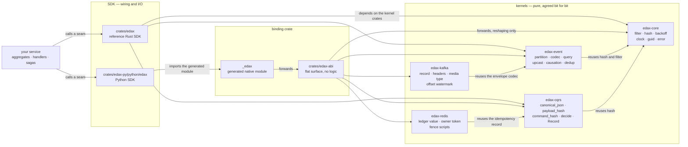
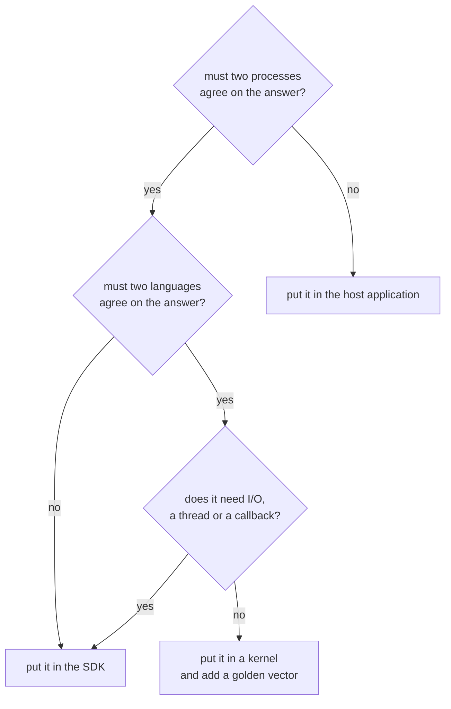

# The kernels

What the five pure Rust kernels own, why the boundary sits exactly there, and how each software
development kit (SDK) reaches them.

The SDK **wires**; the kernel **decides** (`README.md:38`). A decision that must be identical in
every language and every process lives in a kernel. A golden vector in `testdata/golden/` pins it.
Everything else lives above it: transports, transactions, ergonomics and business rules.

`edax-kafka` and `edax-redis` are the two per-technology kernels. Each one owns the bytes, names and
state decisions a backend forces two SDKs to share, and each SDK ships only the client calls around
it. The pattern has a name: a protocol module in Rust, an input and output (I/O) shell per SDK.

The Rust SDK depends on `edax-core`, `edax-event` and `edax-cqrs` directly
(`crates/edax/Cargo.toml`). The Python SDK reaches the same code through one extra hop.
`crates/edax-abi` holds a flat, plain-Rust surface with no logic of its own. Alef generates the
native `_edax` module from it. That generated module is never hand-edited. Both paths end at the
same function, which is why a filter built in Python and a filter built in Rust reach the same
verdict.

## The rule: the SDK wires, the kernel decides

Neither the SDK nor the binding crate may **re-derive** kernel logic (`AGENTS.md`, "Binding
responsibilities"). Concretely, that forbids:

| Forbidden above the kernel | Why |
|---|---|
| Duplicated validation — filter null/missing rules, upcast gap detection, concurrency checks | Two evaluators drift on the edge cases; the edge cases are exactly where filters get subtle |
| A re-implemented idempotency, dedup or `payload_hash` decision | The SDK *wires* middleware; the kernel *decides*. A second implementation makes a shared ledger disagree with itself |
| Host-side canonicalization before hashing | Python's `json.dumps(ensure_ascii=True)` does not agree with serde on non-ASCII, so idempotency keys would stop matching across SDKs |
| Routing or partition placement | `partition` and `rendezvous` are the kernel's, so two consumers with different worker counts cannot disagree about an aggregate id |
| Business rules | Those belong to the host application, not to a shared library |

The binding crate does **only** type conversion, error-to-exception mapping, idiomatic config and
builders, and async-runtime integration. Nothing else.

Two places show the rule honored rather than asserted:

- The Python exception classes read their terminal/transient verdict from the kernel at class
  definition time and never state it themselves — `cls.terminal =
  _edax.error_code_is_terminal(code)`. A code the kernel does not know fails the import.
- The Rust SDK's `Error::code` maps each variant to an `ErrorCode` and stops there; the verdict is
  read back off the code.

The test for a new decision is one question.

## The decisions, and what each golden vector prevents

Every row is a decision the kernel owns. The vector is the cross-language contract: both test suites
assert it, and a byte of drift fails the build.

| Decision | Kernel | Golden vector | Failure if two services disagreed |
|---|---|---|---|
| Does this document match this filter? | `edax-core` | `filter.json` | One service returns a row the other hides — a read model that answers differently depending on which replica served it |
| How long until retry `n`? | `edax-core` | `backoff.json` | Workers retry on different rhythms; a shared broker sees a herd where the schedule was meant to spread it |
| Is this failure terminal or transient? | `edax-core` | `error_taxonomy.json` | One SDK caches a failure under the idempotency key that the other would release — a durable replay inconsistency in a shared ledger |
| Which partition does this aggregate id route to? | `edax-event` | `partition.json` | Two consumers place the same aggregate on different workers, so per-key ordering is lost and two writers race the same stream |
| Which owner does rendezvous hashing pick? | `edax-event` | `rendezvous.json` | A rescale remaps ids one node computed and another did not, so a key is served twice or not at all |
| What bytes does this envelope serialize to? | `edax-event` | `envelopes.json` | A producer writes bytes a consumer in another language cannot decode, or decodes into a different event |
| How is a filtered page ordered and where does the cursor cut? | `edax-event` | `query.json` | Page two skips or repeats rows; a cursor generated by one service is rejected or misread by another |
| Which `v -> v+1` steps raise a stored event, and is there a gap? | `edax-event` | `upcast.json` | One service applies transforms in a different order or silently tolerates a missing step, producing a different payload |
| How do `causation_id` and `correlation_id` propagate? | `edax-event` | `causation.json` | A trace breaks at the language boundary, so a cross-service failure cannot be attributed |
| What metadata does a fresh, uncaused event start with? | `edax-event` | `causation_originate.json` | Roots of two traces are generated differently, so correlation cannot be joined |
| Should an incoming sequence be applied or ignored as old? | `edax-event` | `dedup.json` | One consumer applies a redelivered event the other ignores, so ordered at-least-once delivery lands twice |
| What is the stable hash of these bytes? | `edax-cqrs` | `payload_hash.json` | Idempotency keys bind to different hashes, so a duplicate is not recognised as one |
| What are the canonical bytes of this JSON, and their hash? | `edax-cqrs` | `canonical_payload_hash.json` | The same logical command spelled with different key order or escaping hashes twice, defeating deduplication |
| *Which* bytes does a command's hash cover? | `edax-cqrs` | `command_hash.json` | One SDK includes a field the other omits, so the same command looks like a payload mismatch |
| Proceed, replay, or reject a payload mismatch? | `edax-cqrs` | `idempotency.json` | A reused key runs twice in one service and replays in another — a double-charged customer |
| What does the stored record look like, and what verdict does a losing claimant read from it? | `edax-cqrs` | `idempotency_record.json` | A record written by one SDK is unreadable or read with the wrong outcome by another sharing the ledger |
| What key and headers does a published envelope become on a topic? | `edax-kafka` | `kafka_record.json` | A consumer in another language cannot find the event name, or the key splits one aggregate across partitions and loses its order |
| Which format does a fetched record name, and what if nobody knows it? | `edax-kafka` | `kafka_decode.json` | A record is decoded with the wrong codec instead of dead-lettered, so a wrong envelope reaches a handler |
| Which offset may a consumer commit, and which token settles a delivery? | `edax-kafka` | `kafka_offsets.json` | A commit skips an offset still in flight, so a restart never redelivers it |
| What bytes sit under an idempotency key in Redis? | `edax-redis` | `redis_value.json` | A ledger written by one SDK is unreadable by another sharing it, so both run the same command |
| Which Lua does a fenced write run? | `edax-redis` | `redis_scripts.json` | Two SDKs cache two `EVALSHA` digests for one fence, so a lapsed worker overwrites its successor's claim |

Two vectors are derived by a different kernel's test than the one that owns the code. `filter.json`
and `backoff.json` come from the `edax-event` golden test. `filter` and `backoff` themselves live in
`edax-core`. `error_taxonomy.json` comes from the `edax-core` golden test. The harness itself is one
crate, so the rule enforcing the contract cannot drift between kernels.

## Deterministic, and the two functions that are not

Every kernel function is a pure function of its arguments, with three deliberate exceptions:

| Function | Source | Why it is not deterministic | What it guarantees instead |
|---|---|---|---|
| `guid` | `crates/edax-core/src/guid.rs` | Reads the clock and a random source to generate a universally unique identifier (UUID) v7 | Structural only: 8-4-4-4-12 lowercase hyphenated, version 7, RFC4122 variant, time-ordered prefix |
| `current_timestamp` | `crates/edax-core/src/clock.rs` | Reads the wall clock, then bumps a process-local high-water mark | Strictly greater than every prior return in this process, even across an Network Time Protocol (NTP) step backwards |
| `new_owner` | `crates/edax-redis/src/ledger.rs` | Mints a fresh UUID v7 fence token from the clock and a random source | Structural only: 32 lowercase hexadecimal characters, version 7, and distinct per call |

None of the three carries a golden vector, and each docstring says so. They still belong in a kernel
because the shape of what they produce is a cross-language contract. A token of the wrong width
cannot fence a claim any other SDK wrote. Every service must generate an id that
sorts the same way. Every service must generate a timestamp that never repeats. Otherwise event
ordering and the outbox break. Both SDKs take the first two as overridable defaults, so a test can
pin them: `Repository::with_clock` in Rust and the `new_id=` / `now=` constructor arguments in
Python.

`current_timestamp` also holds the only mutable state any kernel *function* keeps: one process-local
`AtomicU64` high-water mark. It spans neither restarts nor machines, which is why the guarantee is
monotonicity and not a value. `edax-kafka`'s `OffsetTracker` is mutable too, but the host owns that
state: a consumer constructs its own tracker, and two trackers share nothing.

## Purity constraints

The kernels are pure, synchronous, allocation-light, and free of I/O, threads and callbacks. Their
whole dependency set is `serde`, `serde_json`, `rmp-serde`, `serde_bytes`, `base64` and `uuid` — no
runtime, no client, no database driver.

What that buys:

- **Reproducibility.** A decision with no ambient input is the same in a test, in continuous
  integration (CI), in production, and in the other language. That is what makes a golden vector a
  proof rather than a snapshot.
- **Table-driven tests with no fixtures.** A vector is input plus expected output. No broker to
  start, no database to seed, no clock to freeze.
- **Safe to call anywhere.** No I/O means no blocking call inside your transaction. No callback
  means the kernel cannot re-enter your code while it holds your lock. No thread means no runtime to
  reconcile with the host's.
- **A surface a generator can bind.** `edax-abi` is a flat list of plain-Rust signatures, which is
  what alef extracts to emit the native module. A kernel that took a callback or an async handle
  could not be described that way.
- **No lock held across a kernel call.** The generated Python wrappers release the interpreter lock
  around each call, for example `py.detach` around `eval_filter`. That is only sound because the
  kernel touches no Python state.

The cost is that everything impure is the SDK's job: persistence, transactions, brokers,
concurrency, retries in wall-clock time. The kernel says *how long to wait*; the SDK does the
waiting.

## See also

- [core.md](./core.md) — `edax-core` module by module: `hash`, `backoff`, `clock`, `guid`, `error`.
- [filter.md](./filter.md) — the filter module of `edax-core`, on its own page.
- [event.md](./event.md) — `edax-event`: partition, codec, query, upcast, causation, dedup, domain.
- [cqrs.md](./cqrs.md) — `edax-cqrs`: canonical JSON, payload and command hashes, the idempotency
  decision and record.
- [kafka.md](./kafka.md) — `edax-kafka`: the record key and headers, the media types, the poison id,
  and the token-settled offset watermark.
- [redis.md](./redis.md) — `edax-redis`: the ledger value layout, the owner token and the two fence
  scripts.
- [golden-vectors.md](./golden-vectors.md) — how the contract is generated, asserted and
  regenerated.
- [../architecture.md](../architecture.md) — the full layering and build pipeline these crates sit
  in.
