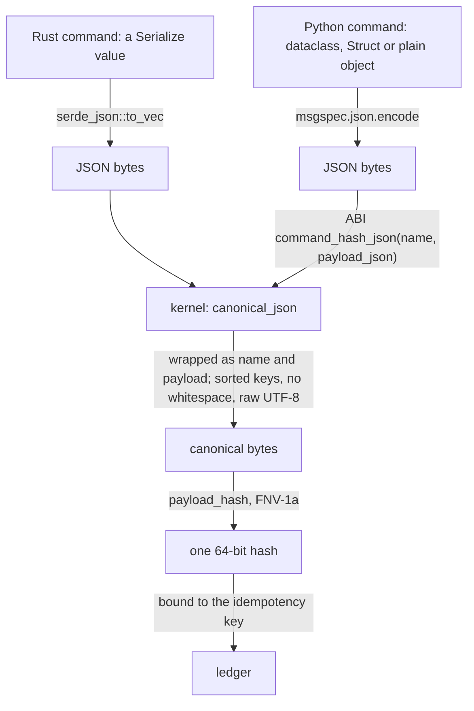
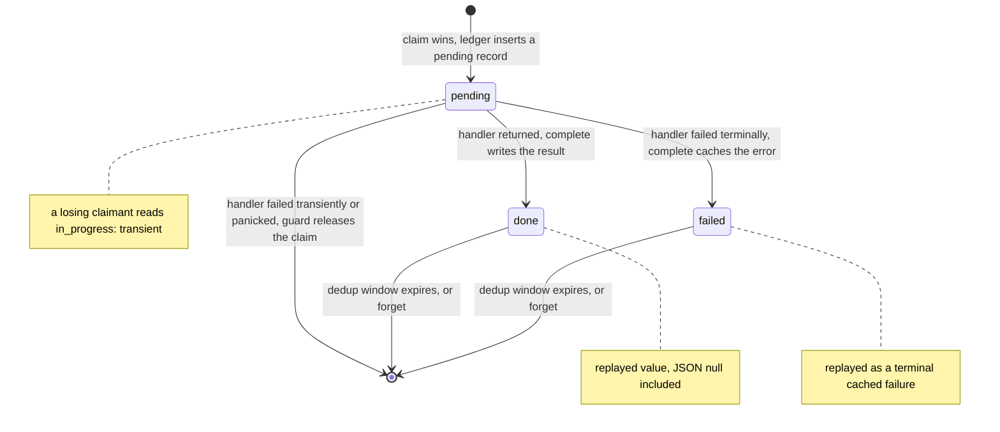
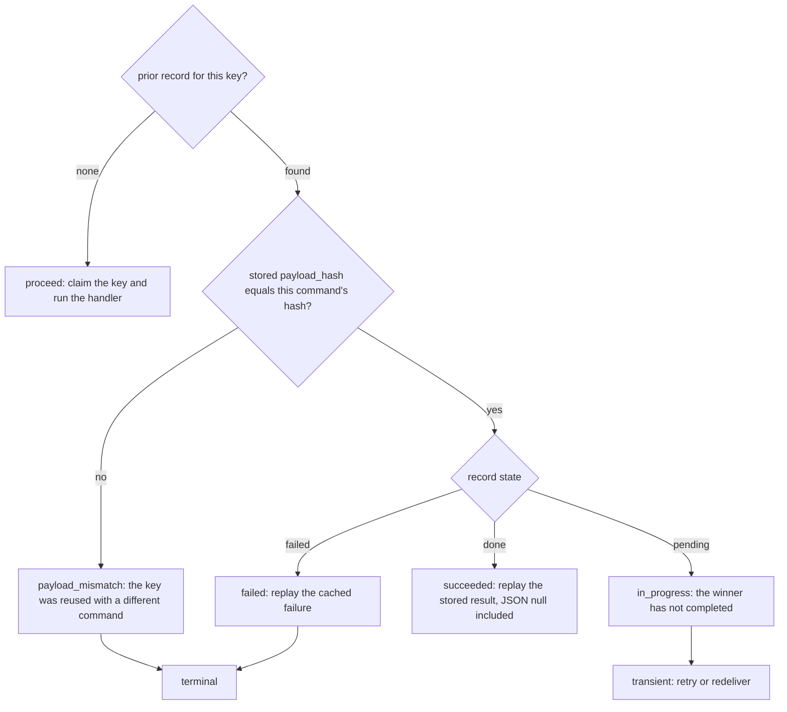

# The command-and-query kernel

`crates/edax-cqrs` owns the decisions on both sides of the separation it is named for, wherever they
must agree across languages and processes. On the command side: which bytes a command's idempotency
hash covers, and which ledger key a guard claims. Also what the stored record looks like, what a
claimant does with a record it did not write, and when a record may be forgotten.

The command bus itself is host-local ergonomics: handler registration, typed dispatch and the
middleware chain. It has no cross-language requirement, so it lives in the software development kits
(SDKs), not here. The table below lists its shared decisions and stored types.

The query side owns reading and maintaining derived state. `ingest` maintains append/upsert rows;
`projection` maintains ordered stateful projections. [`filter`](./filter.md) is the backend-neutral
match decision; `query` composes it with ordering and paging. Neither is an event-sourcing concern,
and the two travel together because the query evaluates the filter.

| Symbol | Decision it owns |
|---|---|
| `canonical_json` | the one byte form of a JSON value, whatever encoder produced it |
| `payload_hash` | the stable 64-bit hash of bytes, Fowler-Noll-Vo 1a (FNV-1a): `edax-core`'s, re-exported |
| `command_hash` | *which* bytes a command's hash covers: its name and its whole payload |
| `received_key` | the idempotency key a received command is claimed under |
| `claim_key` | the ledger key a command guard claims, scoped by the guard |
| `protected` | full HMAC-SHA-256 fingerprints and encrypted command-result records bound to scope, claim and owner |
| `Record` / `State` | the stored record's wire shape and reading order, for the command guard and the event guard alike |
| `decode_prior` | what a claimant reads from stored bytes no reader can decode |
| `outcome` | the verdict a losing claimant reaches from a record |
| `settle_failure` | whether a winner caches its failure or releases the claim |
| `complete_fence` / `release_fence` | whether a claim owner may complete or release the record currently held by a ledger key |
| `forget` | whether a stored record may be deleted, so a re-driven message runs again |
| `Decimal` / `Instant` | the host-value types a Rust field declares, holding the one text `canonical_decimal` and `canonical_timestamp` write, so a command hashes and a payload reads alike in every SDK ([host values](./filter.md#host-values-every-sdk-writes-alike)) |
| `namespace` | the length-prefixed key namespace of a generation, its erasure key ranges, and `AtRest` with the sealed-part check, shared by `ingest` and `projection` |
| `ingest` | append identity, complete-state ownership and compaction, durable rejection precedence, immutable target contracts and exact source coordinates (`ingest.json`) |
| `projection` | canonical ordered delta transitions, dual receipts, source continuity, scoped leases, checkpoint recovery and outbox activation |
| `filter` | the read side's match decision ([filter.md](./filter.md)) |
| `query` | ordering, keyset cursors and paging over the documents a filter selects, and the `document` rule every stored read-model document meets |

---

## `canonical_json` — one byte form per value

Two hosts can serialize the same logical command differently. Key order, whitespace, string escaping
and number spelling are all an encoder's free choice. If those bytes reach the hash, one command binds
to two idempotency keys and a genuine duplicate looks like a new request.

The kernel removes the choice. `canonical_json` writes the JSON Canonicalization Scheme, **RFC 8785**
(JCS), through the `serde_json_canonicalizer` crate. The form is a published standard, so a third SDK
can reproduce it with any JCS library, and it is the same in every build. Cargo unifies features
across a whole build, so one crate anywhere in an adopter's graph that enables
`serde_json/preserve_order`, `arbitrary_precision` or `float_roundtrip` changes how `serde_json` reads
the input. The JCS writer does not depend on any of them, and `crates/edax-cqrs/feature-check`
replays the golden vectors with all three features on, in CI.

### The divergence it prevents

Python's `json.dumps(ensure_ascii=True)` escapes the `é` in `café` to the six characters `\u00e9`.
serde emits the same string as raw UTF-8. Hash those two spellings and the same command gets two
idempotency hashes — one per language. The rule is stated as a binding constraint in `AGENTS.md`:
never canonicalize host-side; hash canonical bytes through the application binary interface (ABI)'s
`payload_hash_json`, which canonicalizes in the kernel first. The kernel's own test case pins it,
and `testdata/golden/canonical_payload_hash.json` carries `{"name":"café"}` so a binding that
escapes it fails.

### Numbers

RFC 8785 writes every number as an IEEE 754 double, in the ECMAScript form. So numbers are canonical
**by value**, not by spelling. `2`, `2.0`, `2e0` and `20e-1` are one number and hash alike. A Python
`amount: float` built with `2` and the same command decoded off a queue as `2.0` bind to one key. A
JavaScript or Go producer, whose encoder writes a whole float as `2`, agrees with both. The filter
already treated `2 == 2.0`; the hash agrees with it.

- `-0` prints as `0`, `1.10` as `1.1`, `0.000001` as `0.000001`, `1.5e-7` as `1.5e-7`.
- A whole double below `1e21` is written out: `1e20` is `100000000000000000000`. From `1e21` it takes
  an exponent: `1e+21`.
- A number too large for a double (`1e400`) is a `codec` error, never silently infinity.

**The safe-integer rule (the kernel's own).** A double rounds the integers past 2^53. So JCS would
write `9007199254740993` as `9007199254740992`, and two ids one apart would share a hash. 2^53 itself
is ambiguous too, since `9007199254740993` reads back as it. So an **integer literal outside
-(2^53 - 1) to 2^53 - 1** is a terminal `codec` error, at any depth. That is the I-JSON safe range
(RFC 7493) and JavaScript's `Number.MAX_SAFE_INTEGER`. An off-the-shelf JCS library (Python's
`rfc8785`, say) refuses the same integers, so it reproduces every form the kernel writes. The kernel
reads the input text before `serde_json` parses it, so `arbitrary_precision` cannot hide a wide
literal. A number written as a float (`9007199254740993.0`, `1e20`) is a float, and rounds as one. A
payload that carries wider integers (a 64-bit id, a snowflake) must carry them as strings. One
consequence: the canonical text of a whole float between 2^53 and `1e21` is an integer literal
outside the safe range, so canonicalizing it a second time is refused.

### What is data and what is formatting

| Input | Canonical output | Why |
|---|---|---|
| `{ "b": 2, "a": 1 }` | `{"a":1,"b":2}` | key order is formatting |
| `{"address":{"zip":"10001","city":"NYC"}}` | nested keys sorted too | sorting is recursive |
| `{"tags":["paid","eu"]}` | unchanged | array order is data |
| `{"age":36,"age":37}` | `{"age":37}` | a duplicate key keeps the last value |
| `{"ｱ":1,"🦀":2,"é":3,"Z":4}` | `{"Z":4,"é":3,"🦀":2,"ｱ":1}` | keys sort by their UTF-16 code units (RFC 8785), so U+1F980 sorts before U+FF71 |
| `{"name":"café"}`, `{"name":"caf\u00e9"}` | raw UTF-8, unescaped | an escape is decoded first: escaping is formatting |
| `"\b\u0001\"\\"` | `"\b\u0001\"\\"` | `"`, `\` and control characters are escaped, by name where JSON has one |
| `{"n":[2,2.0,-0.0,1.10]}` | `{"n":[2,2,0,1.1]}` | numbers by value |
| `{"id":9007199254740992}` | `codec` error | an integer outside the safe range: a double cannot tell it from `9007199254740993` |
| `{"email":"a@b.c",}` | `codec` error naming the line and column | the parser does not accept JSON-ish text |
| `{"total":1e400}` | `codec` error, `out of range` | never coerced to `null`, which would collide |
| `"\ud800"` | `codec` error | a string must be valid Unicode |

Every row is a case in the kernel's own table-driven test, and `testdata/golden/canonical_json.json`
carries the input, the canonical text (or the error) and the hash for every SDK to check. A keyset
cursor (`encode_cursor`) is written in the same canonical form, through a sort fingerprint. So a sort
value that is an integer outside the safe range cannot be minted into a cursor either. A whole float
past 2^53 can: RFC 8785 writes it as integer digits, so `decode_cursor` reads an integer outside the
safe range back as the double it was minted from.

---

## `payload_hash` and `command_hash` — which bytes are covered

`payload_hash` is FNV-1a over bytes. It lives in `edax-core`, the one hash both guards bind a key to,
and this crate re-exports it. It is the cheap half. The
half that carries the contract is `command_hash(name, value)`, which fixes the *input rule*. It
takes the **command name and the whole command value** as one JSON object, `{"name": name,
"payload": value}`, then canonicalizes and hashes it.

That rule is the kernel's on purpose. No SDK and no user picks the bytes. A hand-written
`payload()` per command would let two SDKs disagree without notice.

Three consequences follow from that rule:

- **The name is hashed beside the payload.** One idempotency key names one request. The same key
  reused for another command name is a mismatch, not a second request, even when the two payloads
  are equal. The golden pair `the_name_and_the_whole_command` and `another_name_is_another_command`
  differ by the name alone. A command's name is `Command::TYPE` in Rust and the `type` class
  attribute in Python. It is not an instance field, so it enters the hash once, as the name.
- **The idempotency key is not in the payload.** It travels on the message, as `idempotency_key`,
  beside the payload. A command that also carries the key as a field hashes that field like any
  other.
- **The hash covers the value the handler receives.** A command decoded from the wire hashes after
  its upcast, as a dispatched one does. Two SDKs on one ledger then agree whatever version the
  producer wrote.

What the value *contains* — the field names and which fields exist — is the host's wire shape, as it
is for events. Two services sharing a ledger declare the command with the same fields.

### How both languages reach identical bytes



A host that cannot hand the kernel a Rust value serializes the command with its own standard
encoder. It then hands the kernel the name and the JSON. That is what `command_hash_json(name,
payload_json)` is for. Both paths land
on the same bytes because canonicalization removes everything an encoder is free to choose.

Python encodes the command with msgspec rather than `json.dumps`, so that a `UUID` field encodes
deterministically instead of raising `TypeError`. It does **no** JSON canonicalization of its own.
The hash is `_edax.command_hash_json(cmd.type, _payload_json(cmd))`.

Canonicalization cannot unify what the host encoder writes as two different strings. So a `Decimal`
and a `datetime` go through the kernel's own text forms first: `canonical_decimal` and
`canonical_timestamp`. `Decimal("9.50")` and `Decimal("9.5")` then hash alike, and so do two
`datetime`s for one instant in two offsets. Every SDK must write these types the same way
([the host-value table](./filter.md#host-values-every-sdk-writes-alike)).

The command hash reads the host's serialized value as it is. So in Rust the field's type decides
the text: a decimal field must be `edax_cqrs::Decimal` and an instant field `edax_cqrs::Instant`
(both re-exported as `edax::Decimal` and `edax::Instant`). Each canonicalizes when it is built,
through `FromStr` or `Deserialize`, and refuses what the text function refuses. An `f64`, or a
`String` that holds `9.50`, hashes as another command than Python's `Decimal`. Python has the same
two types, `edax.Decimal` and `edax.Instant`, and the encoder writes them as their text. A command
read by a Python codec must declare them, since the codecs refuse a `decimal.Decimal` or `datetime`
field.

### The golden vectors that hold this

| Vector | Pins |
|---|---|
| `testdata/golden/payload_hash.json` | raw FNV-1a, agreement on multibyte UTF-8 |
| `testdata/golden/canonical_payload_hash.json` | canonicalize-then-hash |
| `testdata/golden/command_hash.json` | the input rule end to end |
| `testdata/golden/claim_key.json` | the claim key |

`command_hash.json` is asserted *through the SDK layer*, not against the kernel function. The Rust
suite rebuilds each case as a `PlaceOrder`, dispatches it through the real `idempotent` middleware,
and compares the hash the ledger received. The `Withdraw` rows wrap a decimal and an instant in a
marker (`{"$decimal": "9.50"}`, `{"$instant": "2024-01-01T01:30:00+01:00"}`). Each suite builds them
with its host types: `edax::Decimal` and `edax::Instant`, or `Decimal` and an aware `datetime`. Every
spelling of one value lands on one hash, and an instant without an offset is refused. The Python suite does the same for three command shapes —
dataclass, `msgspec.Struct`, plain object. Both suites also assert that two conventions the vector
replaced cannot reach it. One is a hash of the payload alone, without the name. The other is a
Python command carrying `type` as an instance field.

## `received_key` — which key a received command is claimed under

`received_key(idempotency_key, id)` is the key a guard claims for a received command. It is the
client's `idempotency_key`, or the command's own `id` when it carries none. A broker redelivers the
same message, and both copies carry one id, so the id still deduplicates a redelivery. An empty key
is still a key. `testdata/golden/command_received_key.json` pins it.

## `claim_key` — which ledger key a command guard claims

`claim_key(mode, tenant, scope, idempotency_key)` is `"edax:cmd:{len(scope)}:{scope}:{idempotency_key}"`,
composed with the tenant by `tenant_key` (`edax-core`) when the tenancy `mode` is a pool:
`"4:acme:edax:cmd:7:billing:req-1"`. `len` counts UTF-8 bytes, so `café` is 5. Both guards and every
`forget` spell the key here, so a Python guard and a Rust guard of one scope claim one row.

| Part | Why |
|---|---|
| `scope` | names the guard: a service, or a stage within one. An ingress guard and a consumer guard that share one ledger never replay each other's outcome for the same key |
| `len(scope)` | makes the key injective: scope `a:b` with key `c` and scope `a` with key `b:c` are two keys |
| `edax:cmd:` | keeps command claims apart from event claims, which start `edax:evt:` |
| tenant, outermost | under a pool, one request id reused by two tenants claims two rows. Outermost, as on every key `tenant_key` composes, so one tenant's rows share a prefix in every store. A bridge keeps the key bare: its store is the tenant's |

A mode that requires a tenant (pool, bridge) and a command that names none is a `codec` error, before
any claim, so a pool never claims a shared row. The event guard's key follows the same rule with
`edax:evt:` and the event id (`event_claim_key` in [`edax-event`](event.md)). Both call
`edax_core::guard_key` with their `GuardKind`, so the two cannot compose in different orders.
`testdata/golden/claim_key.json` pins the key, with a row per mode.

Protected command idempotency keeps this same claim key. `protected::claim_key` validates the
encryption scope and returns the ordinary key unchanged, so enabling protection cannot bypass a
pre-migration result or an in-flight claim. The protected record authenticates the scope, claim
identity, claimant token, fingerprint, and encrypted result. A duplicate under a different scope
fails closed. [`protected_ledger.json`](../../testdata/golden/protected_ledger.json) pins its
fingerprint bytes, result associated data, record encoding and scope checks for both ciphers.

The scope is required in the Rust and Python SDKs. A default would put two services on one ledger under one scope,
and the second would replay the first one's outcome.

---

## `Record` and `State` — the stored shape

Every SDK and every JSON-backed ledger shares one wire shape and one reading order, so a record
written in one language replays identically in the other.

Wire shape — flat JSON, fixed key order:

```json
{"payload_hash": 11234062831410934249, "result": null, "error": null, "error_code": null, "pending": true}
```

A rejection that names why it refused adds one key, written only when present:

```json
{"payload_hash": 11234062831410934249, "result": null, "error": "no such order", "error_code": "rejected", "error_reason": "not_found", "pending": false}
```

| Field | Type | Set when | Missing on read |
|---|---|---|---|
| `payload_hash` | unsigned 64-bit integer | always | required — a missing or non-integer hash makes the record unreadable |
| `result` | any JSON | `done` | reads as `null` |
| `error` | string or null | `failed`: the failure's message, without its code | reads as absent |
| `error_code` | string or null | `failed`: the failure's taxonomy code | reads as no code; so does a `null` or a code this kernel does not know |
| `error_reason` | string, written only when present | `failed` with code `rejected`: why the rejection refused, a name `check_reason` accepts | reads as no reason; so does one beside another code, one that is no name, or one that is not a string |
| `pending` | bool | always | reads as `false` — records written before the field existed |

A failed record keeps its code **beside** the message rather than inside an `error` object. A reader
that predates the field ignores it and still reads the failure, so a shared ledger stays readable
through a rolling deploy. A replay keeps the original code in every SDK. `cached_failure(code,
message)` is the error a losing claimant raises: terminal, with the original failure's wire form as
its message (`"cached_failure: codec: bad payload"`). An empty `error` is still a failure; only
`null` means "not failed". The ABI builds the record from the flat fields a binding holds, through
`State::from_wire`, and refuses a code the taxonomy does not know.

`settle_failure` keeps a rejection's reason beside the `rejected` code and drops any other, so a
reason never keeps a failure from caching. `encode_record` refuses a reason a hand-built record
misplaces. A record with no reason writes no `error_reason` key. Its bytes are the ones a writer that
predates the field wrote, so no Redis or Postgres vector holding such a record changes.

**Reading order: `pending` wins, then `error`, then `result`**. The precedence is written down in
exactly one place, `State::from_wire`, so a foreign writer that over-specifies a record cannot make
two readers disagree. `State` is an enum rather than three optional fields precisely so a decoded
record cannot be both pending and failed. `State::kind()` names it as a `StateKind` (`pending`,
`failed`, `done`), and `StateKind::ALL` is the list a binding checks the states it branches on against.

On the way in every field but the hash is optional — an older or foreign writer may omit `pending`
or `result`. Unknown fields are ignored. A record that is not a JSON object is rejected, because the
derive would otherwise read a JSON array positionally.

### An unreadable record replays as a cached failure

Bytes `decode_record` refuses still hold their key. They are garbage, a torn write, another layout,
a field of the wrong type, or a result a typed reader cannot read as its result type.
`decode_prior(bytes, claimant_hash)` never fails. It reads such bytes as `Record::unreadable`: a terminal failure of code
`codec` whose message names the decode error (`unreadable idempotency record: EOF while parsing ...`).
The guard replays it as `cached_failure`, so the handler never runs again for the key and a dispatcher
dead-letters the message. Raising instead would fail every redelivery until the record expired, and
reading the bytes as a free key would run the handler a second time.

Which hash the failure carries is the one choice left. It keeps the stored `payload_hash` when
that field alone still reads as a `u64` in a JSON object. The hash is checked first, so another command that
reuses the key is still told `payload_mismatch`, not that its own command failed. When the hash does
not read, the failure carries `claimant_hash`: nothing tells the two commands apart, and the claimant
gets the failure, the side that never runs a handler twice. The `decode_error` rows of
`idempotency_record.json` pin each case, and the Redis kernel reads a value whose frame it refuses
the same way.

### A stored `null` result replays as a success

This is the case the module exists to settle. A `null` result on a completed, non-failed record is
a success whose value is null (Python `None`, Rust `()`), not "no result". A handler that returns
nothing is the common case, and its replay must return nothing rather than fail or look pending.

A typed reader decodes the stored value as its own result type. `null` decodes to `()` for a
unit-result command, to `None` for `Option<i64>`, and fails — typed, naming the step — for a command
whose result type has no null form. A pending or failed record never touches the result type at all.

The Rust and Python SDKs are held to it: `testdata/golden/idempotency_record.json` carries
`cached_success_with_null_result`, and the Python suite dispatches a `None`-returning handler twice
and asserts one call and two `None` replays.

### The number bound every JSON-backed ledger inherits

A `result` integer is exact within the `i64`/`u64` range and comes back as an `f64` outside it —
equal in value where a double can hold it, lossy beyond. `u64::MAX` round-trips exactly; `2^64`
comes back as `1.8446744073709552e19`. Pinned in Rust and in Python. A result that must carry a
wider integer carries it as a string.

### Record lifecycle



`encode_record` is the only encoding a ledger may persist; `decode_prior` is how a store reads the
record that holds a key, and `decode_record` is the strict reader under it. Both refuse a record holding
an integer wider than 64 bits as `codec`. A reader without arbitrary precision would take it as the
nearest double, while a typed reader would refuse it. One record would then replay two ways. A guard
whose result holds one caches that `codec` failure, and a foreign record that holds one replays as a
cached `codec` failure. Encoding a result JSON
cannot express fails loudly rather than silently dropping the record, because
the claim is already taken and a dropped record would strand the key.

Two rules hold for every store's `complete`, so the memory store and the Redis ledger cannot word
them apart:

- `check_settled(record)` refuses a record that reads as pending, as `bad_handle`. Its bytes match
  the claim it would replace, so the key would stay claimed with no run behind it. Bytes that do not
  decode pass: a reader replays them as a cached failure. `idempotency_record.json` carries the
  verdict for every row.
- `lapsed_claim(key)` is the `store` error a `complete` gets when the key no longer holds its
  claim: it lapsed and was taken over, or the key settled with another record.

---

## `outcome` — the verdict

There is no separate "proceed or replay" call. A claimant that *wins* the claim proceeds; there is no
record to judge. A stored hash of `0` is a real hash, not "absent": `idempotency_record.json` pins
that a record stored under `0` mismatches any other command and replays against itself.

`outcome(prior, current)` is what a claimant that *lost* the claim does with the winner's record. It
checks the hash first, so a mismatched payload is rejected even while the winner is still in
progress. Only then does the record's state decide. The four variants are the whole classification.
`Outcome` is not `#[non_exhaustive]`, so a fifth variant is a wire-format change that breaks every
SDK at compile time instead of falling into a catch-all. A binding reads the verdict by name:
`Outcome::kind()` is an `OutcomeKind`, and the Python SDK checks its `ClaimVerdict` against
`OutcomeKind::ALL` at import, so a fifth variant fails the import there.



| Record | Hash | `outcome` | The Rust and Python SDKs raise | Class |
|---|---|---|---|---|
| any | differs | `payload_mismatch` | `PayloadMismatch(key)` | terminal |
| `pending` | matches | `in_progress` | `InProgress(key)` | transient |
| `failed` | matches | `failed` | `CachedFailure` with the original wire form (`cached_failure`) | terminal |
| `done` | matches | `succeeded` | the cached result is returned | — |

The error is the kernel's too: `replay(prior, current, key)` answers the cached result, or the error a
loser fails with, so neither SDK builds one. Rust returns it as it is. Python reads it through
`_edax.idempotency_replay`, which also names the `outcome` its observer reports, and raises it with
`errors.from_wire`. `testdata/golden/idempotency_record.json` pins every state and
verdict. A binding must read with
`decode_prior` to the same fields, re-emit the same bytes, reach the same verdict and raise the same
replay.

The winner's half of the table is `settle_failure(payload_hash, code, message, reason) -> Cache(record) |
Release`. After the handler failed, a won claim completes with the failed record the kernel builds
when the code is terminal and nonfatal. The record stores that code with an empty message;
the compatibility `message` parameter is ignored. Validated rejection reasons remain available in
ordinary records. It releases transient, fatal, and uncoded failures,
including panics and cancellations. Both guards ask it with the code the
failure carries: Rust `edax_cqrs::settle_failure(hash, code_of(e), ..)`, Python
`_edax.idempotency_settle_failure(hash, str(e), errors.code_of(e), errors.reason_of(e))`. So two SDKs guarding one ledger
cache the same failures, as the same record. `testdata/golden/idempotency_settle.json` pins one row
per code, the uncoded failure and an empty message.

`testdata/golden/idempotency_guard.json` pins the whole claim, run and settle as scenarios: what one
dispatch returns or raises, whether the handler ran, and what the key holds after it. Each SDK replays
every row through its own guard over its memory ledger.

---

## Ledger fences

`complete_fence(key, holder)` and `release_fence(holder)` define the same ownership checks for
every ledger backend. The store classifies what the key holds, then applies the kernel's verdict
atomically with the write.

| Current holder | Complete | Release |
|---|---|---|
| caller's claim | write the settled record | delete the claim |
| the same settled record | leave it unchanged | leave it unchanged |
| no record, another claim or another settled record | fail with a `store` error | leave it unchanged |

A repeated completion succeeds only when it matches the settled record. A worker whose claim
expired cannot overwrite its successor. A repeated release is harmless and cannot delete another
worker's claim. `testdata/golden/idempotency_fence.json` pins these cases. Redis's Lua scripts replay
the same contract; the memory ledger calls these functions directly.

## `forget` — deleting a settled record

`forget(key, record)` answers whether a store may delete the record `key` holds, so a re-driven
message runs its handler again. An operator re-drives a command from a dead-letter queue this way.

| Record | `forget` | Why |
|---|---|---|
| `pending` | `in_progress` error, `unsettled_claim(key)` | the run may still complete, and its record would land after the delete |
| `done` or `failed` | delete | the outcome is settled |
| bytes no reader decodes | delete | `decode_prior` replays them as a cached failure, so forgetting them is the way out of a poisoned key |
| no record | nothing to do | the key is already free |

Forget is not release. A release is the claimant settling its own claim, by its handle. A forget acts
on an outcome nobody owns any more, so it carries no handle. Every store decides with this one
function. The memory store asks it inside a transaction. The Redis ledger asks it through
`forget_outcome`, then deletes only while the key still holds the value it read. See
[redis.md](./redis.md). `redis_ledger.json` pins the Redis decision, and `redis_fence.json` the
script.

---

## `query` — ordering and pagination

The pipeline is `filter -> keyset(after) -> sort -> offset -> limit`. A backend may push all of it
into native `WHERE`, `ORDER BY` and `LIMIT` clauses. The semantics stay the kernel's, and
`query_json` is the reference applier the golden vectors pin.

`query` answers with a `Page { rows, next }`. `next` is the cursor minted from the last row under
the query's own sort. It is set only while rows follow the page, and never for an unsorted query.
A caller therefore never restates the sort to build one.

| Decision | Rule |
|---|---|
| total order | number < string < bool < array < object < null; numbers by value (exact for two integers), strings by code point, bools `false < true` |
| decimal key | a `SortKey` with `"collation": "decimal"` orders decimal text by exact value; other strings sort after it, by code point; the collation is part of the cursor's fingerprint |
| tiebreak | `effective_sort` appends `{"path": "id"}` unless the sort already ends on that key with no collation (`"7"` and `"07"` tie under the decimal one); `TIEBREAK_PATH` names it |
| document | `document(id, value)` and `document_json(id, json)` refuse a stored document that is not a JSON object as `codec`, since the query reads each row's key from its `id` field; the JSON form also refuses an integer wider than 64 bits. `projection_document.json` pins it |
| cursor | `base64url_nopad(canonical_json({"s": <fingerprint>, "v": [<sort-key values>]}))`; the fingerprint is the `payload_hash` of the canonical effective sort, as 16 hex digits |
| replay | `decode_cursor` refuses a cursor whose fingerprint is not the query's sort, a forged arity, and any cursor on an unsorted query, each as `codec` |
| mint | `encode_cursor` refuses an empty sort and a row whose `id` is missing or `null`, so tied rows can never be dropped silently |
| spec | `Query`, `SortKey` and every filter node refuse unknown fields; sort paths follow the filter's path rule; integer literals wider than 64 bits are refused |

The cursor is written in the canonical form, so it is the same text whatever `serde_json` features a
build turns on. It is URL-safe base64 with no padding, so it survives a URL query string. A
standard-base64 cursor, or one that encodes a bare tuple, is refused rather than misread. Paging under
concurrent inserts and deletes neither skips nor repeats a row present throughout, as long as rows
do not change their sort key. A proptest in `query.rs` and a Hypothesis twin through the binding
check that. `testdata/golden/query.json` and `cursor.json` pin the bytes and every refusal.

The total order, the tiebreak and the cursor are documented from the host's side in
[../sdk/projections.md](../sdk/projections.md#keyset-cursors). The Rust SDK re-exports the kernel's
`Query`, `SortKey` and `Page` rather than defining its own, so the spec and the applier cannot drift.

---

## `ingest` — append and complete-state upsert

`Contract` fixes a target generation's mode, source incarnation, mapper identity and `at_rest`. Key helpers
scope row identities by generation, tenant and erasure subject, and source coordinates by source
incarnation, topic, partition and offset. `scope_range` names the key range that holds every row of
one subject, or of a whole tenant without a subject, which an erasure cleanup deletes. `validate_inputs` refuses records outside that
contract. `check_sealed` runs after the sink seals and before it writes. On a sealed target, every
written input of a subject must carry a keyed fingerprint. Its `private` part must be absent or a
protected-state envelope of the row key's tenant and subject.

`plan` receives original inputs, locked stored rows and persisted rejections. It resolves durable
rejections before selecting owners. In append mode, identical event replay succeeds and changed
content under the same identity is rejected. In upsert mode, one aggregate stream owns each row.
A higher sequence replaces state, a lower sequence is stale, and conflicting content at the current
sequence is rejected. A row holds a `private` part, sealed unless the target is `plaintext`, and a
plaintext `public` part. Both parts absent retain a deletion marker. An `erased` input,
whose key was destroyed, is accepted without a write. A sealed input carries `keyed_fingerprint`, an
HMAC under the subject's fingerprint key. Once the key is gone, no stored hash can test a guessed
value. A sealed and an unsealed copy of one sequence conflict. The planner validates every original
before compacting eligible replacements into the final writes.

`inputs_json` checks original numeric tokens before decoding application values. Integer literals
outside the canonical JSON safe range become record-local failures instead of rounded identities.
Protocol offsets and sequences keep their full supported integer width. `ingest.json` and
`ingestion_numbers.json` pin these contracts.

The store must commit the plan's state writes and rejection records in one transaction.
`edax-memory::ingest` provides the reference sink. `edax-postgres::ingest` supplies SQL and recovery
verdicts; the Python adapter supplies the transaction. See [ingestion](../backends/ingestion.md).

## `projection` — ordered state transitions

A stateful projection folds events: it repeatedly applies a pure reducer to previous state and an event. The reducer implements
application behavior. This kernel decides whether the event may run and which records must commit
with its result. It maintains one state per tenant/aggregate; cross-aggregate state and external
snapshot imports are outside this contract.

`lock(request)` names the locks a store takes first: the generation lock, shared for partition
work and exclusive for initialization, freeze and activation, and the partition's own lock.
`keys(request)` names the records an operation reads, the manifest first.
`transition(request, records, now_ms)` returns a result and a plan: `inserts` for records read as
absent, `updates` for records read as present, and new `intents`. The store commits the plan
atomically; an insert that meets a concurrent insert fails, so a race retries instead of
overwriting. The kernel does no I/O and never invokes a reducer.

| Operation | Decision |
|---|---|
| Initialize | Bind the immutable generation contract and complete partition/start vector |
| Acquire, refresh, release, load | Fence checkpoint ownership, extend it, and recover authoritative progress |
| PrepareBatch | Check source continuity, ownership, event identity and sequence for every input in order; return each input's novelty, canonical reducer input and the state the batch read |
| ApplyBatch | Check one reducer result per novel input; save replacement states, both deduplication receipts, deterministic intents and the next source offset |
| Freeze and activate | Retire old owners, capture cutoffs, and set the immutable cutoffs delivery reads |
| Get | Read one aggregate's state |

Two receipts bind each event to its event ID and aggregate sequence. Each holds a hash of the
canonical event, not the event itself. For a sealed event the hash is `keyed_fingerprint`, an HMAC
under the subject's fingerprint key. State keys carry the event's erasure subject, so an aggregate cannot change
subjects. `state_scope_range` names one subject's state, or a whole tenant's, for a plaintext generation's cleanup. A reducer result holds a `private` and a `public` part. On a `sealed` generation (`Contract.at_rest`),
`ApplyBatch` refuses a subject's `private` part unless the host sealed it under the event's scope. It
refuses a subject's intent payload unless sealed whatever `at_rest` says. `state_key` and `intent_id`
name the identities that sealing binds. An
`erased` input, whose key was destroyed, writes its receipts and advances the cursor. It calls no
reducer and changes no state. An erased replay matches a receipt from before erasure. Identical replay skips the reducer. A sequence gap or conflict stops processing rather than dropping a delta. Source proof
checks cover physical source identity, history and retained/readable boundaries. These checks
cannot establish that a restored database contains every previously created aggregate; the host
must restore a consistent generation and terminate every previous writer before recovery.

`request_json` validates application number tokens before decoding. Reducer input, replacement state
and intent payloads use canonical JSON. The reducer cannot observe source offset or attempt number.
`intent_id` provides stable effect identity and `eligible` applies activation cutoffs when an
intent is read for delivery. Each intent
record carries its tenant, aggregate and a generation-wide commit `position`, the outbox order. Delivery is
at least once, so the destination must deduplicate intent IDs, including after backup restore.

`projection_state.json`, `projection_state_boundaries.json` and `ingestion_numbers.json` pin these decisions. The
[projection processing guide](../sdk/projection-processing.md) covers leases, transactions, rebuilds and offline restore.

## What the kernel does not own

The kernel decides. It never performs I/O, holds a lock, or retries.

| Not owned | Whose it is | Why |
|---|---|---|
| the **claim** | the ledger backend's atomic insert-if-absent | linearizability across processes is a store property — `INSERT ... ON CONFLICT DO NOTHING`, `SET NX`, a unique-key insert. Never a read then a write. |
| the **transaction** | the SDK guard and the host's `Transactor` | whether the claim commits with the events it guards is a wiring choice. In Rust, `idempotent` uses the auto-commit handle and `idempotent_in` reads the host's open handle. Python's guard joins the ambient transaction, or opens one with `unit_of_work=`. |
| the **retry policy** | the `retry` middleware, outside the guard | attempt counts and backoff are host policy. |
| releasing a claim after a transient failure | the guard | the kernel has no verdict on the handler's error; the SDK classifies it and calls `complete` or `release`. |

Every window, both modes and both guards are in [`../sdk/idempotency.md`](../sdk/idempotency.md). What edax promises end to end is in
[`../guides/delivery-guarantees.md`](../guides/delivery-guarantees.md).

---

## See also

- [`../sdk/idempotency.md`](../sdk/idempotency.md) — both guards, both modes, and every failure
  window the kernel deliberately does not close.
- [`./golden-vectors.md`](./golden-vectors.md) — how `command_hash.json` and
  `idempotency_record.json` are generated and asserted.
- [`./core.md`](./core.md) — `payload_hash`, backoff, and the error taxonomy
  `PayloadMismatch` / `InProgress` / `CachedFailure` come from.
- [`../sdk/commands.md`](../sdk/commands.md) — the `CommandBus` and middleware chain the kernel
  deliberately leaves to the SDKs.
- [`../sdk/errors.md`](../sdk/errors.md) — which verdicts are terminal and what branches on them.
