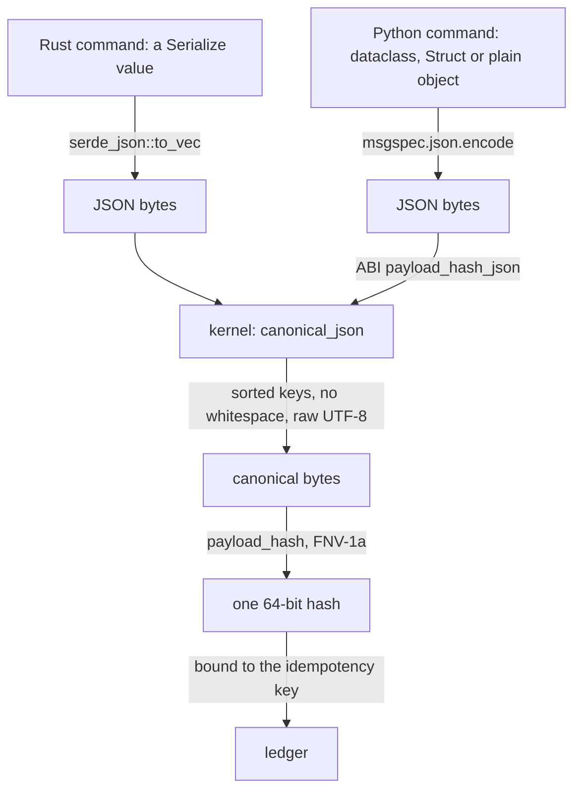
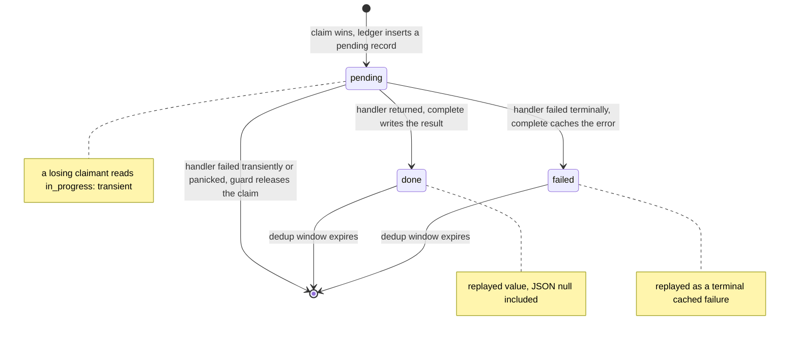
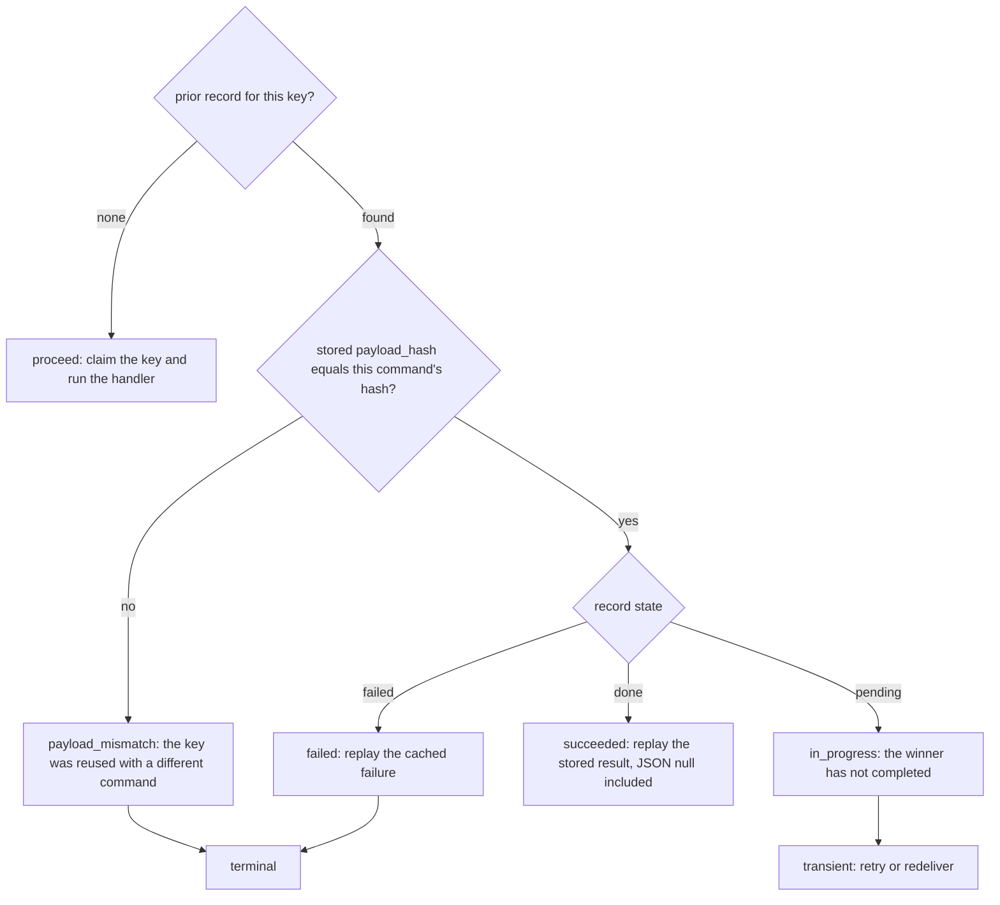

# The command-side kernel

`crates/edax-cqrs` owns the command-side decisions that must agree across languages and processes.
Which bytes a command's idempotency hash covers. What the stored record looks like. What a claimant
does with a record it did not write.

The command bus itself is host-local ergonomics: handler registration, typed dispatch and the
middleware chain. It has no cross-language requirement, so it lives in the software development kits
(SDKs), not here. The kernel is five decisions and one stored shape.

| Symbol | Decision it owns |
|---|---|
| `canonical_json` | the one byte form of a JSON value, whatever encoder produced it |
| `payload_hash` | the stable 64-bit hash of bytes, Fowler-Noll-Vo 1a (FNV-1a) |
| `command_hash` | *which* bytes a command's hash covers |
| `decide` | proceed, replay, or reject a reused key |
| `Record` / `State` | the stored record's wire shape and reading order |
| `outcome` | the verdict a losing claimant reaches from a record |

---

## `canonical_json` — one byte form per value

Two hosts can serialize the same logical command differently. Key order, whitespace and string
escaping are all an encoder's free choice. If those bytes reach the hash, one command binds to two
idempotency keys and a genuine duplicate looks like a new request.

The kernel removes the choice. `canonical_json` parses the JSON and re-emits it through one parser
and one serializer, so the canonical form is whatever that pair emits — the same in every binding.
Object keys come out sorted because `serde_json::Map` is a `BTreeMap` here, with no `preserve_order`
feature.

### The divergence it prevents

Python's `json.dumps(ensure_ascii=True)` escapes the `é` in `café` to the six characters `\u00e9`.
serde emits the same string as raw UTF-8. Hash those two spellings and the same command gets two
idempotency hashes — one per language. The rule is stated as a binding constraint in `AGENTS.md:67`:
never canonicalize host-side; hash canonical bytes through the application binary interface (ABI)'s
`payload_hash_json`, which canonicalizes in the kernel first. The kernel's own test case pins it,
and `testdata/golden/canonical_payload_hash.json` carries `{"name":"café"}` so a binding that
escapes it fails.

### Numbers

Numbers keep the form they were written in. `1` and `1.0` are distinct canonical values and hash
differently, so no binding may coerce one to the other. The golden vector carries both `{"n":1}` and
`{"n":1.0}` as separate cases with different hashes.

**The wide-integer caveat.** An integer outside `i64`/`u64` range is carried as a 64-bit float. Two
such integers that round to the same float share an idempotency hash. A payload that needs exact
integers wider than 64 bits must carry them as strings.

### What is data and what is formatting

| Input | Canonical output | Why |
|---|---|---|
| `{ "b": 2, "a": 1 }` | `{"a":1,"b":2}` | key order is formatting |
| `{"address":{"zip":"10001","city":"NYC"}}` | nested keys sorted too | sorting is recursive |
| `{"tags":["paid","eu"]}` | unchanged | array order is data |
| `{"age":36,"age":37}` | `{"age":37}` | a duplicate key keeps the last value |
| `{"name":"café"}` | raw UTF-8, unescaped | escaping is formatting |
| `{"email":"a@b.c",}` | error naming line and column | the parser does not accept JSON-ish text |
| `{"total":1e400}` | error, `number out of range` | never coerced to `null`, which would collide |

Every row is a case in the kernel's own table-driven test.

---

## `payload_hash` and `command_hash` — which bytes are covered

`payload_hash` is FNV-1a over bytes, delegated to `edax_core::fnv1a64`. It is the cheap half. The
half that carries the contract is `command_hash`, which fixes the *input rule*: the **whole command
value**, serialized as one JSON object, then canonicalized, then hashed.

That rule is the kernel's on purpose. No SDK and no user picks the bytes — a hand-written
`payload()` was the one place two SDKs could quietly disagree.

Two consequences follow from "the whole value":

- **The idempotency-key field is hashed too.** Reusing a key with a different command is a mismatch
  even when only that field moved. The golden base fixture carries `request_id`, the field the key
  is read from, so the vector cannot pass for a body-only rule.
- **The type name is excluded, because it is routing.** A command's type is `command_type()` in Rust
  and a class attribute in Python. It is not an instance field, so it stays out of the hash on both
  sides.

What the value *contains* — the field names and which fields exist — is the host's wire shape, as it
is for events. Two services sharing a ledger declare the command with the same fields.

### How both languages reach identical bytes



A host that cannot hand the kernel a Rust value serializes the command with its own standard
encoder. It then hands the kernel the JSON. That is what `payload_hash_json` is for. Both paths land
on the same bytes because canonicalization removes everything an encoder is free to choose.

Python uses `msgspec.json.encode` rather than `json.dumps` so that `UUID`, `datetime` and `Decimal`
fields encode deterministically instead of raising `TypeError`, and it does **no** canonicalization
of its own. The hash call is one line: `_edax.payload_hash_json(_payload_json(cmd))`.

### The golden vectors that hold this

| Vector | Pins |
|---|---|
| `testdata/golden/payload_hash.json` | raw FNV-1a over six inputs, including `café ☕ 🦀` — agreement on multibyte UTF-8 |
| `testdata/golden/canonical_payload_hash.json` | canonicalize-then-hash: key order, non-ASCII, `1` versus `1.0`, nested sorting, `{}` |
| `testdata/golden/command_hash.json` | the input rule end to end: seven commands mapped to hashes |

`command_hash.json` is asserted *through the SDK layer*, not against the kernel function. The Rust
suite rebuilds each case as a `PlaceOrder`, dispatches it through the real `idempotent` middleware,
and compares the hash the ledger received. The Python suite does the same for three command shapes —
dataclass, `msgspec.Struct`, plain object. Both suites also assert that the two conventions the
vector replaced cannot reach it: a body-only payload, and a Python command carrying `type` as an
instance field.

---

## `Record` and `State` — the stored shape

Every SDK and every JSON-backed ledger shares one wire shape and one reading order, so a record
written in one language replays identically in the other.

Wire shape — flat JSON, fixed key order:

```json
{"payload_hash": 11234062831410934249, "result": null, "error": null, "pending": true}
```

| Field | Type | Set when | Missing on read |
|---|---|---|---|
| `payload_hash` | unsigned 64-bit integer | always | required — a missing or non-integer hash is a codec error |
| `result` | any JSON | `done` | reads as `null` |
| `error` | string or null | `failed` | reads as absent |
| `pending` | bool | always | reads as `false` — records written before the field existed |

**Reading order: `pending` wins, then `error`, then `result`**. The precedence is written down in
exactly one place, `State::from_wire`, so a foreign writer that over-specifies a record cannot make
two readers disagree. `State` is an enum rather than three optional fields precisely so a decoded
record cannot be both pending and failed.

On the way in every field but the hash is optional — an older or foreign writer may omit `pending`
or `result`. Unknown fields are ignored. A record that is not a JSON object is rejected, because the
derive would otherwise read a JSON array positionally.

### A stored `null` result replays as a success

This is the case the module exists to settle. A `null` result on a completed, non-failed record is a
**success whose value is null** — Python `None`, Rust `()` — not "no result". A handler that returns
nothing is the common case, and its replay must return nothing rather than fail or look pending.

A typed reader decodes the stored value as its own result type. `null` decodes to `()` for a
unit-result command, to `None` for `Option<i64>`, and fails — typed, naming the step — for a command
whose result type has no null form. A pending or failed record never touches the result type at all.

Both SDKs are held to it: `testdata/golden/idempotency_record.json` carries
`cached_success_with_null_result`, and the Python suite dispatches a `None`-returning handler twice
and asserts one call and two `None` replays.

### The number bound every JSON-backed ledger inherits

A `result` integer is exact within the `i64`/`u64` range and comes back as an `f64` outside it —
equal in value where a double can hold it, lossy beyond. `u64::MAX` round-trips exactly; `2^64`
comes back as `1.8446744073709552e19`. Pinned in Rust and in Python. A result that must carry a
wider integer carries it as a string.

### Record lifecycle



`encode_record` is the only encoding a ledger may persist; `decode_record` is the only reader.
Encoding a result JSON cannot express fails loudly rather than silently dropping the record, because
the claim is already taken and a dropped record would strand the key.

---

## `decide` and `outcome` — the verdicts

`decide(prior, current)` takes the stored payload hash for the key (`None` if the key is unseen) and
this command's hash. It returns one of three names, and `Decision::as_str` is the single source of
truth for the string form across bindings.

A stored hash of `0` is a real prior, not "absent". `testdata/golden/idempotency.json` pins that
with two cases: `prior = 0, current = 0` replays; `prior = 0` against any other hash is a mismatch.
Six cases in all, asserted in Python by `edax.idempotency_decision`.

`outcome(prior, current)` is what a claimant that *lost* the claim does with the winner's record. It
checks the hash first, through `decide`, so a mismatched payload is rejected even while the winner
is still in progress. Only then does the record's state decide. The four variants are the whole
classification, so adding one is a wire-format change that should break every SDK at compile time
rather than fall into a catch-all.



| Record | Hash | `outcome` | Both SDKs raise | Class |
|---|---|---|---|---|
| any | differs | `payload_mismatch` | `PayloadMismatch(key)` | terminal |
| `pending` | matches | `in_progress` | `InProgress(key)` | transient |
| `failed` | matches | `failed` | `CachedFailure(error)` | terminal |
| `done` | matches | `succeeded` | the cached result is returned | — |

The mapping is one `match` in Rust and one `if` chain in Python. Neither re-derives the verdict;
both call the kernel and translate. `testdata/golden/idempotency_record.json` holds twelve cases
covering every state, the three mismatch-beats-state cases, the two older-writer shapes and the
absent-`result` shape. Each case carries `stored`, `current`, `payload_hash`, `state`, `outcome` and
`encoded`, so a binding must decode to the same fields, re-emit the same bytes, and reach the same
verdict.

---

## What the kernel does not own

The kernel decides. It never performs I/O, holds a lock, or retries.

| Not owned | Whose it is | Why |
|---|---|---|
| the **claim** | the ledger backend's atomic insert-if-absent | linearizability across processes is a store property — `INSERT ... ON CONFLICT DO NOTHING`, `SET NX`, a unique-key insert. Never a read then a write. |
| the **transaction** | the SDK guard and the host's `Transactor` | whether the claim commits with the events it guards is a wiring choice: `idempotent` uses the auto-commit handle, `idempotent_in` reads the host's open handle. |
| the **retry policy** | the `retry` middleware, outside the guard | attempt counts and backoff are host policy. |
| releasing a claim after a transient failure | the guard | the kernel has no verdict on the handler's error; the SDK classifies it and calls `complete` or `release`. |

The consequence matters for the guarantee. Every window, both modes and both guards are in
[`../sdk/idempotency.md`](../sdk/idempotency.md). What edax promises end to end is in
[`../guides/delivery-guarantees.md`](../guides/delivery-guarantees.md).

---

## See also

- [`../sdk/idempotency.md`](../sdk/idempotency.md) — both guards, both modes, and every failure
  window the kernel deliberately does not close.
- [`./golden-vectors.md`](./golden-vectors.md) — how `command_hash.json`, `idempotency.json` and
  `idempotency_record.json` are generated and asserted.
- [`./core.md`](./core.md) — `fnv1a64` behind `payload_hash`, backoff, and the error taxonomy
  `PayloadMismatch` / `InProgress` / `CachedFailure` come from.
- [`../sdk/commands.md`](../sdk/commands.md) — the `CommandBus` and middleware chain the kernel
  deliberately leaves to the SDKs.
- [`../sdk/errors.md`](../sdk/errors.md) — which verdicts are terminal and what branches on them.
