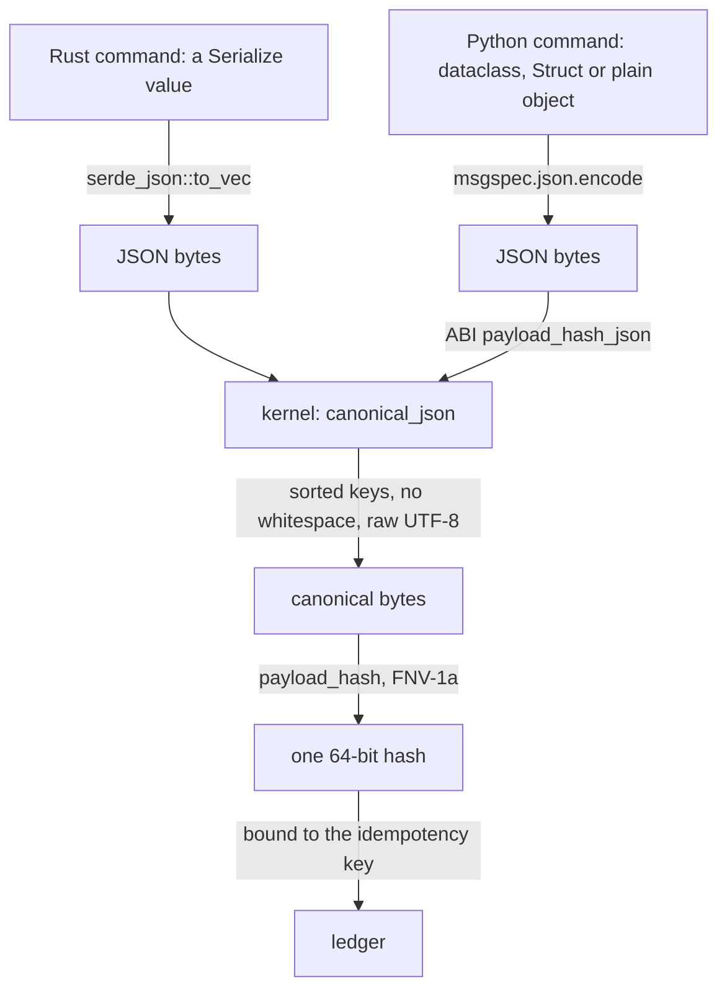
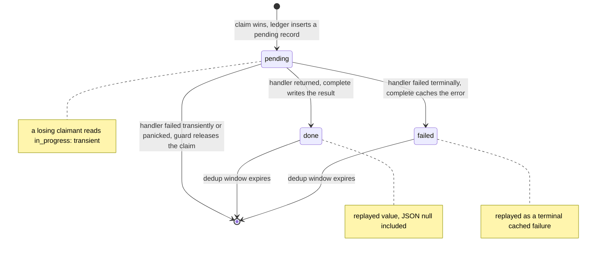
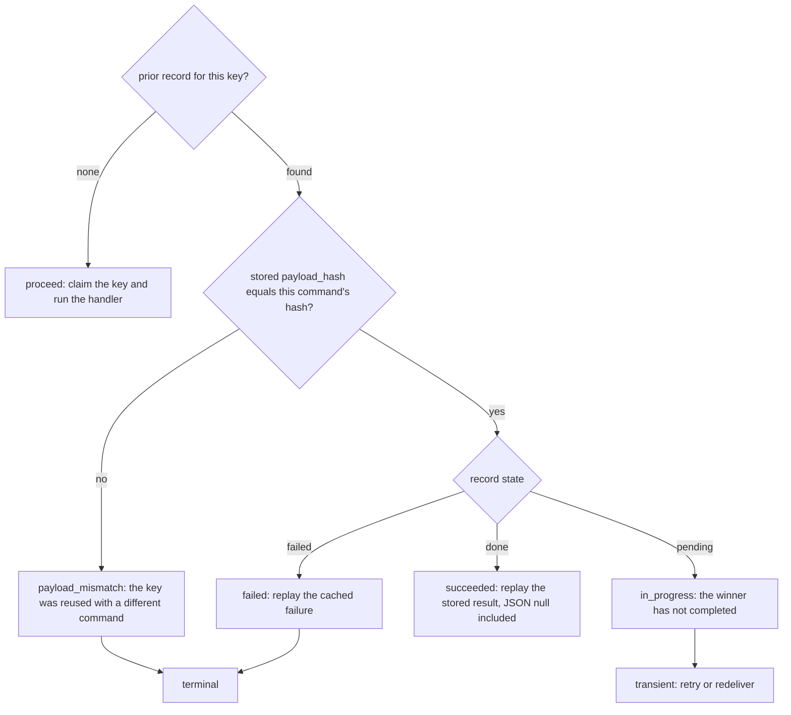

# The command-and-query kernel

`crates/edax-cqrs` owns the decisions on both sides of the separation it is named for, wherever they
must agree across languages and processes. On the command side: which bytes a command's idempotency
hash covers, what the stored record looks like, what a claimant does with a record it did not write.

The command bus itself is host-local ergonomics: handler registration, typed dispatch and the
middleware chain. It has no cross-language requirement, so it lives in the software development kits
(SDKs), not here. The command side is six decisions and one stored shape.

The query side is the half a read model answers with. [`filter`](./filter.md) is the backend-neutral
match decision; `query` composes it with ordering and paging. Neither is an event-sourcing concern,
and the two travel together because the query evaluates the filter.

| Symbol | Decision it owns |
|---|---|
| `canonical_json` | the one byte form of a JSON value, whatever encoder produced it |
| `payload_hash` | the stable 64-bit hash of bytes, Fowler-Noll-Vo 1a (FNV-1a) |
| `command_hash` | *which* bytes a command's hash covers |
| `Record` / `State` | the stored record's wire shape and reading order |
| `decode_prior` | what a claimant reads from stored bytes no reader can decode |
| `outcome` | the verdict a losing claimant reaches from a record |
| `settle` | whether a winner caches its failure or releases the claim |

---

## `canonical_json` — one byte form per value

Two hosts can serialize the same logical command differently. Key order, whitespace, string escaping
and number spelling are all an encoder's free choice. If those bytes reach the hash, one command binds
to two idempotency keys and a genuine duplicate looks like a new request.

The kernel removes the choice. `canonical_json` writes the JSON Canonicalization Scheme, **RFC 8785**
(JCS), through the `serde_json_canonicalizer` crate. The form is a published standard, so a third SDK
can reproduce it with any JCS library, and it is the same in every build. Cargo unifies features
across a whole build, so one crate anywhere in an adopter's graph that enables
`serde_json/preserve_order`, `arbitrary_precision` or `float_roundtrip` changes how `serde_json` reads
the input. The JCS writer does not depend on any of them, and `crates/edax-cqrs/feature-check`
replays the golden vectors with all three features on, in CI.

### The divergence it prevents

Python's `json.dumps(ensure_ascii=True)` escapes the `é` in `café` to the six characters `\u00e9`.
serde emits the same string as raw UTF-8. Hash those two spellings and the same command gets two
idempotency hashes — one per language. The rule is stated as a binding constraint in `AGENTS.md`:
never canonicalize host-side; hash canonical bytes through the application binary interface (ABI)'s
`payload_hash_json`, which canonicalizes in the kernel first. The kernel's own test case pins it,
and `testdata/golden/canonical_payload_hash.json` carries `{"name":"café"}` so a binding that
escapes it fails.

### Numbers

RFC 8785 writes every number as an IEEE 754 double, in the ECMAScript form. So numbers are canonical
**by value**, not by spelling. `2`, `2.0`, `2e0` and `20e-1` are one number and hash alike. A Python
`amount: float` built with `2` and the same command decoded off a queue as `2.0` bind to one key. A
JavaScript or Go producer, whose encoder writes a whole float as `2`, agrees with both. The filter
already treated `2 == 2.0`; the hash agrees with it.

- `-0` prints as `0`, `1.10` as `1.1`, `0.000001` as `0.000001`, `1.5e-7` as `1.5e-7`.
- A whole double below `1e21` is written out: `1e20` is `100000000000000000000`. From `1e21` it takes
  an exponent: `1e+21`.
- A number too large for a double (`1e400`) is a `codec` error, never silently infinity.

**The 2^53 rule (the kernel's own).** A double holds every integer up to 2^53 exactly and rounds the
ones past it. So JCS would write `9007199254740993` as `9007199254740992`, and two ids one apart
would share a hash. So an **integer literal whose magnitude exceeds 2^53** is a terminal `codec`
error, at any depth. The kernel reads the input text before `serde_json` parses it, so
`arbitrary_precision` cannot hide a wide literal. A number written as a float (`9007199254740993.0`,
`1e20`) is a float, and rounds as one. A payload that carries wider integers (a 64-bit id, a
snowflake) must carry them as strings. One consequence: the canonical text of a whole float between
2^53 and `1e21` is an integer literal past 2^53, so canonicalizing it a second time is refused.

### What is data and what is formatting

| Input | Canonical output | Why |
|---|---|---|
| `{ "b": 2, "a": 1 }` | `{"a":1,"b":2}` | key order is formatting |
| `{"address":{"zip":"10001","city":"NYC"}}` | nested keys sorted too | sorting is recursive |
| `{"tags":["paid","eu"]}` | unchanged | array order is data |
| `{"age":36,"age":37}` | `{"age":37}` | a duplicate key keeps the last value |
| `{"ｱ":1,"🦀":2,"é":3,"Z":4}` | `{"Z":4,"é":3,"🦀":2,"ｱ":1}` | keys sort by their UTF-16 code units (RFC 8785), so U+1F980 sorts before U+FF71 |
| `{"name":"café"}`, `{"name":"caf\u00e9"}` | raw UTF-8, unescaped | an escape is decoded first: escaping is formatting |
| `"\b\u0001\"\\"` | `"\b\u0001\"\\"` | `"`, `\` and control characters are escaped, by name where JSON has one |
| `{"n":[2,2.0,-0.0,1.10]}` | `{"n":[2,2,0,1.1]}` | numbers by value |
| `{"id":9007199254740993}` | `codec` error | an integer a double would round |
| `{"email":"a@b.c",}` | `codec` error naming the line and column | the parser does not accept JSON-ish text |
| `{"total":1e400}` | `codec` error, `out of range` | never coerced to `null`, which would collide |
| `"\ud800"` | `codec` error | a string must be valid Unicode |

Every row is a case in the kernel's own table-driven test, and `testdata/golden/canonical_json.json`
carries the input, the canonical text (or the error) and the hash for every SDK to check. A keyset
cursor (`encode_cursor`) is written in the same canonical form, through a sort fingerprint, so a sort
value past 2^53 cannot be minted into a cursor either.

---

## `payload_hash` and `command_hash` — which bytes are covered

`payload_hash` is FNV-1a over bytes, delegated to `edax_core::fnv1a64`. It is the cheap half. The
half that carries the contract is `command_hash`, which fixes the *input rule*: the **whole command
value**, serialized as one JSON object, then canonicalized, then hashed.

That rule is the kernel's on purpose. No SDK and no user picks the bytes. A hand-written
`payload()` per command would let two SDKs disagree without notice.

Two consequences follow from "the whole value":

- **The idempotency-key field is hashed too.** Reusing a key with a different command is a mismatch
  even when only that field moved. The golden base fixture carries `request_id`, the field the key
  is read from, so the vector cannot pass for a body-only rule.
- **The type name is excluded, because it is routing.** A command's type is `command_type()` in Rust
  and a class attribute in Python. It is not an instance field, so it stays out of the hash on both
  sides.

What the value *contains* — the field names and which fields exist — is the host's wire shape, as it
is for events. Two services sharing a ledger declare the command with the same fields.

### How both languages reach identical bytes



A host that cannot hand the kernel a Rust value serializes the command with its own standard
encoder. It then hands the kernel the JSON. That is what `payload_hash_json` is for. Both paths land
on the same bytes because canonicalization removes everything an encoder is free to choose.

Python uses `msgspec.json.encode` rather than `json.dumps` so that `UUID`, `datetime` and `Decimal`
fields encode deterministically instead of raising `TypeError`, and it does **no** canonicalization
of its own. The hash is `_edax.payload_hash_json` over `_payload_json(cmd)`.

### The golden vectors that hold this

| Vector | Pins |
|---|---|
| `testdata/golden/payload_hash.json` | raw FNV-1a over six inputs, including `café ☕ 🦀` — agreement on multibyte UTF-8 |
| `testdata/golden/canonical_payload_hash.json` | canonicalize-then-hash: key order, non-ASCII, `1` versus `1.0`, nested sorting, `{}` |
| `testdata/golden/command_hash.json` | the input rule end to end: ten commands, eight mapped to hashes and two refused past 2^53 |

`command_hash.json` is asserted *through the SDK layer*, not against the kernel function. The Rust
suite rebuilds each case as a `PlaceOrder`, dispatches it through the real `idempotent` middleware,
and compares the hash the ledger received. The Python suite does the same for three command shapes —
dataclass, `msgspec.Struct`, plain object. Both suites also assert that the two conventions the
vector replaced cannot reach it: a body-only payload, and a Python command carrying `type` as an
instance field.

---

## `Record` and `State` — the stored shape

Every SDK and every JSON-backed ledger shares one wire shape and one reading order, so a record
written in one language replays identically in the other.

Wire shape — flat JSON, fixed key order:

```json
{"payload_hash": 11234062831410934249, "result": null, "error": null, "error_code": null, "pending": true}
```

| Field | Type | Set when | Missing on read |
|---|---|---|---|
| `payload_hash` | unsigned 64-bit integer | always | required — a missing or non-integer hash makes the record unreadable |
| `result` | any JSON | `done` | reads as `null` |
| `error` | string or null | `failed`: the failure's message, without its code | reads as absent |
| `error_code` | string or null | `failed`: the failure's taxonomy code | reads as no code; so does a `null` or a code this kernel does not know |
| `pending` | bool | always | reads as `false` — records written before the field existed |

A failed record keeps its code **beside** the message rather than inside an `error` object. A reader
that predates the field ignores it and still reads the failure, so a shared ledger stays readable
through a rolling deploy. A replay keeps the original code in every SDK. `cached_failure(code,
message)` is the error a losing claimant raises: terminal, with the original failure's wire form as
its message (`"cached_failure: codec: bad payload"`). An empty `error` is still a failure; only
`null` means "not failed". `encode_record_fields` builds the record from flat fields for a binding
and refuses a code the taxonomy does not know.

**Reading order: `pending` wins, then `error`, then `result`**. The precedence is written down in
exactly one place, `State::from_wire`, so a foreign writer that over-specifies a record cannot make
two readers disagree. `State` is an enum rather than three optional fields precisely so a decoded
record cannot be both pending and failed.

On the way in every field but the hash is optional — an older or foreign writer may omit `pending`
or `result`. Unknown fields are ignored. A record that is not a JSON object is rejected, because the
derive would otherwise read a JSON array positionally.

### An unreadable record replays as a cached failure

Bytes `decode_record` refuses still hold their key. They are garbage, a torn write, another layout,
a field of the wrong type, or a result a typed reader cannot read as its result type.
`decode_prior(bytes, claimant_hash)` never fails. It reads such bytes as `Record::unreadable`: a terminal failure of code
`codec` whose message names the decode error (`unreadable idempotency record: EOF while parsing ...`).
The guard replays it as `cached_failure`, so the handler never runs again for the key and a dispatcher
dead-letters the message. Raising instead would fail every redelivery until the record expired, and
reading the bytes as a free key would run the handler a second time.

Which hash the failure carries is the one choice left. It keeps the stored `payload_hash` when
that field alone still reads as a `u64` in a JSON object. The hash is checked first, so another command that
reuses the key is still told `payload_mismatch`, not that its own command failed. When the hash does
not read, the failure carries `claimant_hash`: nothing tells the two commands apart, and the claimant
gets the failure, the side that never runs a handler twice. The `decode_error` rows of
`idempotency_record.json` pin each case, and the Redis kernel reads a value whose frame it refuses
the same way.

### A stored `null` result replays as a success

This is the case the module exists to settle. A `null` result on a completed, non-failed record is
a success whose value is null (Python `None`, Rust `()`), not "no result". A handler that returns
nothing is the common case, and its replay must return nothing rather than fail or look pending.

A typed reader decodes the stored value as its own result type. `null` decodes to `()` for a
unit-result command, to `None` for `Option<i64>`, and fails — typed, naming the step — for a command
whose result type has no null form. A pending or failed record never touches the result type at all.

Both SDKs are held to it: `testdata/golden/idempotency_record.json` carries
`cached_success_with_null_result`, and the Python suite dispatches a `None`-returning handler twice
and asserts one call and two `None` replays.

### The number bound every JSON-backed ledger inherits

A `result` integer is exact within the `i64`/`u64` range and comes back as an `f64` outside it —
equal in value where a double can hold it, lossy beyond. `u64::MAX` round-trips exactly; `2^64`
comes back as `1.8446744073709552e19`. Pinned in Rust and in Python. A result that must carry a
wider integer carries it as a string.

### Record lifecycle



`encode_record` is the only encoding a ledger may persist; `decode_prior` is how a store reads the
record that holds a key, and `decode_record` is the strict reader under it. Encoding a result JSON
cannot express fails loudly rather than silently dropping the record, because
the claim is already taken and a dropped record would strand the key.

---

## `outcome` — the verdict

There is no separate "proceed or replay" call. A claimant that *wins* the claim proceeds; there is no
record to judge. A stored hash of `0` is a real hash, not "absent": `idempotency_record.json` pins
that a record stored under `0` mismatches any other command and replays against itself.

`outcome(prior, current)` is what a claimant that *lost* the claim does with the winner's record. It
checks the hash first, so a mismatched payload is rejected even while the winner is still in
progress. Only then does the record's state decide. The four variants are the whole classification.
`Outcome` is not `#[non_exhaustive]`, so a fifth variant is a wire-format change that breaks every
SDK at compile time instead of falling into a catch-all.



| Record | Hash | `outcome` | Both SDKs raise | Class |
|---|---|---|---|---|
| any | differs | `payload_mismatch` | `PayloadMismatch(key)` | terminal |
| `pending` | matches | `in_progress` | `InProgress(key)` | transient |
| `failed` | matches | `failed` | `CachedFailure` with the original wire form (`cached_failure`) | terminal |
| `done` | matches | `succeeded` | the cached result is returned | — |

The mapping is one `match` in Rust and one `if` chain in Python. Neither re-derives the verdict;
both call the kernel and translate. `testdata/golden/idempotency_record.json` covers every state and
the three mismatch-beats-state cases. It also covers the two older-writer shapes, the absent-`result`
shape, a coded failure, an empty message and an unknown `error_code`. One row is a host rejection
written the way the Rust SDK's guard writes it, and fourteen are unreadable. Each case carries
`stored`, `current`, `payload_hash`, `state`, `outcome` and `encoded`, plus `error`, `error_code` and
`replay` for a failure, and `decode_error` for an unreadable one. A binding must read with
`decode_prior` to the same fields, re-emit the same bytes, reach the same verdict and raise the same
replay.

The winner's half of the table is `settle(code) -> Cache(code) | Release`. After the handler failed,
a won claim caches the failure under its code when the kernel's verdict for that code is terminal.
It releases the claim for anything else: a transient code, or no code (a host's own error, a panic,
a cancellation). Both guards ask it (`edax_cqrs::settle`; Python `errors.code_of` through
`idempotency_settle`), so two SDKs guarding one ledger cache the same failures.
`testdata/golden/idempotency_settle.json` pins one row per code and the uncoded failure.

---

## `query` — ordering and pagination

The pipeline is `filter -> keyset(after) -> sort -> offset -> limit`. A backend may push all of it
into native `WHERE`, `ORDER BY` and `LIMIT` clauses. The semantics stay the kernel's, and
`query_json` is the reference applier the golden vectors pin.

`query` answers with a `Page { rows, next }`. `next` is the cursor minted from the last row under
the query's own sort. It is set only while rows follow the page, and never for an unsorted query.
A caller therefore never restates the sort to build one.

| Decision | Rule |
|---|---|
| total order | number < string < bool < array < object < null; numbers by value (exact for two integers), strings by code point, bools `false < true` |
| tiebreak | `effective_sort` appends `{"path": "id"}` unless the sort already ends there; `TIEBREAK_PATH` names it |
| cursor | `base64url_nopad(canonical_json({"s": <fingerprint>, "v": [<sort-key values>]}))`; the fingerprint is the `payload_hash` of the canonical effective sort, as 16 hex digits |
| replay | `decode_cursor` refuses a cursor whose fingerprint is not the query's sort, a forged arity, and any cursor on an unsorted query, each as `codec` |
| mint | `encode_cursor` refuses an empty sort and a row whose `id` is missing or `null`, so tied rows can never be dropped silently |
| spec | `Query`, `SortKey` and every filter node refuse unknown fields; sort paths follow the filter's path rule; integer literals wider than 64 bits are refused |

The cursor is written in the canonical form, so it is the same text whatever `serde_json` features a
build turns on. It is URL-safe base64 with no padding, so it survives a URL query string. A
standard-base64 cursor, or one that encodes a bare tuple, is refused rather than misread. Paging under
concurrent inserts and deletes neither skips nor repeats a row present throughout, as long as rows
do not change their sort key. A proptest in `query.rs` and a Hypothesis twin through the binding
check that. `testdata/golden/query.json` and `cursor.json` pin the bytes and every refusal.

The total order, the tiebreak and the cursor are documented from the host's side in
[../sdk/projections.md](../sdk/projections.md#keyset-cursors). The Rust SDK re-exports the kernel's
`Query`, `SortKey` and `Page` rather than defining its own, so the spec and the applier cannot drift.

---

## What the kernel does not own

The kernel decides. It never performs I/O, holds a lock, or retries.

| Not owned | Whose it is | Why |
|---|---|---|
| the **claim** | the ledger backend's atomic insert-if-absent | linearizability across processes is a store property — `INSERT ... ON CONFLICT DO NOTHING`, `SET NX`, a unique-key insert. Never a read then a write. |
| the **transaction** | the SDK guard and the host's `Transactor` | whether the claim commits with the events it guards is a wiring choice. In Rust, `idempotent` uses the auto-commit handle and `idempotent_in` reads the host's open handle. Python's guard joins the ambient transaction, or opens one with `unit_of_work=`. |
| the **retry policy** | the `retry` middleware, outside the guard | attempt counts and backoff are host policy. |
| releasing a claim after a transient failure | the guard | the kernel has no verdict on the handler's error; the SDK classifies it and calls `complete` or `release`. |

Every window, both modes and both guards are in [`../sdk/idempotency.md`](../sdk/idempotency.md). What edax promises end to end is in
[`../guides/delivery-guarantees.md`](../guides/delivery-guarantees.md).

---

## See also

- [`../sdk/idempotency.md`](../sdk/idempotency.md) — both guards, both modes, and every failure
  window the kernel deliberately does not close.
- [`./golden-vectors.md`](./golden-vectors.md) — how `command_hash.json` and
  `idempotency_record.json` are generated and asserted.
- [`./core.md`](./core.md) — `fnv1a64` behind `payload_hash`, backoff, and the error taxonomy
  `PayloadMismatch` / `InProgress` / `CachedFailure` come from.
- [`../sdk/commands.md`](../sdk/commands.md) — the `CommandBus` and middleware chain the kernel
  deliberately leaves to the SDKs.
- [`../sdk/errors.md`](../sdk/errors.md) — which verdicts are terminal and what branches on them.
