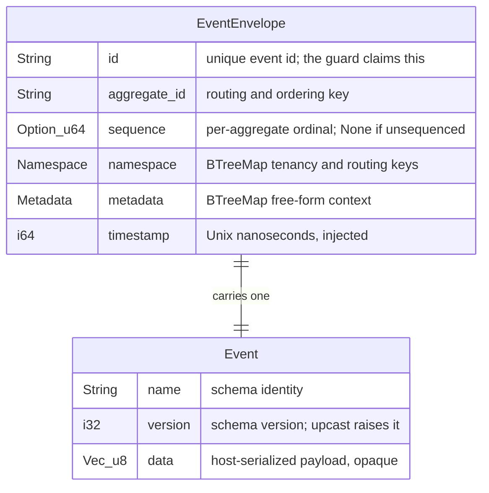
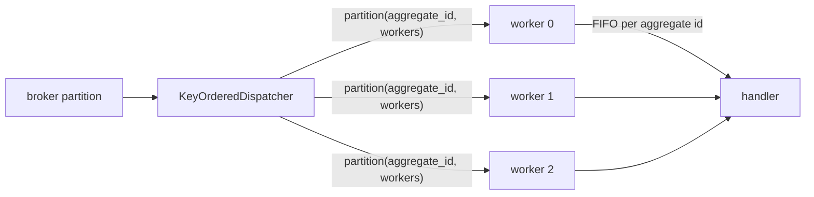
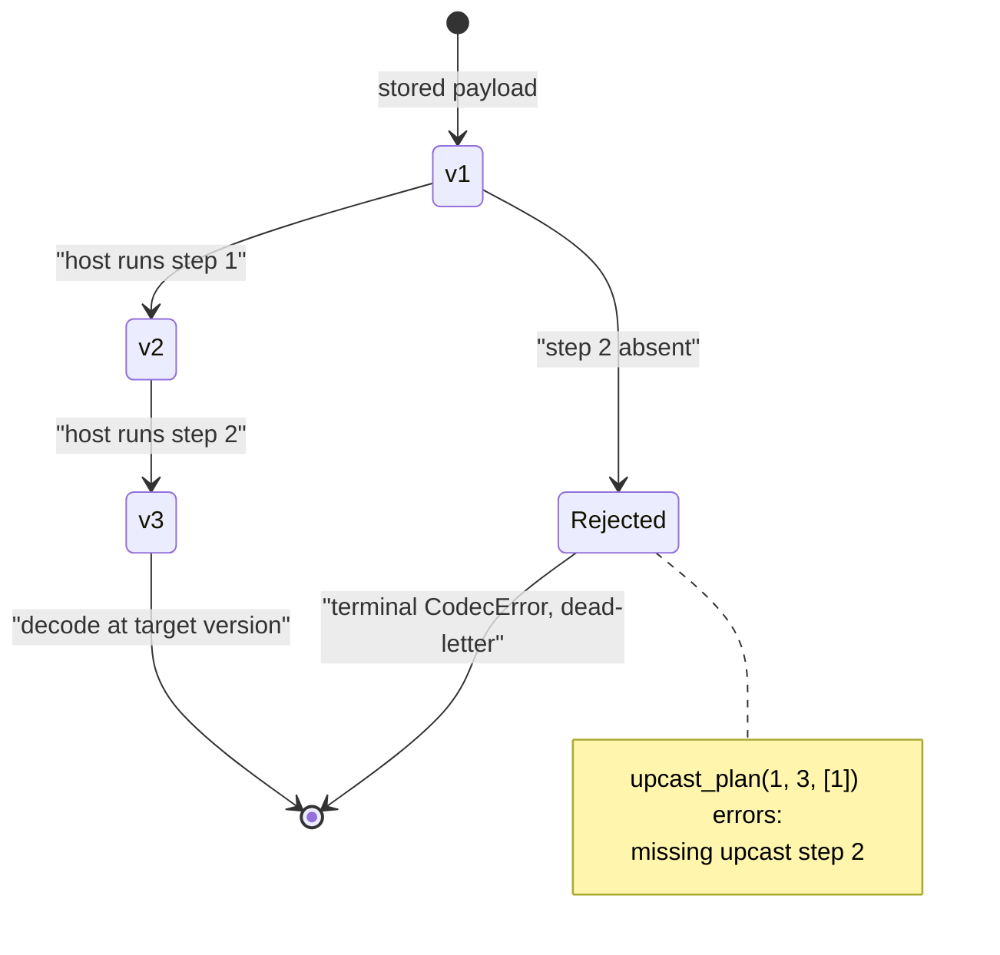
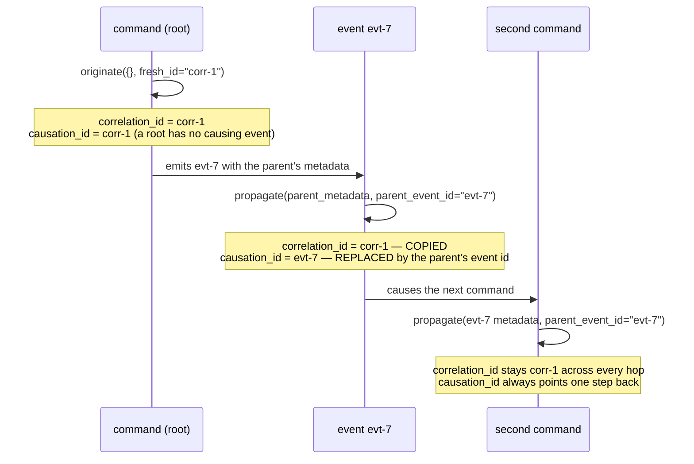

# The event kernel — `edax-event`

The event-sourcing consistency kernel: the routing, byte, ordering and lineage decisions every
service must agree on bit-for-bit.

`edax-event` is pure and synchronous — no I/O, no threads, no callbacks. It decides; the software
development kits (SDKs) wire. Every decision below is pinned by a file in `testdata/golden/`, so a
Python service and a Rust service cannot drift.

| Module | Owns | Golden vector |
|---|---|---|
| `domain` | the envelope shape every binding shares | `envelopes.json` |
| `partition` | which partition an aggregate id routes to | `partition.json`, `rendezvous.json` |
| `codec` | the reproducible wire bytes for an envelope | `envelopes.json` |
| `upcast` | which `v -> v+1` steps run, in which order | `upcast.json` |
| `causation` | `correlation_id` / `causation_id` propagation | `causation.json`, `causation_originate.json` |
| `dedup` | the ignore-old decision for ordered delivery | `dedup.json` |

Host code reaches the kernel through an SDK. The SDKs reach it through the flat application binary
interface (ABI) in `crates/edax-abi`. That crate holds no logic of its own.

## `domain` — the envelope

Four types, all in `crates/edax-event/src/domain.rs`. `Namespace` and `Metadata` are both
`BTreeMap<String, String>`, not `HashMap`: sorted key order is what makes the encoded bytes
reproducible. `timestamp` is injected rather than read from a clock so a golden vector can be
reproduced.



Which fields are the kernel's business:

| Field | Kernel reads it for | Kernel's opinion of the value |
|---|---|---|
| `aggregate_id` | `partition`, `rendezvous` | none — any bytes route |
| `sequence` | `should_apply` | ordinal only; `None` means "nothing to order against" |
| `event.version` | `upcast_plan` | must be `<=` the target version |
| `event.data` | nothing | opaque bytes; base64 in JSON, native bytes in MessagePack |
| `metadata` | `originate`, `propagate` | only the two chain keys; the rest is carried untouched |
| `id`, `namespace`, `timestamp` | nothing | encoded verbatim |

In Python the same shape is a native class, not a parallel dataclass. `edax.Envelope` is the alias
callers construct with. The type stub `_edax.pyi` lists the field types.

```python
import edax

env = edax.Envelope(
    id="acct-1-deposit-1",
    aggregate_id="acct-1",
    event=edax.Event("Deposited", 1, b"4200"),
    namespace={},
    metadata={},
    timestamp=0,
)
```

```rust
use edax_event::{Event, EventEnvelope, Metadata, Namespace};

let env = EventEnvelope {
    id: "evt-1".into(),
    aggregate_id: "agg-1".into(),
    event: Event { name: "InvoiceIssued".into(), version: 1, data: vec![0xde, 0xad, 0xbe, 0xef] },
    sequence: Some(7),
    namespace: Namespace::new(),
    metadata: Metadata::new(),
    timestamp: 1_700_000_000_000_000_000,
};
```

The constructor order differs: the Python class takes `sequence` last with a default, because the
binding generator moves optional parameters to the end.

## `partition` — routing an aggregate id

Two routing functions, and a deployment picks exactly one. They are not interchangeable once a
deployment is running.

| | Rule | Resize behaviour |
|---|---|---|
| `partition(id, n)` | `fnv1a32(id) % max(n, 1)` | growing `N` remaps almost every id |
| `rendezvous(id, n)` | the node in `0..n` with the highest `fnv1a64(id ++ node_le)`, ties to the lowest index | growing `N` remaps about `1/N` of ids |

`partition_bytes` and `rendezvous_bytes` take raw bytes; the string forms pass UTF-8 bytes through.
`n = 0` clamps to 1 rather than dividing by zero, so every id maps to 0 — the first case in both
golden files.

### Worked example: growing `N` from 8 to 9

| aggregate id | `partition` at 8 | `partition` at 9 | `rendezvous` at 8 | `rendezvous` at 9 |
|---|---|---|---|---|
| `agg-1` | 4 | 2 | 0 | 0 |
| `agg-2` | 5 | 8 | 5 | 5 |
| `order-42` | 4 | 8 | 3 | 3 |
| `user:7` | 5 | 1 | 1 | 1 |

All four modulo assignments move; none of the rendezvous ones do. The rendezvous columns are the
committed `n: 8` and `n: 9` entries of `testdata/golden/rendezvous.json`.
`testdata/golden/partition.json` pins `n` at 0, 1, 7, 256 and 1024. The modulo values above follow
from the same `fnv1a32(id) % n` rule those entries fix. A test pins the minimal-remap property:
growing 8 to 9 over 2000 ids moves well under a third of them.

### Who calls it

`N` is a deployment-wide constant; a consumer's worker count `W` is local. Hashing by `W` would make
two consumers with different pool sizes disagree about the same id. The one safe place to pass `W`
is a local fan-out pool. `KeyOrderedDispatcher` is exactly that. The broker has already routed the
aggregate here, so the choice never leaves the process.



One aggregate's events land on one worker in first in, first out (FIFO) order; different aggregates
run in parallel. Both `KeyOrderedDispatcher` implementations pick the worker this way.

```python
import edax

worker = edax.partition("acct-1", 8)  # 0..7
owner = edax.rendezvous("acct-1", 8)  # resize-friendly alternative
```

```rust
let worker = edax_event::partition("acct-1", 8);
let owner = edax_event::rendezvous("acct-1", 8);
```

## `codec` — reproducible envelope bytes

`Format` has two variants, `Json` and `Msgpack`. `Format::from_name` resolves `"json"` / `"msgpack"`
and errors otherwise. `Format::media_type` names each variant's media type,
`application/vnd.edax.envelope+json` or `application/vnd.edax.envelope+msgpack`, and
`Format::from_media_type` resolves it back. Transports that carry a content type, such as the Kafka
`content-type` header, use the pair. See `docs/kernels/kafka.md` for the vocabulary.

| | `data` on the wire | Shape | Golden `evt-1` size |
|---|---|---|---|
| `Format::Json` | base64 string | field-named object | 206 bytes |
| `Format::Msgpack` | native bytes | 7-element positional array | 73 bytes |

Determinism rests on two things. Sorted map keys: `Namespace` and `Metadata` are `BTreeMap`, so
whatever order a host filled them in, the encoding sorts them. Field order is fixed. MessagePack
drops the field names entirely and encodes the struct positionally, so position is the contract. The
golden `msgpack_hex` for `evt-1` starts `97`, a 7-element array. Then come `evt-1` and `agg-1`, then
a nested 3-element array for the event.

Reproducible bytes matter because two services in different languages hash, compare and store the
same logical envelope. Suppose Python sorted `metadata` by insertion and Rust by key. One event
would then produce two byte strings. Any comparison over the encoded form would disagree.
`testdata/golden/envelopes.json` pins four envelopes as `json_hex` and `msgpack_hex`; both test
suites re-encode them and compare hex. A host may serialize its own envelopes in a format the kernel
does not know. Routing and deduplication still work. `partition` and `should_apply` read fields, not
encoded bytes.

`encode_from_json(format, json)` parses boundary JSON and emits the wire bytes;
`decode_to_json(format, wire)` does the reverse. The Python SDK reaches the kernel through a shorter
path. The flat ABI's `encode_envelope` takes the fields flat, so any host model can be encoded
without first building a record. `decode_envelope` returns the structured envelope.
`KernelSerializer` is the thin wrapper over the pair.

```python
import edax

ser = edax.kernel("msgpack")  # or "json", the default
wire = ser.encode(env)
back = ser.decode(wire)  # CodecError on bad bytes — terminal, dead-letter it
```

```rust
use edax_event::Format;

let wire = Format::Msgpack.encode(&env);
let back = Format::Msgpack.decode(&wire)?;
```

`Format::encode` is infallible; the envelope holds only strings, ints, byte vectors and string-keyed
maps. Decoding is fallible. The binding tags the failure with the `codec` error code. The host then
raises a terminal `CodecError` instead of retrying a poison message forever.

## `upcast` — planning a version chain

`upcast_plan(from, to, available)` returns `[from, from+1, ..., to-1]`, where step `v` upgrades a
`v` payload to `v+1`. Three outcomes:

| Input | Result |
|---|---|
| `from == to` | empty plan — already current |
| every step in `from..to` present | the ordered step list; extra unrelated steps are ignored |
| any step in `from..to` absent | error naming the **first** missing step |
| `from > to` | error — downgrades are not modeled |

The split is deliberate. **The kernel plans, the host's code rewrites the payload.** A transform is
domain code and cannot live in a language-neutral kernel. Which steps run, and in what order, is a
consistency decision. Two services replaying the same stored events must rebuild the same state.



`testdata/golden/upcast.json` carries a gap on the first step: `from: 1`, `to: 3`, `available: [2]`.
Its expected message names step 1, not step 2. The plan fails on the earliest hole, not the nearest
one.

```python
from edax.upcast import Upcaster

upcaster = Upcaster().step(1, lambda d: d + b"1").step(2, lambda d: d + b"2")
upcaster.to(b"x", from_=1, to=3)  # b"x12" — steps run in kernel-planned order
upcaster.to(b"x", from_=3, to=3)  # b"x" — empty plan, nothing re-applied
upcaster.to(b"x", from_=1, to=4)  # raises CodecError: missing upcast step 3
```

```rust
let plan = edax_event::upcast_plan(1, 3, &[1, 2])?;   // [1, 2]
assert!(edax_event::upcast_plan(1, 3, &[1]).is_err()); // missing step 2
```

Python wires this into the event codec. `RegistryEventCodec.unmarshal` calls `Upcaster.to` before
decoding, with no host-side version comparison. The kernel decides whether a payload is current or
comes from a newer writer. Both failures are deterministic, so the binding tags them `codec` and the
dispatcher dead-letters on the first attempt instead of nacking forever. The Rust SDK ships no
`Upcaster`; a Rust host calls `upcast_plan` directly.

## `causation` — linking a chain

Two well-known metadata keys, `CORRELATION_ID` (`"correlation_id"`) and `CAUSATION_ID`
(`"causation_id"`), carry the chain. They live in `metadata`, so the envelope wire format is
untouched — nothing about `codec` changes to get tracing.

| Function | Input | `correlation_id` | `causation_id` |
|---|---|---|---|
| `originate(metadata, fresh_id)` | a root event's own metadata plus one generated id | the given one, else `fresh_id` | the given one, else the resulting `correlation_id` |
| `propagate(parent_metadata, parent_event_id)` | the parent's metadata and its event id | the parent's, else `parent_event_id` | always `parent_event_id` |

Both return **only the two keys** for the host to merge; no other metadata is carried.
`correlation_id` alone decides whether a metadata is already on a chain. A lone `causation_id` does
not suppress a fresh correlation id. That is the `{causation_id: evt-0}` case in
`testdata/golden/causation_originate.json`, whose expected `correlation_id` is `fresh-1`.

`fresh_id` is a parameter rather than a generated value because generation is non-deterministic.
Keeping it out leaves the function pure, so one golden vector pins the rule.



The rule that `causation_id` becomes the parent's **event id**, not the parent's `causation_id`, is
what keeps the chain a graph rather than a flat list. `testdata/golden/causation.json` fixes it: a
parent with `{correlation_id: corr-1, causation_id: evt-1}` and id `evt-2` yields `{correlation_id:
corr-1, causation_id: evt-2}`.

A root's `causation_id` is the only one that names no event. `fresh_id` is minted before any
envelope exists, so `originate` points it at the chain the root opens rather than claiming an id
that was never an event's. That makes `causation_id == correlation_id` **not** a root marker: the
first case of `causation.json`, `propagate({}, "evt-root")`, gives a first *child* the same equality
with a real event id. A walker stops when a `causation_id` matches no stored event, never on the
equality.

```python
from edax.causation import ensure_ids, propagate

root = ensure_ids()  # generates a guid, stamps both keys
child = propagate(root, "evt-7")  # merge into the child event's metadata
```

```rust
use edax::{guid, originate, propagate};   // re-exported from edax-event

let root = originate(&Metadata::new(), &guid());
let child = propagate(&root, "evt-7");
```

`ensure_ids` is the Python convenience that generates the id and merges for the host. It generates
even when both keys are present: one wasted universally unique identifier (UUID) is cheaper than
splitting the rule across two calls. A Rust host calls `originate` with `guid()` itself; both
functions are re-exported at the SDK root.

## `dedup` — the ignore-old decision

`should_apply(stored, incoming)` answers one question for an ordered, at-least-once consumer: is
this event stale? It compares nothing but two per-aggregate sequence ordinals.

| `stored` | `incoming` | Result | Why |
|---|---|---|---|
| `None` | anything | apply | nothing processed yet |
| anything | `None` | apply | the event carries no sequence, so there is nothing to order against |
| `Some(5)` | `Some(6)` | apply | newer |
| `Some(5)` | `Some(5)` | **apply** | the comparison is `stored <= incoming` |
| `Some(5)` | `Some(4)` | drop | stale redelivery or out-of-order older event |

The equal case needs care, and the name invites getting it wrong. `should_apply` does not answer
"have I already applied this event?" — it answers "is this event stale?", and an exact redelivery is
not stale. `should_apply(5, 5)` is `True`, so the event applies again.

That makes it the wrong tool on its own for a replayed batch. Measured: replaying a stream through
`should_apply` as the only dedup correctly skipped 180 stale events. It also re-applied exactly one
event per key, a silent 18% read-model error. Every key's newest event has a sequence equal to the
stored one. Put `idempotent_by_id` in front of the handler when the effect is not itself idempotent.
Over the same 400 deliveries that gives 200 handler runs and exact balances.

Use `should_apply` for what it is: a cheap ordinal comparison that drops events already superseded.
An at-least-once handler stays responsible for its own effect-idempotency on the equality boundary.
`testdata/golden/dedup.json` pins all nine cases, including both ends of the `u64` ceiling. This is
not command idempotency by key. Here a stale event is dropped by comparing a sequence. There a
duplicate command is replayed by comparing a key in the ledger.

Neither SDK calls `should_apply` for you: the host owns where the last-applied sequence per
aggregate is stored, so it owns the check. Both SDKs surface it at their root — `edax.should_apply`
in Python, `edax::should_apply` in Rust — so the call reads the same in either language. A
projection keeps a `last_sequence` beside its read model. It reads that value and asks the kernel.
It then applies the event and advances the ordinal, or skips the event.

```python
import edax

entity = await projections.get(env.aggregate_id)
stored = None if entity is None else entity.document["last_sequence"]
if edax.should_apply(stored, env.sequence):
    apply_to(entity.document, env)
    entity.document["last_sequence"] = env.sequence
    await projections.save(entity)  # compare-and-set on version
```

```rust
if edax::should_apply(stored_sequence, envelope.sequence) {
    // apply, then persist the new high-water mark in the same transaction
}
```

Persist the ordinal in the same transaction as the projection write. A crash between two separate
commits leaves the high-water mark ahead of the state it claims to describe.

## See also

- [kernels/core.md](./core.md) — `fnv1a32` and `fnv1a64` behind both routing functions, plus the
  error taxonomy.
- [kernels/filter.md](./filter.md) — the filter abstract syntax tree (AST) the read side evaluates.
- [kernels/cqrs.md](./cqrs.md) — the other kernel on top of `edax-core`: `command_hash` and
  idempotency-by-key on the command side, `query` and cursors on the read side.
- [kernels/golden-vectors.md](./golden-vectors.md) — how every vector cited here is generated and
  asserted.
- [sdk/consuming.md](../sdk/consuming.md) — `KeyOrderedDispatcher`, the one caller of `partition`.
- [sdk/projections.md](../sdk/projections.md) — `ProjectionStore.get_many` and cursors in practice.
- [guides/delivery-guarantees.md](../guides/delivery-guarantees.md) — what `should_apply` is and is
  not worth end to end.
