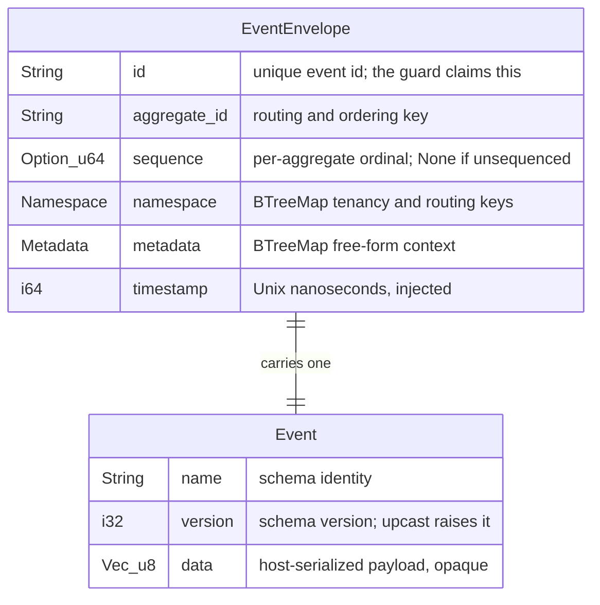
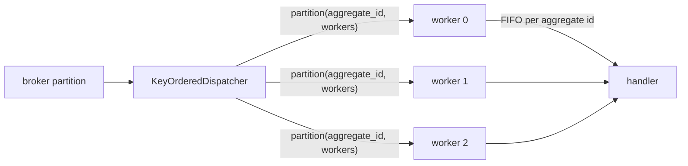
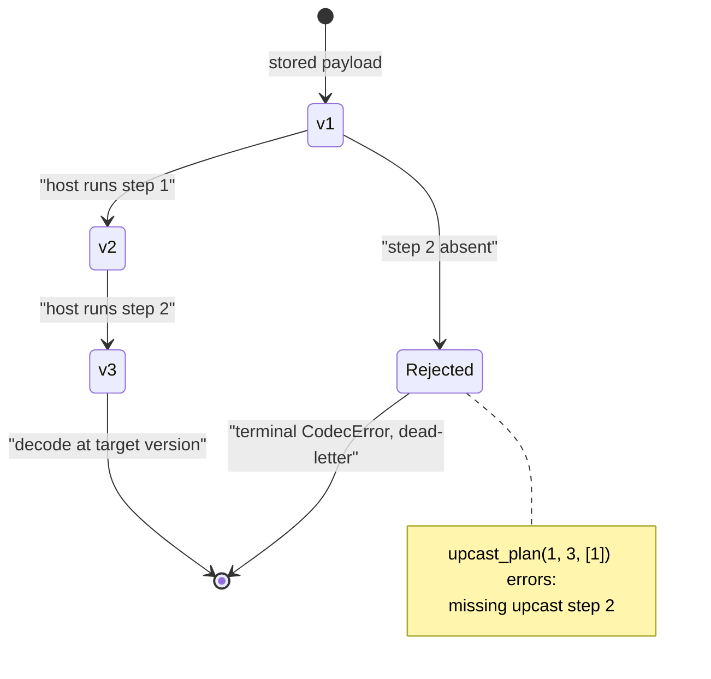
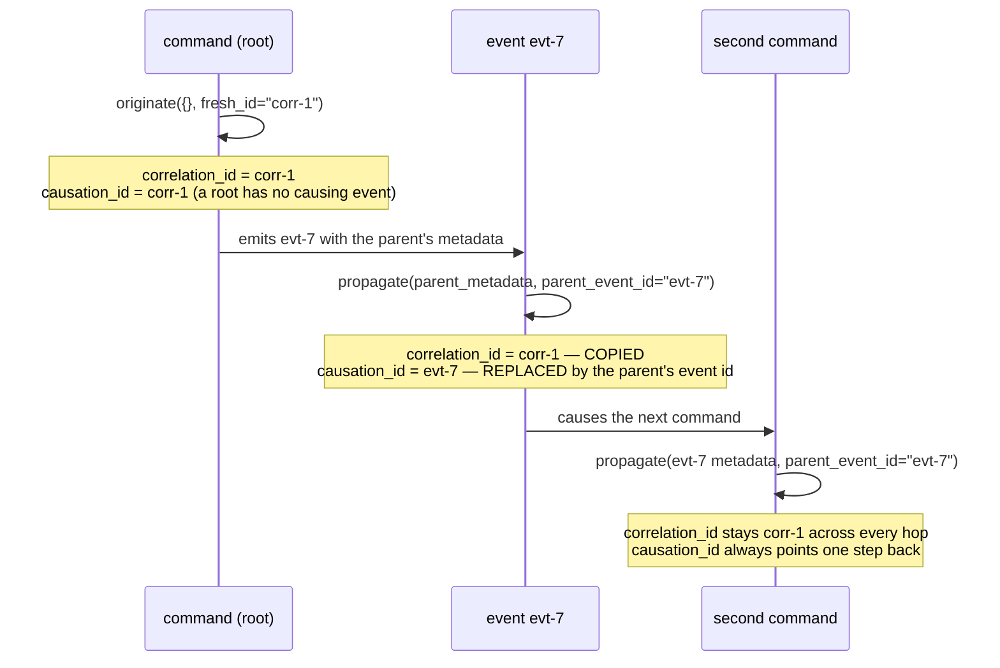

# The event kernel — `edax-event`

The event-sourcing consistency kernel: the routing, byte, ordering and lineage decisions every
service must agree on bit-for-bit.

`edax-event` is pure and synchronous — no I/O, no threads, no callbacks. It decides; the software
development kits (SDKs) wire. Every decision below is pinned by a file in `testdata/golden/`, so a
Python service and a Rust service cannot drift.

| Module | Owns | Golden vector |
|---|---|---|
| `domain` | the envelope shape every binding shares | `envelopes.json` |
| `partition` | which local worker runs an aggregate id (never broker placement) | `partition.json` |
| `codec` | the reproducible wire bytes for an envelope, and how they evolve | `envelopes.json`, `envelope_decode.json` |
| `upcast` | which `v -> v+1` steps run, in which order | `upcast.json` |
| `causation` | `correlation_id` / `causation_id` propagation | `causation.json`, `causation_originate.json` |
| `staleness` | whether an event is older than the watermark, and the watermark after it applies | `staleness.json` |
| `dedup` | the key and hash an event's idempotency guard claims | `event_idempotency.json` |
| `sequence` | the dense-batch rule an append must satisfy, and a replay checks | `sequence_batch.json` |
| `retry` | a consumer's or relay's retry and dead-letter policy: a failure's kind from its code, hand back after which step, or die | `retries.json`, `retry_failure.json` |
| `saga` | whether a saga step folds an event, the write it makes (save, complete, ignore, nothing) and its outbox command id | `saga.json` |

Host code reaches the kernel through an SDK. The SDKs reach it through the flat application binary
interface (ABI) in `crates/edax-abi`. That crate holds no logic of its own.

## `domain` — the envelope

Four types, all in `crates/edax-event/src/domain.rs`. `Namespace` and `Metadata` are both
`BTreeMap<String, String>`, not `HashMap`: sorted key order is what makes the encoded bytes
reproducible. `timestamp` is injected rather than read from a clock so a golden vector can be
reproduced.



Which fields are the kernel's business:

| Field | Kernel reads it for | Kernel's opinion of the value |
|---|---|---|
| `aggregate_id` | `partition` | none — any bytes route, hashed as UTF-8 with no Unicode normalization |
| `sequence` | `is_stale`, `advance`, `check_batch` | a `u64` ordinal; `None` means "nothing to order against" |
| `event.version` | `upcast_plan` | must be `<=` the target version |
| `event.data` | nothing | opaque bytes; base64 in JSON, native bytes in MessagePack |
| `metadata` | `originate`, `propagate` | only the two chain keys; the rest is carried untouched |
| `id`, `namespace`, `timestamp` | nothing | encoded verbatim |

In Python the same shape is a native class, not a parallel dataclass. `edax.EventEnvelope` is the alias
callers construct with. The type stub `_edax.pyi` lists the field types.

```python
import edax

env = edax.EventEnvelope(
    id="acct-1-deposit-1",
    aggregate_id="acct-1",
    event=edax.Event("Deposited", 1, b"4200"),
    namespace={},
    metadata={},
    timestamp=0,
)
```

```rust
use edax_event::{Event, EventEnvelope, Metadata, Namespace};

let env = EventEnvelope {
    id: "evt-1".into(),
    aggregate_id: "agg-1".into(),
    event: Event { name: "InvoiceIssued".into(), version: 1, data: vec![0xde, 0xad, 0xbe, 0xef] },
    sequence: Some(7),
    namespace: Namespace::new(),
    metadata: Metadata::new(),
    timestamp: 1_700_000_000_000_000_000,
};
```

The constructor order differs: the Python class takes `sequence` last with a default, because the
binding generator moves optional parameters to the end.

## `partition` — local fan-out

| | Rule | Resize behaviour |
|---|---|---|
| `partition(id, w)` | `fnv1a32(id) % max(w, 1)` | growing `w` remaps almost every id |

`partition` picks which of a consumer's `w` workers runs an aggregate's events. It is local fan-out
and nothing else. The string's UTF-8 bytes are hashed with no Unicode normalization, so the NFC and
NFD spellings of `café` are two ids. `w = 0` clamps to 1 rather than dividing by zero, so every id
maps to 0 — the first case in the golden file. `testdata/golden/partition.json` pins `w` at 0, 1, 7,
256, 1024 and `u32::MAX` for eight ids, the NFC/NFD pair included.

It is **not** broker placement. Which Kafka partition a record lands on must agree with every
producer on the topic, including Java services and Kafka Connect. So it is Java's murmur2
partitioner, `edax_kafka::partition_for`, which every edax Kafka shell passes explicitly. See
[kernels/kafka.md](./kafka.md).

### Who calls it

A consumer's worker count `w` is local. Two consumers with different pool sizes would disagree about
the same id. That is harmless here only because the broker has already routed the aggregate to one
consumer, so the choice never leaves the process. `KeyOrderedDispatcher` is the one caller.



One aggregate's events land on one worker in first in, first out (FIFO) order; different aggregates
run in parallel. Both `KeyOrderedDispatcher` implementations pick the worker this way.

```python
import edax

worker = edax.partition("acct-1", 8)  # 0..7
```

```rust
let worker = edax_event::partition("acct-1", 8);
```

## `codec` — reproducible envelope bytes

`Format` has two variants, `Json` and `Msgpack`. `Format::from_name` resolves `"json"` / `"msgpack"`
and errors otherwise. `Format::media_type` names each variant's media type,
`application/vnd.edax.envelope+json` or `application/vnd.edax.envelope+msgpack`, and
`Format::from_media_type` resolves it back. Transports that carry a content type, such as the Kafka
`content-type` header, use the pair. See `docs/kernels/kafka.md` for the vocabulary.

| | `data` on the wire | Shape | Golden `evt-1` size |
|---|---|---|---|
| `Format::Json` | base64 string | field-named object | 206 bytes |
| `Format::Msgpack` | native bytes | field-named map | 151 bytes |

Determinism rests on two things. Sorted map keys: `Namespace` and `Metadata` are `BTreeMap`, so
whatever order a host filled them in, the encoding sorts them by UTF-8 bytes. That puts `"Z"` before
`"a"`, and U+FF71 after U+1F980, although JavaScript, Java and C# sort that pair the other way by
UTF-16 code units. Field order is fixed. Both formats write the envelope and its nested `event` as a
map keyed by field name. The golden `msgpack_hex` for `evt-1` starts `87`, a 7-entry map, then
`a2 6964`, the key `id`.

### Evolution: one rule for both formats

A field added by a newer writer must not turn every message into poison for an older reader. So
both formats follow one rule, pinned by `testdata/golden/envelope_decode.json`:

| Input | JSON | MessagePack |
|---|---|---|
| a field the reader does not know, top level or in `event` | ignored | ignored |
| `sequence` missing or `null` | `None` | `None` |
| any other field missing | `codec` error | `codec` error |
| a field repeated | `codec` error | `codec` error |
| a key repeated inside `namespace` or `metadata` | the last wins | the last wins |
| the envelope or `event` as a positional array | `codec` error | `codec` error |
| bytes after the envelope | `codec` error (whitespace is not bytes) | `codec` error |

The map form costs bytes against the old positional array, and buys forward compatibility in both
formats. Each decode row is written once as a wire value and encoded in both formats, so the two
cannot follow different rules. The vector pins only the error code for a refusal: the message is the
parser's own text, which a second SDK's parser words differently.

Reproducible bytes matter because two services in different languages hash, compare and store the
same logical envelope. Suppose Python sorted `metadata` by insertion and Rust by key. One event
would then produce two byte strings. Any comparison over the encoded form would disagree.
`testdata/golden/envelopes.json` pins sixteen envelopes as `json_hex` and `msgpack_hex`. They cover
the key order traps above and escaping: `"`, `\`, U+001F as `\u001f`, DEL and U+2028 raw. They
cover non-ASCII written raw in both formats, `i64` and `i32` extremes, and a negative timestamp. And
they cover the MessagePack width boundaries: fixint/uint8/uint16/uint32/uint64, bin8/bin16 and
fixstr/str8. Both test suites re-encode
them and compare hex. A host may serialize its own envelopes in a format the kernel does not know.
Routing and ordering still work: `partition` and `is_stale` read fields, not encoded bytes.

The ABI's `encode_envelope(format, envelope)` takes the native envelope the host already holds, as
`kafka_record` does, and `decode_envelope` returns one. `KernelSerializer` is the thin Python wrapper over
the pair. The native envelope is the Python SDK's model. It compares, hashes and pickles by value. Its
`namespace` and `metadata` iterate in key order, the wire's. Its constructor takes `sequence` last:
`EventEnvelope(id, aggregate_id, event, namespace, metadata, timestamp, sequence=None)`. The binding
generator puts an optional parameter after the required ones.

```python
import edax

ser = edax.KernelSerializer("msgpack")  # or "json", the default
wire = ser.encode(env)
back = ser.decode(wire)  # CodecError on bad bytes — terminal, dead-letter it
```

```rust
use edax_event::Format;

let wire = Format::Msgpack.encode(&env);
let back = Format::Msgpack.decode(&wire)?;
```

`Format::encode` is infallible; the envelope holds only strings, ints, byte vectors and string-keyed
maps. Decoding is fallible. The binding tags the failure with the `codec` error code. The host then
raises a terminal `CodecError` instead of retrying a poison message forever.

## `upcast` — planning a version chain

`upcast_plan(from, to, available)` returns `[from, from+1, ..., to-1]`, where step `v` upgrades a
`v` payload to `v+1`. `available` is the step versions that have a transform, or `None` for an event
name with no transforms at all. The outcomes:

| Input | Result |
|---|---|
| `from > to`, whatever `available` is | error — the payload comes from a newer writer; downgrades are not modeled |
| `available` is `None` | empty plan — every step is the identity, so an older payload reads as it is |
| `from == to` | empty plan — already current |
| every step in `from..to` present | the ordered step list; extra unrelated steps are ignored |
| any step in `from..to` absent | error naming the **first** missing step |

A codec asks on **every** unmarshal, also for a name with no upcaster. That is what makes the
newer-writer refusal hold everywhere. A v5 payload read by a v1 codec raises. It never decodes
silently and drops the fields the older reader does not know.

The split is deliberate. **The kernel plans, the host's code rewrites the payload.** A transform is
domain code and cannot live in a language-neutral kernel. Which steps run, and in what order, is a
consistency decision. Two services replaying the same stored events must rebuild the same state.



`testdata/golden/upcast.json` carries a gap on the first step: `from: 1`, `to: 3`, `available: [2]`.
Its expected message names step 1, not step 2. The plan fails on the earliest hole, not the nearest
one. The vector also pins that `available` is a set: unsorted and repeated entries plan the same.
It pins negative versions, an empty `available` with `from < to`, the `i32` extremes, and the
identity rows (`available: null`): current, older, and a newer writer, refused. A span of 2^32
versions fails at its second step without walking the span, and an identity span is an empty plan. Every error row carries the
kernel's exact message, and both SDK suites compare it.

```python
from edax.upcast import Upcaster

upcaster = Upcaster().step(1, lambda d: d + b"1").step(2, lambda d: d + b"2")
upcaster.to(b"x", from_=1, to=3)  # b"x12" — steps run in kernel-planned order
upcaster.to(b"x", from_=3, to=3)  # b"x" — empty plan, nothing re-applied
upcaster.to(b"x", from_=1, to=4)  # raises CodecError: missing upcast step 3
```

```rust
let plan = edax_event::upcast_plan(1, 3, Some(&[1, 2]))?;    // [1, 2]
assert!(edax_event::upcast_plan(1, 3, Some(&[1])).is_err()); // missing step 2
assert!(edax_event::upcast_plan(5, 1, None).is_err());       // a newer writer, no upcaster
```

Both SDKs wire this into their event codecs. Python's `RegistryEventCodec.unmarshal` and Rust's
`RegistryCodec` / `SerdeCodec::unmarshal` ask the kernel before decoding, with the name's `Upcaster`
steps or `None`, and no host-side version comparison. Both failures are deterministic, so they are
`codec` errors and the dispatcher dead-letters on the first attempt instead of nacking forever.
`Upcaster.step` (both SDKs) refuses a second transform for one version as `already_registered`.

## `retry` — when a failed message dies

`Retries` is the policy a consumer runs on a failed message, sans-IO in the `OffsetTracker` style.
The host builds it with `Retries::new(max_attempts, sink)`, where `sink` is whether a dead-letter
sink is wired. The host runs the handler, the sink, the wait and the ack or nack. It asks
`failed(id, broker_attempt, failure)` what to do, with `failure = Failure::of(code)`. `code` is the
failure's error code, `None` for one no code classifies. `in_progress` reads as `Contended`: another
consumer holds the message's idempotency claim. A terminal code reads as `Terminal`, anything else as
`Transient`. The ABI takes the code itself, so no SDK maps an error to a kind. The answer:

| Rule | Detail |
|---|---|
| the attempt | `max(broker_attempt, recorded) + 1`, saturating |
| it dies | a `Terminal` failure, or `0 < max_attempts <= attempt`, and only with a sink |
| it is handed back | everything else, after backoff step `attempt - 1`; the attempt is recorded, so the wait grows |
| contention | its own growing step; never counts toward `max_attempts` |
| the sink fails | `sink_failed(id, attempt)` keeps the attempt and answers the step; the redelivery dies again |
| it succeeds | `succeeded` / `dead_lettered` forget its counts |

Two SDKs consuming one topic agree on when a message dies, so a poison message is not dead-lettered
by one service and retried forever by the other. Both `KeyOrderedDispatcher`s and both `Relay`s run
it, the relays keyed by outbox row id. `retries.json` holds operation scripts, each op with the
answer the kernel gave; both suites replay them. `retry_failure.json` pins `Failure::of` for every
code and for none.

## `saga` — the write a saga step makes

`saga_admit(folded, env)` answers whether a runner folds `env` at all. `folded` is the text the
instance's last write saved, empty for a new instance. It holds one mark per source aggregate: the
highest sequence and the last event id folded from it. A redelivered event is a `Repeat` when its id
is its aggregate's mark or its sequence is below it. The runner skips a repeat, so a step whose ack
was lost does not decide its commands again. Anything else is `Fold { folded }`, the marks to save with the step.
An unsequenced event is a repeat only of the last one folded from its aggregate. Marks the function
did not write are a `codec` error.

`saga_write(loaded, completes, has_commands)` answers what a saga runner writes after a fold:

| Loaded, and the fold | Write |
|---|---|
| a completed instance | `Ignore`: the event is not folded at all |
| nothing, and the fold keeps no state and sends no command | `Nothing` |
| anything else, keeping state | `Save { expected }` at the loaded version (`0` when absent) |
| anything else, completing | `Complete { expected }` at the loaded version |
 The commands go in the same write,
the saga outbox, each with `saga_command_id(correlation_id, version, index)` =
`"{correlation_id}:{version}:{index}"`, unique per committed transition. `SagaCommand` is the outbox
row: that id, the correlation, the command marshaled as an `Event`, a timestamp. See
[sagas](../sdk/sagas.md). Pinned by `saga.json`.

## `causation` — linking a chain

Two well-known metadata keys, `CORRELATION_ID` (`"correlation_id"`) and `CAUSATION_ID`
(`"causation_id"`), carry the chain. They live in `metadata`, so the envelope wire format is
untouched — nothing about `codec` changes to get tracing.

| Function | Input | `correlation_id` | `causation_id` |
|---|---|---|---|
| `originate(metadata, fresh_id)` | a root event's own metadata plus one generated id | the given one, else `fresh_id` | the given one, else the resulting `correlation_id` |
| `propagate(parent_metadata, parent_event_id)` | the parent's metadata and its event id | the parent's, else `parent_event_id` | always `parent_event_id` |

Both return **only the two keys** for the host to merge; no other metadata is carried.
`correlation_id` alone decides whether a metadata is already on a chain. A lone `causation_id` does
not suppress a fresh correlation id. That is the `{causation_id: evt-0}` case in
`testdata/golden/causation_originate.json`, whose expected `correlation_id` is `fresh-1`. A key is
present when it is set, whatever its value: an empty `correlation_id` is a chain, and an empty
`causation_id` is kept. Both vectors pin the empty-string cases, so a host that tests truthiness
fails them. The ABI exports the two key names (`correlation_id_key()`, `causation_id_key()`), so no
SDK restates the strings.

`fresh_id` is a parameter rather than a generated value because generation is non-deterministic.
Keeping it out leaves the function pure, so one golden vector pins the rule.



The rule that `causation_id` becomes the parent's **event id**, not the parent's `causation_id`, is
what keeps the chain a graph rather than a flat list. `testdata/golden/causation.json` fixes it: a
parent with `{correlation_id: corr-1, causation_id: evt-1}` and id `evt-2` yields `{correlation_id:
corr-1, causation_id: evt-2}`.

A root's `causation_id` is the only one that names no event. `fresh_id` is minted before any
envelope exists, so `originate` points it at the chain the root opens rather than claiming an id
that was never an event's. That makes `causation_id == correlation_id` **not** a root marker: the
first case of `causation.json`, `propagate({}, "evt-root")`, gives a first *child* the same equality
with a real event id. A walker stops when a `causation_id` matches no stored event, never on the
equality.

```python
from edax.causation import ensure_ids, propagate

root = ensure_ids()  # generates a guid, stamps both keys
child = propagate(root, "evt-7")  # merge into the child event's metadata
```

```rust
use edax::{guid, originate, propagate};   // re-exported from edax-event

let root = originate(&Metadata::new(), &guid());
let child = propagate(&root, "evt-7");
```

`ensure_ids` is the Python convenience that generates the id and merges for the host. It generates
even when both keys are present: one wasted universally unique identifier (UUID) is cheaper than
splitting the rule across two calls. A Rust host calls `originate` with `guid()` itself; both
functions are re-exported at the SDK root.

## `staleness` — the ordered consumer's watermark

An ordered, at-least-once consumer keeps the highest sequence it applied per aggregate, its
watermark. Two kernel functions own the whole rule:

- `is_stale(stored, incoming)` — is this event older than the watermark? Skip it if so.
- `advance(stored, incoming)` — the watermark after the event applies: the higher of the two.

| `stored` | `incoming` | `is_stale` | `advance` | Why |
|---|---|---|---|---|
| `None` | anything | false | `incoming` | nothing applied yet |
| `Some(5)` | `None` | false | `Some(5)` | an unsequenced event has no place in the order, and never erases the mark |
| `Some(5)` | `Some(6)` | false | `Some(6)` | newer |
| `Some(5)` | `Some(5)` | **false** | `Some(5)` | the comparison is `incoming < stored` |
| `Some(5)` | `Some(4)` | true | `Some(5)` | a stale redelivery or an out-of-order older event; the mark never moves back |

`advance` exists because the obvious update, `watermark = env.sequence`, is wrong twice. An
unsequenced event erases the mark, so the next stale redelivery applies. And a stale event that
slipped through moves the mark backwards. Over the stream `[1, 2, 5, None, 3]` that update applied
all five and ended at 3; the kernel's fold applies `[1, 2, 5, None]` and ends at 5.
`testdata/golden/staleness.json` pins every pair, both `u64` ceiling cases, and three folds: that
stream, a redelivery after a seek back, and out-of-order copies.

The equal case needs care. `is_stale` does not answer "have I already applied this event?" — it
answers "is this event older?", and an exact redelivery is not older. `is_stale(5, 5)` is false, so
the event applies again. That makes it the wrong tool on its own for a replayed batch. Measured:
replaying a stream through the ordinal check as the only dedup correctly skipped 180 stale events.
It also re-applied exactly one event per key, a silent 18% read-model error. Every key's newest event
has a sequence equal to the stored one. Put `idempotent_by_id` in front of the handler when the
effect is not itself idempotent. Over the same 400 deliveries that gives 200 handler runs and exact
balances. The key that guard claims is the kernel's too: `event_idempotency(envelope)` in `dedup`.

The ordering also assumes the consumer itself does not reorder. Say a nack seeks back while later
copies of the same aggregate are already queued, and a worker runs them. The older event then
arrives after the newer one, and `is_stale` skips it for good. The SDK consumers do not do that: a
nack rewinds the partition and retires the queued copies (`OffsetTracker::is_live`), and the
dispatcher skips them. A consumer of your own must do the same (see
[sdk/consuming.md](../sdk/consuming.md)).

Neither SDK calls these for you: the host owns where the watermark per aggregate is stored, so it
owns the check. Both SDKs surface them at their root — `edax.is_stale` and `edax.advance` in Python,
`edax::is_stale` and `edax::advance` in Rust — so the call reads the same in either language. A
projection keeps a `last_sequence` beside its read model. It reads that value and asks the kernel.
It then applies the event and stores the advanced mark, or skips the event.

```python
import edax
from edax import Entity

entity = await projections.get(env.aggregate_id) or Entity(env.aggregate_id, 0, {"last_sequence": None})
stored = entity.document["last_sequence"]
if not edax.is_stale(stored, env.sequence):
    apply_to(entity.document, env)
    entity.document["last_sequence"] = edax.advance(stored, env.sequence)
    await projections.save(entity)  # compare-and-set on version
```

```rust
if !edax::is_stale(stored_sequence, envelope.sequence) {
    // apply, then persist edax::advance(stored_sequence, envelope.sequence) in the same transaction
}
```

Persist the mark in the same transaction as the projection write. A crash between two separate
commits leaves the mark ahead of the state it claims to describe.

## `sequence` — the dense-batch rule

`check_batch(expected, sequences)` is the rule every event store applies before an append writes.
The batch must run `expected + 1, expected + 2, ...` in order, every envelope sequenced. A gap, a
repeat, a reordering or an unsequenced envelope is a `codec` error naming the 0-based batch index.
Versions and sequences are one `u64` space end to end, so the comparison is exact past `i64::MAX`.
A batch that would run past `u64::MAX` is refused rather than clamped, since a clamp would let two
envelopes share the ceiling. A negative version from a host is refused at the boundary as a `codec`
error. `testdata/golden/sequence_batch.json` pins every branch, the ceiling cases included.

## See also

- [kernels/core.md](./core.md) — `fnv1a32` behind `partition`, `fnv1a64` behind the payload hash,
  plus the error taxonomy.
- [kernels/kafka.md](./kafka.md) — broker placement, `partition_for`.
- [kernels/filter.md](./filter.md) — the filter abstract syntax tree (AST) the read side evaluates.
- [kernels/cqrs.md](./cqrs.md) — the other kernel on top of `edax-core`: `command_hash` and
  idempotency-by-key on the command side, `query` and cursors on the read side.
- [kernels/golden-vectors.md](./golden-vectors.md) — how every vector cited here is generated and
  asserted.
- [sdk/consuming.md](../sdk/consuming.md) — `KeyOrderedDispatcher`, the one caller of `partition`.
- [sdk/projections.md](../sdk/projections.md) — `ProjectionStore.get_many` and cursors in practice.
- [guides/delivery-guarantees.md](../guides/delivery-guarantees.md) — what `is_stale` is and is not
  worth end to end.
