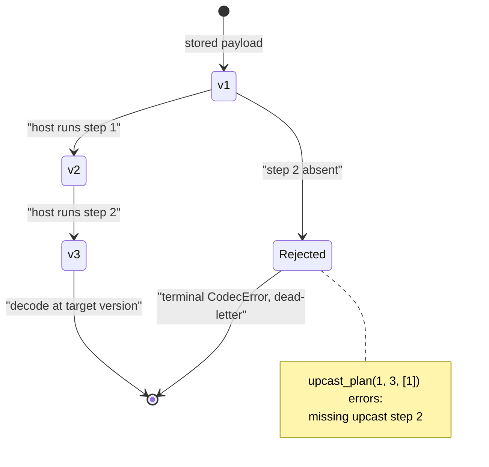
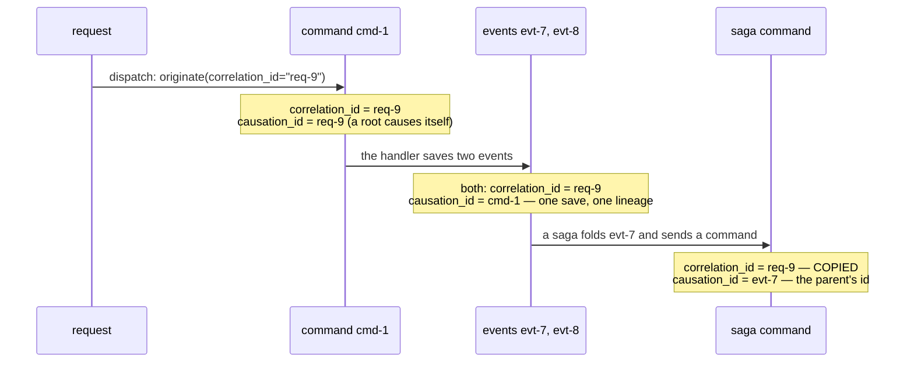

# The event kernel — `edax-event`

The event-sourcing consistency kernel: the routing, byte, ordering and lineage decisions every
service must agree on bit-for-bit.

`edax-event` is pure and synchronous — no I/O, no threads, no callbacks. It decides; the software
development kits (SDKs) wire. Every decision below is pinned by a file in `testdata/golden/`, so a
Python service and a Rust service cannot drift.

| Module | Owns | Golden vector |
|---|---|---|
| `domain` | the event and command message shapes, the extension key rule, the ordering key, a received command's key | `envelopes.json`, `extensions.json`, `ordering_key.json`, `command_received_key.json` |
| `partition` | which local worker runs an ordering key (never broker placement) | `partition.json` |
| `codec` | the reproducible wire bytes for both kinds of message, their media types, and how they evolve | `envelopes.json`, `envelope_decode.json` |
| `upcast` | which `v -> v+1` steps run, in which order | `upcast.json` |
| `causation` | the lineage of a message: `correlation_id` / `causation_id` propagation | `causation.json`, `causation_originate.json` |
| `staleness` | whether an event is older than the watermark, and the watermark after it applies | `staleness.json` |
| `dedup` | the key and hash an event's idempotency guard claims | `event_idempotency.json` |
| `sequence` | the dense-batch rule an append must satisfy, and a replay checks; when a save writes a snapshot | `sequence_batch.json`, `snapshot_due.json` |
| `retry` | a consumer's or relay's retry and dead-letter policy: a failure's kind from its code, hand back after which step, or die | `retries.json`, `retry_failure.json` |
| `saga` | whether a saga step folds an event, the write it makes (save, complete, nothing) and the command messages it sends | `saga.json` |

Host code reaches the kernel through an SDK. The SDKs reach it through the flat application binary
interface (ABI) in `crates/edax-abi`. That crate holds no logic of its own.

## `domain` — the messages

Two messages cross a process boundary: `EventMessage` and `CommandMessage`, both in
`crates/edax-event/src/domain.rs`. Both are flat: identity, payload, lineage, time, then two string
maps. Nothing nests. A `Kind` enum names the two, `Event` and `Command`. It is exhaustive on purpose,
so a new kind is a compile error in every SDK rather than a silent default.

| Field | `EventMessage` | `CommandMessage` | Read by |
|---|---|---|---|
| `id` | `String`, the event's unique id | `String`, this message instance | the event guard; the causation of a child; the retry policy's attempt count |
| `idempotency_key` | — | `Option<String>`, the client's intent; `None` makes no claim | the command guard, through `claim_key` |
| `aggregate_id` | `String` | `Option<String>`, the target, if any | the ordering key |
| `tenant` | `Option<String>` | `Option<String>` | `tenant_key`: every key a seam is called with |
| `sequence` | `Option<u64>`, the per-aggregate ordinal | — | `is_stale`, `advance`, `check_batch` |
| `name` | `String` | `String` | routing, `upcast_plan`, the command hash |
| `version` | `u32`, the payload schema version | `u32` | `upcast_plan` |
| `data` | `Vec<u8>`, the host-serialized payload | `Vec<u8>` | nothing: opaque, base64 in JSON, native bytes in MessagePack |
| `correlation_id` | `String` | `String` | lineage |
| `causation_id` | `String` | `String` | lineage |
| `occurred_at` | `Option<i64>`, valid time | — | nothing: the host's |
| `recorded_at` | `i64`, transaction time | — | relay lag |
| `issued_at` | — | `i64`, the issuer's clock | relay lag |
| `extensions` | `Extensions` | `Extensions` | edax extensions, such as trace context |
| `metadata` | `Metadata` | `Metadata` | nothing: the application's |

Two more shapes sit beside the messages. `Event` is a codec's output: `name`, `version` and `data`.
An aggregate holds its pending events in that shape. `EventDraft` is an event as a repository hands
it to the store: every field of an `EventMessage` but `recorded_at`. The store stamps that field, and
`EventDraft::record(recorded_at)` makes the message.

### Three tiers of fields

Every key in a message has one owner.

| Tier | Owner | Rule |
|---|---|---|
| a typed field | edax: a kernel or an SDK decision reads it | its own type, pinned by the codec goldens |
| `extensions` | edax extensions: trace context, request origin | keys match `[a-z0-9][a-z0-9._-]{0,63}`; values are opaque strings |
| `metadata` | the application | opaque to edax; tenancy lives here |

`check_extensions` is the key rule: 1 to 64 bytes of lowercase ASCII letters, digits, `.`, `_` and
`-`, starting with a letter or a digit. A dot namespaces keys per extension, as in `http.origin_ip`.
Lowercase keeps a key safe as a header name on every transport. The codec checks on encode and on
decode, so a producer never mints a message every consumer would refuse.
`testdata/golden/extensions.json` pins the rule.

`Extensions` and `Metadata` are both `BTreeMap<String, String>`, not `HashMap`. Sorted key order is
what makes the encoded bytes reproducible.

Broker facts never enter a message. The offset, the partition and the broker's own time ride on the
delivery, beside the message. `KafkaFetched` in Python carries them, `timestamp` and
`timestamp_type` included.

### Time

A message carries at most two clock readings, each with one meaning.

| Time | Field | Who sets it | Meaning |
|---|---|---|---|
| valid time | `occurred_at` on an event | the host | when the fact happened; `None` means when it was recorded |
| transaction time | `recorded_at` on an event | the store, at append | when the store recorded the fact, on the store's clock |
| issue time | `issued_at` on a command | the issuer | when the command was built |
| broker time | none: on the delivery | the broker or the producer client | Kafka's `CreateTime` or `LogAppendTime`, in milliseconds |
| processing time | none | — | when a handler takes the message; never stored |

Every stored time is Unix nanoseconds in an `i64`. A database store stamps `recorded_at` with its
own `now()`. The memory store takes the reading as an argument, because a binding cannot hand it a
callable clock. None of these times orders anything: order on `sequence`.

### The ordering key

`ordering_key(aggregate_id, id)` is the key that orders a message against others. An event's is its
aggregate id. A command's is its target aggregate, or its own id when it names none. A command
without a target then spreads by id, instead of piling onto one empty key. An empty aggregate id
is still an aggregate id. The Kafka record key, the memory broker's partition and the dispatcher's
worker all start from it. `testdata/golden/ordering_key.json` pins it.

`received_key(idempotency_key, id)` is the key a guard claims for a received command. It is the
client's `idempotency_key`, or the command's own `id` when it carries none. A broker redelivers the
same message, and both copies carry one id, so the id still deduplicates a redelivery. An empty key
is still a key. `testdata/golden/command_received_key.json` pins it.

```python
import edax

msg = edax.EventMessage(
    id="evt-1",
    aggregate_id="acct-1",
    name="Deposited",
    version=1,
    data=b"4200",
    correlation_id="corr-1",
    causation_id="cmd-1",
    recorded_at=1_700_000_000_000_000_000,
    extensions={"traceparent": "00-abc-def-01"},
    metadata={},
    sequence=1,
)
```

```rust
use edax_event::{EventMessage, Extensions, Metadata};

let msg = EventMessage {
    id: "evt-1".into(),
    aggregate_id: "agg-1".into(),
    sequence: Some(7),
    name: "InvoiceIssued".into(),
    version: 1,
    data: vec![0xde, 0xad, 0xbe, 0xef],
    correlation_id: "corr-1".into(),
    causation_id: "cmd-1".into(),
    occurred_at: None,
    recorded_at: 1_700_000_000_000_000_000,
    extensions: Extensions::new(),
    metadata: Metadata::new(),
};
```

In Python each shape is a native class, not a parallel dataclass. It compares, hashes and pickles by
value, and its maps iterate in key order, the wire's. The type stub `_edax.pyi` lists the field
types. The constructor order differs from Rust: the binding generator moves optional parameters,
such as `sequence` and `occurred_at`, to the end.

## `codec` — reproducible message bytes

`Format` has two variants, `Json` and `Msgpack`. `Format::from_name` resolves `"json"` and
`"msgpack"`, and errors otherwise. A media type names a format and a kind together:

| | `Kind::Event` | `Kind::Command` |
|---|---|---|
| `Format::Json` | `application/vnd.edax.event+json` | `application/vnd.edax.command+json` |
| `Format::Msgpack` | `application/vnd.edax.event+msgpack` | `application/vnd.edax.command+msgpack` |

`Format::media_type(kind)` gives the string, and `Format::from_media_type` resolves it back to the
pair. Anything else is a `codec` error, never a fallback. The bytes do not say which kind they hold;
the media type does. A transport that carries one, such as the Kafka `content-type` header, decodes
by it. A decode of the wrong kind then fails on the kind, not on whichever field is missing. See
[kafka.md](./kafka.md) for the vocabulary.

| | `data` on the wire | Shape | Golden `base` event size |
|---|---|---|---|
| `Format::Json` | base64 string | field-named object | 323 bytes |
| `Format::Msgpack` | native bytes | field-named map | 258 bytes |

Determinism rests on two things. Sorted map keys: `Extensions` and `Metadata` are `BTreeMap`, so
whatever order a host filled them in, the encoding sorts them by UTF-8 bytes. That puts `"Z"` before
`"a"`, and U+FF71 after U+1F980, although JavaScript, Java and C# sort that pair the other way by
UTF-16 code units. Field order is fixed. Both formats write a message as a map keyed by field name.
The golden `msgpack_hex` of the `base` event starts `8c`, a 12-entry map, then `a2 6964`, the key
`id`. A command starts `8b`, an 11-entry map.

### Evolution: one rule for both formats and both kinds

A field added by a newer writer must not turn every message into poison for an older reader. So
both formats follow one rule, pinned by `testdata/golden/envelope_decode.json`:

| Input | JSON | MessagePack |
|---|---|---|
| a field the reader does not know | ignored | ignored |
| an optional field missing or `null`: `sequence`, `occurred_at`, `idempotency_key`, a command's `aggregate_id` | `None` | `None` |
| any other field missing, the `extensions` map included | `codec` error | `codec` error |
| a negative `version` | `codec` error | `codec` error |
| an `extensions` key outside the key rule | `codec` error | `codec` error |
| a field repeated | `codec` error | `codec` error |
| a key repeated inside `extensions` or `metadata` | the last wins | the last wins |
| the message as a positional array | `codec` error | `codec` error |
| bytes after the message | `codec` error (whitespace is not bytes) | `codec` error |

A writer writes every optional field as an explicit `null`. The map form costs bytes against a
positional array, and buys forward compatibility in both formats. Each decode row is written once as
a wire value and encoded in both formats, so the two cannot follow different rules. The vector pins
only the error code for a refusal: the message is the parser's own text, which a second SDK's parser
words differently.

Reproducible bytes matter because two services in different languages hash, compare and store the
same logical message. Suppose Python sorted `metadata` by insertion and Rust by key. One event
would then produce two byte strings. Any comparison over the encoded form would disagree.
`testdata/golden/envelopes.json` pins the bytes of both kinds in both formats, the key order traps
above included. Both test suites re-encode them and compare hex.

A host may serialize its own messages in a format the kernel does not know. Routing and ordering
still work: `partition`, `ordering_key` and `is_stale` read fields, not encoded bytes.

The ABI's `encode_event(format, msg)` and `encode_command(format, msg)` take the native message the
host already holds. `decode_event` and `decode_command` return one. `media_type(format, kind)` names
the pair. `KernelSerializer(fmt, kind)` is the thin Python wrapper over them, one kind per
serializer.

```python
import edax

events = edax.KernelSerializer("msgpack")  # kind "event", the default
commands = edax.KernelSerializer("json", "command")
wire = events.encode(msg)
back = events.decode(wire)  # CodecError on bad bytes — terminal, dead-letter it
```

```rust
use edax_event::Format;

let wire = Format::Msgpack.encode(&msg)?; // refuses a bad extension key
let back: edax_event::EventMessage = Format::Msgpack.decode(&wire)?;
```

Encoding fails only on an extension key outside the rule. A message holds nothing else that can fail
to serialize. Decoding fails on any bytes the rule above refuses. The binding tags both failures
with the `codec` error code. The host then raises a terminal `CodecError` instead of retrying a
poison message forever.

## `upcast` — planning a version chain

`upcast_plan(from, to, available)` returns `[from, from+1, ..., to-1]`, where step `v` upgrades a
`v` payload to `v+1`. `available` is the step versions that have a transform, or `None` for an event
name with no transforms at all. The outcomes:

| Input | Result |
|---|---|
| `from > to`, whatever `available` is | error — the payload comes from a newer writer; downgrades are not modeled |
| `available` is `None` | empty plan — every step is the identity, so an older payload reads as it is |
| `from == to` | empty plan — already current |
| every step in `from..to` present | the ordered step list; extra unrelated steps are ignored |
| any step in `from..to` absent | error naming the **first** missing step |

A codec asks on **every** unmarshal, also for a name with no upcaster. That is what makes the
newer-writer refusal hold everywhere. A v5 payload read by a v1 codec raises. It never decodes
silently and drops the fields the older reader does not know.

The split is deliberate. The kernel plans, and the host's code rewrites the payload. A transform is
domain code and cannot live in a language-neutral kernel. Which steps run, and in what order, is a
consistency decision. Two services replaying the same stored events must rebuild the same state.



`testdata/golden/upcast.json` carries a gap on the first step: `from: 1`, `to: 3`, `available: [2]`.
Its expected message names step 1, not step 2. The plan fails on the earliest hole, not the nearest
one. The vector also pins that `available` is a set: unsorted and repeated entries plan the same. A
span of 2^32 versions fails at its second step without walking the span, and an identity span is an
empty plan. Every error row carries the kernel's exact message, and both SDK suites compare it.

### Each event name has its own version

`upcast_target(available)` is the schema version a codec writes for one event name, and the `to` it
raises that name's older payloads to. It is one past the highest step, or `FIRST_VERSION` (1) when
`available` is `None` or empty. The steps are the version's only source. A codec has no separate
version setting that could disagree with them, and raising one name's version never moves another's.
To bump a name whose shape did not change, register an identity step.

| `available` | Result |
|---|---|
| `None` or `[]` | 1 |
| `[1, 2]`, in any order, repeats collapsed | 3 |
| `[2, 3]`, a chain that starts above 1 | 4; its older versions are retired, so a v1 payload is refused at load |
| a hole, such as `[1, 3]` | error naming the first missing version: a v2 payload could never be raised |
| a step at `u32::MAX` | error: its output has no schema version |

A codec asks once per name, when it is built, so a broken chain fails at startup and not on the first
old row. Every row of `upcast.json` pins `target` (or `target_error`) for its `available` beside the
plan, so a third SDK derives the same version for the same steps.

```python
from edax.upcast import Upcaster

upcaster = Upcaster().step(1, lambda d: d + b"1").step(2, lambda d: d + b"2")
upcaster.to(b"x", from_=1, to=3)  # b"x12" — steps run in kernel-planned order
upcaster.to(b"x", from_=3, to=3)  # b"x" — empty plan, nothing re-applied
upcaster.to(b"x", from_=1, to=4)  # raises CodecError: missing upcast step 3
```

```rust
let plan = edax_event::upcast_plan(1, 3, Some(&[1, 2]))?;    // [1, 2]
assert!(edax_event::upcast_plan(1, 3, Some(&[1])).is_err()); // missing step 2
assert!(edax_event::upcast_plan(5, 1, None).is_err());       // a newer writer, no upcaster
assert_eq!(edax_event::upcast_target(Some(&[1, 2]))?, 3);    // the name writes v3
assert!(edax_event::upcast_target(Some(&[1, 3])).is_err());  // a hole: no target
```

Both SDKs wire this into their event codecs. Python's `RegistryEventCodec` and Rust's `RegistryCodec`
/ `SerdeCodec` ask `upcast_target` for each name when they are built, and stamp that version on
marshal. On unmarshal they ask `upcast_plan` before decoding, with the name's `Upcaster` steps or
`None`, and no host-side version comparison. Every failure is deterministic, so each is a `codec`
error: a broken chain fails the codec's construction, and a bad payload dead-letters on the first
attempt instead of nacking forever. `Upcaster.step` (both SDKs) refuses a second transform for one
version as `already_registered`. A schema version is a `u32`. In Python, a negative or oversized step
is refused at wiring: `Upcaster.step` raises `ValueError`, before any message is stamped.

## `retry` — when a failed message dies

`Retries` is the policy a consumer runs on a failed message, sans-IO in the `OffsetTracker` style.
The host builds it with `Retries::new(max_attempts, sink)`, where `sink` is whether a dead-letter
sink is wired. The host runs the handler, the sink, the wait and the ack or nack. It asks
`failed(id, broker_attempt, failure)` what to do, with `failure = Failure::of(code)`. `code` is the
failure's error code, `None` for one no code classifies. `in_progress` reads as `Contended`: another
consumer holds the message's idempotency claim. A terminal code reads as `Terminal`, anything else as
`Transient`. The ABI takes the code itself, so no SDK maps an error to a kind. The answer:

| Rule | Detail |
|---|---|
| the attempt | `max(broker_attempt, recorded) + 1`, saturating |
| it dies | a `Terminal` failure, or `0 < max_attempts <= attempt`, and only with a sink |
| it is handed back | everything else, after backoff step `attempt - 1`; the attempt is recorded, so the wait grows |
| contention | its own growing step; never counts toward `max_attempts` |
| the sink fails | `sink_failed(id, attempt)` keeps the attempt and answers the step; the redelivery dies again |
| it succeeds | `succeeded` / `dead_lettered` forget its counts |

Two SDKs consuming one topic agree on when a message dies, so a poison message is not dead-lettered
by one service and retried forever by the other. Both `KeyOrderedDispatcher`s and both `Relay`s run
it, the relays keyed by outbox row id. `retries.json` holds operation scripts, each op with the
answer the kernel gave; both suites replay them. `retry_failure.json` pins `Failure::of` for every
code and for none.

## `saga` — the write a saga step makes

`saga_admit(completed, folded, msg)` answers whether a runner folds `msg` at all. A completed
instance (a tombstone) folds nothing: `Completed`, so a late or redelivered event cannot start a
finished workflow again. `folded` is the text the instance's last write saved, empty for a new
instance. It holds one mark per source aggregate: the highest sequence and the last event id folded
from it. A redelivered event is a `Repeat` when its id is its aggregate's mark or its sequence is
below it. The runner skips a repeat, so a step whose ack was lost does not decide its commands
again. Anything else is `Fold { folded }`, the marks to save with the step. An unsequenced event is
a repeat only of the last one folded from its aggregate. Marks the function did not write are a
`codec` error.

`saga_write(loaded, completes, has_commands)` answers what a saga runner writes after a fold. The
loaded instance is absent or running, since `saga_admit` skips a completed one:

| Loaded, and the fold | Write |
|---|---|
| nothing, and the fold keeps no state and sends no command | `Nothing` |
| anything else, keeping state | `Save { expected, version }`: `expected` is the loaded version (`0` when absent) |
| anything else, completing | `Complete { expected, version }`: `expected` is the loaded version |

`version` is the version the write commits, `expected + 1`. The runner stamps the step's command ids
with it, so no SDK adds the one itself. A loaded version of `u64::MAX` has no next version, so
`saga_write` returns a `codec` error.

The commands go in the same write, to the saga outbox. `saga_command(saga, instance_id, version,
index, command, cause_id, cause_correlation_id, issued_at)` builds each one as a `CommandMessage`, so
both SDKs write the same row. `saga` is the saga's name. `cause_id` and `cause_correlation_id` are the
folded event's `id` and `correlation_id`:

| Field | Value | Why |
|---|---|---|
| `id` | `saga_command_id(instance_id, version, index)` = `"{instance_id}:{version}:{index}"` | unique per committed transition; a re-sent row keeps it |
| `idempotency_key` | `scoped(saga, id)` = `"{len(saga)}:{saga}:{id}"`, with `len` in UTF-8 bytes | a re-sent row keeps it, so the consuming bus deduplicates it; two sagas that share an instance id and a bus never claim one key |
| `aggregate_id` | the instance id | one instance's commands keep their order on every transport, and a store can find its rows |
| `correlation_id` | the folded event's | the command stays in the event's flow, not the instance's |
| `causation_id` | the folded event's id | the event caused the command |
| `name`, `version`, `data` | the saga's command, marshaled by the runner's codec | — |
| `issued_at` | the runner's clock | relay lag |

See [sagas](../sdk/sagas.md). Pinned by `saga.json`.

## `causation` — lineage

Every message carries two typed ids, its `Lineage`:

- `correlation_id` — constant for every message in one logical flow, such as a request or a saga
  run.
- `causation_id` — the id of the single message that directly caused this one.

| Function | For | `correlation_id` | `causation_id` |
|---|---|---|---|
| `propagate(parent_id, parent_correlation_id)` | a child of a message | the parent's | the parent's id |
| `originate(correlation_id, causation_id, fresh_id)` | a message no message caused | the given one, else `fresh_id` | the given one, else the resulting `correlation_id` |

`originate` fills only what is missing, and never overwrites a supplied id. That serves an inbound
request that already carries a correlation id. `correlation_id` alone decides whether the caller is
already on a flow. A lone `causation_id` does not suppress a fresh correlation id. That is the
`causation_given_correlation_is_fresh` case in `testdata/golden/causation_originate.json`, whose
expected `correlation_id` is `fresh-1`. An empty string is a supplied id, whatever its truthiness in
a host language. Both vectors pin the empty-string cases, so a host that tests truthiness fails
them.

`fresh_id` is a parameter rather than a generated value because generation is non-deterministic.
Keeping it out leaves the function pure, so one golden vector pins the rule.

Four rules place each message in the graph:

- **One save, one lineage.** Every event one save writes shares one lineage. The cause of all of
  them is the same message, never the event saved beside it.
- **A command is a node.** A command has its own id and lineage. Its handler runs under
  `propagate` of the command, so the events it saves are the command's children.
- **A handled event is a parent.** The router, the dispatcher and the saga runner run a handler
  under `propagate` of the event, so whatever it saves continues the flow.
- **A saga command is the folded event's child.** Its causation is the event's id, and its
  correlation is the event's, not the instance id.



The rule that `causation_id` becomes the parent's **id**, not the parent's `causation_id`, keeps
the flow a graph rather than a flat list. `testdata/golden/causation.json` fixes it: a parent `evt-2`
in flow `corr-1` yields `{correlation_id: corr-1, causation_id: evt-2}`.

A root's `causation_id` is the only one that names no message. `fresh_id` is minted before any
message exists. So `originate` points the root at the flow it opens, rather than claiming an id that
was never a message's. That makes `causation_id == correlation_id` **not** a root marker: the
`evt-root` case of `causation.json` gives a first *child* the same equality with a real message id.
A walker stops when a `causation_id` matches no stored message, never on the equality.

```python
from edax.causation import originate, propagate, use_lineage

root = originate(correlation_id=request_id)  # the inbound request roots the flow
child = propagate(msg)  # Lineage(correlation_id=msg.correlation_id, causation_id=msg.id)
with use_lineage(root):
    await repo.save(account)  # every event of this save carries `root`
```

```rust
use edax::{guid, originate, propagate}; // re-exported from edax-event

let root = originate(Some(request_id), None, &guid());
let child = propagate(&msg.id, &msg.correlation_id);
```

The Python SDK keeps the lineage ambient, in a `contextvars` variable, so a `save` inside a handler
needs no argument. `current_lineage()` reads it, `use_lineage(lineage)` sets it for a block, and
`caused_by(msg)` is `use_lineage(propagate(msg))`. `originate` mints the fresh id itself with
`guid()`. The Rust SDK passes a `Lineage` explicitly.

## `staleness` — the ordered consumer's watermark

An ordered, at-least-once consumer keeps the highest sequence it applied per aggregate, its
watermark. Two kernel functions own the whole rule:

- `is_stale(stored, incoming)` — is this event older than the watermark? Skip it if so.
- `advance(stored, incoming)` — the watermark after the event applies: the higher of the two.

| `stored` | `incoming` | `is_stale` | `advance` | Why |
|---|---|---|---|---|
| `None` | anything | false | `incoming` | nothing applied yet |
| `Some(5)` | `None` | false | `Some(5)` | an unsequenced event has no place in the order, and never erases the mark |
| `Some(5)` | `Some(6)` | false | `Some(6)` | newer |
| `Some(5)` | `Some(5)` | **false** | `Some(5)` | the comparison is `incoming < stored` |
| `Some(5)` | `Some(4)` | true | `Some(5)` | a stale redelivery or an out-of-order older event; the mark never moves back |

`advance` exists because the obvious update, `watermark = msg.sequence`, is wrong twice. An
unsequenced event erases the mark, so the next stale redelivery applies. And a stale event that
slipped through moves the mark backwards. Over the stream `[1, 2, 5, None, 3]` that update applied
all five and ended at 3; the kernel's fold applies `[1, 2, 5, None]` and ends at 5.
`testdata/golden/staleness.json` pins every pair and the fold of that stream.

The equal case needs care. `is_stale` answers "is this event older?", and an exact redelivery is
not older. `is_stale(5, 5)` is false, so the event applies again. That makes it the wrong tool on
its own for a replayed batch. A replay with the ordinal check as its only dedup skips every stale
event, but applies each key's newest event twice, because its sequence equals the stored one. Put
`idempotent_by_id` in front of the handler when the effect is not itself idempotent. The key that
guard claims is the kernel's too: `event_idempotency(msg)` in `dedup`.

The ordering also assumes the consumer itself does not reorder. Say a nack seeks back while later
copies of the same aggregate are already queued, and a worker runs them. The older event then
arrives after the newer one, and `is_stale` skips it for good. The SDK consumers do not do that: a
nack rewinds the partition and retires the queued copies (`OffsetTracker::is_live`), and the
dispatcher skips them. A consumer of your own must do the same (see
[sdk/consuming.md](../sdk/consuming.md)).

Neither SDK calls these for you: the host owns where the watermark per aggregate is stored, so it
owns the check. Both SDKs surface them at their root — `edax.is_stale` and `edax.advance` in Python,
`edax::is_stale` and `edax::advance` in Rust — so the call reads the same in either language. A
projection keeps a `last_sequence` beside its read model. It reads that value and asks the kernel.
It then applies the event and stores the advanced mark, or skips the event.

```python
import edax
from edax import Entity

entity = await projections.get(msg.aggregate_id) or Entity(msg.aggregate_id, 0, {"last_sequence": None})
stored = entity.document["last_sequence"]
if not edax.is_stale(stored, msg.sequence):
    apply_to(entity.document, msg)
    entity.document["last_sequence"] = edax.advance(stored, msg.sequence)
    await projections.save(entity)  # compare-and-set on version
```

```rust
if !edax::is_stale(stored_sequence, msg.sequence) {
    // apply, then persist edax::advance(stored_sequence, msg.sequence) in the same transaction
}
```

Persist the mark in the same transaction as the projection write. A crash between two separate
commits leaves the mark ahead of the state it claims to describe.

## `sequence` — the dense-batch rule

`check_batch(expected, sequences)` is the rule every event store applies before an append writes.
The batch must run `expected + 1, expected + 2, ...` in order, every draft sequenced. A gap, a
repeat, a reordering or an unsequenced draft is a `codec` error naming the 0-based batch index.
Versions and sequences are one `u64` space end to end, so the comparison is exact past `i64::MAX`.
A batch that would run past `u64::MAX` is refused rather than clamped, since a clamp would let two
events share the ceiling. A negative version from a host is refused at the boundary as a `codec`
error. `testdata/golden/sequence_batch.json` pins every branch, the ceiling cases included.

`snapshot_due(every, initial, current)` answers whether a save from version `initial` to `current`
writes a snapshot: when it crosses a multiple of `every`. `1` snapshots on every save that appends,
`0` never does, and a save with nothing pending crosses no multiple. Both repositories ask it, so
two SDKs saving one aggregate type snapshot at the same versions. `testdata/golden/snapshot_due.json`
pins every branch.

## See also

- [kernels/core.md](./core.md) — `fnv1a32` behind `partition`, `fnv1a64` behind the payload hash,
  plus the error taxonomy.
- [kernels/kafka.md](./kafka.md) — broker placement, `partition_for`.
- [kernels/filter.md](./filter.md) — the filter abstract syntax tree (AST) the read side evaluates.
- [kernels/cqrs.md](./cqrs.md) — the other kernel on top of `edax-core`: `command_hash` and
  idempotency-by-key on the command side, `query` and cursors on the read side.
- [kernels/golden-vectors.md](./golden-vectors.md) — how every vector cited here is generated and
  asserted.
- [sdk/consuming.md](../sdk/consuming.md) — `KeyOrderedDispatcher`, the one caller of `partition`.
- [sdk/projections.md](../sdk/projections.md) — `ProjectionStore.get_many` and cursors in practice.
- [guides/delivery-guarantees.md](../guides/delivery-guarantees.md) — what `is_stale` is and is not
  worth end to end.
