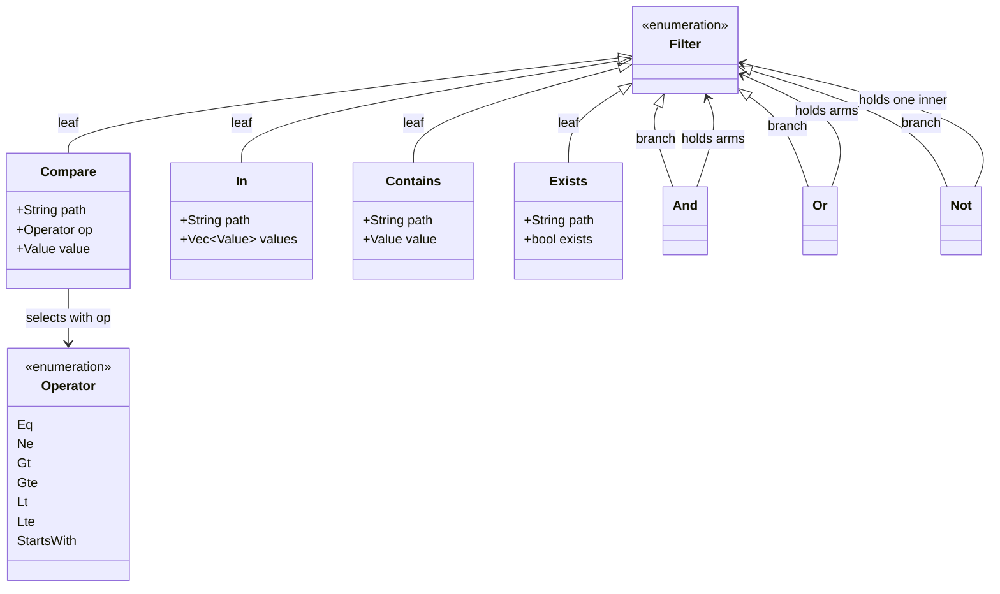
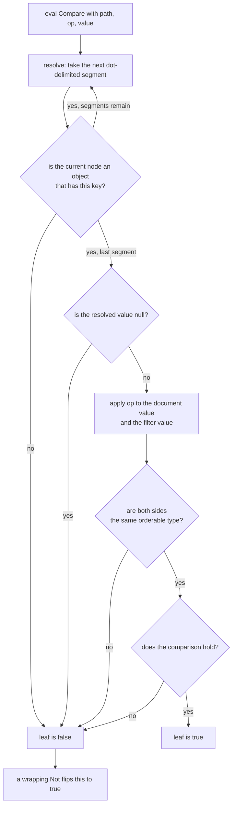

# The filter kernel — `edax-cqrs::filter`

A sealed abstract syntax tree (AST) plus one reference evaluator. The bindings build filters and
call `eval_json`. The match decision is made only here, so the null and missing-path rules cannot
drift between languages. The golden vector is `testdata/golden/filter.json`.

## The AST



Each variant serializes to an externally-tagged, snake_case JSON object. That exact shape is the
wire contract between the software development kits (SDKs), and a unit test pins it.

| Variant | Wire form | Matches when |
|---|---|---|
| `Compare` | `{"compare": {"path", "op", "value"}}` | the path is present, non-null, and the operator holds |
| `In` | `{"in": {"path", "values"}}` | the path is present, non-null, and equals one of `values` |
| `Contains` | `{"contains": {"path", "value"}}` | the path resolves to an **array** that contains `value` |
| `Exists` | `{"exists": {"path", "exists"}}` | presence of the path equals the `exists` flag |
| `And` | `{"and": [...]}` | every arm matches. `And([])` is **true** |
| `Or` | `{"or": [...]}` | any arm matches. `Or([])` is **false** |
| `Not` | `{"not": {...}}` | the inner filter does not match |

`Contains` is the mirror of `In`: `In` tests a scalar path against a given set, `Contains` tests
whether the array at a path includes a given value.

`Operator` is `#[non_exhaustive]`, so a new operator is additive. `Filter` is not. A `match` over
its variants must stay exhaustive. A new variant is then a compile error rather than a wildcard's
silent default.

## Operators

| Operator | Rust constructor | Python constructor | Holds when | Falls to `false` when |
|---|---|---|---|---|
| `Eq` | `eq` | `eq` | values are equal — numeric for two numbers, structural otherwise | — |
| `Ne` | `ne` | `ne` | values are not equal | the path is missing or null |
| `Gt` / `Gte` / `Lt` / `Lte` | `gt` / `gte` / `lt` / `lte` | same names | both sides are numbers, or both are strings, and the ordering holds | any other pairing — mismatched types, bool, array, object |
| `StartsWith` | `starts_with` | `starts_with` | both sides are strings and the document value has the prefix | either side is not a string |

Ordering is defined only *within* a type. Numbers compare numerically, so `1` and `1.0` are equal;
two integers compare exactly, with no `f64` promotion above 2^53. Strings compare by Unicode order,
which is why RFC3339 timestamps need no special operator — as strings they already sort correctly.

## The null and missing-path rule

The semantics are **two-valued**: there is no third "unknown". A path predicate is satisfied only
when the path is present, non-null, and the comparison holds. Everything follows from one helper:

```rust
/// A path is "present" iff it resolves to a non-null value.
fn present<'a>(doc: &'a Value, path: &str) -> Option<&'a Value> {
    match resolve(doc, path) {
        Some(v) if !v.is_null() => Some(v),
        _ => None,
    }
}
```
<sup>`edax_cqrs::filter::eval`</sup>

A leaf that cannot find a value returns `false`. `Not` then negates that `false` to `true`. So `Ne`
and `Not(Eq)` deliberately differ.

| Document | `Eq(p, "x")` | `Ne(p, "x")` | `Not(Eq(p, "x"))` | `Exists(p, true)` | `Exists(p, false)` |
|---|---|---|---|---|---|
| `{"p": "x"}` | true | false | false | true | false |
| `{"p": "y"}` | false | true | true | true | false |
| `{"p": null}` | false | **false** | **true** | false | true |
| `{}` (missing) | false | **false** | **true** | false | true |
| `{"p": {"q": 1}}`, path `p.q.r` | false | **false** | **true** | false | true |

The last row is the same rule one level deeper. `resolve` walks dot-delimited segments, and every
intermediate segment must be an object. A missing key or a non-object segment resolves to nothing.

### Worked example

A read model of accounts, where a closed account carries `closed_at` and an open one leaves it
`null`:

```python
from edax.filter import eq, matches, ne, not_

open_account = {"id": "acct-1", "status": "settled", "closed_at": None}

matches(ne("closed_at", "2024-01-01"), open_account)  # False
matches(not_(eq("closed_at", "2024-01-01")), open_account)  # True
```

Read it this way. "The closing date is something other than 2024-01-01" is not true of an account
with no closing date. "It is not the case that the closing date is 2024-01-01" is true of it. Use
`Not(Eq(...))` for "everything except", and `Ne` for "has a value, and that value differs". Both
SDKs pin this pair — the two `{}`-document cases in `testdata/golden/filter.json`, and
`test_filter.py::test_null_semantics`.

The practical trap: `and_(eq("status", "settled"), ne("closed_at", X))` silently drops every open
account, because the second arm is false wherever `closed_at` is null. Write `not_(eq("closed_at",
X))`, or add `exists("closed_at", False)` as an explicit arm.

## One evaluation, step by step



`eval` dispatches on the variant and recurses for `And` / `Or` / `Not`. `eval_json` is the boundary
the bindings call: it parses filter and document from JSON bytes, returns the verdict, and reports a
parse failure as an `Err`.

## The verdict is the kernel's; the dialect is the backend's

A backend is expected to translate a `Filter` into its own query language, so the database does the
work instead of the process. What it may not do is decide the *match*. A backend whose native `!=`
matches a missing column would answer a `Ne` leaf differently from every other service reading the
same model. A translation is correct only when it reproduces this evaluator's answer for every
document, the null and missing rows included. That is why `ProjectionStore.get_many` is optional. A
backend that cannot reproduce the semantics should leave it unimplemented rather than approximate
it.

## The two surfaces, side by side

| | Rust — `edax_cqrs::filter` | Python — `edax.filter` |
|---|---|---|
| Filter type | the typed `Filter` enum | `Filter = dict[str, Any]`, the kernel's canonical form |
| Comparisons | `eq`, `ne`, `gt`, `gte`, `lt`, `lte`, `starts_with` | same names |
| Set membership | `is_in(path, vec![...])` | `in_(path, *values)` |
| Array membership | `contains(path, value)` | `contains(path, value)` |
| Presence | `exists(path, bool)` — flag required | `exists(path, exists=True)` — flag defaults to `True` |
| Connectives | `and(Vec<Filter>)`, `or(Vec<Filter>)`, `not(Filter)` | `and_(*filters)`, `or_(*filters)`, `not_(filter)` |
| Evaluate | `eval(&Filter, &Value) -> bool` | `matches(filter, document) -> bool` |
| JSON boundary | `eval_json(&[u8], &[u8]) -> Result<bool, String>` | used internally by `matches` |
| Path helpers | `resolve`, `value_cmp` (public, shared with `edax-cqrs::query` next door) | not exposed |

```rust
use edax_cqrs::filter::{and, eq, eval, gt};
use serde_json::json;

let doc = json!({"status": "open", "total": 5000});
let f = and(vec![eq("status", json!("open")), gt("total", json!(4200))]);
assert!(eval(&f, &doc));
```
<sup>the `and_all_true` case of the `edax-cqrs` filter suite; the same filter and document are a case in `testdata/golden/filter.json`</sup>

```python
from edax.filter import and_, eq, gte
from edax.query import sort_key

flt = and_(gte("balance", 100), eq("status", "active"))
sort = [sort_key("balance", desc=True), sort_key("id")]  # richest first, id as tiebreak

page1 = await store.get_many(filter=flt, sort=sort, limit=2)
```
<sup>`examples/py/projection_query.py:35-38`</sup>

The Python constructors are the only part of filtering the SDK owns: which dict key and which op
name each one emits. A wrong key would pass the golden vectors unnoticed, so a separate table test
pins every constructor's output.

## See also

- [edax-core](./core.md) — hashing, backoff, the clock and the error taxonomy.
- [cqrs.md](./cqrs.md) — the rest of the crate: the query that composes a filter with sorting and
  paging, and the command side's idempotency decision.
- [../sdk/projections.md](../sdk/projections.md) — the host view: read models, filters and cursors.
- [golden-vectors.md](./golden-vectors.md) — how `filter.json` is generated and asserted.
