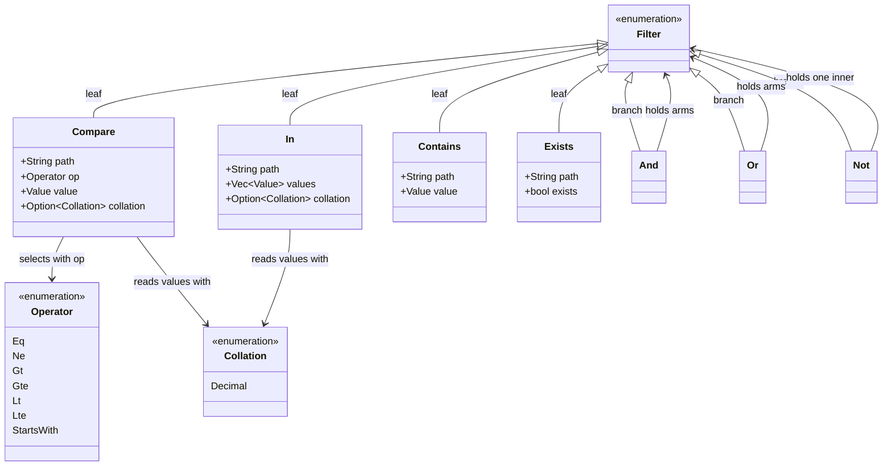
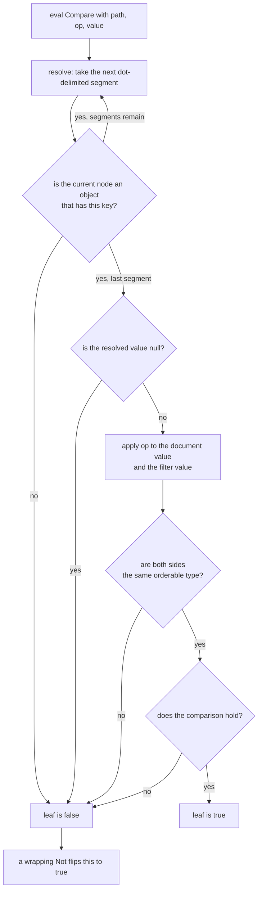

# The filter kernel — `edax_cqrs::filter`

A sealed abstract syntax tree (AST) plus one reference evaluator. The bindings build filters and
call `eval_json`. The match decision is made only here, so the null and missing-path rules cannot
drift between languages. The golden vector is `testdata/golden/filter.json`.

## The AST



Each variant serializes to an externally-tagged, snake_case JSON object. That exact shape is the
wire contract between the software development kits (SDKs), and a unit test pins it.

| Variant | Wire form | Matches when |
|---|---|---|
| `Compare` | `{"compare": {"path", "op", "value", "collation"?}}` | the path is present, non-null, and the operator holds |
| `In` | `{"in": {"path", "values", "collation"?}}` | the path is present, non-null, and equals one of `values` |
| `Contains` | `{"contains": {"path", "value"}}` | the path resolves to an **array** that contains `value` |
| `Exists` | `{"exists": {"path", "exists"}}` | presence of the path equals the `exists` flag |
| `And` | `{"and": [...]}` | every arm matches. `And([])` is **true** |
| `Or` | `{"or": [...]}` | any arm matches. `Or([])` is **false** |
| `Not` | `{"not": {...}}` | the inner filter does not match |

`Contains` is the mirror of `In`: `In` tests a scalar path against a given set, `Contains` tests
whether the array at a path includes a given value.

`collation` is optional and left out of the wire form when unset (see [Decimals](#decimals)).

`Operator` and `Collation` are `#[non_exhaustive]`, so a new operator or collation is additive. `Filter` is not. A `match` over
its variants must stay exhaustive. A new variant is then a compile error rather than a wildcard's
silent default.

## Operators

| Operator | Rust constructor | Python constructor | Holds when | Falls to `false` when |
|---|---|---|---|---|
| `Eq` | `eq` | `eq` | values are equal — numeric for numbers at every depth, structural otherwise | — |
| `Ne` | `ne` | `ne` | values are not equal | the path is missing or null |
| `Gt` / `Gte` / `Lt` / `Lte` | `gt` / `gte` / `lt` / `lte` | same names | both sides are numbers, both strings, or both bools, and the ordering holds | any other pairing — mismatched types, array, object |
| `StartsWith` | `starts_with` | `starts_with` | both sides are strings and the document value has the prefix | either side is not a string |

Ordering is defined only *within* a type. Numbers compare numerically, so `1` and `1.0` are equal;
two integers compare exactly, with no `f64` promotion above 2^53. Strings compare by Unicode code
point, which is UTF-8 byte order. `"Z"` sorts before `"a"`, and U+FF71 sorts after U+1F980.
JavaScript, Java and C# order that last pair the other way, by UTF-16 code units. Strings are not
normalized, so the NFC and NFD spellings of `café` are unequal. Bools order `false < true`, the rank
the read side's sort gives them, so a sort and a range filter agree on every orderable pair. Under
the decimal collation, two decimal texts order by value instead (see [Decimals](#decimals)).

Equality is numeric at every depth, the same rule as at the top level: `eq(p, [1.0])` matches
`[1]`, and `eq(p, {"x": 2.0})` matches `{"x": 2}`. `In` and `Contains` use the same equality.

## Decimals

JSON numbers are doubles to most readers, so an exact amount travels as **decimal text**: a JSON
string such as `"9.5"`. Strings compare by code point, though, and that puts `"10"` before `"9.5"`.
The **decimal collation** fixes this. A `Compare` or `In` node with `"collation": "decimal"` reads
both sides as decimal text and compares them by exact value, at any precision:

```json
{"compare": {"path": "price", "op": "lt", "value": "10", "collation": "decimal"}}
```

Under it, `"9.5"` is below `"10"`, and `"9.50"` equals `"9.5"`. The rules:

- `Eq`, `Ne`, the four orderings and `In` compare by value.
- A document value that is not decimal text compares as a mismatched type does. That covers a number,
  a bool, and a string such as `"n/a"`. `Eq`, the orderings and `In` are then `false`, and `Ne` is
  `true`.
- The comparand must be decimal text, or the kernel refuses the filter. `StartsWith` takes no
  collation, since it tests text.
- `Contains` takes no collation and compares the text.

Decimal text is an optional sign, digits with at most one `.`, and an optional exponent (`1E+2`).
`NaN` and `Infinity` are not decimal text. Its plain notation holds at most 1000 digits.
`canonical_decimal` writes the one canonical form: `9.50` becomes `9.5`, `1E+2` becomes `100`, and
`-0.0` becomes `0`. `bigdecimal` does the parsing and the comparison.

The Python SDK sets the collation for you. A `Decimal` comparand to `eq`, `ne`, `gt`, `gte`, `lt`,
`lte` or `in_` adds it. The Rust constructors are `filter::decimal::{eq, ne, gt, gte, lt, lte,
is_in}`, which take the decimal text.

## Timestamps

No special operator is needed, because string order is chronological for one fixed-width form:
UTC, six fraction digits and a `Z` (`2024-01-01T00:00:00.000000Z`). `canonical_timestamp` writes
an RFC 3339 timestamp in it. It converts the offset to UTC and pads the fraction. Every SDK writes a
host timestamp through it, so documents and comparands share the form. Epoch integers order
correctly too.

Two other forms order wrongly, silently, if they reach a document as plain strings:

- A form that omits a zero fraction. `2024-01-01T00:00:00Z` sorts *after*
  `2024-01-01T00:00:00.500000Z`, because `Z` follows `.`.
- A form with an offset. `2024-01-01T00:30:00+01:00` sorts by wall time, after `2024-01-01T00:00:00Z`,
  although that instant is 23:30Z the day before.

`testdata/golden/filter.json` pins both wrong orderings, and the fixed form's right one.

## Host values every SDK writes alike

A document, a filter and a command hash agree across languages only when every SDK writes a host
value as the same JSON. Two host types have no JSON form of their own, so the kernel fixes it.
A Rust SDK, or a third one, must emit exactly this:

| Host type | JSON | Kernel function | Refused, as `codec` |
|---|---|---|---|
| exact decimal (Python `Decimal`) | a string of `canonical_decimal`'s text: `"9.5"` | `canonical_decimal` | `NaN`, an infinity, more than 1000 digits |
| instant (Python aware `datetime`) | a string of `canonical_timestamp`'s text: `"2024-01-01T00:30:00.000000Z"` | `canonical_timestamp` | no offset, a fraction finer than a microsecond, a UTC year outside 0000 to 9999 |
| calendar date (Python `date`) | ISO `"YYYY-MM-DD"`, already one width | — | — |

A time without an offset is refused rather than read as UTC: its instant is unknown.
`testdata/golden/host_values.json` pins every row, and the Python suite replays it with real
`Decimal` and `datetime` values. The decimal text orders by value only under the decimal collation.
So a range filter or a sort over a decimal field must set it.

## What the kernel refuses

`eval_json`, and every query that carries a filter, reads the filter strictly. Each of these is a
terminal `codec` error, never a filter that silently means something else:

| Input | Why it is refused |
|---|---|
| an unknown field in any node, `{"compare": {..., "vlaue": 1}}` | a typo would otherwise be a no-op |
| a `null` comparand for `Compare` or inside `In` | no present value equals it, so the leaf matches nothing; ask `Exists(path, false)` for a missing or null path |
| a path with an empty segment: `""`, `"a."`, `".a"`, `"a..b"` | a backend translating paths to SQL has no rule for one |
| an integer literal wider than 64 bits | it would be compared as the nearest float, so `eq(x, 2**70)` would match `2**70 + 1` |
| under the decimal collation, a comparand that is not decimal text | no document value could equal or order against it |
| the decimal collation on `StartsWith` | a prefix test reads text, not a value |

`Contains(path, null)` stays valid: it asks whether the array holds a `null` element. A path is
dot-delimited object keys, so a key containing `.` cannot be addressed. A numeric segment is a key,
never an array index: `tags.0` reads `{"tags": {"0": ...}}`, not `{"tags": [...]}`.
`Filter::validate` holds the rule, and `testdata/golden/filter.json` pins each refusal.

## The null and missing-path rule

The semantics are **two-valued**: there is no third "unknown". A path predicate is satisfied only
when the path is present, non-null, and the comparison holds. Everything follows from one helper:

```rust
/// A path is "present" iff it resolves to a non-null value.
fn present<'a>(doc: &'a Value, path: &str) -> Option<&'a Value> {
    match resolve(doc, path) {
        Some(v) if !v.is_null() => Some(v),
        _ => None,
    }
}
```
<sup>`edax_cqrs::filter::eval`</sup>

A leaf that cannot find a value returns `false`. `Not` then negates that `false` to `true`. So `Ne`
and `Not(Eq)` deliberately differ.

| Document | `Eq(p, "x")` | `Ne(p, "x")` | `Not(Eq(p, "x"))` | `Exists(p, true)` | `Exists(p, false)` |
|---|---|---|---|---|---|
| `{"p": "x"}` | true | false | false | true | false |
| `{"p": "y"}` | false | true | true | true | false |
| `{"p": null}` | false | **false** | **true** | false | true |
| `{}` (missing) | false | **false** | **true** | false | true |
| `{"p": {"q": 1}}`, path `p.q.r` | false | **false** | **true** | false | true |

The last row is the same rule one level deeper. `resolve` walks dot-delimited segments, and every
intermediate segment must be an object. A missing key or a non-object segment resolves to nothing.

### Worked example

A read model of accounts, where a closed account carries `closed_at` and an open one leaves it
`null`:

```python
from edax.filter import eq, matches, ne, not_

open_account = {"id": "acct-1", "status": "settled", "closed_at": None}

matches(ne("closed_at", "2024-01-01"), open_account)  # False
matches(not_(eq("closed_at", "2024-01-01")), open_account)  # True
```

Read it this way. "The closing date is something other than 2024-01-01" is not true of an account
with no closing date. "It is not the case that the closing date is 2024-01-01" is true of it. Use
`Not(Eq(...))` for "everything except", and `Ne` for "has a value, and that value differs". Both
SDKs pin this pair — the two `{}`-document cases in `testdata/golden/filter.json`, and
`test_filter.py::test_null_semantics`.

So `and_(eq("status", "settled"), ne("closed_at", X))` drops every open account without warning,
because the second arm is false wherever `closed_at` is null. Write `not_(eq("closed_at",
X))`, or add `exists("closed_at", False)` as an explicit arm.

## One evaluation, step by step



`eval` dispatches on the variant and recurses for `And` / `Or` / `Not`. `eval_json` is the boundary
the bindings call. It parses filter and document from JSON bytes and refuses what the section above
lists. It returns the verdict, and reports every failure as a `codec` error.

## The verdict is the kernel's; the dialect is the backend's

A backend is expected to translate a `Filter` into its own query language, so the database does the
work instead of the process. What it may not do is decide the *match*. A backend whose native `!=`
matches a missing column would answer a `Ne` leaf differently from every other service reading the
same model. A translation is correct only when it reproduces this evaluator's answer for every
document, the null and missing rows included. That is why `ProjectionStore.get_many` is optional. A
backend that cannot reproduce the semantics should leave it unimplemented rather than approximate
it.

## The two surfaces, side by side

| | Rust — `edax_cqrs::filter` | Python — `edax.filter` |
|---|---|---|
| Filter type | the typed `Filter` enum | `Filter = dict[str, Any]`, the kernel's canonical form |
| Comparisons | `eq`, `ne`, `gt`, `gte`, `lt`, `lte`, `starts_with` | same names |
| Decimal comparisons | `decimal::{eq, ne, gt, gte, lt, lte, is_in}`, over decimal text | the same constructors, with a `Decimal` value |
| Set membership | `is_in(path, vec![...])` | `in_(path, *values)` |
| Array membership | `contains(path, value)` | `contains(path, value)` |
| Presence | `exists(path, bool)` — flag required | `exists(path, present=True)` — flag defaults to `True` |
| Connectives | `and(Vec<Filter>)`, `or(Vec<Filter>)`, `not(Filter)` | `and_(*filters)`, `or_(*filters)`, `not_(filter)` |
| Evaluate | `eval(&Filter, &Value) -> bool` | `matches(filter, document) -> bool` |
| JSON boundary | `eval_json(&[u8], &[u8]) -> Result<bool, Error>` | used internally by `matches` |
| Validation | `Filter::validate()` | through `matches` |
| Path helpers | `resolve`, `value_cmp`, `collated_cmp` (public, shared with the `query` module next door) | not exposed |

```rust
use edax_cqrs::filter::{and, eq, eval, gt};
use serde_json::json;

let doc = json!({"status": "open", "total": 5000});
let f = and(vec![eq("status", json!("open")), gt("total", json!(4200))]);
assert!(eval(&f, &doc));
```
<sup>the `and_all_true` case of the `edax-cqrs` filter suite; the same filter and document are a case in `testdata/golden/filter.json`</sup>

```python
from edax.filter import and_, eq, gte
from edax.query import sort_key

only = and_(gte("balance", 100), eq("status", "active"))
order = [sort_key("balance", desc=True), sort_key("id")]  # richest first, id as the tiebreak

page = await store.get_many(filter=only, sort=order, limit=2)
```
<sup>`examples/py/11_projection_query.py`</sup>

The Python constructors are the only part of filtering the SDK owns: which dict key and which op
name each one emits. A wrong key would pass the golden vectors unnoticed, so a separate table test
pins every constructor's output.

## See also

- [edax-core](./core.md) — hashing, backoff, the clock and the error taxonomy.
- [cqrs.md](./cqrs.md) — the rest of the crate: the query that composes a filter with sorting and
  paging, and the command side's idempotency decision.
- [../sdk/projections.md](../sdk/projections.md) — the host view: read models, filters and cursors.
- [golden-vectors.md](./golden-vectors.md) — how `filter.json` is generated and asserted.
