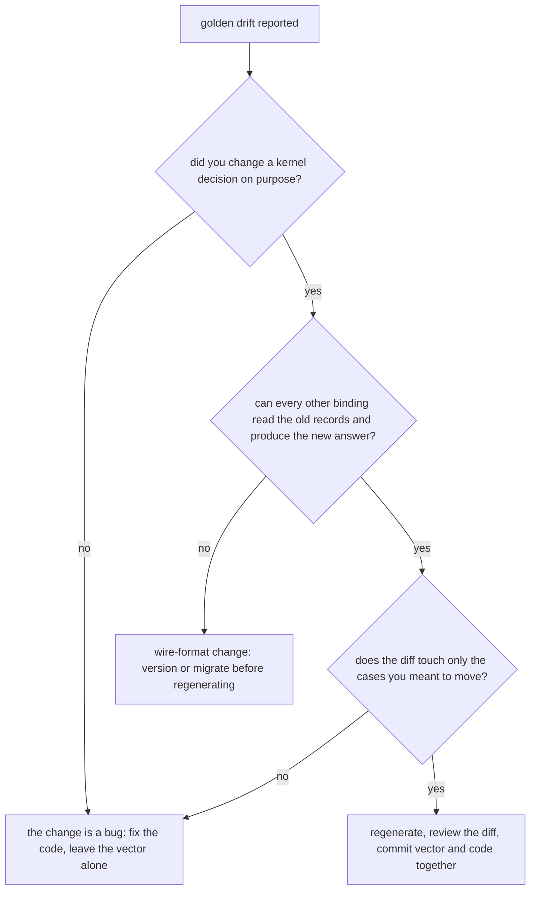

# Golden vectors

`testdata/golden/*.json` is the cross-language contract: the kernels' decisions written down as
data, generated by the Rust suite and asserted by every software development kit (SDK)'s suite.

A golden vector is a committed file of cases, each mapping an input to the answer a kernel gives. It
is generated from the kernel, never hand-written. Every binding reads the same file, so a byte of
drift in any binding fails that binding's build instead of production.

> **A golden vector always wins over a disagreeing test.** Regenerate only when you mean to change the
> contract (`AGENTS.md`). A test that disagrees with a vector is the thing that is
> wrong, unless you are deliberately moving the contract.

---

## Generation and assertion


One harness crate owns the whole rule: one writer, one reader, one path to the golden directory, one
failure message. It is `publish = false` and only ever a `[dev-dependency]`. Every row below is a
rule of `edax_golden::write_or_check`.

| Harness behaviour | Detail |
|---|---|
| mode selection | `EDAX_REGEN=1` regenerates; unset or empty asserts; any other value panics, so `EDAX_REGEN=0` cannot rewrite the contract by accident |
| golden directory | resolved from the harness crate's own manifest, so every kernel gets the same directory whatever its test working directory is |
| written bytes | pretty-printed JSON array with a trailing newline, so `git status` is the proof |
| assertion | compares the parsed JSON **value**, not the bytes — a reformatted file still passes |
| failure message | names the first differing case index and prints only that case, plus the regenerate hint |
| missing file | panics naming the path and the regenerate command |

The Python suite never regenerates. It reads through one helper, `golden(name)` in
`crates/edax-py/tests/conftest.py`, which records every name it loads. A full green run then fails if
any `testdata/golden/*.json` went unread, so a new vector cannot ship without a Python reader. The
Rust suites that replay a vector through the SDK read it with `edax_golden::read`.

---

## Every vector

Each row: what the file pins, which kernel's logic it comes from, the generator that writes it, and
the suites that assert it. Every case object is one row of a JSON array.

| File | Case shape | Pins | Kernel | Generator |
|---|---|---|---|---|
| `backoff.json` | `base_millis`, `cap_millis`, `attempt`, `entropy`, `ceiling_millis`, `expected_millis` | full jitter, `(policy, attempt, entropy) -> millis`: the default policy over 19 attempts including `63` / `64` (the `1 << attempt` shift boundary), `u32::MAX` and `u64::MAX`, three draws each, plus a zero base, a cap below the base and an unbounded policy | `edax-core` `backoff_millis` | `edax-core` `backoff_cases` |
| `canonical_payload_hash.json` | `input`, `expected`, `error` | canonicalize-then-hash (RFC 8785), each pair asserted equal by the generator: key order, `"\u00e9"` and raw `é`, `1.0` and `1`, `1e2` and `100`, `-0` and `0`, an escaped surrogate pair and the raw emoji, a repeated key and its last value, U+2028 raw and escaped, `1e20` and `1.0E+20`, `2^53` as an integer and as a float; and four refusals (an integer past 2^53 either side, `1e400`, a lone surrogate) | `edax-cqrs` | `edax-cqrs` `canonical_payload_hash_cases` |
| `canonical_json.json` | `name`, `input`, `canonical`, `hash`, `error` | the RFC 8785 text itself: keys by UTF-16 code units (U+1F980 before U+FF71), numbers as doubles in the ECMAScript form (`2`, `2.0`, `2e0` alike; `-0` is `0`; `1e20` written out, `1e+21`; a float past 2^53 rounds), escapes decoded and re-escaped, digits in a string left alone; and seven refusals: an integer literal past 2^53 (positive, negative, `u64::MAX`, nested), `1e400`, a lone surrogate, trailing text | `edax-cqrs` `canonical_json` | `edax-cqrs` `canonical_json_cases` |
| `causation.json` | `parent_metadata`, `parent_event_id`, `expected` | which correlation and causation ids a child inherits from its parent, an empty `correlation_id` and an empty parent id included | `edax-event` `propagate` | `edax-event` `causation_cases` |
| `causation_originate.json` | `metadata`, `fresh_id`, `expected` | which of the two chain keys are generated when a root event starts a chain; an empty id counts as present | `edax-event` `originate` | `edax-event` `originate_cases` |
| `command_hash.json` | `name`, `type`, `command`, `expected`, `error` | the hash **input rule**: the whole command value including the idempotency-key field, excluding the routing `type`; a float field holding a whole number hashes alike given as `1.0` or `1`; an integer field at 2^53 hashes exactly; past 2^53 (and past `i64::MAX`) the command is refused as `codec` before any claim. A refusal row pins the code and the rule; its byte offset is the generator encoder's, since each SDK's encoder writes fields in its own order | `edax-cqrs` | `edax-cqrs` `command_hash_cases` |
| `staleness.json` | `op` `pair`: `stored`, `incoming`, `stale`, `advanced`; `op` `fold`: `name`, `stream`, `applied`, `watermark` | `is_stale` and `advance` per pair, both `u64` ceiling cases included, and the fold over three redelivered streams: an unsequenced event never erases the mark, a seek back, out-of-order copies | `edax-event` `is_stale` / `advance` | `edax-event` `staleness_cases` |
| `event_idempotency.json` | `name`, `id`, `data_hex`, `metadata`, `timestamp`, `key`, `payload_hash` | the event guard's input rule: the envelope id is the key, the raw body bytes are hashed, nothing else takes part | `edax-event` `event_idempotency` | `edax-event` `event_idempotency_cases` |
| `envelopes.json` | `name`, `envelope`, `json_hex`, `msgpack_hex` | exact wire bytes for sixteen envelopes in both formats: key order by UTF-8 bytes (`"Z"`, `""`, U+FF71 against U+1F980), escaping, raw non-ASCII, `i64`/`i32` extremes and a negative timestamp, and every MessagePack width boundary | `edax-event` `Format::encode` | `edax-event` `envelope_cases` |
| `envelope_decode.json` | `name`, `json_hex`, `msgpack_hex`, `want` | the evolution rule, one wire value per case in both formats: an unknown field ignored, a missing or `null` `sequence` as `None`; a missing field, a repeated field, a positional (array) envelope or event, trailing bytes and a non-map refused (the code only); a repeated `metadata` key keeps the last | `edax-event` `Format::decode` | `edax-event` `envelope_decode_cases` |
| `error_taxonomy.json` | `code`, `terminal`, `message`, `wire` | all ten codes, each one's terminal or transient verdict, and the `"<code>: "` wire framing | `edax-core` `ErrorCode` | `edax-core` `error_taxonomy_cases` |
| `error_wire.json` | `name`, `wire`, `code`, `message`, `terminal` | how any wire string splits and its verdict, the negative cases included: unknown code, no separator, a colon without a space, an uppercase code, a leading space, the empty string | `edax-core` `split` / `verdict_of_wire` | `edax-core` `error_wire_cases` |
| `filter.json` | `name`, `filter`, `document`, `expected`, `error_code` | 57 filter evaluations: every operator, missing paths, a numeric segment as a key, cross-type compares, exact wide integers, code-point string order and no normalization, nested numeric equality, bool order, the two RFC3339 forms that order wrongly, vacuous `and` / `or`; and six refusals (a `null` comparand, empty path segments, a typo, an unknown node) | `edax-cqrs` `eval_json` | `edax-cqrs` `filter_cases` |
| `idempotency_record.json` | `name`, `stored`, `current`, then `payload_hash`, `state`, `outcome`, `encoded`, plus `result`, or `error`, `error_code` and `replay`; or `error_code` alone for a refusal | the record's wire shape, reading order, re-encoded bytes, replay verdict and replay text — 18 cases including a failure's code beside its message, a host rejection as the Rust guard writes it, an unknown `error_code`, an unknown field ignored, a stored `null` result replaying as a success and a stored hash of `0` being a real hash; and nine refusals (not an object, a missing, float, negative, string or too-wide hash, a non-string `error`, a `null` `pending`, not JSON) | `edax-cqrs` `Record` / `outcome` | `edax-cqrs` `idempotency_record_cases` |
| `kafka_record.json` | `name`, `format`, `envelope`, `key`, `key_hex`, `value_hex`, `headers` | the record a published envelope becomes: the key rule and the `content-type` header, in both formats, with an overridden key, an unsequenced envelope and unicode | `edax-kafka` `encode_record` | `edax-kafka` `kafka_record_cases` |
| `kafka_partition.json` | `name`, `key_hex`, `java_murmur2`, `partitions`, `expected`, `error` | broker placement, Java's murmur2 partitioner: eleven keys at five partition counts, six of them Kafka's own `UtilsTest.testMurmur2` vectors with the Java `int`, an empty key, NFC and NFD spellings, high bytes; `0` partitions refused | `edax-kafka` `partition_for` | `edax-kafka` `kafka_partition_cases` |
| `kafka_decode.json` | `name`, `default_format`, `value_hex`, `headers`, `want` | which format a fetched record names: the first `content-type` wins, an unknown, empty or parameterized one is refused, an absent, upper-case-named or non-UTF-8 one falls back to the default | `edax-kafka` `decode_record` | `edax-kafka` `kafka_decode_cases` |
| `kafka_route.json` | `name`, `headers`, `registered`, `want` | the route every shell takes against its own registry: `default`, `registered` with an index, or `unknown` with the media type, the empty one included | `edax-kafka` `route` | `edax-kafka` `kafka_route_cases` |
| `kafka_dead_letter.json` | `name`, `record`, `topic`, `partition`, `offset`, `error`, `want`; or `name`, `headers`, `want` | the record a dead-letter sink publishes, the original kept verbatim plus four `edax-dlq-*` headers, and the source read back (the last set after two); then seven header sets the reader refuses | `edax-kafka` `dead_letter_record` / `dead_letter_source` | `edax-kafka` `kafka_dead_letter_cases` |
| `kafka_offsets.json` | `name`, `steps` of `op` plus `want` | the token-settled commit watermark replayed step by step: out-of-order acks, the rewind a nack makes and the tokens it retires, re-booked acked offsets, per-partition isolation, `due`, the monotonic guard, stale tokens after a reset, an offset gap, the `i64` ceiling, a refused negative offset, topics in byte order; decisions by name (`settled`, `stale`, `seek`) | `edax-kafka` `OffsetTracker` | `edax-kafka` `kafka_offsets_cases` |
| `redis_value.json` | `name`, `op`, the operands, and `value` or `want` | the ledger value `1<owner><record>`: the claim value, the settled value, and every `split_value` branch, the unversioned layout refused | `edax-redis` `claim_value` / `settled_value` / `split_value` | `edax-redis` `claim_cases`, `settled_cases`, `split_cases` |
| `redis_ledger.json` | `name`, `op`, the operands, and `want` or `error` | the key composition, the refused TTLs and prefix, the refused claim handles, the claim outcome (a lost reply re-sent is won), and the verdict on each Redis error reply | `edax-redis` `ledger_key` / `check_ttl` / `check_claim` / `claim_outcome` / `reply_error` | `edax-redis` `key_cases`, `ttl_cases`, `handle_cases`, `outcome_cases`, `reply_cases` |
| `redis_scripts.json` | `name`, `body` | the four Lua bodies verbatim, so SDKs registering them share one `EVALSHA` digest each | `edax-redis` `CLAIM_SCRIPT` / `COMPLETE_SCRIPT` / `RELEASE_SCRIPT` / `EXTEND_SCRIPT` | `edax-redis` `script_cases` |
| `redis_fence.json` | `name`, `initial`, `initial_ttl_ms`, `script`, `args`, `want_reply`, `want_value`, `want_ttl_ms` | what each script does to a key: 21 rows written out by hand, among them a re-sent claim, a takeover, a release after `complete` landed, and empty and prefix handles | the Lua itself, run by a server | `edax-redis` `fence_cases` |
| `partition.json` | `id`, `n`, `expected` | local fan-out, the worker a dispatcher runs an aggregate on: eight ids (NFC and NFD `café` among them) against six worker counts up to `u32::MAX`; `n = 0` clamps to 1. Not broker placement | `edax-event` `partition` | `edax-event` `partition_cases` |
| `payload_hash.json` | `input`, `expected` | raw Fowler-Noll-Vo 1a (FNV-1a) over six byte strings, including `café ☕ 🦀` | `edax-cqrs` `payload_hash` | `edax-cqrs` `payload_hash_cases` |
| `cursor.json` | `name`, `sort`, `document`, `expected_cursor`, `expected_effective_sort`, `expected_tuple`, `error` | the keyset cursor round trip under base64url: the `id` tiebreak, every type in the total order, a missing sort path, raw non-ASCII, integers at ±2^53; and nine refusals with the kernel's text — a cursor read under another key, direction, key set or no sort, standard base64, and a mint without a sort, from a row without an `id`, or from a sort value past 2^53 | `edax-cqrs` `encode_cursor` / `decode_cursor` / `effective_sort` | `edax-cqrs` `cursor_cases` |
| `query.json` | `name`, `query`, `documents`, `expected_page` (`{rows, next}`), `error_code` | ordering, the total type order, offset, limit, `after` (resume ascending, descending, mid-tie, from a null row, with an offset), numeric and code-point sorts, `next` minted only while rows follow and never for an unsorted query; and five refusals (a cursor under another sort or direction or without one, `next` from a row without an `id`, a typo) | `edax-cqrs` `query` / `encode_cursor` | `edax-cqrs` `query_cases` |
| `sequence_batch.json` | `expected`, `sequences`, `error` | the dense-batch rule over `u64`: accepted runs, an unsequenced envelope, a gap, a reorder, a repeat, exact past `i64::MAX`, the last sequence there is, and a repeat at the `u64` ceiling refused | `edax-event` `check_batch` | `edax-event` `sequence_batch_cases` |
| `upcast.json` | `from`, `to`, `available`, `plan`, `error` | the planned step sequence and which gap the error names, with the exact message: `available` as a set (unsorted, repeated), negative versions, an empty `available`, the `i32` extremes, and `available: null` (a name with no upcaster: identity, but a newer writer refused) | `edax-event` `upcast_plan` | `edax-event` `upcast_cases` |
| `retries.json` | `name`, `max_attempts`, `sink`, `ops` (each `op`, its inputs, `want`; a `failed` op carries the failure's `code`) | the retry and dead-letter policy as operation scripts: the ceiling, terminal, no sink, `max_attempts = 0`, an unclassified failure, broker attempts up and down, contention, success, a failed sink, ids apart, saturation | `edax-event` `Retries` | `edax-event` `retries_cases` |
| `retry_failure.json` | `code`, `failure` | the failure kind of every error code and of none: contention, terminal or transient | `edax-event` `Failure::of` | `edax-event` `retry_failure_cases` |
| `saga.json` | `loaded`, `completes`, `has_commands`, `want`; or `admit` (`folded`, `aggregate_id`, `sequence`, `id`), `want`; or `correlation_id`, `version`, `index`, `command_id` | the saga step's write for every loaded state and fold, whether a step folds an event (a repeat, an older event, another aggregate, unsequenced, unreadable marks), and the outbox command id | `edax-event` `saga_write`, `saga_admit`, `saga_command_id` | `edax-event` `saga_cases` |
| `idempotency_settle.json` | `code`, `cache` | the guard's failure settle table: the code a won claim caches a failure under, or `null` to release it, for every code and none | `edax-cqrs` `settle` | `edax-cqrs` `idempotency_settle_cases` |
| `event_codec.json` | `case`, `name`, `version`, `json`, `msgpack_hex` | one event of each variant shape as the Rust registry codec writes it, both formats; Python must read and write the same bytes | `edax` `RegistryCodec` | `edax` `tests/golden.rs` |

### Who asserts each vector

| File | Rust | Python |
|---|---|---|
| `backoff.json` | its generator, in assert mode | `test_edax.py::test_golden_backoff` |
| `canonical_payload_hash.json` | its generator, and `feature-check` | `test_command.py::test_golden_canonical_payload_hash` |
| `canonical_json.json` | its generator, and `crates/edax-cqrs/feature-check` with `preserve_order`, `arbitrary_precision` and `float_roundtrip` on | `test_cross_sdk.py::test_python_reaches_the_rust_canonical_bytes` |
| `causation.json` | its generator | `test_kernel_extra.py::test_golden_causation` |
| `causation_originate.json` | its generator | `test_edax.py::test_golden_causation_originate` |
| `command_hash.json` | its generator, the real `idempotent` middleware (refusal rows: terminal `codec`, no claim, no handler run), and `feature-check` | `test_command.py::test_golden_command_hash_holds_through_the_middleware` for three command shapes, refusal rows included, plus `test_golden_command_hash_rejects_the_old_per_sdk_rules` |
| `staleness.json` | its generator, and a proptest of the fold over random redelivery orders | `test_edax.py::test_golden_staleness` |
| `event_idempotency.json` | its generator | `test_cross_sdk.py::test_the_event_guard_claims_the_kernels_key_and_hash` |
| `envelopes.json` | its generator | `test_edax.py::test_golden_envelopes`, which also re-encodes the decoded envelope |
| `envelope_decode.json` | its generator, which asserts the two formats agree on every row | `test_edax.py::test_golden_envelope_decode` |
| `error_taxonomy.json` | its generator | `test_kernel_extra.py::test_error_classes_are_the_kernel_code_set` and `test_each_code_keeps_the_kernel_verdict` |
| `error_wire.json` | its generator | `test_kernel_extra.py::test_split_error_and_the_verdict_are_the_kernels` |
| `filter.json` | its generator | `test_filter.py::test_golden_filter` |
| `idempotency_record.json` | its generator | `test_command.py::test_golden_idempotency_record`: decode, re-encode, and the verdict |
| `partition.json` | its generator | `test_edax.py::test_golden_partition` |
| `payload_hash.json` | its generator | `test_command.py::test_golden_payload_hash` |
| `cursor.json` | its generator, and `feature-check` for the minted rows | `test_kernel_extra.py::test_golden_cursor`, refusals included |
| `query.json` | its generator, and a Rust round-trip of each accepted spec through the SDK query shape | `test_kernel_extra.py::test_golden_query`, plus `test_build_spec_matches_the_golden_query_shape` |
| `sequence_batch.json` | its generator | `test_edax.py::test_golden_sequence_batch` |
| `upcast.json` | its generator | `test_kernel_extra.py::test_golden_upcast`, comparing the pinned message raw and through `mapped()`; `test_orchestration_kernels.py::test_golden_upcast_through_the_codec` through `json_codec` |
| `retries.json` | its generator | `test_orchestration_kernels.py::test_golden_retries` |
| `retry_failure.json` | its generator | `test_orchestration_kernels.py::test_golden_retry_failure` |
| `saga.json` | its generator | `test_orchestration_kernels.py::test_golden_saga` |
| `idempotency_settle.json` | its generator | `test_orchestration_kernels.py::test_golden_idempotency_settle`, raw and through `errors.code_of` |
| `event_codec.json` | its generator | `test_orchestration_kernels.py::test_golden_event_codec`, both formats, read and written |
| `kafka_record.json` | its generator | `test_edax.py::test_golden_kafka_record` |
| `kafka_partition.json` | its generator, which checks the six Kafka rows against the Java `int` | `test_kafka.py::test_a_python_producer_places_a_key_where_java_and_rust_do`, through a real `KafkaProducer` |
| `kafka_decode.json` | its generator | `test_edax.py::test_golden_kafka_decode`, through a real `KafkaConsumer`, which also asserts the terminal `CodecError` |
| `kafka_route.json` | its generator | `test_edax.py::test_golden_kafka_route`, through `_edax.kafka_route` |
| `kafka_dead_letter.json` | its generator, which reads every source back | `test_edax.py::test_golden_kafka_dead_letter` |
| `kafka_offsets.json` | its generator, and a proptest model of a consumer under nacks, crashes and rebalances (`tests/model.rs`) | `test_edax.py::test_golden_kafka_offsets`, replaying every step through `_edax.offset_tracker()` |
| `redis_value.json` | its generator | `test_edax.py::test_golden_redis_value` |
| `redis_ledger.json` | its generator | `test_edax.py::test_golden_redis_ledger` |
| `redis_scripts.json` | its generator | `test_edax.py::test_golden_redis_scripts` |
| `redis_fence.json` | its generator, which writes the rows but cannot run Lua | `test_redis.py::test_golden_redis_fence`, against fakeredis and, given `EDAX_REDIS_URL`, a live Redis |

"Its generator" means the same `tests/golden.rs` function that writes the file asserts it whenever
`EDAX_REGEN` is unset — one function, two modes.

Three vectors are asserted **through the SDK layer** rather than against the kernel function.
`command_hash.json` is dispatched through each SDK's own `idempotent` middleware. The hash the
ledger received is then compared. That proves both SDKs bind one key to one number for one command.
`query.json` is parsed into the SDK's own query type, so a re-declared shape fails.
`kafka_decode.json` is polled through a real `KafkaConsumer`, so the adapter's routing is what is
proved, not a copy of it in the test.

---

## Regenerating

Verbatim from `AGENTS.md` ("Kernels are the source of truth"):

```
EDAX_REGEN=1 mise exec -- cargo test -p edax-event --test golden
EDAX_REGEN=1 mise exec -- cargo test -p edax-cqrs  --test golden
EDAX_REGEN=1 mise exec -- cargo test -p edax-core  --test golden
EDAX_REGEN=1 mise exec -- cargo test -p edax-kafka --test golden
EDAX_REGEN=1 mise exec -- cargo test -p edax-redis --test golden
EDAX_REGEN=1 mise exec -- cargo test -p edax       --test golden
```

Then read the diff. The files are pretty-printed with a stable key order, so `git diff` shows
exactly which cases moved.

To assert instead, drop the env var — the same tests run in assert mode as part of the workspace
suite (`AGENTS.md`, "Build & test"):

```
mise exec -- cargo test -p edax-core -p edax-event -p edax-cqrs -p edax-kafka -p edax-redis -p edax
```

### Legitimate versus hiding a bug



| Regenerating is legitimate when | Regenerating hides a bug when |
|---|---|
| you added a case to a generator and the new case is the only diff | a case you did not touch moved |
| you changed a kernel decision deliberately and the diff matches that decision | you regenerate to make a red suite green without reading the diff |
| you added a new error code, and `error_taxonomy.json` grows by that row | the hash of an unchanged command changed — that means the hash input rule moved, and every stored key in production now mismatches |
| a new kernel function gets its first vector | `idempotency_record.json` bytes changed — stored records written by the old code become unreadable or reclassify |

The two files to be most careful with are `command_hash.json` and `idempotency_record.json`. A
command's hash is bound into live idempotency keys, and a record's bytes are already on disk in
every running ledger. Moving either is a compatibility event, not a test fix.

---

## The stale native module trap

Every Python golden assertion runs through `_edax`. A stale `_edax` therefore defeats the whole
contract while the suite stays green. Read [the stale native module
trap](../guides/getting-started.md#the-stale-native-module-trap) before you trust a Python golden
run.

Run both suites before you finish. `cargo test` alone misses binding regressions (`AGENTS.md`, "Before you finish").

---

## See also

- [`./cqrs.md`](./cqrs.md) — what `command_hash.json` and
  `idempotency_record.json` pin, decision by decision.
- [`./core.md`](./core.md) — the logic behind `backoff.json` and `error_taxonomy.json`.
- [`./filter.md`](./filter.md) — the logic behind `filter.json`.
- [`./event.md`](./event.md) — the logic behind `partition.json`, `envelopes.json`,
  `envelope_decode.json`, `upcast.json`, `causation.json`, `staleness.json` and `sequence_batch.json`.
- [`./kafka.md`](./kafka.md) — the logic behind `kafka_record.json`, `kafka_partition.json`,
  `kafka_decode.json`, `kafka_route.json`, `kafka_dead_letter.json` and `kafka_offsets.json`.
- [`./redis.md`](./redis.md) — the logic behind `redis_value.json`, `redis_ledger.json`,
  `redis_scripts.json` and `redis_fence.json`.
- [`../guides/testing.md`](../guides/testing.md) — golden vectors beside the model tests, proptest
  and Hypothesis.
- [`../architecture.md`](../architecture.md) — why the kernels exist and how the native module is
  built.
