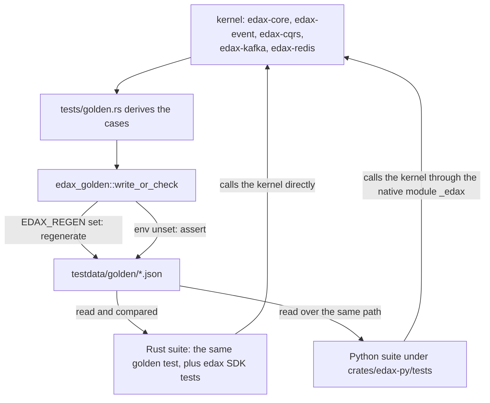
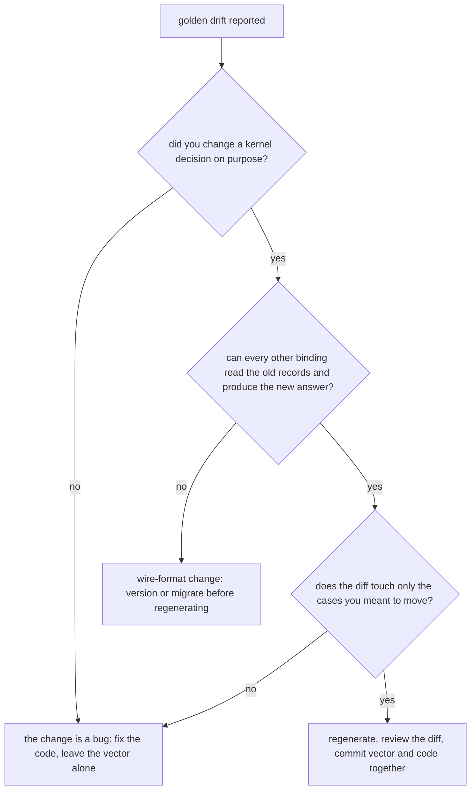

# Golden vectors

`testdata/golden/*.json` is the cross-language contract: the kernels' decisions written down as
data, generated by the Rust suite and asserted by every software development kit (SDK)'s suite.

A golden vector is a committed file of cases, each mapping an input to the answer a kernel gives. It
is generated from the kernel, never hand-written. Every binding reads the same file, so a byte of
drift in any binding fails that binding's build instead of production.

> **A golden vector always wins over a disagreeing test.** Regenerate only when you mean to change the
> contract (`AGENTS.md`). A test that disagrees with a vector is the thing that is
> wrong, unless you are deliberately moving the contract.

---

## Generation and assertion



One harness crate owns the whole rule: one writer, one reader, one path to the golden directory, one
failure message. It is `publish = false` and only ever a `[dev-dependency]`. Every row below is a
rule of `edax_golden::write_or_check`.

| Harness behaviour | Detail |
|---|---|
| mode selection | the **presence** of `EDAX_REGEN` selects regenerate; the value is not inspected, so `EDAX_REGEN=0` still regenerates |
| golden directory | resolved from the harness crate's own manifest, so every kernel gets the same directory whatever its test working directory is |
| written bytes | pretty-printed JSON array with a trailing newline, so `git status` is the proof |
| assertion | compares the parsed JSON **value**, not the bytes — a reformatted file still passes |
| failure message | names the first differing case index and prints only that case, plus the regenerate hint |
| missing file | panics naming the path and the regenerate command |

The Python suite never regenerates. It only reads, from a path derived the same way in each test
file: `Path(__file__).resolve().parents[3] / "testdata" / "golden"`.

---

## Every vector

Each row: what the file pins, which kernel's logic it comes from, the generator that writes it, and
the suites that assert it. Every case object is one row of a JSON array.

| File | Case shape | Pins | Kernel | Generator |
|---|---|---|---|---|
| `backoff.json` | `attempt`, `expected_millis` | 17 attempts including `63` / `64`, which straddle the `1 << attempt` shift boundary, and the cap | `edax-core` `backoff_millis` | `edax-event` `backoff_cases` |
| `canonical_payload_hash.json` | `input`, `expected` | canonicalize-then-hash: key order, whitespace, non-ASCII, `1` versus `1.0`, nested sorting, `{}` | `edax-cqrs` | `edax-cqrs` `canonical_payload_hash_cases` |
| `causation.json` | `parent_metadata`, `parent_event_id`, `expected` | which correlation and causation ids a child inherits from its parent | `edax-event` `propagate` | `edax-event` `causation_cases` |
| `causation_originate.json` | `metadata`, `fresh_id`, `expected` | which of the two chain keys are generated when a root event starts a chain | `edax-event` `originate` | `edax-event` `originate_cases` |
| `command_hash.json` | `name`, `type`, `command`, `expected` | the hash **input rule**: the whole command value including the idempotency-key field, excluding the routing `type` | `edax-cqrs` | `edax-cqrs` `command_hash_cases` |
| `dedup.json` | `stored`, `incoming`, `expected` | apply-or-drop by sequence, including both `u64` ceiling cases | `edax-event` `should_apply` | `edax-event` `dedup_cases` |
| `envelopes.json` | `envelope`, `json_hex`, `msgpack_hex` | exact wire bytes for four envelopes in both formats, with unicode and a `2^53 + 1` sequence | `edax-event` `encode_from_json` | `edax-event` `envelope_cases` |
| `error_taxonomy.json` | `code`, `terminal`, `message`, `wire` | all nine codes, each one's terminal or transient verdict, and the `"<code>: "` wire framing | `edax-core` `ErrorCode` | `edax-core` `error_taxonomy_cases` |
| `filter.json` | `filter`, `document`, `expected` | 32 filter evaluations: every operator, missing paths, cross-type compares, vacuous `and` / `or` | `edax-core` `eval` | `edax-event` `filter_cases` |
| `idempotency.json` | `prior`, `current`, `expected` | `proceed` / `replay` / `payload_mismatch`, including that a stored hash of `0` is a real prior | `edax-cqrs` `decide` | `edax-cqrs` `idempotency_cases` |
| `idempotency_record.json` | `name`, `stored`, `current`, `payload_hash`, `state`, `outcome`, `encoded`, plus `result` or `error` | the record's wire shape, reading order, re-encoded bytes and replay verdict — 12 cases including a stored `null` result replaying as a success | `edax-cqrs` `Record` / `outcome` | `edax-cqrs` `idempotency_record_cases` |
| `kafka_record.json` | `name`, `format`, `envelope`, `key`, `key_hex`, `value_hex`, `headers` | the record a published envelope becomes: the key rule and the four contract headers, in both formats, with an overridden key, an unsequenced envelope and unicode | `edax-kafka` `encode_record` | `edax-kafka` `kafka_record_cases` |
| `kafka_decode.json` | `name`, `default_format`, `value_hex`, `headers`, `want` | which format a fetched record names: the first `content-type` wins, an unknown one is refused, an absent one falls back to the default | `edax-kafka` `decode_record` | `edax-kafka` `kafka_decode_cases` |
| `kafka_offsets.json` | `name`, `steps` of `op` plus `want` | the token-settled commit watermark replayed step by step: out-of-order acks, nack rewinds, per-partition isolation, the monotonic guard, and stale tokens after a reset | `edax-kafka` `OffsetTracker` | `edax-kafka` `kafka_offsets_cases` |
| `redis_value.json` | `name`, `op`, the operands, and `value` or `want` | the ledger value `<owner><record>`: both writers, the width check, and every `split_value` branch | `edax-redis` `claim_value` / `record_value` / `split_value` | `edax-redis` `claim_cases`, `record_cases`, `split_cases` |
| `redis_scripts.json` | `name`, `body` | both Lua fence bodies verbatim, so two SDKs registering them share one `EVALSHA` digest | `edax-redis` `FENCED_SET_SCRIPT` / `FENCED_DEL_SCRIPT` | `edax-redis` `script_cases` |
| `partition.json` | `id`, `n`, `expected` | consistent-hash placement for six aggregate ids against five partition counts; `n = 0` clamps to 1 | `edax-event` `partition` | `edax-event` `partition_cases` |
| `payload_hash.json` | `input`, `expected` | raw Fowler-Noll-Vo 1a (FNV-1a) over six byte strings, including `café ☕ 🦀` | `edax-cqrs` `payload_hash` | `edax-cqrs` `payload_hash_cases` |
| `cursor.json` | `sort`, `document`, `expected_cursor`, `expected_effective_sort`, `expected_tuple` | the keyset cursor round trip: the `id` tiebreak, every type in the total order, a missing sort path, and a tuple whose arity does not match the sort | `edax-event` `encode_cursor` / `decode_cursor` / `effective_sort` |
| `query.json` | `query`, `documents`, `expected_page`, `expected_cursor` | ordering, the total type order, offset, limit, `after`, and the byte-identical cursor generated from the last row | `edax-event` `query_json` / `encode_cursor` | `edax-event` `query_cases` |
| `rendezvous.json` | `id`, `n`, `expected` | rendezvous placement for six ids against six bucket counts | `edax-event` `rendezvous` | `edax-event` `rendezvous_cases` |
| `sequence_batch.json` | `expected`, `sequences`, `error` | the dense-batch rule: accepted runs, an unsequenced envelope, a gap, a reorder, a repeat, the `i64` ceiling | `edax-event` `check_sequence_batch` | `edax-event` `sequence_batch_cases` |
| `upcast.json` | `from`, `to`, `available`, `plan`, `error` | the planned step sequence, and which gap the error names when a step is missing | `edax-event` `upcast_plan` | `edax-event` `upcast_cases` |

`filter.json` and `backoff.json` pin `edax-core` logic but are generated by the `edax-event` golden
test, so they regenerate with the `edax-event` command.

### Who asserts each vector

| File | Rust | Python |
|---|---|---|
| `backoff.json` | its generator, in assert mode | `test_edax.py::test_golden_backoff` |
| `canonical_payload_hash.json` | its generator | `test_command.py::test_golden_canonical_payload_hash` |
| `causation.json` | its generator | `test_kernel_extra.py::test_golden_causation` |
| `causation_originate.json` | its generator | `test_edax.py::test_golden_causation_originate` |
| `command_hash.json` | its generator, and the real `idempotent` middleware | `test_command.py::test_golden_command_hash_holds_through_the_middleware` for three command shapes, plus `test_golden_command_hash_rejects_the_old_per_sdk_rules` |
| `dedup.json` | its generator | `test_edax.py::test_golden_dedup` |
| `envelopes.json` | its generator | `test_edax.py::test_golden_envelopes`, which also re-encodes the decoded envelope |
| `error_taxonomy.json` | its generator | `test_kernel_extra.py::test_error_classes_are_the_kernel_code_set` and `test_each_code_keeps_the_kernel_verdict` |
| `filter.json` | its generator | `test_filter.py::test_golden_filter` |
| `idempotency.json` | its generator | `test_command.py::test_golden_idempotency` |
| `idempotency_record.json` | its generator | `test_command.py::test_golden_idempotency_record`: decode, re-encode, and the verdict |
| `partition.json` | its generator | `test_edax.py::test_golden_partition` |
| `payload_hash.json` | its generator | `test_command.py::test_golden_payload_hash` |
| `cursor.json` | its generator, including the mismatched-arity cases | `test_kernel_extra.py::test_golden_cursor` |
| `query.json` | its generator, and a Rust round-trip of each spec through the SDK query shape | `test_kernel_extra.py::test_golden_query`, plus `test_build_spec_matches_the_golden_query_shape` |
| `rendezvous.json` | its generator | `test_kernel_extra.py::test_golden_rendezvous` |
| `sequence_batch.json` | its generator | `test_edax.py::test_golden_sequence_batch` |
| `upcast.json` | its generator | `test_kernel_extra.py::test_golden_upcast` |
| `kafka_record.json` | its generator | `test_edax.py::test_golden_kafka_record` |
| `kafka_decode.json` | its generator | `test_edax.py::test_golden_kafka_decode`, which also asserts the mapped terminal `CodecError` |
| `kafka_offsets.json` | its generator | `test_edax.py::test_golden_kafka_offsets`, replaying every step through `_edax.offset_tracker()` |
| `redis_value.json` | its generator | `test_edax.py::test_golden_redis_value` |
| `redis_scripts.json` | its generator | `test_edax.py::test_golden_redis_scripts` |

"Its generator" means the same `tests/golden.rs` function that writes the file asserts it whenever
`EDAX_REGEN` is unset — one function, two modes.

Two vectors are asserted **through the SDK layer** rather than against the kernel function.
`command_hash.json` is dispatched through each SDK's own `idempotent` middleware. The hash the
ledger received is then compared. That proves both SDKs bind one key to one number for one command.
`query.json` is parsed into the SDK's own query type, so a re-declared shape fails.

---

## Regenerating

Verbatim from `AGENTS.md:43`:

```
EDAX_REGEN=1 mise exec -- cargo test -p edax-event --test golden
EDAX_REGEN=1 mise exec -- cargo test -p edax-cqrs  --test golden
EDAX_REGEN=1 mise exec -- cargo test -p edax-core  --test golden
EDAX_REGEN=1 mise exec -- cargo test -p edax-kafka --test golden
EDAX_REGEN=1 mise exec -- cargo test -p edax-redis --test golden
```

Then read the diff. The files are pretty-printed with a stable key order, so `git diff` shows
exactly which cases moved.

To assert instead, drop the env var — the same tests run in assert mode as part of the workspace
suite (`AGENTS.md:19`):

```
mise exec -- cargo test -p edax-core -p edax-event -p edax-cqrs -p edax-kafka -p edax-redis -p edax
```

### Legitimate versus hiding a bug



| Regenerating is legitimate when | Regenerating hides a bug when |
|---|---|
| you added a case to a generator and the new case is the only diff | a case you did not touch moved |
| you changed a kernel decision deliberately and the diff matches that decision | you regenerate to make a red suite green without reading the diff |
| you added a new error code, and `error_taxonomy.json` grows by that row | the hash of an unchanged command changed — that means the hash input rule moved, and every stored key in production now mismatches |
| a new kernel function gets its first vector | `idempotency_record.json` bytes changed — stored records written by the old code become unreadable or reclassify |

The two files to be most careful with are `command_hash.json` and `idempotency_record.json`. A
command's hash is bound into live idempotency keys, and a record's bytes are already on disk in
every running ledger. Moving either is a compatibility event, not a test fix.

---

## The stale native module trap

Every Python golden assertion runs through `_edax`. A stale `_edax` therefore defeats the whole
contract while the suite stays green. Read [the stale native module
trap](../guides/getting-started.md#the-stale-native-module-trap) before you trust a Python golden
run.

Run both suites before you finish. `cargo test` alone misses binding regressions (`AGENTS.md:72`).

---

## See also

- [`./cqrs.md`](./cqrs.md) — what `command_hash.json`, `idempotency.json` and
  `idempotency_record.json` pin, decision by decision.
- [`./core.md`](./core.md) — the logic behind `backoff.json` and `error_taxonomy.json`.
- [`./filter.md`](./filter.md) — the logic behind `filter.json`.
- [`./event.md`](./event.md) — the logic behind `partition.json`, `rendezvous.json`,
  `envelopes.json`, `query.json`, `upcast.json`, `causation.json` and `dedup.json`.
- [`./kafka.md`](./kafka.md) — the logic behind `kafka_record.json`, `kafka_decode.json` and
  `kafka_offsets.json`.
- [`./redis.md`](./redis.md) — the logic behind `redis_value.json` and `redis_scripts.json`.
- [`../guides/testing.md`](../guides/testing.md) — golden vectors beside the model tests, proptest
  and Hypothesis.
- [`../architecture.md`](../architecture.md) — why the kernels exist and how the native module is
  built.
