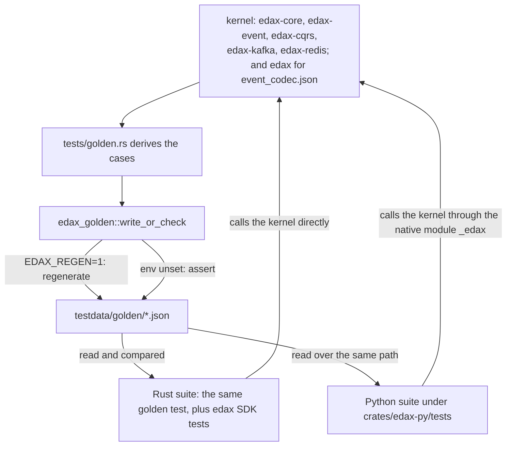
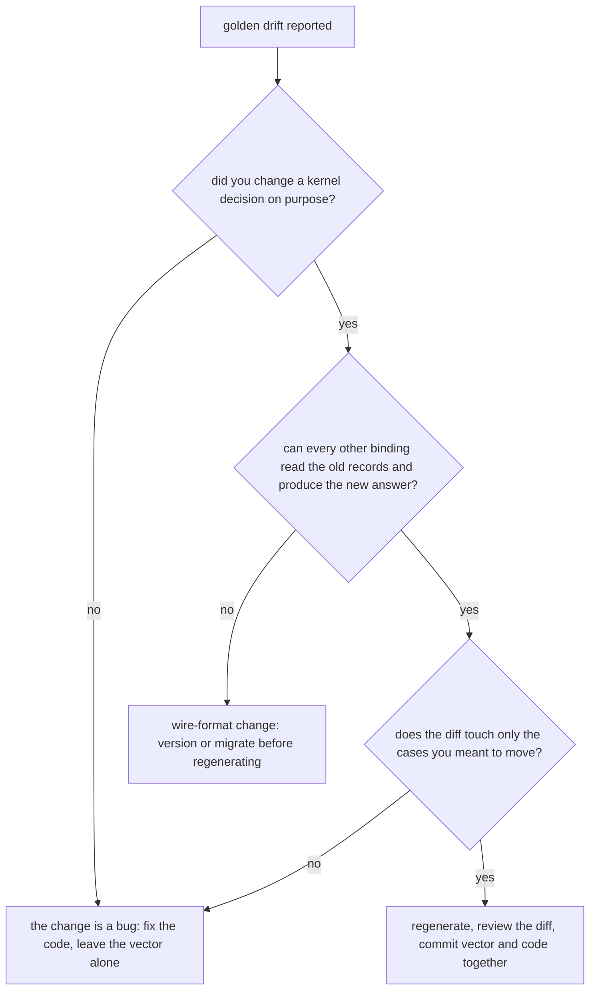

# Golden vectors

`testdata/golden/*.json` is the cross-language contract: the kernels' decisions written down as
data, generated by the Rust suite and asserted by the suite of every software development kit
(SDK).

A golden vector is a committed file of cases, each mapping an input to the answer a kernel gives. It
is generated from the kernel, never hand-written. Every binding reads the same file, so a byte of
drift in any binding fails that binding's build instead of production.

> **A golden vector always wins over a disagreeing test.** Regenerate only when you mean to change the
> contract (`AGENTS.md`).

---

## Generation and assertion



One harness crate owns the whole rule: one writer, one reader, one path to the golden directory, one
failure message. It is `publish = false` and only ever a `[dev-dependency]`. Every row below is a
rule of `edax_golden::write_or_check`.

| Harness behaviour | Detail |
|---|---|
| mode selection | `EDAX_REGEN=1` regenerates; unset or empty asserts; any other value panics, so `EDAX_REGEN=0` cannot rewrite the contract by accident |
| golden directory | resolved from the harness crate's own manifest, so every kernel gets the same directory whatever its test working directory is |
| written bytes | pretty-printed JSON array with a trailing newline, so `git status` is the proof |
| assertion | compares the parsed JSON **value**, not the bytes — a reformatted file still passes |
| failure message | names the first differing case index and prints only that case, plus the regenerate hint |
| missing file | panics naming the path and the regenerate command |

The Python suite never regenerates. It reads through one helper, `golden(name)` in
`crates/edax-py/tests/conftest.py`, which records every name it loads. A full green run then fails if
any `testdata/golden/*.json` went unread, so a new vector cannot ship without a Python reader. A run
counts as full when it collected every test module, a live suite that skips itself included, and was
not narrowed by `-k`, `-m` or `--deselect`.

**One refusal shape.** A row records a refused call under `error`: `null` when the call succeeded, else
the error's wire form `"<code>: <message>"`. Every generator writes it with `edax_golden::refusal`, and
the Python replayers compare it with `wire_of(error)` from `conftest.py`. Where the message is a format
parser's own text rather than the kernel's (`envelope_decode.json`, `event_codec.json`), it differs per
format and per SDK, so the replayer compares the code only, `wire_code(wire)`. A field named `error`
inside an input or a stored value is data, not a refusal. Examples are the failure text a dead-letter
record carries, a stored idempotency record's `error` and `error_code`, and a scripted handler failure. The
Rust suites that replay a vector through the SDK read it with `edax_golden::read`.

---

## Every vector

Each row: what the file pins, which kernel's logic it comes from, the generator that writes it, and
the suites that assert it. Every case object is one row of a JSON array.

| File | Case shape | Pins | Kernel | Generator |
|---|---|---|---|---|
| `backoff.json` | `base_millis`, `cap_millis`, `attempt`, `entropy`, `ceiling_millis`, `expected_millis` | full jitter, `(policy, attempt, entropy) -> millis`: the default policy over 19 attempts including `63` / `64` (the `1 << attempt` shift boundary), `u32::MAX` and `u64::MAX`, three draws each, plus a zero base, a cap below the base and an unbounded policy | `edax-core` `backoff_millis` | `edax-core` `backoff_cases` |
| `tenancy.json` | `mode`, `requires_tenant`, `composes_keys`, `tenant`, `key`, `expected`, `error` | the tenancy rule: which of the three modes requires a tenant, which composes it into the key a seam is called with, and the refusal when a mode requires one and the call has none. Four keys (including an empty one and one holding the separator) against ten tenants (absent, empty, plain, non-ASCII, the `a:b` / `a` pair the length prefix keeps apart, 64 and 65 ASCII bytes, and 32 and 33 `é`: 64 and 66 bytes, the limit counted in bytes and not characters) | `edax-core` `tenant_key` | `edax-core` `tenancy_cases` |
| `canonical_payload_hash.json` | `input`, `expected`, `error` | canonicalize-then-hash (RFC 8785), each pair asserted equal by the generator: key order, `"\u00e9"` and raw `é`, `1.0` and `1`, `1e2` and `100`, `-0` and `0`, an escaped surrogate pair and the raw emoji, a repeated key and its last value, U+2028 raw and escaped, `1e20` and `1.0E+20`, `2^53 - 1` as an integer and as a float; and four refusals (an integer past 2^53 either side, `1e400`, a lone surrogate) | `edax-cqrs` | `edax-cqrs` `canonical_payload_hash_cases` |
| `canonical_json.json` | `name`, `input`, `canonical`, `hash`, `error` | the RFC 8785 text itself: keys by UTF-16 code units (U+1F980 before U+FF71), numbers as doubles in the ECMAScript form (`2`, `2.0`, `2e0` alike; `-0` is `0`; `1e20` written out, `1e+21`; a float past 2^53 rounds), escapes decoded and re-escaped, digits in a string left alone; and nine refusals: an integer literal outside the I-JSON safe range -(2^53 - 1) to 2^53 - 1 (2^53 either side, past it either side, `u64::MAX`, nested), `1e400`, a lone surrogate, trailing text | `edax-cqrs` `canonical_json` | `edax-cqrs` `canonical_json_cases` |
| `causation.json` | `parent_id`, `parent_correlation_id`, `expected` | the lineage a child gets from its parent: the parent's correlation, the parent's id as causation; a first child of a root, and an empty parent correlation, included | `edax-event` `propagate` | `edax-event` `causation_cases` |
| `causation_originate.json` | `correlation_id`, `causation_id`, `fresh_id`, `expected` | the lineage of a message no message caused: which ids are filled from `fresh_id`, and that a supplied one is kept; a lone causation id still gets a fresh correlation, and an empty id counts as supplied | `edax-event` `originate` | `edax-event` `originate_cases` |
| `command_hash.json` | `name`, `type`, `command`, `expected`, `error` | the hash **input rule**: the command name (`type`) and its whole value, as `{"name", "payload"}`; two commands that differ by name alone hash apart; a float field holding a whole number hashes alike given as `1.0` or `1`; an integer field at 2^53 - 1 hashes exactly; from 2^53 (and past `i64::MAX`) the command is refused as `codec` before any claim. A refusal row pins the code and the rule; its byte offset is the generator encoder's, since each SDK's encoder writes fields in its own order. The `Withdraw` rows wrap a decimal and an instant in a marker (`{"$decimal": "9.50"}`, `{"$instant": ...}`) that each SDK builds with its host types: `9.50` and `9.5`, and `+01:00` and its UTC instant, are one hash, and an instant without an offset is refused | `edax-cqrs` | `edax-cqrs` `command_hash_cases` |
| `claim_key.json` | `tenancy`, `tenant`, `scope`, `idempotency_key`, `expected`, `error` | the ledger key a command guard claims, `claim_key(mode, tenant, scope, key)`: a scope and a key that would spell each other without the length, an empty scope, an empty key, a non-ASCII scope counted in bytes; a silo that ignores the tenant, a pool that composes it outermost, a separator inside the tenant, a bridge that keeps the key bare, and the `codec` refusal of a pool or a bridge without a tenant | `edax-cqrs` `claim_key` | `edax-cqrs` `claim_key_cases` |
| `staleness.json` | `op` `pair`: `stored`, `incoming`, `stale`, `advanced`; `op` `fold`: `name`, `stream`, `applied`, `watermark` | `is_stale` and `advance` per pair, both `u64` ceiling cases included, and the fold over three redelivered streams: an unsequenced event never erases the mark, a seek back, out-of-order copies | `edax-event` `is_stale` / `advance` | `edax-event` `staleness_cases` |
| `event_idempotency.json` | `name`, `tenancy`, `scope`, `id`, `tenant`, `data_hex`, `extensions`, `metadata`, `recorded_at`, `key`, `payload_hash`, `error` | the event guard's input rule: the event id under the guard's scope is the key (`edax:evt:`), composed with the tenant under a pool, and the raw body bytes are hashed; two scopes are two keys for one event; extensions, metadata and time take no part; a pool or a bridge refuses an event without a tenant as `codec` | `edax-event` `event_idempotency` | `edax-event` `event_idempotency_cases` |
| `envelopes.json` | `name`, `kind`, `message`, `json_hex`, `msgpack_hex` | exact wire bytes for 21 messages in both formats, 17 events and 4 commands: key order by UTF-8 bytes (`"Z"`, `""`, U+FF71 against U+1F980), escaping, raw non-ASCII, integer extremes and ceilings, an `occurred_at` before `recorded_at`, a time before the epoch, every MessagePack width boundary; a command with no key and no target, one a saga built, one with extensions | `edax-event` `Format::encode` | `edax-event` `envelope_cases` |
| `envelope_decode.json` | `name`, `kind`, `json_hex`, `msgpack_hex`, `want` | the evolution rule, one wire value per case in both formats, decoded as its `kind`: an unknown field ignored, a missing or `null` `sequence` and `tenant` and a missing `occurred_at` as `None`, a set `occurred_at` and `tenant` read back, a 64-byte tenant read back; a missing field, a missing `extensions` map, a negative version, a bad extension key, an empty or over-long tenant (65 bytes, or 33 characters of 66 bytes), a repeated field, a positional (array) message, trailing bytes and a non-map refused (`want` is `{"error": <wire>}`, matched by code); a repeated `metadata` key keeps the last; a command missing its `tenant`, `idempotency_key` or `aggregate_id` read as `None`, and one with a bad tenant or no `issued_at` refused | `edax-event` `Format::decode` | `edax-event` `envelope_decode_cases` |
| `extensions.json` | `key`, `error` | the [extension key rule](./event.md#three-tiers-of-fields): a dotted key, a hyphenated one, a leading digit and the 64-byte ceiling accepted; empty, upper case, a leading dot, a space, non-ASCII and 65 bytes refused as `codec` | `edax-event` `check_extensions` | `edax-event` `extensions_cases` |
| `error_taxonomy.json` | `code`, `terminal`, `fatal`, `message`, `wire` | all ten codes, each one's terminal or transient verdict, whether it is fatal (the wiring's: never cached, a consumer stops on it), and the `"<code>: "` wire framing | `edax-core` `ErrorCode` | `edax-core` `error_taxonomy_cases` |
| `error_wire.json` | `name`, `wire`, `code`, `message`, `terminal` | how any wire string splits (`store` and the whole string when it names no known code) and its verdict, the negative cases included: unknown code, no separator, a colon without a space, an uppercase code, a leading space, the empty string | `edax-core` `Error::from_wire` | `edax-core` `error_wire_cases` |
| `filter.json` | `name`, `filter`, `document`, `expected`, `error` | 69 filter evaluations: every operator, missing paths, a numeric segment as a key, cross-type compares, exact wide integers, code-point string order and no normalization, nested numeric equality, bool order, the two RFC3339 forms that order wrongly and the fixed-width UTC form that orders right, vacuous `and` / `or`, and the decimal collation (`"9.5" < "10"`, `"9.50" == "9.5"`, negatives, past 17 digits, `In`, and text that is not decimal compared as a mismatched type); and twelve refusals (a `null` comparand, empty path segments, a typo, an unknown node, a decimal comparand that is not decimal text, a `starts_with` prefix that is not text, `starts_with` under a collation, an unknown collation) | `edax-cqrs` `eval_json` | `edax-cqrs` `filter_cases` |
| `idempotency_record.json` | `name`, `stored`, `current`, then `payload_hash`, `state`, `outcome`, `encoded`, `check_settled`, plus `result`, or `error` and `error_code`; `replay_error` for every losing row, under the key `req-1`; plus `decode_error` for an unreadable record | the record's wire shape, reading order, re-encoded bytes, replay verdict and replay text — 18 readable cases including a failure's code beside its message, a host rejection as the Rust guard writes it, an unknown `error_code`, an unknown field ignored, a stored `null` result replaying as a success and a stored hash of `0` being a real hash; and 14 unreadable ones (not an object, a missing, float, negative, string or too-wide hash, a non-string `error` or `error_code`, a `null` or unknown `pending`, not JSON, garbage, a torn Rust write, a reused key), each read as a cached `codec` failure under the stored hash where it reads, else the claimant's; and for every row whether a store's `complete` takes it (`check_settled` refuses only a pending record, as `bad_handle`) | `edax-cqrs` `Record` / `decode_prior` / `outcome` / `replay` / `check_settled` | `edax-cqrs` `idempotency_record_cases` |
| `kafka_record.json` | `name`, `kind`, `format`, `tenancy`, `message`, `key`, `key_hex`, `value_hex`, `headers`, `error` | the record a published event or command becomes: the key under each tenancy (bare in a silo and a bridge, composed with the tenant in a pool, a pool or bridge message with no tenant refused) and the `content-type` header, in both formats, with an overridden key kept verbatim, a command without a target keyed by its id, an unsequenced event and unicode; a bad extension key refused for each kind | `edax-kafka` `record` over `Format::encode` | `edax-kafka` `kafka_record_cases` |
| `kafka_partition.json` | `name`, `key_hex`, `java_murmur2`, `partitions`, `expected`, `error` | broker placement, Java's murmur2 partitioner: thirteen keys at five partition counts, six of them Kafka's own `UtilsTest.testMurmur2` vectors with the Java `int`, an empty key, NFC and NFD spellings, high bytes, two tenants' pooled keys for one aggregate; `0` partitions refused | `edax-kafka` `partition_for` | `edax-kafka` `kafka_partition_cases` |
| `kafka_decode.json` | `name`, `registry` (each `format`, `kind`, `media_type`, the default first), `value_hex`, `headers`, `want` (`kind` and `message`, a `route` with its `media_type`, or the decode `error`) | what a consumer built with the row's registry makes of a fetched record: the first `content-type` wins; an unknown, empty, parameterized or 0.1 envelope one is poison; an absent, upper-case-named or non-UTF-8 one goes to an event default and is poison under a command default; a record of a kind nobody registered is poison; a mixed registry decodes either kind; bytes the picked serializer cannot read fail its decode | `edax-kafka` `route`, then `Format::decode` | `edax-kafka` `kafka_decode_cases` |
| `kafka_route.json` | `name`, `headers`, `registered`, `default_kind`, `want` | the route every shell takes against its own registry and default kind: `default`, `headerless` under a command default, `registered` with an index (a command media type included), or `unknown` with the media type, the empty one included; or the `error` refusing a registry that names a media type twice | `edax-kafka` `route`, `check_media_types` | `edax-kafka` `kafka_route_cases` |
| `kafka_dead_letter.json` | `name`, `record`, `topic`, `partition`, `offset`, `code`, `message`, `want` (with its `stub`); or `name`, `headers`, `want` | the record a dead-letter sink publishes, the original kept verbatim plus four `edax-dlq-*` headers, `edax-dlq-error` rendered from the code (or `unclassified`) and the message, and the source read back (the last set after two); its stub, the value dropped and `edax-dlq-dropped` added, read back with the dropped count; then eight header sets the reader refuses | `edax-kafka` `dead_letter_record` / `dead_letter_stub` / `dead_letter_source` | `edax-kafka` `kafka_dead_letter_cases` |
| `kafka_config.json` | `name`, `op`, then for `durations` `publish_timeout_ms`, `commit_interval_ms`, `commit_timeout_ms`, `drain_timeout_ms`, `error`; for `consumer` `auto_commit`, `has_group`, `error`; for `dead_sink` `has_dead_sink`, `error`; for `acks` `acks`, `warning` | what a Kafka shell checks when it is built: each duration at one millisecond, zero, minus one and `i64::MIN`, all four at the floor, none set, a refusal `bad_handle` naming the setting; the four consumer configurations, two refused; a consumer run with and without a dead-letter sink; the producer `acks` warned about | `edax-kafka` `check_config`, `check_consumer`, `check_dead_sink`, `acks_warning` | `edax-kafka` `kafka_config_cases` |
| `kafka_error.json` | `name`, `error_code`, `message`, `error` | the verdict on a broker's protocol error code: the three one-record codes as `codec`, the thirteen refused-client codes (authorization, SASL, settings, a fenced producer epoch, a timestamp only a skewed clock earns) as the fatal `bad_handle`, and five left transient as `store` (a corrupt message in transit, a retriable code, a leader move, an unknown server error, which is what aiokafka reports for a code it does not know, an unknown code) | `edax-kafka` `broker_error` | `edax-kafka` `kafka_error_cases` |
| `kafka_offsets.json` | `name`, `steps` of `op` plus `want` | the token-settled commit watermark replayed step by step: out-of-order acks, the rewind a nack makes and the tokens it retires, re-booked acked offsets, per-partition isolation, `due`, the monotonic guard, stale tokens after a reset, a revoke handing back the last watermark as it drops the partition, an offset gap, the `i64` ceiling, a refused negative offset, topics in byte order; decisions by name (`settled`, `stale`, `seek`) | `edax-kafka` `OffsetTracker` | `edax-kafka` `kafka_offsets_cases` |
| `redis_value.json` | `name`, `op`, the operands, and `value` or `want` | the ledger value `1<owner><record>`: the claim value, the settled value, and every `split_value` branch, the unversioned layout refused | `edax-redis` `claim_value` / `settled_value` / `split_value` | `edax-redis` `claim_cases`, `settled_cases`, `split_cases` |
| `redis_ledger.json` | `name`, `op`, the operands, and `want` or `error` | the key composition, the refused settings (prefix, TTLs, deadline, heartbeat), the refused claim handles, the claim outcome (a lost reply re-sent is won, a value no layout reads is a cached `codec` failure), the forget outcome (a free key sends nothing, a pending claim is `in_progress`, a settled or unreadable value is deleted), and the verdict on each Redis error reply, a pending record refused as the settled value, the complete reply (`0` is the lapsed-claim `store` error), the error a forget gives up with, the heartbeat schedule (beats one to three, a claim TTL not divisible by three, saturation) | `edax-redis` `ledger_key` / `check_config` / `check_claim` / `claim_outcome` / `forget_outcome` / `settled_value` / `complete_outcome` / `forget_exhausted` / `heartbeat_due_ms` / `reply_error` | `edax-redis` `key_cases`, `config_cases`, `handle_cases`, `outcome_cases`, `forget_cases`, `settle_cases`, `complete_outcome_cases`, `forget_exhausted_cases`, `heartbeat_cases`, `reply_cases` |
| `redis_scripts.json` | `name`, `body` | the five Lua bodies verbatim, so SDKs registering them share one `EVALSHA` digest each; `forget` has `release`'s body | `edax-redis` `CLAIM_SCRIPT` / `COMPLETE_SCRIPT` / `RELEASE_SCRIPT` / `FORGET_SCRIPT` / `EXTEND_SCRIPT` | `edax-redis` `script_cases` |
| `redis_fence.json` | `name`, `initial`, `initial_ttl_ms`, `script`, `args`, `want_reply`, `want_value`, `want_ttl_ms` | what each script does to a key: 25 rows written out by hand, among them a re-sent claim, a takeover, a release after `complete` landed, empty and prefix handles, and four forgets (a settled record, a free key, a key taken over since the read, a prefix of the value) | the Lua itself, run by a server | `edax-redis` `fence_cases` |
| `ordering_key.json` | `id`, `aggregate_id`, `expected` | the key that orders a message: the aggregate id when present, an empty one included, else the message's own id; non-ASCII ids | `edax-event` `ordering_key` | `edax-event` `ordering_key_cases` |
| `command_received_key.json` | `id`, `idempotency_key`, `expected` | the key a guard claims for a received command: the client's key when present, an empty one included, else the message's own id | `edax-cqrs` `received_key` | `edax-cqrs` `received_key_cases` |
| `partition.json` | `id`, `n`, `expected` | local fan-out, the worker a dispatcher runs an ordering key on: eight ids (NFC and NFD `café` among them) against six worker counts up to `u32::MAX`; `n = 0` clamps to 1. Not broker placement | `edax-event` `partition` | `edax-event` `partition_cases` |
| `payload_hash.json` | `input`, `expected` | raw Fowler-Noll-Vo 1a (FNV-1a) over six byte strings, including `café ☕ 🦀` | `edax-core` `payload_hash` | `edax-core` `payload_hash_cases` |
| `cursor.json` | `name`, `sort`, `document`, `expected_cursor`, `expected_effective_sort`, `expected_tuple`, `error` | the keyset cursor round trip under base64url: the `id` tiebreak, every type in the total order, a missing sort path, raw non-ASCII, integers at ±(2^53 - 1), whole floats past 2^53 that decode as floats, a decimal key whose text comes back exactly; and eleven refusals with the kernel's text — a cursor read under another key, direction, key set or no sort, standard base64, and a mint without a sort, from a row whose `id` is missing, null, an array or an object, or from a sort value at 2^53 | `edax-cqrs` `encode_cursor` / `decode_cursor` / `effective_sort` | `edax-cqrs` `cursor_cases` |
| `query.json` | `name`, `query`, `documents`, `expected_page` (`{rows, next}`), `error` | ordering, the total type order, offset, limit, `after` (resume ascending, descending, mid-tie, from a null row, with an offset), numeric and code-point sorts, decimal sorts by value under the collation (ascending, descending, paged, resumed inside a tie, after a collated filter), `next` minted only while rows follow and never for an unsorted query; and nine refusals (a cursor under another sort, direction or collation or without one, `next` from a row without an `id` or with an object one, a typo, a `null` comparand in the filter, a sort path with an empty segment) | `edax-cqrs` `query` / `encode_cursor` | `edax-cqrs` `query_cases` |
| `host_values.json` | `name`, `kind`, `input`, `json`, `epoch_micros`, `error` | the JSON text a host value becomes in every SDK: a `decimal` as its canonical text (trailing zeros, leading zeros, `-0.0`, exponents, past 17 digits and past 2^53 kept exact; `NaN`, `sNaN`, an infinity and more than 1000 digits refused), a `datetime` as fixed-width UTC (a whole second, milliseconds, microseconds, offsets converted across midnight, a year below 1000; no offset refused), a `date` as ISO, a `float` as JSON writes it (`NaN` and the infinities as `null`, as `serde_json` and msgspec both write them). The generator checks each instant against `epoch_micros`, and that the texts sort as the instants do | `edax-cqrs` `canonical_decimal` / `canonical_timestamp` | `edax-cqrs` `host_values_cases` |
| `sequence_batch.json` | `expected`, `sequences`, `version`, `error` | the dense-batch rule over `u64`, and the stream version after an accepted batch: accepted runs, an unsequenced draft, a gap, a reorder, a repeat, exact past `i64::MAX`, the last sequence there is, and a repeat at the `u64` ceiling refused | `edax-event` `check_batch` | `edax-event` `sequence_batch_cases` |
| `snapshot_due.json` | `every`, `initial`, `current`, `due` | the snapshot interval: none (`0`), a save with nothing pending, a save inside one interval, a save crossing one or several multiples, the `u64` ceiling | `edax-event` `snapshot_due` | `edax-event` `snapshot_due_cases` |
| `draft_batch.json` | `name`, the save's inputs (`aggregate_id`, `tenant`, `initial`, `snapshot_every`, `payloads`, `ids`, `lineage`, `extensions`, `metadata`, `occurred_at`), and `want` (`drafts`, `version`, `snapshot`) or `error` | the drafts a save appends: none, one, many sequenced from `initial + 1`, a snapshot crossing and not, the tenant and the valid time on every draft, the last sequence there is; and refused: past `u64::MAX`, a bad extension key, an empty tenant, an id count that is not the event count | `edax-event` `draft_batch` | `edax-event` `draft_batch_cases` |
| `command_owner.json` | `name`, `id`, `command_tenant`, `tenant`, `want` or `error` | the tenant of a command a save sends: kept when it is the aggregate's, stamped when it names none, refused when it names another | `edax-event` `own_command` | `edax-event` `command_owner_cases` |
| `upcast.json` | `from`, `to`, `available`, `plan`, `error`, `target`, `target_error` | the planned step sequence and which gap the error names, with the exact message: `available` as a set (unsorted, repeated), an empty `available`, the `u32` extremes, and `available: null` (a name with no upcaster: identity, but a newer writer refused); and the version a codec writes for the name with those steps, refused for a hole or a step at the `u32` ceiling | `edax-event` `upcast_plan`, `upcast_target` | `edax-event` `upcast_cases` |
| `retries.json` | `name`, `max_attempts`, `sink`, `ops` (each `op`, its inputs, `want`; a `failed` op carries the failure's `code`) | the retry and dead-letter policy as operation scripts: the ceiling, terminal, no sink, `max_attempts = 0`, an unclassified failure, broker attempts up and down, contention, a fatal failure that stops uncounted with and without a sink, success, a sink that takes or refuses (`sunk` with `taken` and the refusal's `code`), a fatal sink failure that stops and keeps no attempt, ids apart, saturation; a verdict is `nack`, `dead` or `stop` | `edax-event` `Retries` | `edax-event` `retries_cases` |
| `retry_failure.json` | `code`, `failure` | the failure kind of every error code and of none: fatal, terminal, transient or contended | `edax-event` `Failure::of` | `edax-event` `retry_failure_cases` |
| `retry_step.json` | `name`, `attempts`, `failed`, `code`, `want` or `error` | the in-process retry: the step before the next run or `null` to stop; the first and a later failure, the last attempt, unclassified, terminal, fatal, contention spending an attempt, one attempt, and `0` attempts refused | `edax-event` `retry_step`, `retry_attempts` | `edax-event` `retry_step_cases` |
| `relay_drain.json` | `name`, `max_attempts`, `sink`, `ops` (each `op`, its inputs, `want`; `begin` lists the batch's rows by `id`, `aggregate_id` and `tenant`) | the relay's drain rule as operation scripts: an empty batch, every row published, a failed row holding back its key only, a growing step, a sink that takes or refuses (`sunk` with `taken` and the refusal's `code`), a fatal sink refusal stopping the drain, `max_attempts`, two transient failures stopping the drain, an outage whose failed rows the sink took still waiting and raising, a publish resetting that count, contention, a terminal failure and a taken dead letter neither counting nor resetting, a fatal stop with no wait, the tenant in the key, a command keyed by its own id, store failures | `edax-event` `Drain` | `edax-event` `relay_drain_cases` |
| `saga.json` | `loaded` (`state` `absent`, `active` or `completed`, and its `version`), `completes`, `has_commands`, `want`; or `loaded_row` (`completed`, `version`), `want` (the `loaded` it reads as, or the `error`); or `admit` (`saga`, `loaded`, `folded`, `aggregate_id`, `sequence`, `id`, and for a failure-named event `name` and `causation_id`), `want`; each `want` names its answer in `action`, the kernel's `as_str`; or `saga`, `instance_id`, `version`, `index`, `command_id`; or `saga_command` (the saga, instance, version, index, command and cause), `want`; or `saga_command_failed` (`command`, `code`, `error`, `recorded_at`), `want` | the saga step's write for every loaded state and fold (the expected and the committing version, or a `codec` error at the last version and for a tombstone), the flat store row each `Loaded` reads from (and the tombstone with no version, refused), whether a step folds an event (a tombstone, a repeat, an older event below the mark, another aggregate, unsequenced, a crash replay of one aggregate's sequenced and unsequenced events, each failure of the instance's own commands once, a host event that only shares the failure name, or carries a real command id under a fresh id, folding as unsequenced, another saga's command no failure, unreadable marks), the outbox command id, the whole command message (the id under the saga's name, the idempotency key as the id, the instance as `aggregate_id`, the folded event as its parent), and the failure event a dead command folds back (with a code, with none, and a row that names no instance) | `edax-event` `Loaded::from_row`, `saga_write`, `saga_admit`, `saga_command_id`, `saga_command`, `saga_command_failed` | `edax-event` `saga_cases` |
| `projection_document.json` | `name`, `id`, `json`, `want` (`ok` with the document and `keyed` with it as a read returns it, or `error`) | what a projection store's save takes as a document: an object and an empty object kept; an array, a scalar, `null`, an integer past 64 bits and text that is not JSON refused as `codec`; and what `get` and `get_many` read back, the row key as `id`, overwriting a stale one | `edax-cqrs` `document_json`, `keyed_document` | `edax-cqrs` `projection_document_cases` |
| `idempotency_settle.json` | `code`, `message`, `payload_hash`, `want` (`{"cache": <record>}` or `"release"`) | the guard's failure settle table: the failed record a won claim caches, or a release, for every code, none, and an empty message | `edax-cqrs` `settle_failure` | `edax-cqrs` `idempotency_settle_cases` |
| `idempotency_guard.json` | `name`, `key`, `payload_hash`, `prior`, `run`, `want`, `want_record` | one guarded dispatch: a success, a null success, a terminal failure, a host rejection, a transient and an unclassified failure released; a loser replaying a result, a cached failure, a claim in flight, a reused key, an unreadable record, a failure without a code | `edax-cqrs` `settle_failure`, `replay` | `edax-cqrs` `idempotency_guard_cases` |
| `idempotency_fence.json` | `name`, `op`, `key`, `holds`, `want`, `holds_after` | the fence every ledger applies to a settling write: `complete` and `release` over each class of what the key holds (free, the caller's claim, another claim, the same settled record, another record), the verdict, and the class the key is left in | `edax-cqrs` `complete_fence`, `release_fence` | `edax-cqrs` `idempotency_fence_cases` |
| `event_codec.json` | `case`, `name`, `version`, `fields`, `json`, `msgpack_hex`, `error` | one event of each variant shape as the Rust registry codec writes it from `fields`, both formats: a nested struct, a string payload, a unit variant, and a decimal and an instant (in their markers) written in the kernel's canonical text; and foreign bytes refused as `codec` (matched by code): an array for a struct at the top and nested, an instant with no offset, a `NaN` and an infinite decimal. Python must build the same event from `fields`, write the same bytes, read them back and refuse the same bytes | `edax` `RegistryCodec` over `Format::encode_payload` / `decode_payload` | `edax` `tests/golden.rs` |

### Who asserts each vector

| File | Rust | Python |
|---|---|---|
| `backoff.json` | its generator, in assert mode | `test_edax.py::test_golden_backoff` |
| `tenancy.json` | its generator | `test_edax.py::test_golden_tenancy` |
| `canonical_payload_hash.json` | its generator, and `feature-check` | `test_command.py::test_golden_canonical_payload_hash` |
| `canonical_json.json` | its generator, and `crates/edax-cqrs/feature-check` with `preserve_order`, `arbitrary_precision` and `float_roundtrip` on | `test_cross_sdk.py::test_python_reaches_the_rust_canonical_bytes` |
| `causation.json` | its generator | `test_edax.py::test_golden_causation` |
| `causation_originate.json` | its generator | `test_edax.py::test_golden_causation_originate` |
| `claim_key.json` | its generator | `test_cross_sdk.py::test_a_command_claims_the_kernels_scoped_key` |
| `command_hash.json` | its generator, the real `idempotent` middleware (refusal rows: terminal `codec`, no claim, no handler run; a host value the kernel refuses cannot be built), and `feature-check` | `test_command.py::test_golden_command_hash_holds_through_the_middleware` for three command shapes, refusal rows included, plus `test_golden_command_hash_rejects_the_old_per_sdk_rules` |
| `staleness.json` | its generator, and a proptest of the fold over random redelivery orders | `test_edax.py::test_golden_staleness` |
| `event_idempotency.json` | its generator | `test_cross_sdk.py::test_the_event_guard_claims_the_kernels_key_and_hash` |
| `envelopes.json` | its generator | `test_edax.py::test_golden_envelopes`, which also re-encodes the decoded message |
| `envelope_decode.json` | its generator, which asserts the two formats agree on every row | `test_edax.py::test_golden_envelope_decode` |
| `extensions.json` | its generator | `test_cross_sdk.py::test_an_extension_key_follows_the_kernels_rule` |
| `error_taxonomy.json` | its generator | `test_kernel_extra.py::test_error_classes_are_the_kernel_code_set` and `test_each_code_keeps_the_kernel_verdict` |
| `error_wire.json` | its generator | `test_kernel_extra.py::test_split_error_and_the_verdict_are_the_kernels` |
| `filter.json` | its generator | `test_filter.py::test_golden_filter` |
| `host_values.json` | its generator | `test_host_values.py::test_golden_host_values`, with real `Decimal`, `datetime` and `date` values through the SDK's one encoder |
| `idempotency_record.json` | its generator | `test_command.py::test_golden_idempotency_record`: decode, re-encode, the verdict, the strict reader's refusal and the memory store's `complete` against `check_settled`; `test_cross_sdk.py` replays the torn Rust write through a dispatcher |
| `ordering_key.json` | its generator | `test_cross_sdk.py::test_a_message_orders_by_the_kernels_key` |
| `command_received_key.json` | its generator | `test_cross_sdk.py::test_a_received_command_claims_the_kernels_key` |
| `partition.json` | its generator | `test_edax.py::test_golden_partition` |
| `payload_hash.json` | its generator | `test_command.py::test_golden_payload_hash` |
| `cursor.json` | its generator, and `feature-check` for the minted rows | `test_kernel_extra.py::test_golden_cursor`, refusals included |
| `query.json` | its generator, and a Rust round-trip of each accepted spec through the SDK query shape | `test_kernel_extra.py::test_golden_query`, plus `test_query_json_matches_the_golden_query_shape` |
| `sequence_batch.json` | its generator | `test_edax.py::test_golden_sequence_batch` |
| `snapshot_due.json` | its generator, and `repository.rs::snapshot_every_writes_one_where_a_save_crosses_its_interval` | `test_edax.py::test_golden_snapshot_due` |
| `upcast.json` | its generator | `test_kernel_extra.py::test_golden_upcast`, comparing the pinned message raw and through `mapped()`; `test_orchestration_kernels.py::test_golden_upcast_through_the_codec` through `json_codec` |
| `retries.json` | its generator | `test_orchestration_kernels.py::test_golden_retries` |
| `retry_failure.json` | its generator | `test_orchestration_kernels.py::test_golden_retry_failure`, through `_edax.retry_failure`, the policy and `edax.is_fatal` |
| `retry_step.json` | its generator | `test_orchestration_kernels.py::test_golden_retry_step`, and `test_retry_runs_as_the_golden_step_answers` through `edax.retry` |
| `relay_drain.json` | its generator | `test_orchestration_kernels.py::test_golden_relay_drain`, through the native handle the relay holds |
| `draft_batch.json` | its generator | `test_orchestration_kernels.py::test_golden_draft_batch` |
| `command_owner.json` | its generator | `test_orchestration_kernels.py::test_golden_command_owner` |
| `idempotency_guard.json` | its generator, and `idempotency.rs::the_guard_settles_and_replays_as_the_golden_scenarios_say` over `MemoryLedger` | `test_orchestration_kernels.py::test_golden_idempotency_guard`, through `guarded` over `MemoryLedger` |
| `idempotency_fence.json` | its generator, and `idempotency.rs::golden_idempotency_fence` through the memory store | `test_redis.py::test_golden_idempotency_fence`, against the Lua on fakeredis and, given `EDAX_REDIS_URL`, a live Redis |
| `saga.json` | its generator | `test_orchestration_kernels.py::test_golden_saga` |
| `idempotency_settle.json` | its generator | `test_orchestration_kernels.py::test_golden_idempotency_settle`, on the code `errors.code_of` reads off each failure |
| `projection_document.json` | its generator | `test_projection.py::test_golden_projection_document`: the kernel check, `edax.projection.check_document` and the memory store's `save` |
| `event_codec.json` | its generator | `test_orchestration_kernels.py::test_golden_event_codec`, both formats: built from `fields`, written, read back, and the refused rows refused |
| `kafka_record.json` | its generator | `test_edax.py::test_golden_kafka_record` |
| `kafka_partition.json` | its generator, which checks the six Kafka rows against the Java `int` | `test_kafka.py::test_a_python_producer_places_a_key_where_java_and_rust_do`, through a real `KafkaProducer` |
| `kafka_decode.json` | its generator | `test_edax.py::test_golden_kafka_decode`, through a real `KafkaConsumer` built with the row's registry, which also asserts the terminal `CodecError` |
| `kafka_route.json` | its generator | `test_edax.py::test_golden_kafka_route`, through `_edax.kafka_route` |
| `kafka_dead_letter.json` | its generator, which reads every source back | `test_edax.py::test_golden_kafka_dead_letter`, the record and its stub |
| `kafka_config.json` | its generator | `test_edax.py::test_golden_kafka_config`, through `_edax.kafka_check_config`, `_edax.kafka_check_consumer`, `_edax.kafka_check_dead_sink` and `_edax.kafka_acks_warning` |
| `kafka_error.json` | its generator | `test_kafka.py::test_golden_kafka_error_through_the_producer`, each code raised by the client and read back from `KafkaProducer.publish` |
| `kafka_offsets.json` | its generator, and a proptest model of a consumer under nacks, crashes and rebalances (`tests/model.rs`) | `test_edax.py::test_golden_kafka_offsets`, replaying every step through `_edax.offset_tracker()` |
| `redis_value.json` | its generator | `test_edax.py::test_golden_redis_value` |
| `redis_ledger.json` | its generator | `test_edax.py::test_golden_redis_ledger` |
| `redis_scripts.json` | its generator | `test_edax.py::test_golden_redis_scripts` |
| `redis_fence.json` | its generator, which writes the rows but cannot run Lua | `test_redis.py::test_golden_redis_fence`, against fakeredis and, given `EDAX_REDIS_URL`, a live Redis |

"Its generator" means the same `tests/golden.rs` function that writes the file asserts it whenever
`EDAX_REGEN` is unset — one function, two modes.

Three vectors are asserted **through the SDK layer** rather than against the kernel function.
`command_hash.json` is dispatched through each SDK's own `idempotent` middleware. The hash the
ledger received is then compared. That proves both SDKs bind one key to one number for one command.
`query.json` is parsed into the SDK's own query type, so a re-declared shape fails.
`kafka_decode.json` is polled through a real `KafkaConsumer`, so the adapter's routing is what is
proved, not a copy of it in the test.

---

## Regenerating

Verbatim from `AGENTS.md` ("Kernels are the source of truth"):

```
EDAX_REGEN=1 mise exec -- cargo test -p edax-event --test golden
EDAX_REGEN=1 mise exec -- cargo test -p edax-cqrs  --test golden
EDAX_REGEN=1 mise exec -- cargo test -p edax-core  --test golden
EDAX_REGEN=1 mise exec -- cargo test -p edax-kafka --test golden
EDAX_REGEN=1 mise exec -- cargo test -p edax-redis --test golden
EDAX_REGEN=1 mise exec -- cargo test -p edax       --test golden
```

Then read the diff. The files are pretty-printed with a stable key order, so `git diff` shows
exactly which cases moved.

To assert instead, drop the env var — the same tests run in assert mode as part of the workspace
suite (`AGENTS.md`, "Build & test"):

```
mise exec -- cargo test --workspace
```

### Legitimate versus hiding a bug



| Regenerating is legitimate when | Regenerating hides a bug when |
|---|---|
| you added a case to a generator and the new case is the only diff | a case you did not touch moved |
| you changed a kernel decision deliberately and the diff matches that decision | you regenerate to make a red suite green without reading the diff |
| you added a new error code, and `error_taxonomy.json` grows by that row | the hash of an unchanged command changed — that means the hash input rule moved, and every stored key in production now mismatches |
| a new kernel function gets its first vector | `idempotency_record.json` bytes changed — stored records written by the old code become unreadable or reclassify |

The two files to be most careful with are `command_hash.json` and `idempotency_record.json`. A
command's hash is bound into live idempotency keys, and a record's bytes are already on disk in
every running ledger. Moving either is a compatibility event, not a test fix.

---

## The stale native module trap

Every Python golden assertion runs through `_edax`. A stale `_edax` therefore defeats the whole
contract while the suite stays green. Read [the stale native module
trap](../guides/getting-started.md#the-stale-native-module-trap) before you trust a Python golden
run.

Run both suites before you finish. `cargo test` alone misses binding regressions (`AGENTS.md`,
"Before you finish").

---

## See also

- [`./cqrs.md`](./cqrs.md) — what `command_hash.json`, `claim_key.json` and `idempotency_record.json`
  pin, decision by decision.
- [`./core.md`](./core.md) — the logic behind `backoff.json` and `error_taxonomy.json`.
- [`./filter.md`](./filter.md) — the logic behind `filter.json`.
- [`./event.md`](./event.md) — the logic behind `partition.json`, `ordering_key.json`,
  `extensions.json`, `envelopes.json`, `envelope_decode.json`, `upcast.json`, `causation.json`, `staleness.json`, `sequence_batch.json` and
  `snapshot_due.json`.
- [`./kafka.md`](./kafka.md) — the logic behind `kafka_record.json`, `kafka_partition.json`,
  `kafka_decode.json`, `kafka_route.json`, `kafka_dead_letter.json`, `kafka_offsets.json`,
  `kafka_config.json` and `kafka_error.json`.
- [`./redis.md`](./redis.md) — the logic behind `redis_value.json`, `redis_ledger.json`,
  `redis_scripts.json`, `redis_fence.json` and the fence table `idempotency_fence.json`.
- [`../guides/testing.md`](../guides/testing.md) — golden vectors beside the model tests, proptest
  and Hypothesis.
- [`../architecture.md`](../architecture.md) — why the kernels exist and how the native module is
  built.
