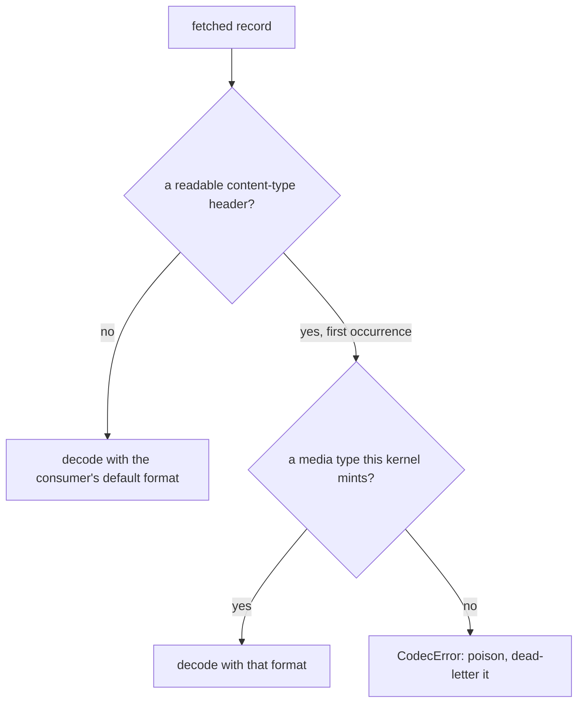
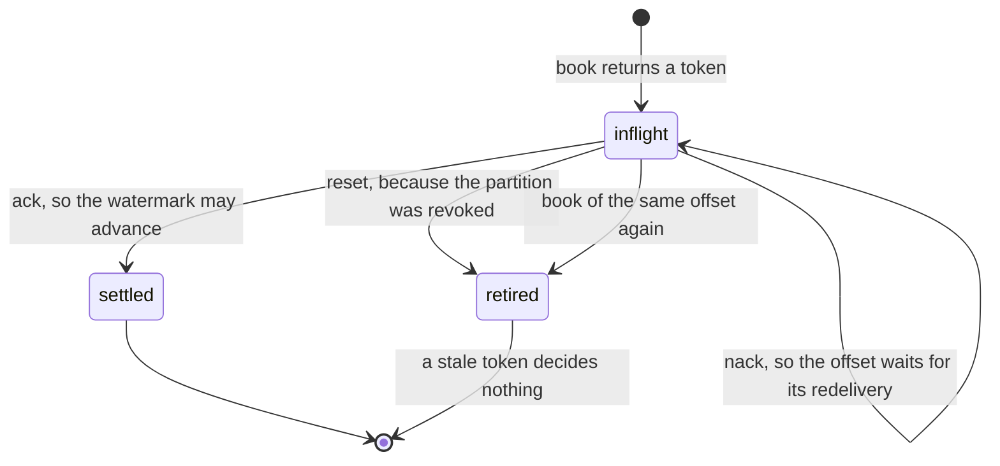

# The Kafka kernel — `edax-kafka`

The Kafka protocol kernel: the record a published envelope becomes, and the offset watermark a
consumer commits.

`edax-kafka` is pure and synchronous. It links no Kafka client library at all. Every software
development kit (SDK) ships its own input and output (I/O) shell over it, `aiokafka` in Python and
`rdkafka` in a Rust host. A topic therefore reads the same whatever language wrote it, and a
consumer commits the same offsets whatever language runs it.

| Module | Owns | Golden vector |
|---|---|---|
| `record` | the key rule, the four contract headers, the media types, the poison id | `kafka_record.json`, `kafka_decode.json` |
| `offsets` | the per-partition commit watermark, settled by token | `kafka_offsets.json` |

Placement is not here. The client's partitioner still picks the partition from the key.

## `record` — what a published envelope becomes

A record has three parts: a key, value bytes, and headers. The kernel owns the key and the headers.
Who owns the value depends on which of the two layers you call.

| Layer | Functions | Value bytes | Used by |
|---|---|---|---|
| primitive | `record`, `content_type` | the caller's, with the caller's media type | an SDK whose host supplied a serializer |
| composed | `encode_record`, `decode_record` | the kernel codec's, through `Format::encode` | a Rust host, and the golden vectors |

Both layers write the same key and the same four headers. That is the point of the split: a host
serializer changes the bytes, never the contract around them.

### The key

The key is the aggregate id, or the override the caller passes. It crosses as UTF-8 bytes.

Kafka orders within a partition, and the key chooses the partition. One aggregate's events therefore
stay on one partition and arrive in the order they were published. Override the key only when your
partitioning differs, a tenant id for instance. Per-aggregate order then holds only while that key
is still a function of the aggregate id.

### The four headers

Every record carries exactly these, in this order.

| Header | Value | A reader uses it to |
|---|---|---|
| `content-type` | the media type of the value bytes | pick the serializer that decodes the value |
| `edax-id` | the envelope id, for example `evt-1` | dedup or trace without decoding the value |
| `edax-event` | the event name, for example `InvoiceIssued` | filter or route without decoding the value |
| `edax-event-version` | the event version as ASCII decimal, for example `1` | plan an upcast without decoding the value |

Three things are deliberately absent. The aggregate id is the key already. The sequence is in the
value. No metadata is copied, because trace propagation is the host's own `traceparent`. Every
header costs bytes on every record, so a new one lands only together with a reader for it.

The version is text rather than a binary integer because header values have no shared integer
encoding across clients. The header name is lower case, the Kafka convention, and the lookup is
case-sensitive. A producer that wrote `Content-Type` wrote a different header.

### The two media types

| `Format` | Media type |
|---|---|
| `Json` | `application/vnd.edax.envelope+json` |
| `Msgpack` | `application/vnd.edax.envelope+msgpack` |

Two words that are not synonyms. `content-type` is the *header*; its value is a *media type*
(RFC 6838, once called a MIME type), optionally followed by parameters such as `; charset=utf-8`.
Kernel functions that read or write the header say `content_type`; the one that mints the string
says `media_type`. The kernel returns the header value whole and matches it as one exact string, so
a header carrying parameters does not match; no edax producer writes any.

What the string means, part by part:

| Part | Meaning |
|---|---|
| `application/` | the top-level type for opaque, program-consumed data |
| `vnd.` | the vendor tree (RFC 6838 §3.2): a product-specific format. Subtypes with no prefix are IANA standards such as `application/json`; `x-` is the deprecated unregistered prefix. Registering with IANA is optional in the vendor tree and has not been done |
| `edax.envelope` | the vendor and the format: an event envelope as `edax-event` encodes it |
| `+json`, `+msgpack` | the structured-syntax suffix (RFC 6839): tooling that never heard of edax still knows how to parse the bytes |

Plain `application/json` is not used. It could not tell an edax envelope from any other JSON on a
shared topic, and the consumer's registry needs one exact string per serializer. A custom serializer
follows the same shape: `application/vnd.<vendor>.<format>+<syntax>`.

`media_type(format)` is the one place that mapping lives, so it cannot be read here and written
differently there. `Format` is `#[non_exhaustive]`. A variant this kernel does not know is a codec
error, never a fallback, so a record can never carry a header naming the wrong codec. The change
that adds a variant mints its media type here.

### Decoding: which format the record names

Three rules, and each closes a specific hole.

- **The first `content-type` wins.** A record carrying two is ambiguous. Picking the first is the
  rule both sides implement identically. A first value that is not UTF-8 reads as absent, and does
  not reach past itself to a second header.
- **An unknown media type is refused.** A producer rollout the consumer cannot read becomes one
  poison message, rather than a stream of envelopes decoded with the wrong codec.
- **No readable content type falls back to the default.** A header-less record still decodes,
  whether written before this kernel or by a client that drops headers.

`testdata/golden/kafka_decode.json` pins all four branches, including a msgpack value under a JSON
default.

### `poison_id` — naming a message that did not decode

`poison_id(topic, partition, offset)` returns `"{topic}/{partition}/{offset}"`.

A message that did not decode has no envelope, and therefore no id. Those three coordinates are the
only identity it has. The offset alone repeats on every partition, so two poison messages would
share one id and a dead-letter queue keyed on it would keep the first and reject the second.

### Reserved: explicit partitioning

`KafkaRecord` names a future `partition: Option<u32>` field, filled from
`edax_event::partition(aggregate_id, n)` when a shell passes a partition count. It is **not built**.
The module documentation reserves it so a later change has one obvious home. Today the client's
partitioner places the record by key, which already keeps one aggregate's events on one partition
and in order.

## `offsets` — the token-settled commit watermark

`KeyOrderedDispatcher` acks in worker order, not in fetch order. A bare commit would therefore skip
past an offset still in flight and lose it on restart. `OffsetTracker` answers with a watermark
instead: the lowest offset still in flight, or one past the highest delivered when none remain.

| Call | Returns | Rule |
|---|---|---|
| `book(topic, partition, offset)` | a token | monotonic, starting at 1; booking an offset already in flight retires the old token |
| `ack(token)` | `{commit, offset}` | `offset` is the watermark; `commit` is true only when it is above the last committed one |
| `committed(topic, partition, offset)` | nothing | the shell reports a commit the client confirmed; max-merge; a no-op for an unknown partition |
| `nack(token)` | `{seek, offset}` | `offset` is the lowest offset in flight, and the delivery stays in flight |
| `reset(topic, partition)` | nothing | drops a revoked partition's bookkeeping and retires its tokens |
| `stats()` | one row per partition | `{topic, partition, unsettled, max_delivered, committed}`, ordered by topic then partition |

Two sentinel values. `NO_DELIVERY` is `0`, the token no booking ever carries, so a host's "no
delivery" placeholder cannot alias a live one. `-1` is the offset that names no position: nothing
delivered yet, nothing committed yet, or a decision no state backs.

### Settlement is by token

A token names one delivery for the tracker's whole life. Keying settlement on `(partition, offset)`
instead leaves a hole a rebalance opens. Revoke a partition, reset it, get it assigned back, then
re-book offset 5. The pre-revoke ack for 5 would discard that fresh booking. A stale token settles
nothing, so that ack returns `{commit: false, offset: -1}` and the new booking survives.
`testdata/golden/kafka_offsets.json` pins that scenario, and the one where a redelivery re-books an
offset and the first token goes stale.

### Why `ack` and `committed` are two steps

Settlement is data, not a callback. `ack` and `nack` return the decision, and the I/O shell performs
it. The shell then reports the outcome back with `committed`, and only once the client's commit
returned.

That keeps a failed client commit out of the record. If `ack` recorded the watermark itself, a
commit that raised would still count as committed. The tracker would then refuse the next, correct
commit at that offset, because the guard only commits a watermark above the recorded one. Recording
after the fact also makes the guard monotonic under out-of-order commits: `committed` max-merges, so
two confirmations that returned out of order leave the higher watermark recorded.

### Why `nack` seeks the lowest offset

`seek` sets the partition's single fetch position. Nacking 5 and then 7 with each offset as its own
target would move the position to 7, and 5 would never come back. The kernel answers with the lowest
offset in flight instead. Re-reading acked offsets above it is at-least-once, not loss. The nacked
offset also stays in flight until its redelivered copy settles, so a later ack cannot commit past
it.

## The golden vectors

| File | Case shape | What it pins |
|---|---|---|
| `kafka_record.json` | `name`, `format`, `envelope`, `key`, `key_hex`, `value_hex`, `headers` | eight records: both formats, an overridden key against the default, an unsequenced envelope with an empty payload, and unicode |
| `kafka_decode.json` | `name`, `default_format`, `value_hex`, `headers`, `want` | five decodes: no content type, an overriding one, an unknown one, two content types, and header-less bytes in the other format |
| `kafka_offsets.json` | `name`, `steps` with an `op` and a `want` each | eight scenarios replayed step by step, each ending in the `stats` it left |

A step's `op` is one of `book`, `ack`, `committed`, `nack`, `reset` and `stats`. `book` wants a
token, `ack` wants `{commit, offset}`, `nack` wants `{seek, offset}`, and `stats` wants the rows. One
replay therefore covers both the decisions and the state they left behind.

Regenerate with `EDAX_REGEN=1 mise exec -- cargo test -p edax-kafka --test golden`, and read the
diff before committing it.

## How each SDK reaches it

| | Rust | Python |
|---|---|---|
| record | `edax_kafka::encode_record` / `decode_record` | `_edax.kafka_record`, `_edax.kafka_content_type`, `_edax.decode_kafka_record` |
| media type | `edax_kafka::media_type` | `_edax.kafka_media_type`, behind `KernelSerializer.content_type` |
| poison id | `edax_kafka::poison_id` | `_edax.kafka_poison_id` |
| offsets | `edax_kafka::OffsetTracker` | `_edax.offset_tracker()` |

The Rust SDK ships the kernel and no client shell. The Kafka adapter lives in the Python SDK:
`KafkaProducer` and `KafkaConsumer` in `edax.backend.kafka` call the client and these functions, and
decide nothing themselves. Read [backends/kafka.md](../backends/kafka.md) for the adapter's side.

## See also

- [backends/kafka.md](../backends/kafka.md) — the adapter: the client calls, the serializer
  registry, record middleware, and what is left to the host.
- [kernels/event.md](./event.md) — the envelope shape and the codec whose bytes a record carries.
- [kernels/golden-vectors.md](./golden-vectors.md) — how the three vectors here are generated and
  asserted.
- [sdk/consuming.md](../sdk/consuming.md) — `KeyOrderedDispatcher`, the reason acks arrive out of
  order.
- [guides/delivery-guarantees.md](../guides/delivery-guarantees.md) — what the watermark buys end to
  end.
