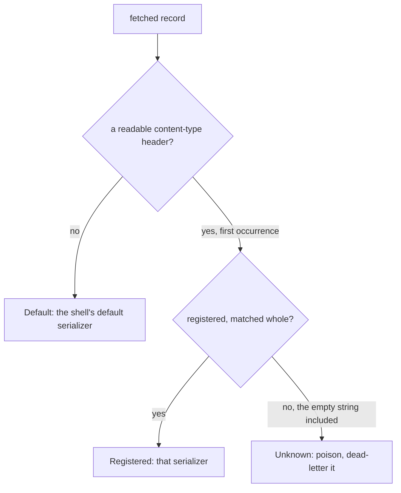
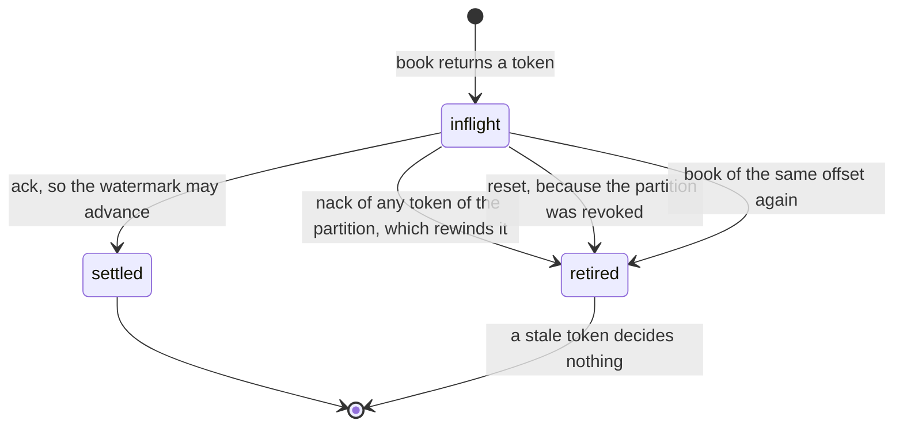

# The Kafka kernel — `edax-kafka`

The Kafka protocol kernel: the record a published envelope becomes, the route a fetched record
takes, the record a dead-letter sink publishes, and the offset watermark a consumer commits.

`edax-kafka` is pure and synchronous. It links no Kafka client library at all. Every software
development kit (SDK) ships its own input and output (I/O) shell over it, `aiokafka` in Python and
`rdkafka` in a Rust host. A topic therefore reads the same whatever language wrote it, and a
consumer commits the same offsets whatever language runs it.

| Module | Owns | Golden vector |
|---|---|---|
| `record` | the key rule, the `content-type` header, the media types, the route by it, the poison id, the dead-letter record | `kafka_record.json`, `kafka_decode.json`, `kafka_route.json`, `kafka_dead_letter.json` |
| `partition` | broker placement: the partition a keyed record lands on | `kafka_partition.json` |
| `offsets` | the per-partition commit watermark, settled by token, the rewind a nack makes, and what is due | `kafka_offsets.json` |

## `record` — what a published envelope becomes

A record has three parts: a key, value bytes, and headers. The kernel owns the key and the headers.
Who owns the value depends on which of the two layers you call.

| Layer | Functions | Value bytes | Used by |
|---|---|---|---|
| primitive | `record`, `content_type` | the caller's, with the caller's media type | an SDK whose host supplied a serializer |
| composed | `encode_record`, `decode_record` | the kernel codec's, through `Format::encode` | a Rust host, and the golden vectors |

Both layers write the same key and the same header. That is the point of the split: a host
serializer changes the bytes, never the contract around them.

### The key

The key is the aggregate id, or the override the caller passes. It crosses as UTF-8 bytes.

Kafka orders within a partition, and the key chooses the partition through `partition_for` below.
One aggregate's events therefore stay on one partition and arrive in the order they were published.
Override the key only when your partitioning differs, a tenant id for instance. Per-aggregate order
then holds only while that key is still a function of the aggregate id.

### The one header

Every record edax writes carries exactly one header.

| Header | Value | A reader uses it to |
|---|---|---|
| `content-type` | the media type of the value bytes | pick the serializer that decodes the value |

Everything else is deliberately absent. The aggregate id is the key already. The id, the event name,
the version and the sequence are in the value, which every reader decodes anyway. No metadata is
copied, because trace propagation is the host's own `traceparent`. Every header costs bytes on every
record, so a header lands only together with a reader for it. Three earlier headers (`edax-id`,
`edax-event`, `edax-event-version`) had no reader and were dropped. A record from an older producer
still carries them, and decodes the same: a reader ignores headers it does not know.

Kafka allows a null key, value or header value; the kernel record has none. A shell crosses each
null as empty bytes. One rule covers all three. A null `content-type` therefore routes like an empty
one, as poison. A keyless tombstone from a foreign producer dead-letters with an empty key and value.

The header name is lower case, the Kafka convention, and the lookup is case-sensitive. A producer
that wrote `Content-Type` wrote a different header. The ABI exports the name
(`kafka_content_type_header()`, Python `edax.backend.kafka.CONTENT_TYPE`), so a record middleware
that rewrites the value rewrites the header by the kernel's name instead of restating it.

### The two media types

| `Format` | Media type |
|---|---|
| `Json` | `application/vnd.edax.envelope+json` |
| `Msgpack` | `application/vnd.edax.envelope+msgpack` |

Two words that are not synonyms. `content-type` is the *header*; its value is a *media type*
(RFC 6838, once called a MIME type), optionally followed by parameters such as `; charset=utf-8`.
Kernel functions that read or write the header say `content_type`; the one that mints the string
says `media_type`. The kernel returns the header value whole and matches it as one exact string, so
a header carrying parameters does not match; no edax producer writes any.

What the string means, part by part:

| Part | Meaning |
|---|---|
| `application/` | the top-level type for opaque, program-consumed data |
| `vnd.` | the vendor tree (RFC 6838 §3.2): a product-specific format. Subtypes with no prefix are IANA standards such as `application/json`; `x-` is the deprecated unregistered prefix. Registering with IANA is optional in the vendor tree and has not been done |
| `edax.envelope` | the vendor and the format: an event envelope as `edax-event` encodes it |
| `+json`, `+msgpack` | the structured-syntax suffix (RFC 6839): tooling that never heard of edax still knows how to parse the bytes |

Plain `application/json` is not used. It could not tell an edax envelope from any other JSON on a
shared topic, and the consumer's registry needs one exact string per serializer. A custom serializer
follows the same shape: `application/vnd.<vendor>.<format>+<syntax>`.

`edax_event::Format::media_type` is the one place that mapping lives, so it cannot be read here and
written differently there. It sits with the codec, not with this kernel, because it names the
*format* and not the transport. A media type is the same string over Kafka, over HTTP, or in a file.
The change that adds a `Format` variant mints its media type in the same edit.
`Format::from_media_type` refuses a media type edax never mints — a codec error, never a fallback,
so a record can never decode as the wrong codec.

### `route`: which serializer the record names

`route(headers, registered)` answers `Default`, `Registered(index)` or `Unknown(media_type)` against
the media types the shell registered, in its order. Every shell calls it, so two SDKs send one
record to the same serializer, or both to the dead-letter sink. `decode_record` is `route` over the
formats this kernel mints. The ABI flattens it to `KafkaRoute { registered, unknown }`; neither set
means the default.



Three rules, and each closes a specific hole.

- **The first `content-type` wins.** A record carrying two is ambiguous. Picking the first is the
  rule both sides implement identically. A first value that is not UTF-8 reads as absent, and does
  not reach past itself to a second header.
- **An unknown media type is refused.** A producer rollout the consumer cannot read becomes one
  poison message, rather than a stream of envelopes decoded with the wrong codec. An empty value is
  a media type too, one nobody registers, and so is a value with parameters.
- **No readable content type falls back to the default.** A header-less record still decodes,
  whether written before this kernel or by a client that drops headers.

`testdata/golden/kafka_route.json` pins the rule against a registry in eleven rows. They cover no
header, a foreign header only, a kernel and a host media type, an unknown one, and an empty registry.
They also cover an empty value, an upper-case name, two headers, a non-UTF-8 first value, and
parameters.
`testdata/golden/kafka_decode.json` pins the composed decode, including a msgpack value under a JSON
default, an empty value, an upper-case name, a non-UTF-8 first value and a parameterized type.

### `poison_id` — naming a message that did not decode

`poison_id(topic, partition, offset)` returns `"{topic}/{partition}/{offset}"`.

A message that did not decode has no envelope, and therefore no id. Those three coordinates are the
only identity it has. The offset alone repeats on every partition, so two poison messages would
share one id and a dead-letter queue keyed on it would keep the first and reject the second.

### `dead_letter_record` — what a dead-letter sink publishes

`dead_letter_record(record, topic, partition, offset, error)` keeps the fetched record's key, value
and headers verbatim, and appends four headers: `edax-dlq-topic`, `edax-dlq-partition`,
`edax-dlq-offset` (both decimal) and `edax-dlq-error`. A republish to the source topic after the fix
then routes and decodes as the original did: the content type, a middleware's key id and a
`traceparent` all survive. `dead_letter_source(headers)` is the reader. It takes the last set, the
most recent dead-lettering, and answers nothing when a coordinate is missing or unreadable.
`testdata/golden/kafka_dead_letter.json` pins both, a record dead-lettered twice included.

## `partition` — broker placement

Every producer on a topic must place one key on one partition, or two producers split an aggregate
across partitions and its order is lost. The producers on an edax topic are not all edax, and their
client libraries disagree. Java, Kafka Connect, Kafka Streams and aiokafka place a keyed record with
Java's murmur2 partitioner. librdkafka (`rdkafka`, `confluent-kafka`) defaults to CRC32. So the
kernel fixes Java's rule. Every edax shell passes the partition it names explicitly, instead of
leaving placement to its client library:

```
partition_for(key, partitions) = (murmur2(key) & 0x7fffffff) % partitions
```

`murmur2` is Kafka's `Utils.murmur2`: seed `0x9747b28c`, little-endian 4-byte blocks, a tail that
falls through. The mask is `Utils.toPositive`. It is a mask, not `abs`, so a port that negates a
negative hash lands elsewhere. The key is the record's final key bytes, after every
middleware ran: the bytes the broker stores. `partitions` is the topic's count from the client's
metadata; `0` is a `codec` error, never a division by zero.

`edax_event::partition` is a different function for a different job: the local worker a dispatcher
runs an aggregate on. It must never pick a broker partition, because FNV-1a disagrees with every
non-edax producer.

`testdata/golden/kafka_partition.json` pins eleven keys at five partition counts. Six keys are
Kafka's own `UtilsTest.testMurmur2` vectors (`clients/src/test/java/org/apache/kafka/common/utils/
UtilsTest.java`), carried as the Java `int` they assert, so a port is checked against Java and not
only against this kernel. The rest pin an empty key, NFC and NFD spellings of one name, and bytes
above `0x7f`.

## `offsets` — the token-settled commit watermark

`KeyOrderedDispatcher` acks in worker order, not in fetch order. A bare commit would therefore skip
past an offset still in flight and lose it on restart. `OffsetTracker` answers with a watermark
instead: the lowest offset still in flight, or one past the highest delivered when none remain.

| Call | Returns | Rule |
|---|---|---|
| `book(topic, partition, offset)` | a token | monotonic, starting at 1; booking an offset already in flight retires the old token; a negative offset is a `codec` error |
| `is_live(token)` | bool | whether the token still settles its delivery; a dispatcher skips a delivery that is not live |
| `ack(token)` | `AckDecision` | `Settled`, or `Stale` for a token that settles nothing |
| `due()` | one row per partition | `{topic, partition, offset}` for every watermark above both the last commit and the first offset booked, ordered by topic then partition |
| `committed(topic, partition, offset)` | nothing | the shell reports a commit the client confirmed; max-merge; a no-op for an unknown partition |
| `nack(token)` | `NackDecision` | `Seek(offset)` to the lowest offset in flight, retiring every token of the partition; `Stale` for a token that settles nothing |
| `reset(topic, partition)` | nothing | drops a revoked partition's bookkeeping and retires its tokens |
| `stats()` | one row per partition | `{topic, partition, unsettled, live, max_delivered, committed}`, ordered by topic then partition; `committed` is `None` before the first commit |

The decisions are exhaustive enums and `#[must_use]`, so a new outcome is a compile error in every
shell and a dropped decision is a warning. The ABI flattens them without a sentinel: `ack` answers
a bool and `NackDecision { seek: Option<i64> }`. One sentinel value remains, `NO_TOKEN`
(`edax_core::NO_TOKEN`), `0`, the token no booking ever carries, so a host's "no delivery"
placeholder cannot alias a live one.

### Settlement is by token



A token names one delivery for the tracker's whole life. Keying settlement on `(partition, offset)`
instead leaves a hole a rebalance opens. Revoke a partition, reset it, get it assigned back, then
re-book offset 5. The pre-revoke ack for 5 would discard that fresh booking. A stale token settles
nothing, so that ack returns `Stale` and the new booking survives.
`testdata/golden/kafka_offsets.json` pins that scenario, and the one where a redelivery re-books an
offset and the first token goes stale.

### Why `ack`, `due` and `committed` are three steps

Settlement is data, not a callback. `ack` only settles, so a worker never waits on a commit round
trip. A shell commits what `due` names, all partitions in one call, on its own schedule and under its
own deadline. It then reports each commit back with `committed`, and only once the client's commit
returned.

That keeps a failed client commit out of the record: a commit that raised is simply due again. If the
tracker recorded the watermark itself, the commit that raised would count as committed, and the
next, correct commit at that offset would be refused. Recording after the fact also keeps the record
monotonic under out-of-order commits: `committed` max-merges, so two confirmations that returned out
of order leave the higher watermark recorded.

`due` also skips a watermark no higher than the first offset booked. A fresh tracker does not know the
group's commit after a restart or a rebalance. But it fetched from there, so committing it again
would be a round trip for nothing.

### Why `nack` seeks the lowest offset and rewinds the partition

`seek` sets the partition's single fetch position. Nacking 5 and then 7 with each offset as its own
target would move the position to 7, and 5 would never come back. The kernel answers with the lowest
offset in flight instead. Re-reading acked offsets above it is at-least-once, not loss. The nacked
offset also stays in flight until its redelivered copy settles, so no commit passes it.

The seek brings back every offset from the target on, so the copies already fetched are dead weight.
Running one would apply a later event of a key before the redelivered earlier one, and a staleness
guard (`is_stale`) would then skip the earlier one for good. So the nack retires every token of the
partition, and the dispatcher skips a delivery that is not `is_live`. Only a handler already running
finishes stale. This assumes what a Kafka client does. The shell books each fetched record before it
fetches the next, and a seek drops the records the client had buffered for that partition.

Compaction may remove a retired offset before the fetch comes back. Such an offset pins the
watermark until a rebalance or a restart resets the partition.

## The golden vectors

| File | Case shape | What it pins |
|---|---|---|
| `kafka_record.json` | `name`, `format`, `envelope`, `key`, `key_hex`, `value_hex`, `headers` | eight records: both formats, an overridden key against the default, an unsequenced envelope with an empty payload, and unicode |
| `kafka_partition.json` | `name`, `key_hex`, `java_murmur2`, `partitions`, `expected`, `error` | eleven keys at 1, 3, 12, 100 and 2^31 − 1 partitions, six of them Kafka's own Java vectors, plus `0` partitions refused |
| `kafka_decode.json` | `name`, `default_format`, `value_hex`, `headers`, `want` | nine decodes: no content type, an overriding one, an unknown one, two content types, header-less bytes in the other format, an empty value, an upper-case name, a non-UTF-8 first value, a parameterized type |
| `kafka_route.json` | `name`, `headers`, `registered`, `want` | eleven routes against a host's registry |
| `kafka_dead_letter.json` | `name`, `record`, coordinates, `error`, `want`; or `name`, `headers`, `want` | five dead-letter records and their source, then seven header sets the reader refuses |
| `kafka_offsets.json` | `name`, `steps` with an `op` and a `want` each | fourteen scenarios replayed step by step, each ending in the `stats` it left |

A step's `op` is one of `book`, `ack`, `nack`, `is_live`, `due`, `committed`, `reset` and `stats`.
`book` wants a token or an error; `ack` wants `{decision: "settled"}` or `{decision: "stale"}`;
`nack` wants `{decision: "seek", offset}` or `{decision: "stale"}`; `is_live` wants `{live}`; `due`
and `stats` want rows. One replay therefore covers both the decisions and the state they left
behind. The scenarios include the rewind, a re-booking of acked offsets after a seek, an offset gap,
the `i64` ceiling, a negative offset, and topics in byte order.

Regenerate with `EDAX_REGEN=1 mise exec -- cargo test -p edax-kafka --test golden`, and read the
diff before committing it.

## How each SDK reaches it

| | Rust | Python |
|---|---|---|
| record | `edax_kafka::encode_record` / `decode_record` | `_edax.kafka_record`, `_edax.kafka_content_type_header` |
| route | `edax_kafka::route` | `_edax.kafka_route`, which `KafkaConsumer` calls on every record |
| dead letter | `edax_kafka::dead_letter_record` / `dead_letter_source` | `_edax.kafka_dead_letter_record`, `_edax.kafka_dead_letter_source`, behind `KafkaFetched.dead_letter` |
| placement | `edax_kafka::partition_for` | `_edax.kafka_partition_for`, which `KafkaProducer` passes as `partition=` |
| media type | `edax_event::Format::media_type` | `_edax.media_type`, behind `KernelSerializer.media_type` |
| poison id | `edax_kafka::poison_id` | `_edax.kafka_poison_id` |
| offsets | `edax_kafka::OffsetTracker` | `_edax.offset_tracker()` |

The Rust SDK ships the kernel and no client shell. The Kafka adapter lives in the Python SDK:
`KafkaProducer` and `KafkaConsumer` in `edax.backend.kafka` call the client and these functions, and
decide nothing themselves. Read [backends/kafka.md](../backends/kafka.md) for the adapter's side.

## See also

- [backends/kafka.md](../backends/kafka.md) — the adapter: the client calls, the serializer
  registry, record middleware, and what is left to the host.
- [kernels/event.md](./event.md) — the envelope shape and the codec whose bytes a record carries.
- [kernels/golden-vectors.md](./golden-vectors.md) — how the six vectors here are generated and
  asserted.
- [sdk/consuming.md](../sdk/consuming.md) — `KeyOrderedDispatcher`, the reason acks arrive out of
  order.
- [guides/delivery-guarantees.md](../guides/delivery-guarantees.md) — what the watermark buys end to
  end.
