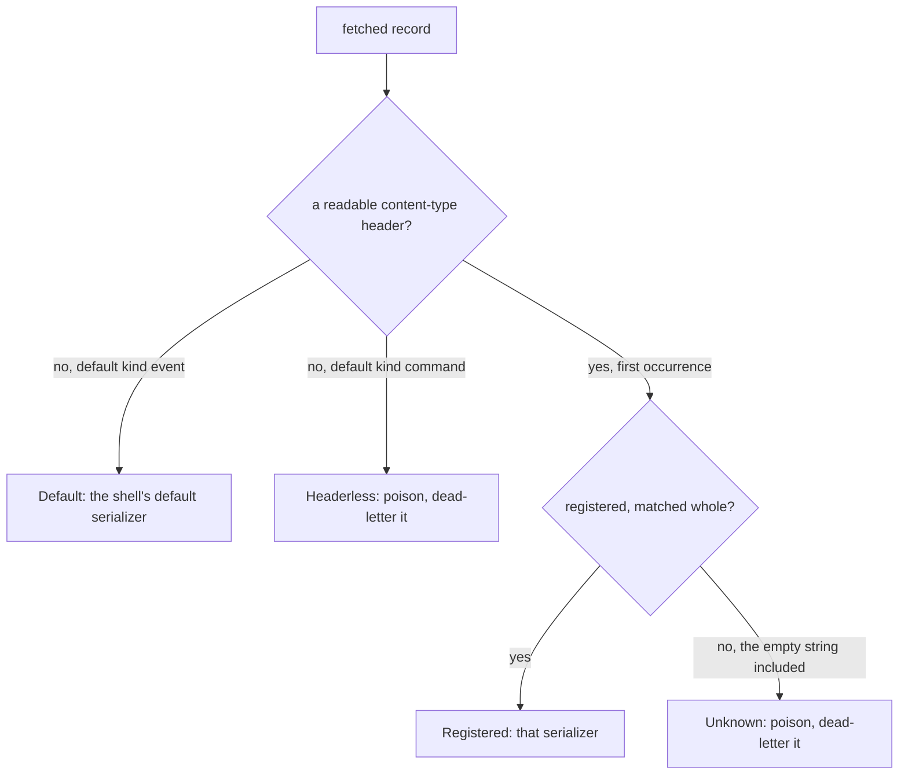
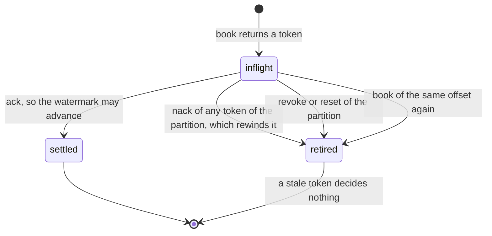

# The Kafka kernel — `edax-kafka`

The Kafka protocol kernel: the record a published message becomes, the route a fetched record
takes, the record a dead-letter sink publishes, and the offset watermark a consumer commits. It also
says what a shell's client settings and broker errors mean.

`edax-kafka` is pure and synchronous. It links no Kafka client library. Every software
development kit (SDK) ships its own input and output (I/O) shell over it, `aiokafka` in Python and
`rdkafka` in a Rust host. A topic therefore reads the same whatever language wrote it, and a
consumer commits the same offsets whatever language runs it.

| Module | Owns | Golden vector |
|---|---|---|
| `record` | the key rule, the `content-type` header, the media types, the route by it, the poison id, the dead-letter record and its stub, ingestion raw encoding, stable source digest and rejection provenance | `kafka_record.json`, `kafka_decode.json`, `kafka_route.json`, `kafka_dead_letter.json`, `kafka_ingestion_raw.json` |
| `client` | the durations a shell refuses at build, and the verdict on a broker's protocol error code | `kafka_config.json`, `kafka_error.json` |
| `partition` | broker placement: the partition a keyed record lands on | `kafka_partition.json` |
| `offsets` | the per-partition commit watermark, settled by token, the rewind a nack makes, and what is due | `kafka_offsets.json` |

## `record` — what a published message becomes

A record has three parts: a key, value bytes, and headers. The kernel owns the key and the headers.
The serializer owns the value: the kernel codec (`Format::encode`, behind `KernelSerializer`) or a
host's own. `record(msg, tenancy, key, value, content_type)` builds the record around the value bytes
and the media type that names them, one generic function for both kinds of message. `record_key` is
its key rule alone.

`record` takes the deployment's `Tenancy` and is fallible: a mode that requires a tenant and a message
that names none is a `codec` error. A producer then never publishes a record every consumer would
refuse. A host serializer changes the bytes and never the contract around them.

### The key

The key is the override the caller passes, verbatim, or else `record_key(tenancy, msg)`. That is the
message's [ordering key](./event.md#the-ordering-key), composed with its tenant where the mode
composes keys: `4:acme:agg-1` under `Tenancy::Pool`. It crosses as UTF-8 bytes. A
command and the events of the aggregate it targets then share a partition, and two tenants'
same-named aggregates do not. The rule is the kernel's and `kafka_record.json` pins it per mode, so
two SDKs producing to one topic place one aggregate on one partition.

Kafka orders within a partition, and the key chooses the partition through `partition_for` below.
One aggregate's messages therefore stay on one partition and arrive in the order they were
published.
Override the key only when your partitioning differs, a tenant id for instance. Per-aggregate order
then holds only while that key is still a function of the aggregate id.

### The one header

Every record edax writes carries exactly one header.

| Header | Value | A reader uses it to |
|---|---|---|
| `content-type` | the media type of the value bytes | pick the serializer that decodes the value |

Everything else is deliberately absent. The aggregate id is the key already. The id, the name, the
version and the sequence are in the value, which every reader decodes anyway. No extension or
metadata entry is copied, and trace propagation needs no header: `traceparent` rides in the
message's `extensions`. The kind needs no header either, because the media type names it. Every header costs bytes on every
record, so a header lands only together with a reader for it. An older producer may still write
`edax-id`, `edax-event` and `edax-event-version`. Nothing reads them, and the record decodes the
same, because a reader ignores headers it does not know.

Kafka allows a null key, value or header value; the kernel record has none. A shell crosses each
null as empty bytes. One rule covers all three. A null `content-type` therefore routes like an empty
one, as poison. A keyless tombstone from a foreign producer dead-letters with an empty key and value.

The header name is lower case, the Kafka convention, and the lookup is case-sensitive. A producer
that wrote `Content-Type` wrote a different header. The ABI exports the name
(`kafka_content_type_header()`, Python `edax.backend.kafka.CONTENT_TYPE`), so a record middleware
that rewrites the value rewrites the header by the kernel's name instead of restating it.

### The four media types

The codec mints one media type per format and kind.
[edax-event](./event.md#codec--reproducible-message-bytes) lists the four.

Two words that are not synonyms. `content-type` is the *header*; its value is a *media type*
(RFC 6838, once called a MIME type), optionally followed by parameters such as `; charset=utf-8`.
Kernel functions that read or write the header say `content_type`; the one that mints the string
says `media_type`. The kernel returns the header value whole and matches it as one exact string, so
a header carrying parameters does not match; no edax producer writes any.

What the string means, part by part:

| Part | Meaning |
|---|---|
| `application/` | the top-level type for opaque, program-consumed data |
| `vnd.` | the vendor tree (RFC 6838 §3.2): a product-specific format. Subtypes with no prefix are IANA standards such as `application/json`; `x-` is the deprecated unregistered prefix. Registering with IANA is optional in the vendor tree and has not been done |
| `edax.event`, `edax.command` | the vendor and the kind: a message of that kind as `edax-event` encodes it |
| `+json`, `+msgpack` | the structured-syntax suffix (RFC 6839): tooling that never heard of edax still knows how to parse the bytes |

Plain `application/json` is not used. It could not tell an edax message from any other JSON on a
shared topic, and the consumer's registry needs one exact string per serializer. A custom serializer
follows the same shape: `application/vnd.<vendor>.<format>+<syntax>`.

`edax_event::Format::media_type(kind)` is the one place that mapping lives, so it cannot be read
here and written differently there. It sits with the codec, not with this kernel, because it names
the *format and kind*, not the transport. A media type is the same string over Kafka, over HTTP, or in a file.
The change that adds a `Format` variant mints its media type in the same edit.
`Format::from_media_type` refuses a media type edax never mints — a codec error, never a fallback,
so a record can never decode as the wrong codec. The 0.1 media type
`application/vnd.edax.envelope+json` is one of those now.

### `route`: which serializer the record names

`route(headers, registered, default_kind)` answers `Default`, `Headerless`, `Registered(index)` or
`Unknown(media_type)` against the media types the shell registered, in its order. `default_kind` is
the kind the shell's default serializer reads. Every shell calls it, so two SDKs send one record to
the same serializer, or both to the dead-letter sink. It is the kernel's only consume-side rule: the
serializer the route picks decodes the bytes, and a decode that fails is poison too. A media type
names a format and a kind, so a shell registers one serializer per kind it reads, and one registry
may hold both kinds. The ABI flattens it to `KafkaRoute { registered, unknown, headerless }`; none set
means the default.



Four rules decide the route.

- **The first `content-type` wins.** A record carrying two is ambiguous. Picking the first is the
  rule both sides implement identically. A first value that is not UTF-8 reads as absent, and does
  not reach past itself to a second header.
- **An unknown media type is refused.** A producer rollout the consumer cannot read becomes one
  poison message, rather than a stream of messages decoded with the wrong codec. An empty value is
  a media type too, one nobody registers, and so is a value with parameters.
- **No readable content type falls back to the default, as an event.** A header-less record still
  decodes, from an older producer or from a client that drops headers. Every such record
  is an event. A command always carries the header. So under a command default the route is
  `Headerless`, which the shell treats as poison rather than guess.
- **The registry decides the kind.** A consumer of events registers event media types only, so a
  command record on its topic is `Unknown` and poison, and the reverse too.

A registry that names one media type twice is refused (`check_media_types`, an `already_registered`
error), because it would decode one topic two ways. A shell checks its registry once, when it is
built.

`testdata/golden/kafka_route.json` pins the route against a registry and a default kind.
`testdata/golden/kafka_decode.json` pins what a consumer makes of a fetched record. Each row names the
registry a consumer is built with, kernel serializers only and the default first. It then names the
message the picked serializer decodes, or why the record is poison.

### `poison_id` — naming a message that did not decode

`poison_id(topic, partition, offset)` returns `"{topic}/{partition}/{offset}"`.

A message that did not decode has no id: the id is inside the bytes that failed. Those three coordinates are the
only identity it has. The offset alone repeats on every partition, so two poison messages would
share one id and a dead-letter queue keyed on it would keep the first and reject the second.

### `dead_letter_record` — what a dead-letter sink publishes

`dead_letter_record(record, topic, partition, offset, code, message)` keeps the fetched record's key
and value. It removes every prior `edax-dlq-error` header, retains the other headers, and appends
`edax-dlq-topic`, `edax-dlq-partition`, `edax-dlq-offset` (the latter two in decimal) and
`edax-dlq-error`. The error header contains only the taxonomy code, such as `codec`, or
`unclassified` when no code is available. The compatibility `message` argument is never persisted;
exception text can contain opened payload data. A repeated dead letter retains earlier coordinate
headers but has only the current code-only error header. A republish to the source topic after the fix
then routes and decodes as the original did: the content type, a middleware's key id and a
`traceparent` all survive. `dead_letter_source(headers)` is the reader. It takes the last set, the
most recent coordinates, and answers nothing when a coordinate is missing or unreadable. A present
`edax-dlq-dropped` that is not UTF-8 counts as unreadable, not missing.

A dead-letter topic may refuse the record itself: the original plus four headers can pass the
broker's size limit. `dead_letter_stub(dead)` drops the value, keeps the key and every header, and
appends `edax-dlq-dropped` with the count of dropped bytes. A sink sends the stub once the broker
refused the full record as a `codec` error. The coordinates are the pointer to the value, which the
source topic holds until its retention passes. Without the stub, the sink would raise on every try and
the partition would rewind to the record forever. `testdata/golden/kafka_dead_letter.json` pins the
record, the stub and the reader.

## `client` — settings and broker errors

`check_config(publish_timeout_ms, commit_interval_ms, commit_timeout_ms, drain_timeout_ms)` refuses a
duration below one millisecond as a `bad_handle` error naming it. `None` is a setting the call site
does not take. A shell calls it when it is built, so a misconfigured consumer fails at startup:

| Setting | At zero or below |
|---|---|
| `publish_timeout_ms` | every send times out |
| `commit_interval_ms` | the commit loop sleeps for nothing and spins |
| `commit_timeout_ms` | no commit ever lands |
| `drain_timeout_ms` | a revoke hands a running key to the new owner at once |

`check_consumer(auto_commit, has_group)` guards the consumer client. It refuses one that loses or
never commits offsets, as a `bad_handle` error. An auto-committing client commits its fetch position, which runs
ahead of the deliveries a dispatcher still holds, so a restart skips them. A client with no group has
nowhere to commit. The shell reads both facts from its client library, and passes the safe value for a
fact it cannot read. `check_dead_sink(has_dead_sink)` refuses a consumer run with no dead-letter sink, as a
`bad_handle` error. A nack rewinds the partition, so a message that fails for good would come back forever.
The shell calls it when it is handed a dispatcher. `acks_warning(acks)` is the warning a producer earns for any `acks` but all (`-1`, `ACKS_ALL`). The
outbox marks a row published once the send is acknowledged. So an ack that a failed leader takes with
it is a lost event. It is a warning, not a refusal: a producer that relays no outbox may choose speed.

`broker_error(error_code, message)` is the kernel error for a broker error, by its Kafka protocol error
code. Every client reports the same number: aiokafka's `errno`, librdkafka's `code()`, Java's
`Errors.code()`. The code decides the verdict by blast radius:

| Codes | Verdict | What the consumer side does |
|---|---|---|
| `MESSAGE_TOO_LARGE` 10, `RECORD_LIST_TOO_LARGE` 18, `INVALID_RECORD` 87 | terminal `codec`: one record | dead-letters that record; the next may pass |
| `INVALID_TOPIC_EXCEPTION` 17, `INVALID_REQUIRED_ACKS` 21, `INVALID_TIMESTAMP` 32, `UNSUPPORTED_VERSION` 35, `UNSUPPORTED_FOR_MESSAGE_FORMAT` 43 | fatal `bad_handle`: client settings or clock | stops the relay or the consumer, dead-lettering nothing |
| `TOPIC_AUTHORIZATION_FAILED` 29, `GROUP_AUTHORIZATION_FAILED` 30, `CLUSTER_AUTHORIZATION_FAILED` 31, `UNSUPPORTED_SASL_MECHANISM` 33, `ILLEGAL_SASL_STATE` 34, `TRANSACTIONAL_ID_AUTHORIZATION_FAILED` 53, `SASL_AUTHENTICATION_FAILED` 58 | fatal `bad_handle`: authentication or authorization | stops the relay or the consumer, dead-lettering nothing |
| `INVALID_PRODUCER_EPOCH` 47 | fatal `bad_handle`: fenced producer | stops the relay or the consumer, dead-lettering nothing |
| `CORRUPT_MESSAGE` 2 and any other code | transient `store` | retries |

`bad_handle` is fatal in the kernel's retry policy ([`Failure::Fatal`](./event.md)). So a topic ACL
mistake stops the relay, which does not move the outbox into the dead-letter queue one row at a time.
`UNKNOWN_TOPIC_OR_PARTITION` 3 stays transient, as Kafka marks it: a partition move reports it for a
moment. A client failure with no protocol code, a client-side timeout or a lost connection, is no
broker error; the shell leaves it unclassified, which is transient. aiokafka's own `retriable` flag is
not read, because it calls its own `KafkaTimeoutError` final.

## `partition` — broker placement

Every producer on a topic must place one key on one partition, or two producers split an aggregate
across partitions and its order is lost. The producers on an edax topic are not all edax, and their
client libraries disagree. Java, Kafka Connect, Kafka Streams and aiokafka place a keyed record with
Java's murmur2 partitioner. librdkafka (`rdkafka`, `confluent-kafka`) defaults to CRC32. So the
kernel fixes Java's rule. Every edax shell passes the partition it names explicitly, instead of
leaving placement to its client library:

```
partition_for(key, partitions) = (murmur2(key) & 0x7fffffff) % partitions
```

`murmur2` is Kafka's `Utils.murmur2`: seed `0x9747b28c`, little-endian 4-byte blocks, a tail that
falls through. The mask is `Utils.toPositive`. It is a mask, not `abs`, so a port that negates a
negative hash lands elsewhere. The key is the record's final key bytes, after every middleware ran:
the bytes the broker stores. `partitions` is the topic's count from the client's
metadata; `0` is a `codec` error, never a division by zero.

`edax_event::partition` is a different function for a different job: the local worker a dispatcher
runs an aggregate on. It must never pick a broker partition, because FNV-1a disagrees with every
non-edax producer.

`testdata/golden/kafka_partition.json` pins the rule. Some of its keys are Kafka's own
`UtilsTest.testMurmur2` vectors, carried as the Java `int` they assert, so a port is checked against
Java and not only against this kernel.

## `offsets` — the token-settled commit watermark

`KeyOrderedDispatcher` acks in worker order, not in fetch order. A bare commit would therefore skip
past an offset still in flight and lose it on restart. `OffsetTracker` answers with a watermark
instead: the lowest offset still in flight, or one past the highest delivered when none remain.

| Call | Returns | Rule |
|---|---|---|
| `book(topic, partition, offset)` | a token | monotonic, starting at 1; booking an offset already in flight retires the old token; a negative offset is a `codec` error |
| `is_live(token)` | bool | whether the token still settles its delivery; a dispatcher skips a delivery that is not live |
| `ack(token)` | `AckDecision` | `Settled`, or `Stale` for a token that settles nothing |
| `due()` | one row per partition | `{topic, partition, offset, generation}` for every watermark above both the last commit and the first offset booked, ordered by topic then partition |
| `committed_generation(topic, partition, offset, generation)` | nothing | max-merges a confirmed commit only into the generation that requested it |
| `committed(topic, partition, offset)` | nothing | synchronous callers only; the partition must not change between reading the watermark and reporting completion |
| `nack(token)` | `NackDecision` | `Seek(offset)` to the lowest offset in flight, retiring every token of the partition; `Stale` for a token that settles nothing |
| `revoke(topic, partition)` | `Option<Due>` | gives up a revoked partition in one step: its last watermark still due, for the shell to commit while the partition is still its own, and the bookkeeping dropped with every token retired |
| `reset(topic, partition)` | nothing | drops a partition's bookkeeping and retires its tokens, committing nothing: for a partition just assigned, in case a revoke was never announced |
| `stats()` | one row per partition | `{topic, partition, unsettled, live, max_delivered, committed}`, ordered by topic then partition; `committed` is `None` before the first commit |

The decisions are exhaustive enums and `#[must_use]`, so a new outcome is a compile error in every
shell and a dropped decision is a warning. The ABI flattens them without a sentinel: `ack` answers
a bool and `NackDecision { seek: Option<i64> }`. One sentinel value remains, `NO_TOKEN`
(`edax_core::NO_TOKEN`), `0`, the token no booking ever carries, so a host's "no delivery"
placeholder cannot alias a live one.

### Settlement is by token



A token names one delivery for the tracker's whole life. Keying settlement on `(partition, offset)`
instead leaves a hole a rebalance opens. Revoke a partition, reset it, get it assigned back, then
re-book offset 5. The pre-revoke ack for 5 would discard that fresh booking. A stale token settles
nothing, so that ack returns `Stale` and the new booking survives.
`testdata/golden/kafka_offsets.json` pins that scenario, and the one where a redelivery re-books an
offset and the first token goes stale.

### Why `ack`, `due` and `committed` are three steps

Settlement is data, not a callback. `ack` only settles, so a worker never waits on a commit round
trip. A shell commits what `due` names, all partitions in one call, on its own schedule and under its
own deadline. It reports each commit back with `committed_generation` after the client's commit returns.
Each watermark carries an opaque generation local to its tracker. Reset, revoke, and nack invalidate
old completions. An old response cannot suppress commits after a partition is assigned back.

That keeps a failed client commit out of the record: a commit that raised is due again. If the
tracker recorded the watermark itself, the commit that raised would count as committed, and the
next, correct commit at that offset would be refused. Recording after the fact also keeps the record
monotonic within a generation: two confirmations that return out of order leave the higher watermark recorded.
The shell must still serialize broker requests. Generation checks protect local bookkeeping only.
A timeout or cancellation of the waiter does not prove that the client's request has ended.
The Python committer retains the actual client task until completion before sending another commit.
Revocation retires tokens before waiting on that request. If it outlives the drain deadline, admission
stays stopped while the unresolved request remains tracked.

`due` also skips a watermark no higher than the first offset booked. A fresh tracker does not know the
group's commit after a restart or a rebalance. But it fetched from there, so committing it again
would be a round trip for nothing.

The shell also captures assignment generation before fetching and checks it before booking returned
records. Otherwise an old fetch could receive fresh delivery tokens after reassignment. Every
rewind retires the previous generation. When a runner discards fetched results before booking, it
resumes from the last proven contiguous completion frontier. The lowest retained record alone is
not sufficient when earlier fetched records were discarded.

### Why `nack` seeks the lowest offset and rewinds the partition

`seek` sets the partition's single fetch position. Nacking 5 and then 7 with each offset as its own
target would move the position to 7, and 5 would never come back. The kernel answers with the lowest
offset in flight instead. Re-reading acked offsets above it is at-least-once, not loss. The nacked
offset also stays in flight until its redelivered copy settles, so no commit passes it.

The seek brings back every offset from the target on, so the copies already fetched are dead weight.
Running one would apply a later event of a key before the redelivered earlier one, and a staleness
guard (`is_stale`) would then skip the earlier one for good. So the nack retires every token of the
partition, and the dispatcher skips a delivery that is not `is_live`. Only a handler already running
finishes stale. This assumes what a Kafka client does. The shell books each fetched record before it
fetches the next, and a seek drops the records the client had buffered for that partition.

Compaction may remove a retired offset before the fetch comes back. Such an offset pins the
watermark until a rebalance or a restart resets the partition.

## The golden vectors

Each section above names the file that pins its rule. [Golden vectors](./golden-vectors.md) lists
each file's case shape and what it covers.

In `kafka_offsets.json`, each step names its `op`. The ops are `book`, `ack`, `nack`, `is_live`, `due`,
`committed`, `reset`, `revoke` and `stats`.
`book` wants a token or an error; `ack` wants `{decision: "settled"}` or `{decision: "stale"}`;
`nack` wants `{decision: "seek", offset}` or `{decision: "stale"}`; `is_live` wants `{live}`. `revoke`
wants `{due}`, a row or `null`, and `due`
and `stats` want rows. One replay therefore covers both the decisions and the state they left
behind.

Regenerate with `EDAX_REGEN=1 mise exec -- cargo test -p edax-kafka --test golden`, and read the
diff before committing it.

## How each SDK reaches it

| | Rust | Python |
|---|---|---|
| record | `edax_kafka::record`, `record_key` | `_edax.kafka_event_record` / `_edax.kafka_command_record` under the producer's `tenancy` and the host's `key=` override, if any; `_edax.kafka_content_type_header` |
| route | `edax_kafka::route` | `_edax.kafka_route`, which `KafkaConsumer` calls on every record |
| dead letter | `edax_kafka::dead_letter_record` / `dead_letter_stub` / `dead_letter_source` | `_edax.kafka_dead_letter_record`, behind `KafkaFetched.dead_letter`, and `_edax.kafka_dead_letter_stub`, which `KafkaDeadLetterSink` sends when the topic refuses the record; the reader is Rust's alone |
| client | `edax_kafka::check_config`, `check_consumer`, `check_dead_sink`, `acks_warning`, `broker_error` | `_edax.kafka_check_config`, which every adapter calls when it is built; `_edax.kafka_check_consumer` and `_edax.kafka_acks_warning` over what the adapter reads off its client; `_edax.kafka_check_dead_sink`, which `KafkaConsumer.run` calls; `_edax.kafka_broker_error`, around every client call |
| placement | `edax_kafka::partition_for` | `_edax.kafka_partition_for`, which `KafkaProducer` passes as `partition=` |
| media type | `edax_event::Format::media_type(kind)` | `_edax.media_type(format, kind)`, behind `KernelSerializer.media_type` |
| poison id | `edax_kafka::poison_id` | `_edax.kafka_poison_id` |
| ingestion originals and rejection provenance | `edax_kafka::record::ingestion_raw`, `IngestionRaw::record`, `ingestion_rejection_record` | `_edax.kafka_ingestion_raw`, `_edax.kafka_ingestion_record`, `_edax.kafka_ingestion_rejection_record`, used by `KafkaIngestion` |
| offsets | `edax_kafka::OffsetTracker` | `_edax.offset_tracker()`; its `revoke` behind the rebalance listener |

The Rust SDK ships the kernel and no client shell. The Kafka adapter lives in the Python SDK:
`KafkaProducer` and `KafkaConsumer` in `edax.backend.kafka` call the client and these functions, and
decide nothing themselves. Read [backends/kafka.md](../backends/kafka.md) for the adapter's side.

## See also

- [backends/kafka.md](../backends/kafka.md) — the adapter: the client calls, the serializer
  registry, record middleware, and what is left to the host.
- [kernels/event.md](./event.md) — the message shapes, the ordering key, and the codec whose bytes a
  record carries.
- [kernels/golden-vectors.md](./golden-vectors.md) — how the vectors here are generated and
  asserted.
- [sdk/consuming.md](../sdk/consuming.md) — `KeyOrderedDispatcher`, the reason acks arrive out of
  order.
- [guides/delivery-guarantees.md](../guides/delivery-guarantees.md) — what the watermark buys end to
  end.
