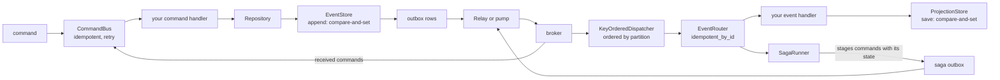
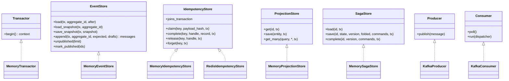

# SDK map

The software development kits (SDKs) connect kernel decisions to persistence and transport.
Their seams (`Protocol` in Python and traits in Rust) let you supply database and broker adapters.
Python and Go provide memory, Redis-ledger and Kafka adapters. See the [Go API map](go.md). You supply durable event,
projection and saga stores.

The pages below use Python method names and compare the Rust reference model where its behavior
differs. The [Go guide](go.md) maps those contracts to Go interfaces and explains its context and
lifetime rules.

## The whole pipeline

State changes and outbox rows can share one database transaction. The relay publishes after that
transaction commits. Publishing and broker delivery are at-least-once. Idempotency guards remove
duplicates within their retention window; version checks reject conflicting writes.

## Seams and the orchestration over them

| Seam | Orchestration | Doc |
|---|---|---|
| `EventStore` | `Repository` loads from snapshot plus replay, saves pending events under optimistic concurrency | [aggregates](aggregates.md) |
| `EventStore` (outbox half) | `Relay.drain` polls outbox rows; `pump` publishes a change-data-capture stream | [outbox](outbox.md) |
| `IdempotencyStore` | `idempotent` and `idempotent_by_id`; in Rust also `idempotent_in` and `idempotent_by_id_in` | [idempotency](idempotency.md) |
| `Transactor` | `transaction` and `current_tx`; in Rust `transaction` and `retry_transaction` | [transactions](transactions.md) |
| `ProjectionStore` | read models, with the kernel's filter and query semantics and portable cursors | [projections](projections.md) |
| `SagaStore` | `SagaRunner` correlates, folds, emits commands, persists at the loaded version | [sagas](sagas.md) |
| `KeyProvider` | `Sealing` reserves and resolves scoped keys; repositories, buses, routers, and saga runners protect payloads | [crypto-shredding](../guides/crypto-shredding.md) |
| `ErasureStore` | `ErasureCoordinator` persists progress, revokes access, coordinates cleanup, and confirms destruction | [erasure workflow](../guides/crypto-shredding.md#erasure-workflow-and-recovery) |
| `Producer`, `Consumer` | `KeyOrderedDispatcher` fans deliveries to workers by partition; `EventRouter` routes by event name | [consuming](consuming.md) |
| — | `CommandBus` and its middleware chain | [commands](commands.md) |
| — | the error taxonomy every retry and dead-letter path branches on | [errors](errors.md) |

Backends live under `edax.backend`, one module per technology, over a client you own. The base
package pulls in no broker or database library. See [backends](../backends/README.md).

## Seams as a class diagram

Signatures are the Python ones, trimmed. Each seam's docstring is the specification. Read it before
implementing.

`ProjectionStore` has no `query` method. Sorting and paging are the kernel's, reached through the
`edax.query` module over documents the store returned. See [projections](projections.md).

## Rust and Python parity

The Rust `edax` crate is a reference model, not a deployable SDK. It holds this SDK's orchestration to
the same kernels from a second language. [Rust parity](rust-parity.md) says what it covers and where it
differs on purpose. It has no ambient transaction: a nested unit of work on one database is refused
instead. And it has no guard that owns the transaction.

## Where to start

Wiring one command end to end: [getting started](../guides/getting-started.md). What each hop
promises: [delivery guarantees](../guides/delivery-guarantees.md).

## See also

- [Architecture](../architecture.md) — why the kernel and SDK boundary sits where it does.
- [Backends](../backends/README.md) — the seam contracts, and writing your own.
- [Python examples](../../examples/py/README.md) and [Go examples](../../crates/edax-go/examples/README.md) — nineteen topics in the same learning order.
