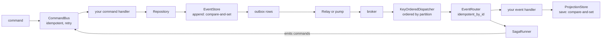
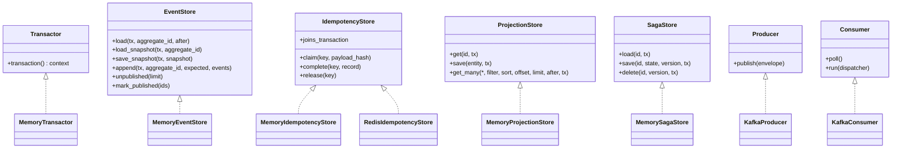

# SDK map

What the software development kit (SDK) layer gives you, where each piece lives, and how far the two
SDKs agree.

The kernels own no I/O, so persistence and transport are the SDK's job. The SDK offers **seams** — a
`Protocol` in Python, a trait in Rust — that you implement against your own database or broker, plus
the orchestration over them. No durable store ships; you bring one.

## The whole pipeline

Everything on the write side of the broker can share one transaction. Everything past the broker is
at-least-once, which is why the guard and the version compare-and-set exist.

## Seams and the orchestration over them

| Seam | Orchestration | Doc |
|---|---|---|
| `EventStore` | `Repository` loads from snapshot plus replay, saves pending events under optimistic concurrency | [aggregates](aggregates.md) |
| `EventStore` (outbox half) | `Relay.drain` polls it, `pump` feeds it from change data capture | [outbox](outbox.md) |
| `IdempotencyStore` | `idempotent`, `idempotent_in`, `idempotent_by_id`, `idempotent_by_id_in` | [idempotency](idempotency.md) |
| `Transactor` | `transaction`, `with_tx`, `current_tx` | [transactions](transactions.md) |
| `ProjectionStore` | read models, with the kernel's filter and query semantics and portable cursors | [projections](projections.md) |
| `SagaStore` | `SagaRunner` correlates, folds, emits commands, persists at the loaded version | [sagas](sagas.md) |
| `Producer`, `Consumer` | `KeyOrderedDispatcher` fans deliveries to workers by partition; `EventRouter` routes by event name | [consuming](consuming.md) |
| — | `CommandBus` and its middleware chain | [commands](commands.md) |
| — | the error taxonomy every retry and dead-letter path branches on | [errors](errors.md) |

Backends live under `edax.backend`, one module per technology, over a client you own. The base
package pulls in no broker or database library. See [backends](../backends/README.md).

## Seams as a class diagram

Signatures are the Python ones, trimmed. Each seam's docstring is the specification. Read it before
implementing.

`ProjectionStore` has no `query` method. Sorting and paging are the kernel's, reached through the
`edax.query` module over documents the store returned. See [projections](projections.md).

## Rust and Python parity

Both SDKs call the same kernels, so every shared decision matches. The orchestration differs where
the language does. [Rust parity](rust-parity.md) is the one home for the name map and the
differences.

Two asymmetries are deliberate, not gaps. Rust has no ambient transaction, and Rust has no guard
that owns the transaction.

## Where to start

Wiring one command end to end: [getting started](../guides/getting-started.md). What each hop
promises: [delivery guarantees](../guides/delivery-guarantees.md).

## See also

- [Architecture](../architecture.md) — why the kernel and SDK boundary sits where it does.
- [Backends](../backends/README.md) — the seam contracts, and writing your own.
- [Examples](../guides/examples.md) — six runnable walkthroughs.
