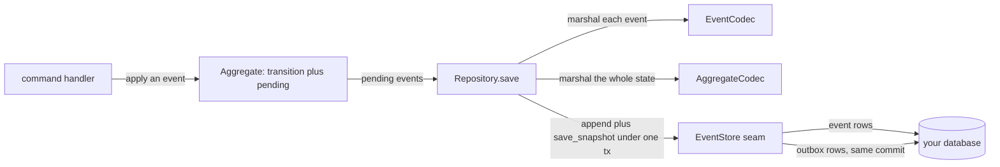
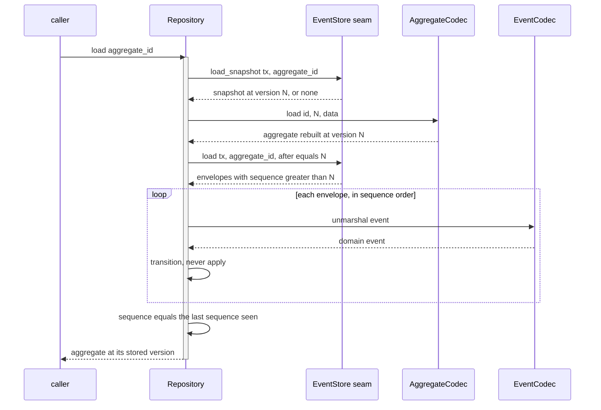
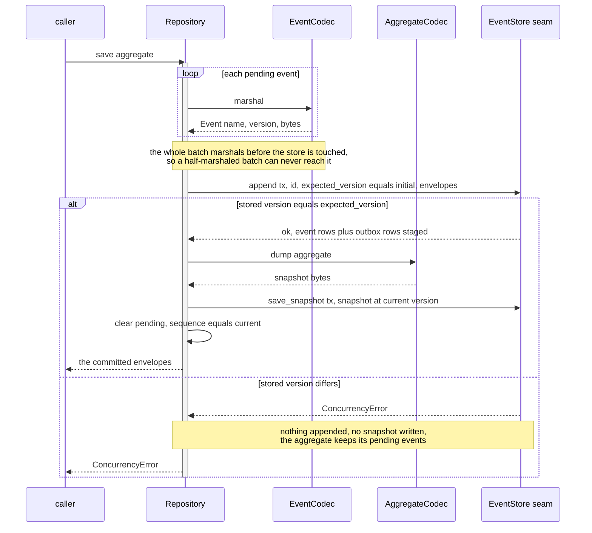
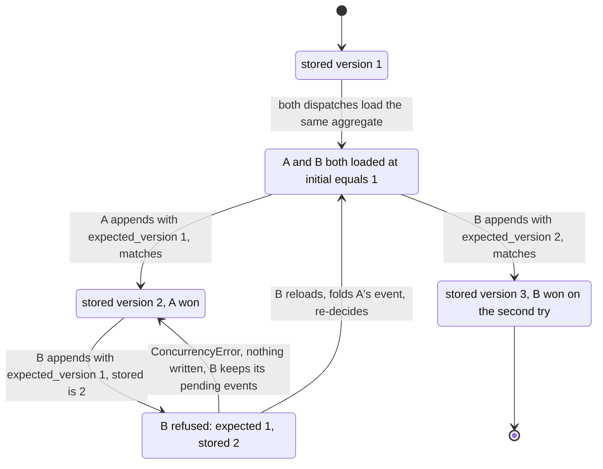

# Aggregates and the write side

How an event-sourced aggregate records events, how `Repository` rehydrates and persists it, and how
`EventStore.append` enforces optimistic concurrency.

The write side is three pieces: an `Aggregate` that folds events into state, two codecs that turn
domain objects into bytes, and an `EventStore` you implement over your own database. `Repository` is
the orchestration between them — it opens no policy of its own beyond "snapshot then replay" on load
and "append then snapshot" on save.



## The aggregate

| Concept | Rust | Python |
|---|---|---|
| the carried state | `Root<E>` embedded, reached through `root()` / `root_mut()` | fields on the `Aggregate` base: `id`, `sequence`, `pending` |
| the version | `Root { version, pending }`, `current()` | `Version(initial, updates)`, `.current` property |
| fold one event | `fn transition(&mut self, event: &Self::Event)` | `def transition(self, event) -> None` |
| record a new event | `apply(event)` — one event | `apply(*events)` — any number |

Both SDKs split the version in two on purpose. One half is what storage last said. The other half
counts what this instance applied since. Their sum is the version a save is about to write. The
stored half is the `expected_version` that save compares against.

Python names the pair `Version(initial, updates)`, and `current` is their sum. Rust keeps `version:
u64` on `Root` with a private `pending`, and `current()` is `version + pending.len()`. `pending` is
private, so a host reaches it only through `apply` and `take_pending`. That keeps one source of
truth for the version.

`apply` does three things in order: `transition` the state, increment the sequence, push the event
onto `pending`. Replay must never call it — a replayed event is already stored, and queueing it as
pending would write it a second time. `Repository` therefore calls `transition` directly when it
folds a loaded stream.

```python
class Account(Aggregate):
    def __init__(self, id: str, initial: int = 0) -> None:
        super().__init__(id, initial)
        self.balance = 0

    def transition(self, event: object) -> None:
        if isinstance(event, Deposited):
            self.balance += event.amount
```

`examples/py/command_handling.py:31`. `transition` is a pure fold: no I/O, no validation, no
raising. The decision to emit an event belongs to the handler. `transition` only applies one that
has already been decided. It also runs on every replay of history that was valid once.

## Two codecs, not one

They are different seams with different jobs. Confusing them is the common mistake.

| | `EventCodec` | `AggregateCodec` |
|---|---|---|
| bridges | one domain event object and its `Event` — `name`, `version`, `data` bytes | the whole aggregate and its snapshot bytes |
| methods | `marshal` / `unmarshal` | `load` / `dump` (plus `type` in Python, `type_name()` in Rust) |
| used on | every event, every save and every replay | one snapshot per save, one per load |
| ships ready-made | yes: `json_codec`, `msgpack_codec` (Python); `JsonCodec`, `MsgpackCodec` (Rust) | no — hand-written on purpose |
| where | `edax.codec`, `edax::codec` | `AggregateCodec` in `edax::aggregate`, `AggregateCodec` in `edax.store` |

The event codecs ship because the shape is mechanical: a fixed set of event types, each serialized
whole. The snapshot codec does not, because only you know which fields are state and which are
derived.

```python
events = json_codec({"Deposited": Deposited, "Withdrawn": Withdrawn})
```

`json_codec` lives in `edax.codec`. `msgpack_codec` takes the same arguments and writes MessagePack
instead — smaller, binary. Both accept `version=` and `upcasters=`, so an older stored payload is
raised to the current shape on load. Rust's `JsonCodec::<T>::new("AccountEvent", 1)` and
`MsgpackCodec` carry one name per codec, since serde alone does not name the type.

The snapshot codec:

```python
class AccountCodec:
    type = "Account"

    def load(self, id: str, version: int, data: bytes | None) -> Account:
        a = Account(id, version)
        if data is not None:
            a.balance = int(data.decode())
        return a

    def dump(self, agg: Account) -> bytes:
        return str(agg.balance).encode()
```

`examples/py/command_handling.py:41`. `data is None` means no snapshot is stored yet, so rebuild the
aggregate empty at version 0.

Every codec failure — an unregistered event name, an unwritable payload, a missing upcast step — is
a `CodecError` in Python and `Error::Codec` in Rust. That is **terminal**: the same bytes fail the
same way on every attempt, so the caller dead-letters instead of redelivering forever. `marshal` and
`dump` are fallible in both directions for exactly this reason. A payload the codec cannot write
reaches the caller as a typed error. It does not panic inside whichever thread called `save`.

## Repository.load — snapshot, then replay the tail



No snapshot means a pure replay from version 0. The version the rehydrated aggregate carries is the
last sequence the store returned, not the snapshot's version, so a snapshot that lags the stream is
still correct. An envelope with no `sequence` is still folded into state but leaves the version
alone.

A snapshot **may lag the stream and must never lead it**. Leading it would make the replay
double-count the events the snapshot already contains.

Rust has two entry points instead of an optional argument: `Repository::load` opens a unit of work
of its own, `Repository::load_in` runs inside the caller's `&mut Tx`. Python has one
`load(aggregate_id, *, tx=None)` that joins the ambient transaction when `tx` is omitted — see
[transactions](./transactions.md).

## Repository.save — marshal, append, snapshot



Sequence numbers are assigned by `Repository`, never renumbered by a store: the envelopes carry
`expected_version + 1 .. + n`. The snapshot is written at `current`, the version after the batch.

Marshaling the whole batch first is deliberate: a codec failure on the third of three events fails
the save outright and appends nothing. `Repository::save_with` marshals first for that reason, and
the Rust store suite asserts it.

An **empty** save still calls `append`. Nothing is written, but the compare-and-set still runs. A
stale caller that applied no events is told it is stale. Its snapshot write is short-circuited
rather than rolling the stored snapshot backwards.

`save` returns the committed envelopes. Publish them eagerly if you want, or leave them to the
[`Relay`](./outbox.md).

**After the store accepts the writes, the aggregate is reset.** `pending` is cleared and the version
becomes the version just written. Inside a caller's transaction that reset happens before the caller
commits. A later rollback then leaves an aggregate that no longer holds its events. Reload it rather
than save it again.

## append is a compare-and-set on the version

`append` is the only place optimistic concurrency lives. Its contract, in full:

> `append` is a compare-and-set on the version: it succeeds only if the stored version equals
> `expected_version`, otherwise raises `ConcurrencyError` and writes nothing. Enforce it in the
> database (a unique constraint on `(aggregate_id, sequence)` or a row lock on the stream), not by
> a read-then-write in Python, so it holds under concurrent writers on separate connections.
> — the `EventStore.append` contract

The "in the database" clause carries the guarantee. A `SELECT max(sequence)` followed by an `INSERT`
is not a compare-and-set: two connections both read the same maximum and both insert. A unique index
on `(aggregate_id, sequence)` makes the second insert fail in the engine, which is the only place
the two writers actually meet.

| Failure | Error | Transient? | What the caller does |
|---|---|---|---|
| stored version differs from `expected_version` | `ConcurrencyError` / `Error::Concurrency { expected, stored }` | transient | reload the aggregate, re-decide, save again |
| a payload will not marshal | `CodecError` / `Error::Codec` | terminal | dead-letter; a retry fails identically |
| the backend is down, a lock wait times out | `StoreError` / `Error::Store` | transient | retry with backoff |

`ConcurrencyError` means exactly one thing and nothing else: a version conflict. A store that
reports a connection failure as a concurrency conflict makes the caller retry a decision it should
not retry. A store that reports a conflict as a store failure makes it retry without reloading,
which conflicts again.

**Nothing is written on a mismatch.** Not a partial batch, not a snapshot. The in-memory adapter
checks the version before staging anything and returns the conflict with both numbers. The
repository's own test asserts the stored snapshot is still the winner's, never the loser's.

### Two dispatches racing on one aggregate id



B must **reload and re-decide**, not re-send the same events. Its pending events were decided
against state that no longer exists; A's event may have invalidated them. That is the whole point of
putting the check on the version rather than on the row: the conflict is a signal that the decision
input changed.

Two ways to avoid the race rather than lose it:

- Route by aggregate id so one writer owns one aggregate at a time. `KeyOrderedDispatcher` does this
  — same aggregate id, same worker, so the read-modify-write needs no lock
  (`examples/py/outbox.py:64`). See [consuming](./consuming.md).
- Wrap the dispatch in `retry` so a conflict is retried with a fresh load. See
  [commands](./commands.md).

`ConcurrencyError` is transient, so the retry middleware and the dispatcher both redeliver on it.
See [errors](./errors.md) for the full taxonomy.

## Snapshots

A `Snapshot` is a marshaled aggregate at a version, so a load can skip replaying the whole stream.

| Field | Meaning |
|---|---|
| `aggregate_id` | the stream it summarises |
| `type_name` | the stable label from the codec — Python `AggregateCodec.type`, Rust `type_name()` |
| `version` | the version the snapshot state is at |
| `data` | whatever `dump` produced |

Both software development kits (SDKs) snapshot on **every** save, and both say so in the same words:
"Snapshot every save; add an interval (every N events) if dump cost bites". Write an interval when
`dump` gets expensive or the state gets large. Correctness does not depend on it. The replay always
folds the tail after whatever version the snapshot carries.

`save_snapshot` is an upsert: last writer wins. It commits in the same `tx` as the append, so a
rollback removes both.

A snapshot is a cache, not a source of truth. Deleting every snapshot must leave the system correct
— it only makes loads slower. That is why `load` folds the tail rather than trusting the snapshot's
version, and why the append's rejection short-circuits the snapshot write.

## Wiring it up

The one wiring snippet lives in [step 3 of getting
started](../guides/getting-started.md#step-3--one-transaction-around-the-dispatch).

`Repository` also takes `new_id=` and `now=` to pin envelope ids and timestamps for a deterministic
test. Without them it uses the kernel's guid and clock. Rust's equivalent is `Repository::new(store,
events, aggregates).with_clock(new_id, now)`.

`save_with` and `save_with_in` in Rust stamp every committed envelope with a namespace and metadata.
`save(..., namespace=, metadata=)` does the same in Python. Put a trace id there, threaded from the
request context. It lands on the outbox row and links command to event to consumer. Keep
per-delivery ids there, not in the command payload, so they never perturb an idempotency hash.

## See also

- [Outbox](./outbox.md) — the rows `append` writes beside the events, and the `Relay` that drains
  them.
- [Transactions](./transactions.md) — how the event store, the projection store and the ledger share
  one commit.
- [Commands](./commands.md) — the `CommandBus` and middleware chain that call a handler like
  `deposit`.
- [Idempotency](./idempotency.md) — why a retried dispatch does not deposit twice.
- [Errors](./errors.md) — which failures are transient and which are terminal.
- [Memory backend](../backends/memory.md) — the reference `EventStore` these examples run on.
