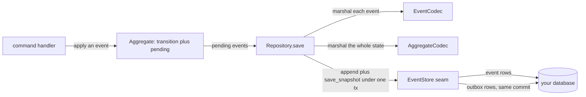
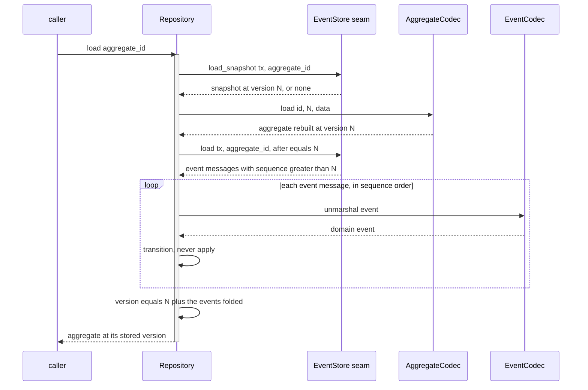
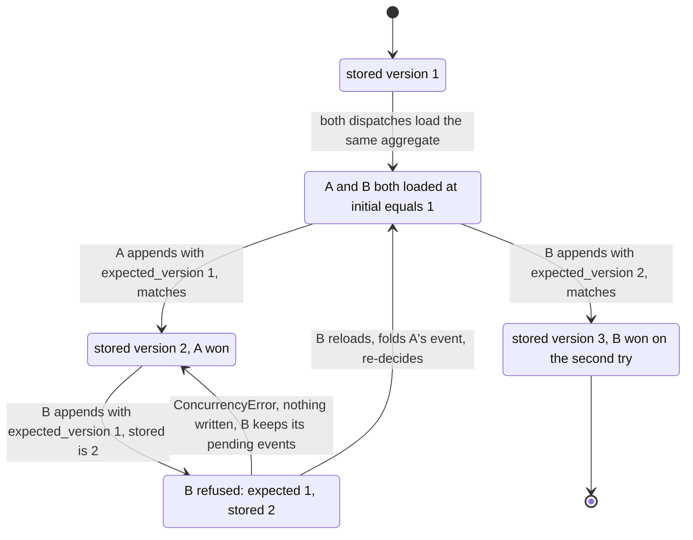

# Aggregates and the write side

How an event-sourced aggregate records events, how `Repository` rehydrates and persists it, and how
`EventStore.append` enforces optimistic concurrency.

The write side is three pieces: an `Aggregate` that folds events into state, two codecs that turn
domain objects into bytes, and an `EventStore` you implement over your own database. `Repository`
orchestrates them. Its only policy is "snapshot then replay" on load and "append then snapshot" on
save.



## The aggregate

| Concept | Rust | Python |
|---|---|---|
| the carried state | `Root<E>` embedded, reached through `root()` / `root_mut()`, read through `id()`, `version()`, `tenant()`, `pending()` | on the `Aggregate` base: `id` and `tenant` fields, `version` and `pending` read-only properties |
| the version | `Root::version()` and `pending()`, `current()` | `Version(initial, updates)`, `.current` property |
| fold one event | `fn transition(&mut self, event: &Self::Event)` | `def transition(self, event) -> None` |
| record a new event | `apply(event)`, one event | `apply(*events)`, any number |

Both SDKs split the version in two on purpose. One half is what storage last said. The other half
counts what this instance applied since. Their sum is the version a save is about to write. The
stored half is the `expected_version` that save compares against.

Python names the pair `Version(initial, updates)`, and `current` is their sum. Rust keeps the
loaded version and the pending events on `Root`, and `current()` is `version() + pending().len()`.
Every `Root` field is private behind a getter. A host adds a pending event only through `apply`; the
`Repository` is the only writer of the version, the tenant and the reset after a save. Python derives
`version` the same way: `updates` is the count of pending events. Both `version` and `pending` are
read-only properties, and `pending` is a tuple. That keeps one source of truth for the version.

`apply` runs `transition` on the state, then records the event as pending, which advances the
current version. Replay must never call it. A replayed event is already stored, and queueing it as
pending would write it a second time. `Repository` therefore calls `transition` directly when it
folds a loaded stream.

```python
class Account(Aggregate):
    def __init__(self, id: str, initial: int = 0) -> None:
        super().__init__(id, initial)
        self.balance = 0

    def transition(self, event: object) -> None:
        if isinstance(event, Deposited):
            self.balance += event.amount
```

From `examples/py/03_snapshots.py`. `transition` is a pure fold: no I/O, no validation, no
raising. The decision to emit an event belongs to the handler. `transition` only applies one that
has already been decided. It also runs on every replay of history that was valid once.

## Two codecs, not one

They are different seams with different jobs, and confusing them is a common mistake.

| | `EventCodec` | `AggregateCodec` |
|---|---|---|
| bridges | one domain event object and its `Payload`: `name`, `version`, `data` bytes | the whole aggregate and its snapshot bytes |
| methods | `marshal` / `unmarshal` | `load` / `dump` (plus `type` in Python, `type_name()` in Rust) |
| used on | every event, every save and every replay | one snapshot per save, one per load |
| ships ready-made | yes: `json_codec`, `msgpack_codec` (Python); `JsonRegistryCodec`, `MsgpackRegistryCodec` (Rust) | no, hand-written on purpose |
| where | `edax.codec`, `edax::codec` | `AggregateCodec` in `edax::aggregate`, `AggregateCodec` in `edax.aggregate` |

The event codecs ship because the shape is mechanical: a fixed set of event types, each serialized
whole. The snapshot codec does not, because only you know which fields are state and which are
derived.

```python
events = json_codec({"Deposited": Deposited, "Withdrawn": Withdrawn})
```

`json_codec` lives in `edax.codec`. `msgpack_codec` takes the same arguments and writes the smaller,
binary MessagePack instead. Both accept `upcasters=`, so an older stored payload is raised to the
current shape on load.

Both write a payload through the SDK's one encoder, the one a command hash and a projection document
use. A `Decimal` is written as the kernel's canonical decimal text (`Decimal("9.50")` as `"9.5"`). An
aware `datetime` is written as fixed-width UTC text (`"2024-01-01T00:30:00.000000Z"`), in MessagePack
too, never as a MessagePack timestamp. A naive `datetime` raises `CodecError`: its instant is unknown.
A payload an earlier release stored, with `"9.50"` or a MessagePack timestamp, still reads as the same value. On read, a struct comes
from a map only, at every depth: a positional array is a `CodecError` in both SDKs. A host value is
read as strictly as it is written. A stored instant with no offset is a `CodecError` in both SDKs, and
so is a decimal that is `NaN` or an infinity. `event_codec.json` pins both.

Each event name has its own schema version, and its upcaster is the only place it is set. A name with
no upcaster writes version 1. A name with one writes one past its highest step, as the kernel's
[`upcast_target`](../kernels/event.md#each-event-name-has-its-own-version) decides. When one event's
shape changes, add a step to that name's upcaster; every other name keeps its version and keeps
reading its stored rows. To bump a name whose shape did not change, register an identity step
(`Upcaster().step(1, lambda d: d)`). A hole in a chain (`step(1)` and `step(3)`, no `step(2)`)
raises `CodecError` when the codec is built.

```python
events = json_codec(
    {"Deposited": Deposited, "Withdrawn": Withdrawn},
    upcasters={"Deposited": Upcaster().step(1, add_currency)},  # Deposited v2, Withdrawn v1
)
```

Every unmarshal asks the kernel's `upcast_plan`, with or without an upcaster for the name. A payload
from a **newer** writer than the name's version raises `CodecError` instead of decoding silently under
the older schema. A name with no upcaster reads an older payload as it is. `Upcaster.step` refuses a
second transform for one version (`AlreadyRegistered`). `examples/py/04_upcasting.py` reads a version
1 event as version 2.

Rust's `JsonRegistryCodec::<AccountEvent>::new()` is the same registry. It has one event name per variant of
the event enum (`Deposited(Deposited)`), the variant's own value as the payload, and
`.upcaster(name, Upcaster)` per name. The upcaster sets that name's version the same way. The
registry writes the same name and bytes as Python's `json_codec` for the same event, pinned by
`testdata/golden/event_codec.json`, so a stream reads the same from either SDK. Declare a decimal
field as `edax::Decimal` and an instant field as `edax::Instant`, so the Rust payload carries the
same text as Python's `Decimal` and `datetime`. The payload rules (map-only structs, no trailing bytes)
are the kernel's `Format::encode_payload` and `Format::decode_payload`; `Json` and `Msgpack` only name
the format.
`JsonCodec::<T>::new(name)` remains for one event type under one name. Its
`.with_upcaster(Upcaster)` sets the version, and it asks the kernel the same way.

The snapshot codec:

```python
class AccountCodec:
    type = "Account"

    def load(self, id: str, version: int, data: bytes | None) -> Account:
        account = Account(id, version)
        if data is not None:
            account.balance = int(data.decode())
        return account

    def dump(self, account: Account) -> bytes:
        return str(account.balance).encode()
```

From `examples/py/03_snapshots.py`. `data is None` means no snapshot is stored yet, so rebuild the
aggregate empty at version 0.

Every codec failure is a `CodecError` in Python and an `edax::Error` with code `codec` in Rust: an
unregistered event name, an unwritable payload, a missing upcast step. It is terminal. The same bytes
fail the same way on every attempt, so the caller dead-letters instead of redelivering forever.
`marshal` and `dump` are fallible in both directions for this reason. A payload the codec cannot write
reaches the caller as a typed error. It does not panic inside whichever thread called `save`.

## Repository.load: snapshot, then replay the tail



No snapshot means a pure replay from version 0. The rehydrated version is the snapshot's plus the
events folded after it, so a snapshot that lags the stream is still correct. The loaded tail must be
dense, and `Repository` checks it with the kernel's `check_sequence_batch`. A gap, a repeat or an
unsequenced event fails the load with `CodecError` instead of folding the wrong state.

A snapshot may lag the stream and must never lead it. Leading it would make the replay double-count
the events the snapshot already contains.

Rust has two entry points instead of an optional argument: `Repository::load(tenant, id)` opens a
unit of work of its own, `Repository::load_in(tx, tenant, id)` runs inside the caller's `&mut Tx`.
Python has one `load(aggregate_id, *, tenant=None, tx=None)` that joins the ambient transaction when
`tx` is omitted. See [transactions](./transactions.md).

## Repository.save: marshal, append, snapshot

```mermaid
sequenceDiagram
    participant C as caller
    participant R as Repository
    participant EC as EventCodec
    participant AC as AggregateCodec
    participant S as EventStore seam

    C->>R: save aggregate
    activate R
    loop each pending event
        R->>EC: marshal
        EC-->>R: Event name, version, bytes
    end
    Note over R,EC: the whole batch marshals before the store is touched,<br/>so a half-marshaled batch can never reach it
    Note over R: one lineage for the batch: lineage=, else the ambient one, else a new flow
    R->>S: append tx, id, expected_version equals initial, drafts
    alt stored version equals expected_version
        S-->>R: the stored messages, recorded_at stamped; event rows plus outbox rows staged
        opt commands were passed
            R->>S: enqueue the command messages in the command outbox, same tx
        end
        opt the version crosses a multiple of snapshot_every
            R->>AC: dump aggregate
            AC-->>R: snapshot bytes
            R->>S: save_snapshot tx
        end
        R->>R: clear pending, version equals current
        R-->>C: the stored event messages
    else stored version differs
        S-->>R: ConcurrencyError
        Note over R,S: nothing appended, no snapshot written,<br/>the aggregate keeps its pending events
        R-->>C: ConcurrencyError
    end
    deactivate R
```

Sequence numbers are assigned by `Repository`, never renumbered by a store: the drafts carry
`expected_version + 1 .. + n`. The store stamps `recorded_at`, and returns the stored messages. The snapshot is written at `current`, the version after the batch.

The whole batch marshals first, so a codec failure on the third of three events fails the save
outright and appends nothing. Rust's `Repository::save` marshals first for that reason, and
the Rust store suite asserts it.

An empty save still calls `append`. Nothing is written, but the compare-and-set still runs. A
stale caller that applied no events is told it is stale. Its snapshot write is short-circuited
rather than rolling the stored snapshot backwards.

`save` returns the stored event messages. Under a transaction the caller commits, they are not
committed until it does. Publish them eagerly if you want, or leave them to the
[`Relay`](./outbox.md).

After the store accepts the writes, the aggregate is reset. `pending` is cleared and the version
becomes the version just written. Inside a caller's transaction that reset happens before the caller
commits. A later rollback then leaves an aggregate that no longer holds its events. Reload it rather
than save it again.

## append is a compare-and-set on the version

`append` is the only place optimistic concurrency lives. The `EventStore` Protocol states it:

> *Optimistic concurrency.* `append` succeeds only if the stored version equals `expected_version`,
> else it raises `ConcurrencyError` and writes nothing. Enforce that with a unique constraint or a row
> lock in the database, never a read-then-write in Python.

The "in the database" clause carries the guarantee. A `SELECT max(sequence)` followed by an `INSERT`
is not a compare-and-set: two connections both read the same maximum and both insert. A unique index
on `(aggregate_id, sequence)` makes the second insert fail in the engine, the one place the two
writers meet.

| Failure | Error | Transient? | What the caller does |
|---|---|---|---|
| stored version differs from `expected_version` | `ConcurrencyError` / `Error::concurrency(expected, stored)` | transient | reload the aggregate, re-decide, save again |
| a payload will not marshal | `CodecError` / code `codec` | terminal | dead-letter; a retry fails identically |
| the backend is down, a lock wait times out | `StoreError` / code `store` | transient | retry with backoff |

`ConcurrencyError` means a version conflict and nothing else. A store that
reports a connection failure as a concurrency conflict makes the caller retry a decision it should
not retry. A store that reports a conflict as a store failure makes it retry without reloading,
which conflicts again.

Nothing is written on a mismatch: no partial batch, no snapshot. The in-memory adapter
checks the version before staging anything and returns the conflict with both numbers. The
repository's own test asserts the stored snapshot is still the winner's, never the loser's.

### Two dispatches racing on one aggregate id



B must reload and re-decide, not re-send the same events. Its pending events were decided against
state that no longer exists; A's event may have invalidated them. The check sits on the version, not
on the row, so the conflict signals that the decision input changed.

Two ways to avoid the race rather than lose it:

- Route by aggregate id so one writer owns one aggregate at a time. `KeyOrderedDispatcher` does this:
  same aggregate id, same worker, so the read-modify-write needs no lock
  (`examples/py/08_consume_events.py`). See [consuming](./consuming.md).
- Wrap the dispatch in `retry` so a conflict is retried with a fresh load. See
  [commands](./commands.md).

`ConcurrencyError` is transient, so the retry middleware and the dispatcher both redeliver on it.
See [errors](./errors.md) for the full taxonomy.

## Snapshots

A `Snapshot` is a marshaled aggregate at a version, so a load can skip replaying the whole stream.

| Field | Meaning |
|---|---|
| `aggregate_id` | the stream it summarises |
| `type_name` | the stable label from the codec: Python `AggregateCodec.type`, Rust `type_name()` |
| `version` | the version the snapshot state is at |
| `data` | whatever `dump` produced |

Both repositories take an interval `n`: `Repository(..., snapshot_every=n)` in Python,
`Repository::new(..).snapshot_every(n)` in Rust. A save snapshots when it carries the version across a
multiple of `n`: `1` (the default) on every save that writes an event, `0` never. A save with nothing
pending writes no snapshot. The rule is the kernel's
(`snapshot_due`, pinned by `testdata/golden/snapshot_due.json`). Raise the interval when `dump` gets
expensive or the state gets large: every snapshot is a second write in the save's unit of work.
Correctness does not depend on it. The replay always folds the tail after whatever version the snapshot
carries. `examples/py/03_snapshots.py` saves seven versions under `snapshot_every=3` and loads from the
snapshot at version 6.

`save_snapshot` keeps the higher version: an older snapshot arriving late never replaces a newer one,
and one past the stream's version is refused as `CodecError`. It commits in the same `tx` as the
append, so a rollback removes both.

A snapshot is a cache, not a source of truth. Deleting every snapshot must leave the system correct,
with slower loads. So `load` folds the tail after the snapshot, and the append's rejection
short-circuits the snapshot write.

Both SDKs' `Repository.load` skip a snapshot they cannot use and replay from version 0. That happens
when its `type_name` is not this codec's, as for another aggregate type under the same id. It also
happens when the codec's `load` refuses its `data`, as after a `dump` format change.

## Wiring it up

The one wiring snippet lives in [step 3 of getting
started](../guides/getting-started.md#step-3--one-unit-of-work-per-dispatch-and-retry-around-it).

`Repository` also takes `new_id=` to pin event ids for a deterministic test. Without it, it uses the
kernel's `guid`. The store owns the clock: `MemoryEventStore(db, now=...)` pins `recorded_at`. Rust
matches both: `Repository::new(store, events, aggregates).with_ids(new_id)` pins the ids, and
`MemoryEventStore::new().with_clock(now)` pins the time.

## What a save stamps on its events

Every event of one save carries the same context.

| Argument | Python `save(...)` | Rust `save` / `save_in`, a field of `SaveOptions` | Default |
|---|---|---|---|
| lineage | `lineage=` | `lineage` | Python: the ambient lineage of the message being handled, else a new flow. Rust: a new flow |
| extensions | `extensions=` | `extensions` | none |
| metadata | `metadata=` | `metadata` | none |
| valid time | `occurred_at=` | `occurred_at` | none: the facts happened when the store records them |
| commands | `commands=` | none | none |
| tenant | from the aggregate | from the aggregate | the tenant the load named; see [multi-tenancy](../guides/multi-tenancy.md) |

The default lineage is what links a flow with no argument. Every handler runs under `propagate` of
the message it handles, so a `save` inside it continues the flow. A save no message caused
`originate`s a new flow. Pass `lineage=originate(correlation_id=request_id)` to root it in an inbound
request instead. The Rust SDK passes the `Lineage` explicitly. See
[edax-event](../kernels/event.md#causation--lineage).

`extensions` carry edax extension context, such as a `traceparent`. A key outside the kernel's
[extension key rule](../kernels/event.md#three-tiers-of-fields) raises `CodecError` before anything
is written. `metadata` is the
application's own. Both land on the outbox row and travel with the event. Keep per-delivery values
there, not in a command payload, so they never perturb an idempotency hash.

`commands` stages command messages in the repository's command outbox, in the same transaction as
the events. Build the repository with `commands=` a `CommandOutbox` first; without one, a save with
commands raises `TypeError`. Each command belongs to the aggregate's tenant, as its events do. One
that names no tenant takes the aggregate's, and one that names another raises `CodecError` before
anything is written. See [commands](./commands.md#three-routes-for-a-command).

An event's `occurred_at` is its valid time: when the fact happened. `save(occurred_at=...)` sets it
on every event of the batch, for facts that happened before they are recorded, such as an import. Left
out, it is `None`: the event happened when the store recorded it, at `recorded_at`.

## See also

- [Outbox](./outbox.md) — the rows `append` writes beside the events, and the `Relay` that drains
  them.
- [Transactions](./transactions.md) — how the event store, the projection store and the ledger share
  one commit.
- [Commands](./commands.md) — the `CommandBus` and middleware chain that call a handler like
  `deposit`.
- [Idempotency](./idempotency.md) — why a retried dispatch does not deposit twice.
- [Errors](./errors.md) — which failures are transient and which are terminal.
- [Memory backend](../backends/memory.md) — the reference `EventStore` these examples run on.
