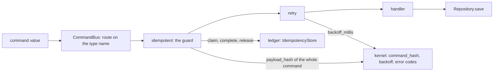
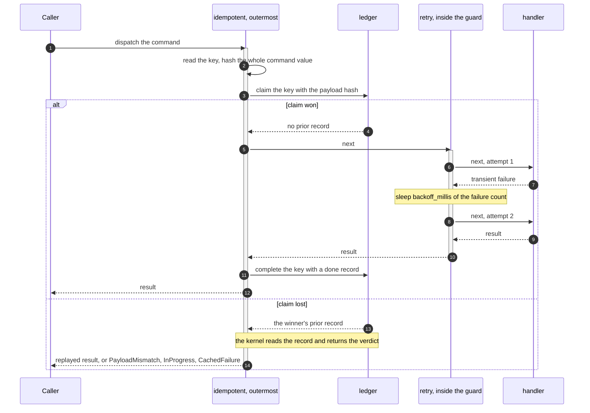
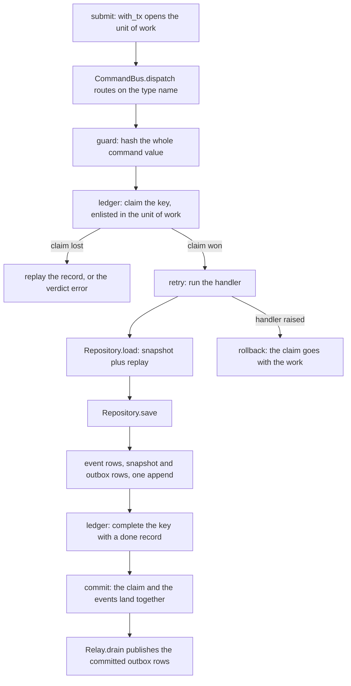

# Commands

The Command Query Responsibility Segregation (CQRS) write side. What a command is in each software
development kit (SDK). How `CommandBus` routes one. How the middleware chain around a handler is
composed.

A command is a value plus a type name. The bus routes on the type name and runs the handler through
a chain of middleware wrapped around it at registration time. The kernel owns everything that has to
agree across languages. Which bytes are hashed. Whether a failure is terminal. The backoff schedule.
Dispatch and the chain are local ergonomics.



## What a command is

| | Rust SDK | Python SDK |
|---|---|---|
| Declaration | `trait Command: Serialize` | `class Command(Protocol)` |
| Type name | `fn command_type(&self) -> &str` | `type`, a class attribute |
| Payload | whatever `Serialize` writes | the declared instance fields |
| Hash input | the whole command value | the whole command value |
| Hashed by | `edax_cqrs::command_hash` | `_edax.payload_hash_json` over `msgspec.json.encode` |

Rust:

```rust
pub trait Command: Serialize {
    fn command_type(&self) -> &str;
}
```

Python declares the same two halves as a `Protocol` with a read-only `type` property. One concrete
command satisfies it with a class attribute:

```python
@dataclass
class Deposit:
    account_id: str
    amount: int
    request_id: str  # idempotency key; part of the hashed identity
    type: ClassVar[str] = "Deposit"  # routing only: a class attribute stays out of the hash
```

### Why the type name stays out of the hash

The idempotency hash covers the command *value*, every instance field included — the field the key
was read from as well. There is no `payload()` method to override, because a hand-written one was
the single place two SDKs could quietly disagree about which bytes get hashed. The rule is the
kernel's and is pinned by `testdata/golden/command_hash.json`, asserted through the real
`idempotent` middleware from both sides.

The type name is routing metadata, not a field. In Rust it is a method return; in Python it must be
a class attribute. Declared as a Python instance field it would enter `vars()` and be hashed. The
Rust command carrying the same business fields would not hash it. That is one key and two numbers,
so a genuine duplicate raises `PayloadMismatch`.

A dataclass is read through its declared fields, defaults included. A command may be decoded off a
queue with a defaulted field left implicit. It hashes as the one its constructor builds.


### The key namespace is yours

`type` stays out of the hash, so two *different* commands with the same business fields hash
identically. `Deposit(account="x", amount=10)` and `Withdraw(account="x", amount=10)` are one hash.
Reuse one idempotency key across them and the second dispatch replays the first one's cached result:
no `PayloadMismatch`, no execution, and the money never moves.

That is the rule working as designed. The hash is over the command value, and it must be, or a Rust
service and a Python service would disagree about the same command. What the kernel cannot know is
which keys belong together. Namespace the key yourself, by command type and by service:

```python
def key_of(cmd: Deposit) -> str:
    # The command type scopes the key, so a reused request id cannot cross command types.
    return f"billing/{cmd.type}/{cmd.request_id}"


bus = CommandBus(idempotent(ledger, key=key_of))
```

The same applies to the ledger. `RedisIdempotencyStore(prefix=...)` defaults to `idem:` for every
store, service and environment, so two services sharing one Redis collide on a bare request id. The
collision is not silent, because it surfaces as a terminal `PayloadMismatch`. It still dead-letters
an event that was never wrong. Give each service its own prefix.

## CommandBus

| Operation | Rust | Python |
|---|---|---|
| Construct | `CommandBus::new()`, then `.with(mw)` | `CommandBus(*middleware)` |
| Add middleware later | `add_middleware(mw)` | — pass them to the constructor |
| Register | `register(command_type, handler) -> Result<(), Error>` | `register(type, handler) -> None` |
| Duplicate registration | `Err(Error::AlreadyRegistered(type))` | `raise AlreadyRegistered(type)` |
| Dispatch | `dispatch(&cmd) -> Result<O, CommandBusError>` | `await dispatch(cmd) -> Any` |
| No handler | `CommandBusError::NotFound(type)` | `raise HandlerNotFound(cmd.type)` |
| Handler failed | `CommandBusError::Handler(HandlerError)` | the handler's exception propagates |

`AlreadyRegistered` is a startup wiring error, not a runtime failure. `EventRouter::register`
returns the same variant for a duplicate event handler. One taxonomy covers both paths. It is
terminal — reregistering the same type never starts working — so it fails the process at wiring time
rather than being retried.

`CommandBusError` holds only the two ways a *dispatch* fails: routing found nothing, or the handler
ran and failed. Every other failure a dispatch can hit is `edax::Error`. That covers the idempotency
verdicts, a duplicate registration and a payload that will not canonicalize. It is the SDK's one
taxonomy, shared with the consume path. Python has no `CommandBusError`: the bus raises
`HandlerNotFound` directly and lets a handler's exception propagate untouched.

Because Rust middleware wrap the handler type, an `edax::Error` raised inside the chain can only
surface as a `Box<dyn std::error::Error>`. The bus reports it as `CommandBusError::Handler`, so a
caller downcasts the source to recover the variant.

## The middleware chain

Both SDKs use the same shape: a middleware takes the next handler and returns a handler.

```rust
pub type HandlerError = Box<dyn std::error::Error>;
pub type Handler<C, O> = Box<dyn Fn(&C) -> Result<O, HandlerError>>;
pub type Middleware<C, O> = Box<dyn Fn(Handler<C, O>) -> Handler<C, O>>;
```

```python
# Handlers are coroutines: a command handler awaits the storage seam (Repository.save, etc.).
Handler = Callable[[Any], Awaitable[Any]]
Middleware = Callable[[Handler], Handler]
```

The Rust handler is synchronous and takes the command by reference. The Python handler is a
coroutine, because it awaits the storage seam. `next` is threaded the same way in both: the
middleware closes over the handler it was given and calls it.

### Composition order

The bus wraps the chain around each handler at `register` time. It folds the middleware list in
reverse, so the first middleware listed ends up outermost:

```rust
// First middleware ends up outermost: wrap inner-to-outer by folding in reverse.
let wrapped = self.middleware.iter().rev().fold(handler, |handler, mw| mw(handler));
```

```python
for mw in reversed(self._middleware):
    handler = mw(handler)
```

Two consequences. First, `CommandBus(idempotent(...), retry(3))` runs the guard first and the retry
inside it. Second, the chain is frozen at registration: in Rust, `add_middleware` after `register`
does not reach an already-registered handler.

### One dispatch, drawn



The guard never releases a claim it lost — the key belongs to the winner.

## retry

| | Rust | Python |
|---|---|---|
| Signature | `retry(attempts: usize) -> Middleware<C, O>` | `retry(attempts: int) -> Middleware` |
| Floor | `attempts.max(1)` | `max(1, attempts)` |
| Sleep | `std::thread::sleep`, blocking | `await asyncio.sleep` |
| Backoff | `edax_core::backoff_millis(failures)` | `_edax.backoff_millis(i) / 1000` |
| Not retried | terminal errors, and a panic keeps unwinding | terminal errors, and `BaseException` is never caught |

`attempts` counts handler runs, not extra runs: `retry(3)` calls the handler at most three times,
and `retry(0)` clamps to one. The cases `zero_attempts_clamps_to_one` and `zero_attempts_runs_once`
pin that.

**What it retries.** Only transient failures. A terminal error is returned or re-raised at once
without using an attempt, because a deterministic failure cannot come out differently. The verdict
is the kernel's — see [`./errors.md`](./errors.md). Python catches `Exception`, so
`asyncio.CancelledError` passes straight through and is never retried.

**The backoff.** The kernel's schedule, `min(100ms * 2^attempt, 30_000ms)`, deterministic with no
jitter so every language sleeps the same amounts. Failed attempt `i` sleeps `backoff_millis(i)`
before attempt `i + 1`: 100ms, 200ms, 400ms, capped at 30s. Randomness stays out of the frozen
kernel; add jitter host-side if many workers retry at once and overload a shared broker.

**Size it before you rely on it.** A jitterless schedule means contenders that collide once collide
again on the same boundary, which is the common case on a hot aggregate. Measured with 40 concurrent
commands on one aggregate: `retry(5)` landed 33 of 40 in 1.61s, while a hand-written jittered loop
landed all 40 in 0.41s. That is the schedule working as documented rather than a defect, but it makes
`retry` the wrong tool for aggregate contention at any real concurrency. For `ConcurrencyError` on a
contended aggregate, write your own jittered loop that opens a fresh unit of work per attempt.

The Rust sleep blocks the calling thread. Wrap the dispatch in your async runtime for non-blocking
retry.

### Where retry sits relative to the guard

### retry placement

The rule depends on who owns the transaction.

| Guard wiring | Order | Why |
|---|---|---|
| `idempotent(store, key)` — the guard owns no transaction | `retry` **inside** the guard | every attempt runs under one claim |
| `idempotent(store, key, unit_of_work=...)` — the guard opens the transaction | `retry` **outside** the guard | each attempt re-claims under a transaction of its own |

The reason for the second row is stated in the source:

> **Put `retry` outside this guard when you pass `unit_of_work`.** Inside it, every attempt would
> run in the one transaction the guard opened.

Many SQL databases abort the transaction on the first failed statement. See
[idempotency](./idempotency.md#rules-and-constraints). Outside the guard, each attempt gets a fresh
claim in a fresh transaction. That is a retry that can succeed. Establish whether your database
aborts before you wire `retry` inside a transaction. The in-memory transactor does not abort, so it
will not warn you.

The same rule applies to any transaction that encloses the attempts. That includes one the host
opened around `dispatch`. On such a backend, put the retry outside the `with_tx` block too. The
in-memory transactor has no abort-on-first-failure rule — a failure the retry catches never reaches
the `with_tx` block, so the unit of work stays usable.

`idempotent_in` is the Rust form that reads a host-supplied transaction handle; `unit_of_work` is
the Python form. Their guarantees are [`./idempotency.md`](./idempotency.md)'s subject, not this
file's.

## The recommended wiring

From `examples/py/command_handling.py:89`:

```python
# idempotency outermost (one claim per request), retry inside it (retries share the claim).
bus = CommandBus(idempotent(MemoryIdempotencyStore(db), key=request_id_of), retry(3))
bus.register("Deposit", deposit)


async def submit(request_id: str, account_id: str, amount: int) -> int:
    async with with_tx(db):  # claim, events, snapshot, outbox: one commit, or one rollback
        return await bus.dispatch(Deposit(account_id, amount, request_id))
```

The key function reads the command's own field (`examples/py/command_handling.py:65`):

```python
def request_id_of(cmd: Any) -> str:
    return cmd.request_id
```

It takes `Any` because one bus routes several command types while `idempotent` types its key
function over the `Command` protocol, which declares only `type`.

**Why retries share one claim.** With `retry` inside the guard, the claim is taken once and every
attempt runs under it. Two transient failures followed by a success produce one `claim`, zero
`release` calls, and one `done` record. With the order reversed, each attempt would claim, fail,
release and re-claim. That is three round trips to the ledger. It also opens a window between
release and re-claim. A concurrent dispatch of the same key could win in that window and run the
handler in parallel. Both suites assert the nesting against a counting store: one claim, no
releases, one backoff slept.

The example's transaction is opened by the host, around the dispatch. The idempotency store and the
event store are built over one `MemoryTransactor`. The claim, the events, the snapshot and the
outbox rows therefore join the same unit of work.

## One `submit()` end to end



Read it in order. `with_tx(db)` begins the unit of work. The guard hashes the command and claims
`request_id` inside that transaction. The handler loads the aggregate and applies the event. It
calls `Repository.save`, which appends the events, the snapshot and their outbox rows atomically.
The guard writes the terminal record. The block exits and one commit lands all of it. A raising
handler rolls back everything, the claim included. The next dispatch of that key runs the handler
again. It does not replay an outcome that never landed.

`Relay.drain` reads committed outbox rows only. The replayed dispatch and the rejected
`PayloadMismatch` publish nothing. The example asserts exactly two envelopes reach the publisher.

## See also

- [Idempotency](./idempotency.md) — what the guard guarantees, both modes and every failure window.
- [Errors](./errors.md) — the terminal / transient taxonomy `retry` and the guard branch on.
- [Transactions](./transactions.md) — `Transactor`, `current_tx`, `with_tx`, `joins_transaction`.
- [Aggregates](./aggregates.md) — `Repository.save`, optimistic concurrency on append.
- [Outbox](./outbox.md) — the rows `Repository.save` writes and how `Relay` drains them.
- [Consuming](./consuming.md) — `KeyOrderedDispatcher` and the same guard on the consume path.
- [Golden vectors](../kernels/golden-vectors.md) — `command_hash.json` and how to regenerate it.
