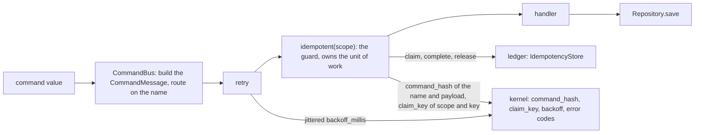
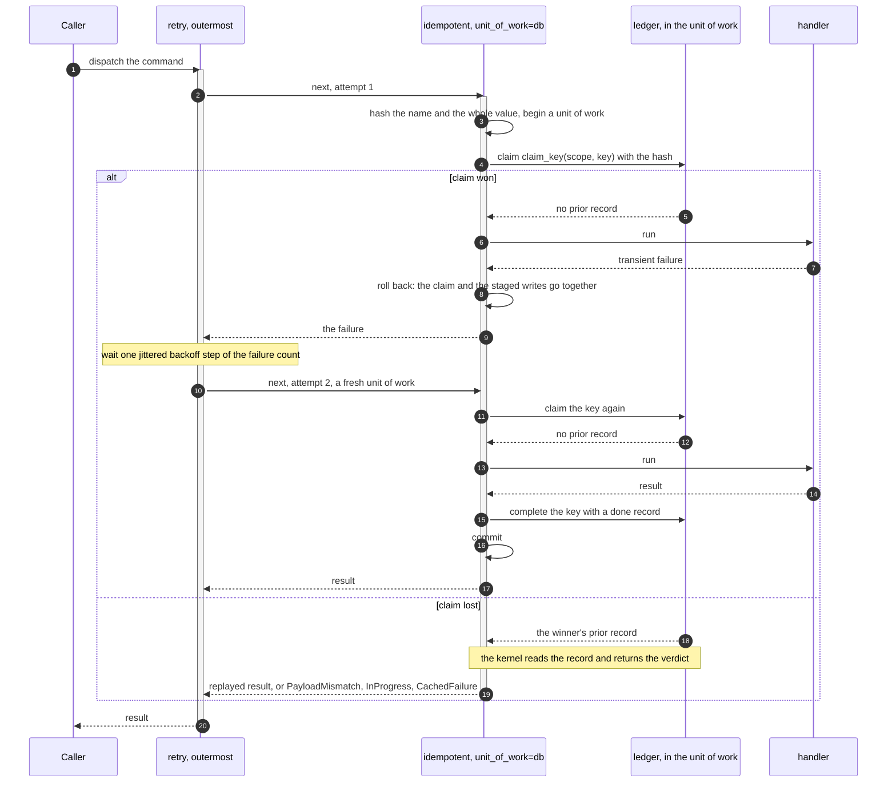
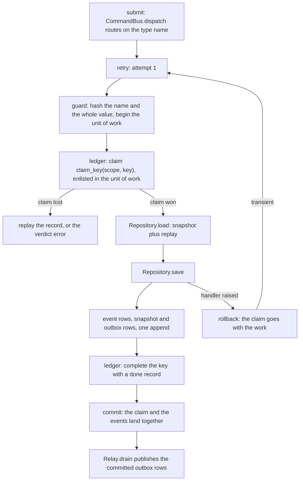

# Commands

The Command Query Responsibility Segregation (CQRS) write side. What a command is in each software
development kit (SDK). How `CommandBus` routes one. How the middleware chain around a handler is
composed. How a command crosses a process boundary, and the three routes it can take.

A command is a value plus a name. The bus routes on the name and runs the handler through a chain of
middleware wrapped around it at registration time. The kernel owns everything that has to agree
across languages: which bytes are hashed, which ledger key is claimed, whether a failure is
terminal, and the backoff schedule. Dispatch and the chain are local to each SDK.



## What a command is

| | Rust SDK | Python SDK |
|---|---|---|
| Declaration | `trait Command: Serialize` | `class Command(Protocol)` |
| Name | `fn command_type(&self) -> &str` | `type`, a class attribute |
| Payload | whatever `Serialize` writes | the declared instance fields |
| Hash input | the name and the whole command value | the name and the whole command value |
| Hashed by | `edax_cqrs::command_hash(name, value)` | `_edax.command_hash_json(cmd.type, ...)` over `msgspec.json.encode` |

Rust:

```rust
pub trait Command: Serialize {
    fn command_type(&self) -> &str;
}
```

Python declares the same two halves as a `Protocol` with a read-only `type` property. One concrete
command satisfies it with a class attribute:

```python
@dataclass
class Deposit:
    account_id: str
    amount: int
    type: ClassVar[str] = "Deposit"  # the command name, hashed with the payload
```

The idempotency key is not a field. It travels beside the command, on the dispatch and on the
message: `bus.dispatch(Deposit("acct-1", 100), idempotency_key="req-A")`.

### The name is hashed with the payload

The idempotency hash covers the command name and the command *value*, every instance field
included. There is no `payload()` method to override: a hand-written one was the one place two SDKs
could disagree about which bytes get hashed. The rule is the kernel's and is pinned by
`testdata/golden/command_hash.json`, asserted through the real `idempotent` middleware from both
sides.

The name enters the hash once, as the name. One idempotency key names one request. So
`Deposit(account="x", amount=10)` and `Withdraw(account="x", amount=10)` under one key are a
`PayloadMismatch`, not a replay of the wrong command's result. In Rust the name is a method return;
in Python it must be a class attribute. Declared as a Python instance field it would enter `vars()`
and be hashed a second time, inside the payload. The Rust command carrying the same business fields
would not do that. That is one key and two numbers, so a genuine duplicate raises `PayloadMismatch`.

A dataclass is read through its declared fields, defaults included. A command may be decoded off a
queue with a defaulted field left implicit. It hashes as the one its constructor builds. The hashed
form is RFC 8785, whose numbers are doubles, so an `amount: float` built with `2` and the same command
decoded as `2.0` bind to one key. A double rounds an integer past 2^53, so a command carrying an
integer outside -(2^53 - 1) to 2^53 - 1 (a 64-bit id, say) is refused as a terminal `CodecError`
before any claim: carry such ids as strings.
A command decoded from the wire hashes after its upcast, as the dispatched one does.

In Rust, register each command type as its own struct on the type-erased `CommandBus`. Never route
several command types through one enum: serde's external tag (`{"Withdraw":{...}}`) would enter the
hash. The same command dispatched from Python, or from the plain struct, would then hash differently
and read as a `PayloadMismatch` on a shared ledger.

## The command message

Every Python dispatch builds a `CommandMessage`, the shape a command has on the wire. A handler still
receives the command value. It reads the message, while it runs, through `current_command()`.

| Field | Value |
|---|---|
| `id` | a fresh `guid()`: this one message instance; a redelivery keeps it |
| `idempotency_key` | the client's intent, the same on every retry of one intent; `None` makes no claim |
| `aggregate_id` | the aggregate the command targets, if any |
| `name`, `version`, `data` | `cmd.type`; `cmd.version`, else 1; the command's JSON, the bytes the hash reads |
| `correlation_id`, `causation_id` | `lineage=`, else the ambient lineage, else a new flow |
| `issued_at` | the issuer's clock, Unix nanoseconds |
| `extensions`, `metadata` | edax extension context, and the application's own |

[edax-event](../kernels/event.md#domain--the-messages) lists which decision reads each field.

**Two ids, two jobs.** `id` names one message. `idempotency_key` names one intent. A client that
retries an HTTP request sends a new message each time, under the same key, so the guard replays the
first outcome. A broker that redelivers sends the same message again, under the same id. A command
with no key still has an id. A handler's events take the command as their parent
([lineage rules](../kernels/event.md#causation--lineage)).

### `dispatch`: in process

```python
result = await bus.dispatch(
    cmd,
    idempotency_key="req-A",  # None (the default): no claim, the handler runs every time
    aggregate_id="acct-1",  # the target, for ordering; optional
    lineage=None,  # None: the ambient lineage of the message being handled, else a new flow
    extensions={"traceparent": traceparent},  # edax extension keys only
    metadata={"tenant": "acme"},  # the application's own
)
```

Every argument but the command is keyword-only. An `extensions` key outside the kernel's
[extension key rule](../kernels/event.md#three-tiers-of-fields) raises `CodecError` before the
handler runs.

### `dispatch_message`: from the wire

`await bus.dispatch_message(msg, codec)` runs a `CommandMessage` a broker or an outbox delivered.
`codec` unmarshals `msg` by its name and version, upcasting on the way, as an `EventCodec` does an
event. The hash covers the value the handler receives, after the upcast. A message with no
`idempotency_key` gets its own `id` as one, so a broker redelivery of the same message replays
instead of running twice. The message keeps its lineage, so its handler's events stay in its flow.

### `command_message`: build one without dispatching

`command_message(cmd, *, codec=None, idempotency_key=None, aggregate_id=None, lineage=None,
extensions=None, metadata=None)` builds the same `CommandMessage` `dispatch` would, and dispatches
nothing. Use it to publish a command, or to stage one in the command outbox. A command that does not
encode, a version outside an unsigned 32-bit integer, or a bad extension key raises the terminal
`CodecError`.

Without `codec`, the message carries the command's JSON and `cmd.version`, or 1. With `codec`, its
name, version and data are what `codec.marshal(cmd)` returns. Build a message for another process's
`dispatch_message` with the codec that consumer reads with. A JSON message under a msgpack codec does
not decode. A version-1 message under a version-2 codec runs the upcaster on data that is already
current. A codec that names the command other than `cmd.type` raises `CodecError`.

## Scope names the guard

`idempotent(store, scope="billing")` deduplicates by the message's idempotency key. `scope` is
required. The guard claims the kernel's
[`claim_key(scope, key)`](../kernels/cqrs.md#claim_key--which-ledger-key-a-command-guard-claims),
never the raw key, so two guards on one ledger never meet. An ingress guard that takes client
requests and a consumer guard that takes commands off a topic may see the same key. Each replays
only its own outcome.

```python
ingress = CommandBus(idempotent(ledger, scope="billing.api", unit_of_work=db))
worker = CommandBus(idempotent(ledger, scope="billing.worker", unit_of_work=db))
```

Name a service, or a stage within one. The
[claim key](../kernels/cqrs.md#claim_key--which-ledger-key-a-command-guard-claims) section says why
the scope has no default.

Where one ledger serves every tenant, pass `tenancy=Tenancy.POOL` as well. The claim is then that
scoped key composed with the message's `tenant`: `claim_key("billing.api", "req-1", tenancy=POOL,
tenant="acme")` is `4:acme:edax:cmd:11:billing.api:req-1`. One request id reused by two tenants claims
two rows instead of replaying one tenant's result to the other. Under a pool or a bridge a message
with no tenant raises `CodecError` before the claim. The kernel composes the key, so a Rust guard of
the same scope and tenancy claims the same row. See [multi-tenancy](../guides/multi-tenancy.md).

The ledger keeps its own namespace too. `RedisIdempotencyStore(conn, prefix=...)` requires the
prefix, with no default. Give each service and environment its own prefix.

### An HTTP `Idempotency-Key`

The client mints one key per intent and sends it on every retry. The handler passes it through
unchanged, and the request id roots the flow.

```python
async def post_deposit(headers: dict[str, str], account_id: str, amount: int) -> int:
    return await bus.dispatch(
        Deposit(account_id, amount),
        idempotency_key=headers.get("Idempotency-Key"),  # absent: no claim
        aggregate_id=account_id,
        lineage=originate(correlation_id=headers.get("X-Request-Id")),
    )
```

A server-minted value belongs beside the payload, never inside it. A field minted fresh per attempt
hashes differently each time. The retry then meets the stored record under the same key and raises
`PayloadMismatch` for a legitimate duplicate.

## Three routes for a command

| Route | How | Atomic with the state change | Delivery |
|---|---|---|---|
| in process | `await bus.dispatch(cmd, idempotency_key=...)` | the guard's unit of work holds the claim and the handler's writes | the caller retries; the guard deduplicates |
| direct publish | `await producer.publish(command_message(cmd, ...))` | no: a dual write | the publish and the state change can each land without the other |
| command outbox | `await repo.save(agg, commands=[command_message(cmd, ...)])`, drained by a `Relay` | yes: the command commits with the events | at-least-once; the consumer deduplicates by the idempotency key |

**In process** is the default. The caller awaits the result.

**Direct publish** sends a `CommandMessage` to a broker. A handler that saves its events and then
publishes can crash between the two, and the command is lost. Publishing first and then failing the
save sends a command for a change that never happened. Use it only where the sender's state needs no
agreement with the command, such as an API gateway that only forwards.

**The command outbox** is the fix for that dual write. Build the repository with a
`CommandOutbox` over the event store's database. Then `save(agg, commands=[...])` stages the command
messages in the same transaction as the events. A `Relay` over the outbox sends them only after the
commit, and sends them again after a crash. So the consumer must deduplicate: give each command an
idempotency key that is the same on every send.

```python
outbox = MemoryCommandOutbox(db)  # over the event store's transactor
repo = Repository(store, events, accounts, commands=outbox)

ship = command_message(
    Ship(order.id), codec=command_codec, idempotency_key=f"ship:{order.id}", aggregate_id=order.id
)
await repo.save(order, commands=[ship])  # the events and the command commit together
await Relay(outbox, producer.publish).drain()  # sent only once committed
```

`CommandOutbox.enqueue(tx, commands)` is the write side, and an `Outbox` of command messages the read
side. [Backends](../backends/README.md#commandoutbox) lists what it refuses. A save with commands on a repository built without an outbox raises `TypeError`.
`MemoryCommandOutbox` is the memory outbox. A saga has its own command outbox in the `SagaStore`,
with the same guarantee; see [sagas](./sagas.md).

On the consuming side, the dispatcher's handler hands each delivered command to
`bus.dispatch_message(msg, command_codec)`, with the codec the producer built the message with. The
consumer's guard then claims the message's idempotency key under its own scope.

## Forget: re-driving a dead-lettered command

A command that failed terminally leaves a cached failure under its key. Every redelivery replays it
as `CachedFailure`, by design. When an operator fixes the cause and re-drives the message from the
dead-letter queue, the cached failure must go first.

```python
from edax.command import forget, received_key

await forget(ledger, "billing.worker", received_key(msg))  # the scope and key the guard claimed
```

`forget(store, scope, key, *, tenancy=Tenancy.SILO, tenant=None, tx=None)` deletes the record the
guard stored under `claim_key(scope, key, tenancy=..., tenant=...)`. Pass the guard's tenancy and the
message's tenant: a pool's record lives under the composed key, and a pool or a bridge refuses a
`forget` with no tenant as `CodecError` rather than delete nothing. The kernel's
[forget decision](../kernels/cqrs.md#forget--deleting-a-settled-record) says which records it may
delete.

## CommandBus

| Operation | Rust | Python |
|---|---|---|
| Construct | `CommandBus::new()` | `CommandBus(*middleware)` |
| Middleware | per command type: `wrap(handler, vec![mw, ...])` before `register` | bus-wide, passed to the constructor |
| Register | `register::<C, O>(command_type, handler) -> Result<(), Error>` | `register(command_type, handler) -> None`, or the `@bus.on(command_type)` decorator, as `EventRouter.on` |
| Duplicate registration | `Err` with code `already_registered` | `raise AlreadyRegistered(command_type)` |
| Dispatch | `dispatch::<C, O>(&cmd) -> Result<O, HandlerError>` | `await dispatch(cmd, *, idempotency_key=None, aggregate_id=None, lineage=None, extensions=None, metadata=None) -> Any` |
| Dispatch a message | none: a Rust host decodes the command itself | `await dispatch_message(msg, codec) -> Any` |
| The message in flight | none | `current_command()`, the `CommandMessage` being handled |
| No handler | code `handler_not_found` (also for a handler registered for another `C` or `O`) | `raise HandlerNotFound(cmd.type)` |
| Handler failed | the handler's `HandlerError`, unchanged | the handler's exception propagates |

The Rust bus is type-erased: one bus routes any number of command types, each registered as its own
type `C` with its own result type `O`. Its middleware is typed by the command it reads and the result
it caches, so `wrap` applies it to each handler rather than once for the bus. Several
`idempotent` guards may share one ledger: `MemoryTransactor::idempotency_store::<O>()` hands out a
typed view per result type over one database.

`AlreadyRegistered` is a startup wiring error, not a runtime failure. `EventRouter::register`
returns the same code for a duplicate event handler. One taxonomy covers both paths. It is terminal,
because registering the same type again never starts working, so it fails the process at wiring time
instead of being retried.

A dispatch fails with the handler's own `HandlerError`, the same type an event handler returns. A saga
dispatching a command returns its failure with `?`, and the verdict survives to the dispatcher.
Every failure the SDK itself raises is an `edax::Error`, the kernel's `Error { code, message }`,
inside that box; a caller downcasts to read its code. Python raises `HandlerNotFound` directly and
lets a handler's exception propagate untouched.

A replayed result is the handler's own type in both SDKs: Rust decodes the record as `O`, and Python's
`idempotent` converts it to `result_type` or the handler's return annotation. See
[idempotency](./idempotency.md#the-loser-paths).

## The middleware chain

Both SDKs use the same shape: a middleware takes the next handler and returns a handler.

```rust
pub type HandlerError = Box<dyn std::error::Error + Send + Sync>;
pub type Handler<C, O> = Box<dyn Fn(&C) -> Result<O, HandlerError> + Send + Sync>;
pub type Middleware<C, O> = Box<dyn Fn(Handler<C, O>) -> Handler<C, O> + Send + Sync>;
```

```python
# Handlers are coroutines: a command handler awaits the storage seam (Repository.save, etc.).
Handler = Callable[[Any], Awaitable[Any]]
Middleware = Callable[[Handler], Handler]
```

The Rust handler is synchronous and takes the command by reference. The Python handler is a
coroutine, because it awaits the storage seam. `next` is threaded the same way in both: the
middleware closes over the handler it was given and calls it.

### Composition order

The chain is wrapped around each handler before it is registered (Rust `wrap`, Python the bus at
`register` time). It folds the middleware list in reverse, so the first middleware listed ends up
outermost:

```rust
// First middleware ends up outermost: fold inner-to-outer, in reverse.
middleware.iter().rev().fold(handler, |handler, mw| mw(handler))
```

```python
for mw in reversed(self._middleware):
    handler = mw(handler)
```

Two consequences. First, `CommandBus(retry(3), idempotent(...))` runs the retry first and the guard
inside it. Second, the chain is frozen at registration.

A Python middleware receives the command value, as the handler does. It reads the message around it
with `current_command()`: its idempotency key, its lineage, its extensions.

### One dispatch, drawn



The guard never releases a claim it lost: the key belongs to the winner.

## retry

| | Rust | Python |
|---|---|---|
| Signature | `retry(attempts: usize, pacing: Pacing) -> Middleware<C, O>` | `retry(attempts: int, *, pacing=None) -> Middleware`; `None` is `Pacing()` |
| Floor | `attempts.max(1)` | `attempts < 1` raises `ValueError` |
| Wait | `pacing.sleep`, default `std::thread::sleep`, blocking | `pacing.sleep`, default `await asyncio.sleep` |
| Backoff | `pacing.delay(failures)`: the kernel's jittered `backoff_millis` | the same, through `_edax.backoff_millis` |
| Not retried | terminal errors, and a panic keeps unwinding | terminal errors, and `BaseException` is never caught |

`attempts` counts handler runs, not extra runs: `retry(3)` calls the handler at most three times. Python
refuses a count below one at wiring (`test_retry_refuses_fewer_than_one_attempt`), where a typo is cheap
to find; the Rust reference model clamps it to one (`zero_attempts_clamps_to_one`).

**What it retries.** Only transient failures. A terminal error is returned or re-raised at once
without using an attempt, because a deterministic failure cannot come out differently. The verdict
is the kernel's; see [errors](./errors.md). Python catches `Exception`, so
`asyncio.CancelledError` passes straight through and is never retried.

**The backoff.** The kernel's schedule with full jitter: failed attempt `i` waits a random duration in
`0 ..= min(100ms * 2^i, 30_000ms)` before attempt `i + 1`. The randomness is the SDK's draw (`Pacing.entropy`),
fed to the pure kernel. A golden vector pins the arithmetic, and contenders that collide once do not
collide again on the same boundary. `Pacing` carries the policy (`Backoff { base_millis, cap_millis }`,
the kernel's default), the sleep and the draw: tune the schedule there, or pass a recording sleep in a
test. See [the kernel's backoff](../kernels/core.md#backoff).

The Rust sleep blocks the calling thread. Wrap the dispatch in your async runtime for non-blocking
retry.

### Where retry sits relative to the guard

A retry must re-run a whole unit of work, never a handler inside one. A second attempt inside the
same transaction reads the first attempt's staged writes, applies them again, and the one commit
lands both. A database that aborts on the first failed statement hides this. The in-memory
transactor does not abort, and neither does a handler whose failure comes from a downstream call
after its writes succeeded.

| Wiring | Verdict |
|---|---|
| `CommandBus(retry(n), idempotent(store, scope=..., unit_of_work=db))`, no transaction around the dispatch | **the one to use**: each attempt claims, runs and commits in a unit of work of its own |
| `retry` inside `idempotent(..., unit_of_work=db)` | refused: the guard's unit of work is open, so `retry` raises `BadHandle` |
| any `retry` under a transaction the host opened around `dispatch` | refused: the host's unit of work is open, so `retry` raises `BadHandle` |
| `idempotent(store, scope=...)` with no transaction anywhere | allowed, but each attempt's writes commit on their own: at-least-once, and the handler must tolerate a re-run |

Python enforces the first two refusals in one check: `retry` raises terminal `BadHandle` while
a `transaction` is open. `test_command.py::test_retry_refuses_to_run_inside_an_open_transaction` pins it.
Rust has no ambient transaction, so its `retry` refuses inside `transaction(&tr, ...)` on the same
thread. Under `idempotent_in`, retry the whole unit of work with `retry_transaction(&tr, n, &pacing, body)`.

`idempotent_in` is the Rust form that reads a host-supplied transaction handle; `unit_of_work` is
the Python form. [Idempotency](./idempotency.md) covers their guarantees.

## The recommended wiring

The wiring `examples/py/05_idempotent_commands.py` runs, with a `submit` entry point added:

```python
# retry outermost: each attempt claims, runs and commits in a unit of work of its own, so a failed
# attempt rolls back whole. retry refuses to run inside an open transaction.
bus = CommandBus(retry(3), idempotent(MemoryIdempotencyStore(db), scope="accounts", unit_of_work=db))
bus.register("Deposit", deposit)


async def submit(request_id: str, account_id: str, amount: int) -> int:
    # no transaction around it
    return await bus.dispatch(Deposit(account_id, amount), idempotency_key=request_id)
```

The guard reads the key from the message the bus built, so one guard serves every command type. A
dispatch without a key passes the guard and runs the handler.

**Why each attempt claims again.** With `retry` outside the guard, a failed attempt rolls back its
claim together with its writes. The next attempt claims again in a fresh unit of work, and starts
from committed state. A concurrent dispatch of the same key can win in the gap between the two
attempts. Then the retry's claim loses, and it replays the winner's outcome or raises `InProgress`.
The handler never runs twice for one committed outcome.

The example's unit of work is opened by the guard, because it was given `unit_of_work=db`. The
idempotency store and the event store are built over one `MemoryTransactor`. The claim, the events,
the snapshot and the outbox rows therefore join the same unit of work.
`examples/py/06_errors_and_retry.py` fails one attempt after its write and asserts that the write
rolled back: the retry starts from committed state.

## One `submit()` end to end



Read it in order. The guard begins the unit of work, hashes the command and claims the scoped
idempotency key inside it. The handler loads the aggregate and applies the event. It calls `Repository.save`, which
appends the events, the snapshot and their outbox rows atomically. The guard writes the terminal
record and commits, and one commit lands all of it. A raising handler rolls back everything, the
claim included. On a transient failure `retry` runs the next attempt in a fresh unit of work. It
does not replay an outcome that never landed.

`Relay.drain` reads committed outbox rows only. The replayed dispatch, the rejected
`PayloadMismatch` and the rolled-back attempt publish nothing. The example dispatches `req-A` three
times and asserts one deposit event.

## See also

- [Idempotency](./idempotency.md) — what the guard guarantees, both modes and every failure window.
- [Errors](./errors.md) — the terminal / transient taxonomy `retry` and the guard branch on.
- [Transactions](./transactions.md) — `Transactor`, `current_tx`, `transaction`, `joins_transaction`.
- [Aggregates](./aggregates.md) — `Repository.save`, optimistic concurrency on append.
- [Outbox](./outbox.md) — the rows `Repository.save` writes and how `Relay` drains them.
- [Consuming](./consuming.md) — `KeyOrderedDispatcher` and the same guard on the consume path.
- [Sagas](./sagas.md) — commands a saga sends through its own outbox.
- [edax-cqrs](../kernels/cqrs.md) — `command_hash`, `claim_key` and `forget`, decision by decision.
- [Golden vectors](../kernels/golden-vectors.md) — `command_hash.json`, `claim_key.json` and how to
  regenerate them.
