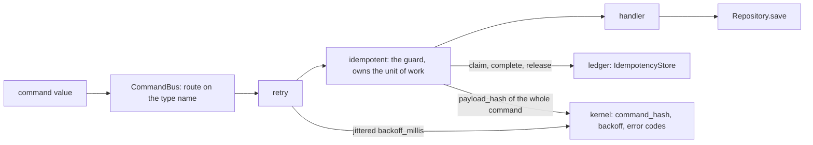
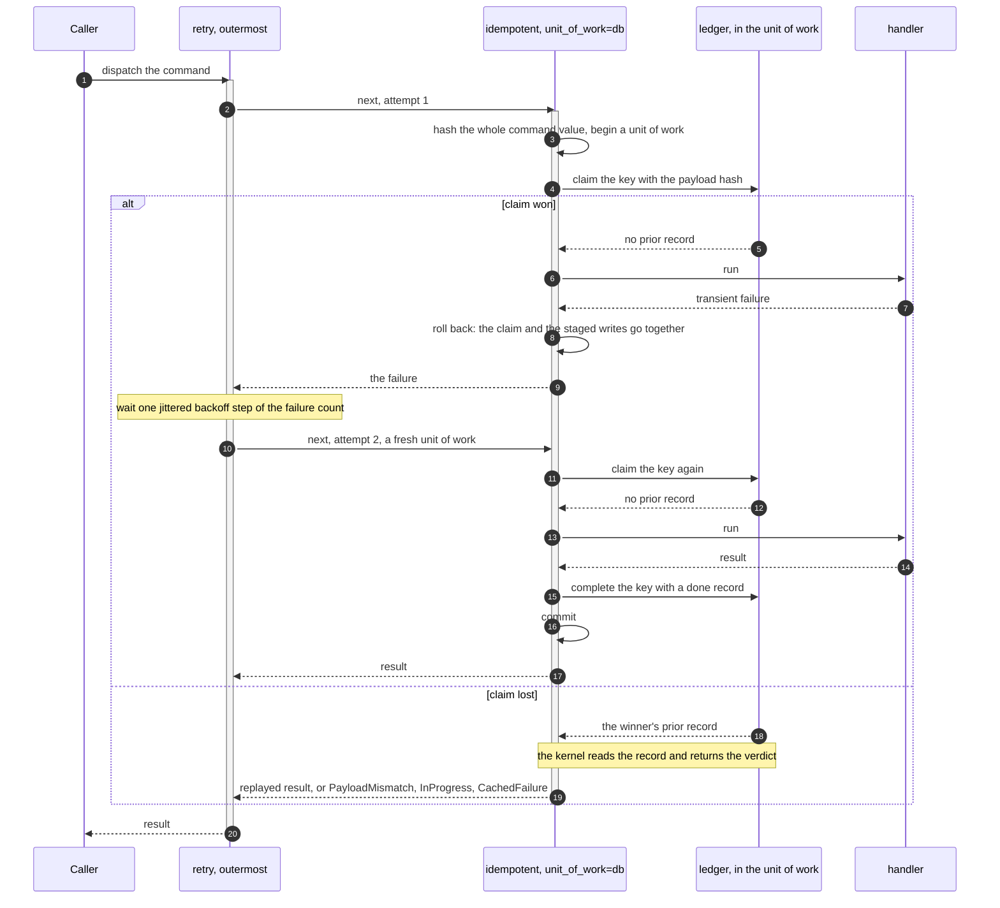
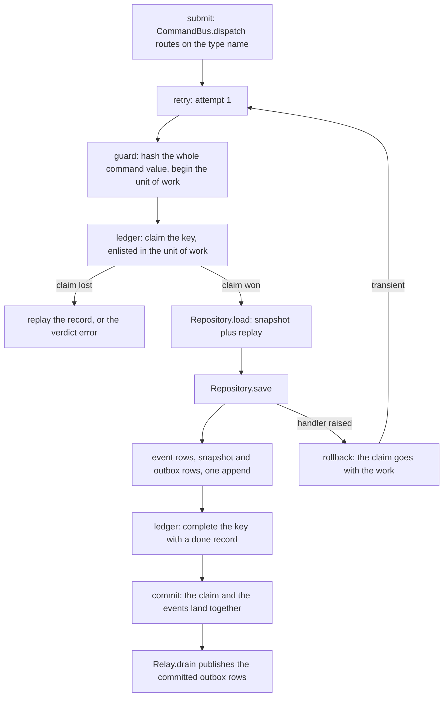

# Commands

The Command Query Responsibility Segregation (CQRS) write side. What a command is in each software
development kit (SDK). How `CommandBus` routes one. How the middleware chain around a handler is
composed.

A command is a value plus a type name. The bus routes on the type name and runs the handler through
a chain of middleware wrapped around it at registration time. The kernel owns everything that has to
agree across languages. Which bytes are hashed. Whether a failure is terminal. The backoff schedule.
Dispatch and the chain are local ergonomics.



## What a command is

| | Rust SDK | Python SDK |
|---|---|---|
| Declaration | `trait Command: Serialize` | `class Command(Protocol)` |
| Type name | `fn command_type(&self) -> &str` | `type`, a class attribute |
| Payload | whatever `Serialize` writes | the declared instance fields |
| Hash input | the whole command value | the whole command value |
| Hashed by | `edax_cqrs::command_hash` | `_edax.payload_hash_json` over `msgspec.json.encode` |

Rust:

```rust
pub trait Command: Serialize {
    fn command_type(&self) -> &str;
}
```

Python declares the same two halves as a `Protocol` with a read-only `type` property. One concrete
command satisfies it with a class attribute:

```python
@dataclass
class Deposit:
    account_id: str
    amount: int
    request_id: str  # idempotency key; part of the hashed identity
    type: ClassVar[str] = "Deposit"  # routing only: a class attribute stays out of the hash
```

### Why the type name stays out of the hash

The idempotency hash covers the command *value*, every instance field included — the field the key
was read from as well. There is no `payload()` method to override, because a hand-written one was
the single place two SDKs could quietly disagree about which bytes get hashed. The rule is the
kernel's and is pinned by `testdata/golden/command_hash.json`, asserted through the real
`idempotent` middleware from both sides.

The type name is routing metadata, not a field. In Rust it is a method return; in Python it must be
a class attribute. Declared as a Python instance field it would enter `vars()` and be hashed. The
Rust command carrying the same business fields would not hash it. That is one key and two numbers,
so a genuine duplicate raises `PayloadMismatch`.

A dataclass is read through its declared fields, defaults included. A command may be decoded off a
queue with a defaulted field left implicit. It hashes as the one its constructor builds. The hashed
form is RFC 8785, whose numbers are doubles, so an `amount: float` built with `2` and the same command
decoded as `2.0` bind to one key. A double rounds an integer past 2^53, so a command carrying one
(a 64-bit id, say) is refused as a terminal `CodecError` before any claim: carry such ids as strings.

In Rust, register each command type as its own struct on the type-erased `CommandBus`. Never route
several command types through one enum: serde's external tag (`{"Withdraw":{...}}`) would enter the
hash. The same command dispatched from Python, or from the plain struct, would then hash differently
and read as a `PayloadMismatch` on a shared ledger.


### The key namespace is yours

`type` stays out of the hash, so two *different* commands with the same business fields hash
identically. `Deposit(account="x", amount=10)` and `Withdraw(account="x", amount=10)` are one hash.
Reuse one idempotency key across them and the second dispatch replays the first one's cached result:
no `PayloadMismatch`, no execution, and the money never moves.

That is the rule working as designed. The hash is over the command value, and it must be, or a Rust
service and a Python service would disagree about the same command. What the kernel cannot know is
which keys belong together. Namespace the key yourself, by command type and by service:

```python
def key_of(cmd: Deposit) -> str:
    # The command type scopes the key, so a reused request id cannot cross command types.
    return f"billing/{cmd.type}/{cmd.request_id}"


bus = CommandBus(idempotent(ledger, key=key_of))
```

The same applies to the ledger. `RedisIdempotencyStore(conn, prefix=...)` requires the prefix, with
no default, because two services sharing one Redis under one prefix collide on a bare request id.
The collision is not silent, because it surfaces as a terminal `PayloadMismatch`. It still
dead-letters an event that was never wrong. Give each service and environment its own prefix.

## CommandBus

| Operation | Rust | Python |
|---|---|---|
| Construct | `CommandBus::new()` | `CommandBus(*middleware)` |
| Middleware | per command type: `wrap(handler, vec![mw, ...])` before `register` | bus-wide, passed to the constructor |
| Register | `register::<C, O>(command_type, handler) -> Result<(), Error>` | `register(command_type, handler) -> None`, or the `@bus.on(command_type)` decorator, as `EventRouter.on` |
| Duplicate registration | `Err` with code `already_registered` | `raise AlreadyRegistered(command_type)` |
| Dispatch | `dispatch::<C, O>(&cmd) -> Result<O, HandlerError>` | `await dispatch(cmd) -> Any` |
| No handler | code `handler_not_found` (also for a handler registered for another `C` or `O`) | `raise HandlerNotFound(cmd.type)` |
| Handler failed | the handler's `HandlerError`, unchanged | the handler's exception propagates |

The Rust bus is type-erased: one bus routes any number of command types, each registered as its own
type `C` with its own result type `O`. Its middleware is typed by the command it reads and the result
it caches, so `wrap` applies it to each handler rather than once for the bus. Several
`idempotent` guards may share one ledger: `MemoryTransactor::idempotency_store::<O>()` hands out a
typed view per result type over one database.

`AlreadyRegistered` is a startup wiring error, not a runtime failure. `EventRouter::register`
returns the same code for a duplicate event handler. One taxonomy covers both paths. It is terminal —
reregistering the same type never starts working — so it fails the process at wiring time rather than
being retried.

A dispatch fails with the handler's own `HandlerError`, the same type an event handler returns. A saga
dispatching a command returns its failure with `?`, and the verdict survives to the dispatcher.
Every failure the SDK itself raises is an `edax::Error` — the kernel's `Error { code, message }` —
inside that box; a caller downcasts to read its code. Python raises `HandlerNotFound` directly and
lets a handler's exception propagate untouched.

A replayed result is the handler's own type in both SDKs: Rust decodes the record as `O`, and Python's
`idempotent` converts it to `result_type` or the handler's return annotation. See
[idempotency](./idempotency.md#the-loser-paths).

## The middleware chain

Both SDKs use the same shape: a middleware takes the next handler and returns a handler.

```rust
pub type HandlerError = Box<dyn std::error::Error + Send + Sync>;
pub type Handler<C, O> = Box<dyn Fn(&C) -> Result<O, HandlerError> + Send + Sync>;
pub type Middleware<C, O> = Box<dyn Fn(Handler<C, O>) -> Handler<C, O> + Send + Sync>;
```

```python
# Handlers are coroutines: a command handler awaits the storage seam (Repository.save, etc.).
Handler = Callable[[Any], Awaitable[Any]]
Middleware = Callable[[Handler], Handler]
```

The Rust handler is synchronous and takes the command by reference. The Python handler is a
coroutine, because it awaits the storage seam. `next` is threaded the same way in both: the
middleware closes over the handler it was given and calls it.

### Composition order

The chain is wrapped around each handler before it is registered (Rust `wrap`, Python the bus at
`register` time). It folds the middleware list in reverse, so the first middleware listed ends up
outermost:

```rust
// First middleware ends up outermost: fold inner-to-outer, in reverse.
middleware.iter().rev().fold(handler, |handler, mw| mw(handler))
```

```python
for mw in reversed(self._middleware):
    handler = mw(handler)
```

Two consequences. First, `CommandBus(retry(3), idempotent(...))` runs the retry first and the guard
inside it. Second, the chain is frozen at registration.

### One dispatch, drawn



The guard never releases a claim it lost — the key belongs to the winner.

## retry

| | Rust | Python |
|---|---|---|
| Signature | `retry(attempts: usize, pacing: Pacing) -> Middleware<C, O>` | `retry(attempts: int, *, pacing: Pacing = Pacing()) -> Middleware` |
| Floor | `attempts.max(1)` | `attempts < 1` raises `ValueError` |
| Wait | `pacing.sleep`, default `std::thread::sleep`, blocking | `pacing.sleep`, default `await asyncio.sleep` |
| Backoff | `pacing.delay(failures)`: the kernel's jittered `backoff_millis` | the same, through `_edax.backoff_millis` |
| Not retried | terminal errors, and a panic keeps unwinding | terminal errors, and `BaseException` is never caught |

`attempts` counts handler runs, not extra runs: `retry(3)` calls the handler at most three times. Python
refuses a count below one at wiring (`test_retry_refuses_fewer_than_one_attempt`), where a typo is cheap
to find; the Rust reference model clamps it to one (`zero_attempts_clamps_to_one`).

**What it retries.** Only transient failures. A terminal error is returned or re-raised at once
without using an attempt, because a deterministic failure cannot come out differently. The verdict
is the kernel's — see [`./errors.md`](./errors.md). Python catches `Exception`, so
`asyncio.CancelledError` passes straight through and is never retried.

**The backoff.** The kernel's schedule with full jitter: failed attempt `i` waits a random duration in
`0 ..= min(100ms * 2^i, 30_000ms)` before attempt `i + 1`. The randomness is the SDK's draw (`Pacing.entropy`),
fed to the pure kernel. A golden vector pins the arithmetic, and contenders that collide once do not
collide again on the same boundary. `Pacing` carries the policy (`Backoff { base_millis, cap_millis }`,
the kernel's default), the sleep and the draw: tune the schedule there, or pass a recording sleep in a
test. See [the kernel's backoff](../kernels/core.md#backoff).

The Rust sleep blocks the calling thread. Wrap the dispatch in your async runtime for non-blocking
retry.

### Where retry sits relative to the guard

A retry must re-run a whole unit of work, never a handler inside one. A second attempt inside the
same transaction reads the first attempt's staged writes, applies them again, and the one commit
lands both. A database that aborts on the first failed statement hides this. The in-memory
transactor does not abort, and neither does a handler whose failure comes from a downstream call
after its writes succeeded.

| Wiring | Verdict |
|---|---|
| `CommandBus(retry(n), idempotent(store, key, unit_of_work=db))`, no transaction around the dispatch | **the one to use**: each attempt claims, runs and commits in a unit of work of its own |
| `retry` inside `idempotent(..., unit_of_work=db)` | refused: the guard's unit of work is open, so `retry` raises `BadHandle` |
| any `retry` under a transaction the host opened around `dispatch` | refused: the host's unit of work is open, so `retry` raises `BadHandle` |
| `idempotent(store, key)` with no transaction anywhere | allowed, but each attempt's writes commit on their own: at-least-once, and the handler must tolerate a re-run |

Python enforces the first two refusals in one check: `retry` raises terminal `BadHandle` while
`a `transaction` is open. `test_command.py::test_retry_refuses_to_run_inside_an_open_transaction` pins it.
Rust has no ambient transaction, so its `retry` refuses inside `transaction(&tr, ...)` on the same
thread. Under `idempotent_in`, retry the whole unit of work with `retry_transaction(&tr, n, &pacing, body)`.

`idempotent_in` is the Rust form that reads a host-supplied transaction handle; `unit_of_work` is
the Python form. Their guarantees are [`./idempotency.md`](./idempotency.md)'s subject, not this
file's.

## The recommended wiring

The wiring `examples/py/05_idempotent_commands.py` runs:

```python
# retry outermost: each attempt claims, runs and commits in a unit of work of its own, so a failed
# attempt rolls back whole. retry refuses to run inside an open transaction.
bus = CommandBus(retry(3), idempotent(MemoryIdempotencyStore(db), key=request_id_of, unit_of_work=db))
bus.register("Deposit", deposit)


async def submit(request_id: str, account_id: str, amount: int) -> int:
    return await bus.dispatch(Deposit(account_id, amount, request_id))  # no transaction around it
```

The key function reads the command's own field, as in the same example:

```python
def request_id_of(cmd: Any) -> str:
    return cmd.request_id
```

It takes `Any` because one bus routes several command types while `idempotent` types its key
function over the `Command` protocol, which declares only `type`.

**Why each attempt claims again.** With `retry` outside the guard, a failed attempt rolls back its
claim together with its writes. The next attempt claims again in a fresh unit of work, and starts
from committed state. A concurrent dispatch of the same key can win in the gap between the two
attempts. Then the retry's claim loses, and it replays the winner's outcome or raises `InProgress`.
The handler never runs twice for one committed outcome.

The example's unit of work is opened by the guard, because it was given `unit_of_work=db`. The
idempotency store and the event store are built over one `MemoryTransactor`. The claim, the events,
the snapshot and the outbox rows therefore join the same unit of work.
`examples/py/06_errors_and_retry.py` fails one attempt after its write and asserts that the write
rolled back: the retry starts from committed state.

## One `submit()` end to end



Read it in order. The guard begins the unit of work, hashes the command and claims `request_id`
inside it. The handler loads the aggregate and applies the event. It calls `Repository.save`, which
appends the events, the snapshot and their outbox rows atomically. The guard writes the terminal
record and commits, and one commit lands all of it. A raising handler rolls back everything, the
claim included. On a transient failure `retry` runs the next attempt in a fresh unit of work. It
does not replay an outcome that never landed.

`Relay.drain` reads committed outbox rows only. The replayed dispatch, the rejected
`PayloadMismatch` and the rolled-back attempt publish nothing. The example asserts exactly two
envelopes reach the publisher.

## See also

- [Idempotency](./idempotency.md) — what the guard guarantees, both modes and every failure window.
- [Errors](./errors.md) — the terminal / transient taxonomy `retry` and the guard branch on.
- [Transactions](./transactions.md) — `Transactor`, `current_tx`, `transaction`, `joins_transaction`.
- [Aggregates](./aggregates.md) — `Repository.save`, optimistic concurrency on append.
- [Outbox](./outbox.md) — the rows `Repository.save` writes and how `Relay` drains them.
- [Consuming](./consuming.md) — `KeyOrderedDispatcher` and the same guard on the consume path.
- [Golden vectors](../kernels/golden-vectors.md) — `command_hash.json` and how to regenerate it.
