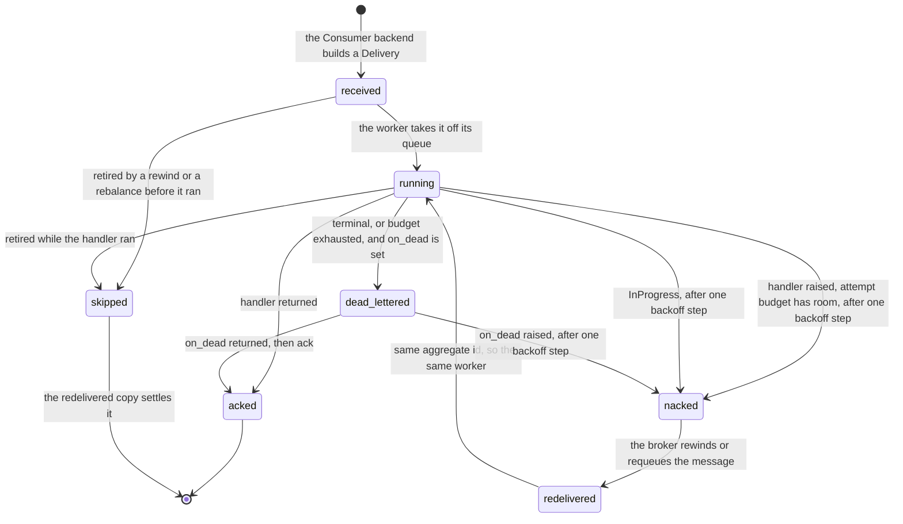
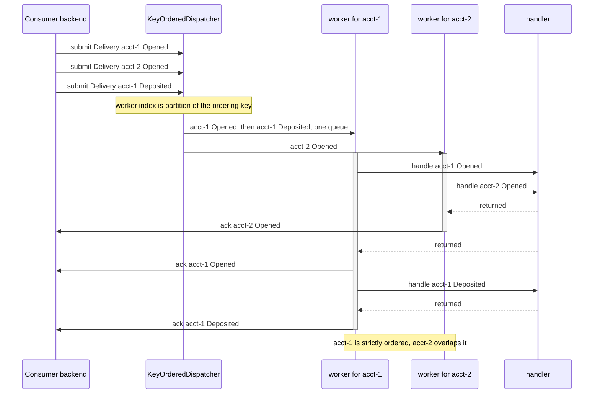

# Consuming events

The consume path: how a broker message reaches an event handler, and how the dispatcher settles it.

Four pieces sit between the broker and your code. A `Consumer` backend turns a message into a
`Delivery`, a `KeyOrderedDispatcher` picks the worker, an `EventRouter` picks the handler. The
dispatcher then acks, nacks or dead-letters that delivery by what the handler did.


## The pieces

| Piece | Source | Owns |
|---|---|---|
| `Consumer` | seam, `edax.broker` | poll one message, build a `Delivery`, run the submit loop |
| `Delivery` | `edax.delivery`, `edax::dispatcher` | the message (`Delivery.message`, an event or a command) plus `attempt` and the two settle handles |
| `KeyOrderedDispatcher` | `edax.dispatcher`, `edax::dispatcher` | worker selection, settlement, the attempt budget, dead-letter routing |
| `EventRouter` | `edax.router`, `edax::router` | the handler registry by event name and the middleware chain |

`Delivery` composes with the message rather than extending it. The ack token is per-delivery
transport state. It may be a Kafka offset, an Amazon Simple Queue Service (SQS) receipt, or a Rabbit
delivery tag. It is not part of the message, and most tokens are not stable across redelivery. The
broker's other facts ride beside it too: Kafka's offset, partition and record timestamp are on
`Delivery.origin`, a `KafkaFetched`, never in the message.

There is no `Consumer` trait in the Rust software development kit (SDK). Rust ships the in-memory
broker (`crates/edax/src/backend/broker.rs`) and expects a host adapter to call
`KeyOrderedDispatcher::submit` itself. Python declares the seam as a `Protocol` with `poll` alone.
`poll` returns a `Delivery`, an `Undecodable` for a record that will not decode, or `None` at the end
of the stream. The free function `edax.broker.consume(consumer, dispatcher)` is the one submit loop,
so a host's own backend writes only `poll`.

## KeyOrderedDispatcher

The broker already routed the message to this process. `workers` is local parallelism only. Each
worker owns one queue, and the worker for an event is

```
worker index = partition(ordering_key(message), workers)
```

The [ordering key](../kernels/event.md#the-ordering-key) is the kernel's. `partition` is the
kernel's bucket function, `fnv1a32(key) % n`. It is pure and stable, so the same aggregate id always
lands on the same worker for the life of the dispatcher. The Rust and Python SDKs refuse zero workers at
construction.

**The ordering guarantee.** All events carrying one aggregate id run on one worker, one at a
time, in the order they were submitted. Events for different aggregate ids run in parallel, one
worker each.

**Its limits.**

- A successful `on_dead` acknowledges the failed event and lets later events of that key run.
  This leaves a processing gap. Redriving the dead letter after a sequence watermark advances can
  make `is_stale` reject it; saga admission reports `below_mark` and skips it.
  Repair or rebuild affected state when replay would fall below that mark.
- Kafka requires `on_dead`, but a sink may raise: a transient refusal nacks, while a fatal refusal
  stops the dispatcher. Neither provides durable per-key parking. A Kafka nack rewinds the whole
  partition, including other keys. A workflow requiring every event in order must stop before
  acknowledging a failed event and arrange recovery before resuming.
- No order across aggregate ids. Two aggregates progress independently, and which finishes first is
  unspecified.
- The map is modulo the worker count, so several aggregate ids share a worker. A slow handler for
  one of them delays the others on that queue.
- The dispatcher preserves only the order it was submitted in. Per-key order upstream of that is
  the broker's contract.
- Per-key order holds through a nack only on a transport that rewinds. A log (Kafka, the
  in-memory broker) seeks the partition back to its lowest unsettled offset. It also retires every
  delivery of the partition it already handed out. A worker skips a delivery that is no longer
  `live`: no handler run, no settlement, reported as `retired`. The redelivered earlier event therefore
  runs before the later one. A transport that requeues a nacked delivery behind later ones instead
  reorders the key, and the handler must tolerate that.
- A nack costs duplicates on keys that never failed. The seek re-reads every message of the
  partition above the lowest unsettled offset, other keys' acked messages included. Their order
  holds, but they run again. Measured on Kafka with 20 injected nacks in 600 events: 37-50% duplicate
  deliveries. These are the transport's semantics, not the dispatcher's, so every handler must be
  idempotent, not only the ones that fail.

A second `start` raises: a second task draining one queue would consume it concurrently and break
per-key order.

### Rust threads, Python tasks

| | Rust | Python |
|---|---|---|
| Worker | an OS thread per queue, `std::thread::spawn` | an `asyncio.Task` per queue |
| Queue | `std::sync::mpsc::sync_channel(depth)` | `asyncio.Queue(maxsize=max_queue)` |
| Backpressure | a bounded channel; the send blocks when full | `max_queue`, `submit` awaits when full |
| Configuration | `KeyOrderedDispatcher::builder(workers, handler).max_attempts(n).on_dead(f).pacing(p).build()?`; `build` refuses zero workers and fails when a worker thread cannot spawn | keyword arguments on the constructor, `pacing=` included; `workers` below 1 raises `BadHandle`, as `build` does |
| Message kind | `KeyOrderedDispatcher<M>`, `Delivery<M>`, `M` an `EventMessage` (the default) or a `CommandMessage` | `KeyOrderedDispatcher[M]`, `Delivery[M]`, `M` an `EventMessage`, a `CommandMessage`, or their union for a transport that carries both |
| Handler bound | `Fn(&M) -> Result<(), HandlerError> + Send + Sync` | `Handler[M]`: a callable that takes the message and returns an awaitable, as an `EventRouter`'s handlers and a command handler are |
| Crashing handler | `catch_unwind` keeps the worker alive; the panic settles as a nack | any `BaseException` but `KeyboardInterrupt`, `SystemExit` and the worker's own cancel nacks the delivery; the worker continues |
| Stop | `stop(self)` drops the senders, drains, joins | `await stop(timeout=None)`, idempotent: refuses later `submit`s, drains, and past the deadline cancels the workers and nacks what they held or had queued |
| Ambient unit of work | Rust has none; the host threads its own handle | the worker clears the ambient map so a handler cannot inherit the transaction of whoever started the dispatcher |

Why the Python worker clears the ambient transaction:
[transactions](./transactions.md#boundary-rules).

The Rust and Python SDKs take a `Delivery` only. A bare message would have nothing to settle it, so a handler
failure would reach no ack, nack or sink. Python refuses one with `BadHandle`; in Rust it does not
compile. A test that watches only the handler submits `edax.testing.delivery(msg)`, a delivery whose
settlement does nothing.

One dispatcher carries one message kind, the one its handler takes. Behind an `EventRouter` that is
the event. A command consumer feeds received commands to `CommandBus.dispatch_message` instead, and
its dispatcher carries the command.

**Lineage.** The Python worker runs each handler under `propagate` of the message it delivers, so a
`save` inside it continues the flow ([lineage rules](../kernels/event.md#causation--lineage)). The
worker starts each run with no ambient lineage of its own, so a handler never inherits
the lineage of whoever started the dispatcher.

**Worker health.** A handler that raises `asyncio.CancelledError` because it awaited a future
someone else cancelled fails its delivery, not its worker: the delivery is nacked like a transient
failure. So is any other `BaseException`, such as a native `PanicException`. A worker that ends anyway
strands every key routed to it, so `stats().running` reads `False` once any worker is dead, and
`stats().workers_alive` counts the live ones. The dispatcher logs the death at `ERROR`. On Python
3.10, which has no `Task.cancelling()`, every `CancelledError` counts as the worker's own, so a worker
can still end that way there and the health check shows it.

**Shutdown.** Pass the deadline to `stop(timeout=...)` rather than wrapping `stop()` in
`asyncio.wait_for`. Either way `stop` returns only once no worker is left, so a later `start()` never
puts two workers on one queue. Past the deadline it cancels the workers, nacks the delivery each one
held and every delivery still queued, and so leaves nothing submitted unsettled. A `submit` that
was waiting on a full queue when `stop` began lands first, and is nacked with the rest. Each of them
reaches the observer once, as `stopped`. After `stop`, `submit` raises `DispatcherStopped` (a
`RuntimeError`) until the next `start`. A consumer loop that polled a delivery and then meets it
nacks the delivery and ends.

## Settlement

`ack` settles that message only. The dispatcher acks in worker order, not fetch order: worker A
may finish offset 7 before worker B finishes 5.

An offset-based backend must therefore track a per-partition watermark and commit that: the lowest
offset still unsettled, or one past the highest delivered when nothing is unsettled. A bare "commit
the current position" acknowledges unsettled messages and loses them on restart. The `Consumer`
Protocol states this. `KafkaConsumer` implements it through the `edax-kafka` kernel's offset
tracker; see [kafka](../backends/kafka.md).

`nack` returns the message to the broker for another attempt: a seek, a negative ack, or a requeue.

The dispatcher settles each delivery at most once: ack or nack, never both. In Rust settling
consumes the `Delivery`, so the other closure can never also run. A delivery the transport retired
is not settled at all: before the handler it is skipped, and after the handler its settlement is
dropped, because the redelivered copy settles it. A raising `on_dead` nacks the delivery after one
backoff step, so the redelivery gives the sink another try. Leaving it unsettled would pin a log
broker: nothing redelivers a delivery while its consumer lives.

Settlement is not a delivery guarantee. A crash after the handler ran and before the ack redelivers
the message, so delivery stays at-least-once and handlers must be idempotent.



## Ordering in practice

Two events for `acct-1` and one for `acct-2`, with the aggregate ids landing on different workers
(`test_dispatcher.py::test_different_aggregates_progress_on_different_workers` pins that they do).



## Retry and dead-letter

By default a raising handler nacks and the broker redelivers forever. Two settings bound that:
`max_attempts` and `on_dead`. The rule below is the kernel's (`edax_event::Retries`, pinned by
`testdata/golden/retries.json`). The Rust and Python SDKs' dispatchers, and both `Relay`s, perform its answers, so
two services consuming one topic dead-letter the same message at the same attempt. `max_attempts` is
an unsigned 32-bit count; the Python dispatcher and `Relay` refuse any other value with `BadHandle`
when they are built.

An attempt is one handler run of a delivery, counted as

```
attempt = max(Delivery.attempt, in-process counter) + 1
```

The in-process counter belongs to the dispatcher and is keyed by message id inside its tenant. Two
tenants' stores may mint the same id, so each tenant's message counts toward its own ceiling. The
counter resets on restart, so a crash mid-retry grants a fresh `max_attempts`. A broker-supplied
`Delivery.attempt` makes the ceiling survive a restart. Neither in-tree backend reads one from its client, so both report `0`.

| Outcome of a handler run | `on_dead` set | `on_dead` unset |
|---|---|---|
| Returned | ack | ack |
| Raised, terminal error | `on_dead`, then ack, on the first attempt whatever `max_attempts` says | nack, redelivered forever |
| Raised, transient error, attempt below `max_attempts` | sleep one backoff step, then nack | same |
| Raised, transient error, attempt reaches `max_attempts` | `on_dead`, then ack | nack, redelivered forever |
| `max_attempts` is `0` | the ceiling is disabled; only terminal errors dead-letter | sleep one backoff step, then nack, forever |
| Raised `InProgress` | sleep one backoff step, then nack; the budget is untouched | same |
| Raised a fatal error (`BadHandle`) | nack at once, uncounted; the dispatcher stops | same |

Terminal versus transient is the kernel's verdict for the code the error carries, read through
`edax.is_terminal(err)`. See [errors.md](./errors.md).

**A fatal error stops the dispatcher.** `bad_handle` is a wiring fault: a refused credential, a
topic the broker refuses, a store that refuses its own settings. Every message would fail alike, so
dead-lettering them would move the whole topic into the dead-letter queue one message at a time. The
kernel answers `stop` instead, whatever `max_attempts` says and with or without a sink. The delivery
is nacked at once and never counted. Every worker hands back what it has not run, reported as
`stopped`. The next `submit` fails with the error: Python's raises it, and Rust's returns it. The consumer loop hands its polled delivery back and ends on it, so `consumer.run` raises the
error for the host to fix the wiring and restart. `edax.is_fatal(err)` (Rust `edax::is_fatal`) reads
the kind. A `Relay` stops the same way: the drain hands the row back without a wait, and
`Relay.run` raises.
`examples/py/09_dead_letters.py` runs the rows that have a sink: a terminal error, a transient one
that passes, and one that reaches `max_attempts`.

**Dead-lettering needs `on_dead`.** Without a sink a dead delivery still nacks and comes back. It
is never dropped, and never bounded either. A terminal error dead-letters on the first attempt
because retrying it would only repeat it. With no sink installed that same terminal error is
nacked and redelivered forever, at the capped backoff. On a log that stalls the partition, so
`KafkaConsumer.run` refuses a dispatcher without `on_dead`.

**A sink that raises nacks.** The policy keeps the attempt, so the redelivery reaches the sink
again, after a longer wait. The observer reports `sink_failed`. A sink that raises a fatal error stops
the dispatcher instead, as a fatal handler failure does. Say the broker refuses the dead-letter topic:
every dead message would fail on it alike. The kernel decides (`Retries::sunk`, pinned by
`retries.json`), and a `Relay` stops the same way on the sink's error (`relay_drain.json`).

**A payload that will not decode** never reaches a handler. The consumer's `poll` returns it as an
`Undecodable`: its id, its raw bytes and the decode error, with no message. The consumer loop hands it
to `dispatcher.settle_poison`: `on_dead`, then ack. With no sink, or a sink that raises, it nacks after
a backoff step counted by the poison id, so one stray record cannot spin the consumer against the
broker. A sink that raises a fatal error nacks the record at once and ends the consumer loop on that
error. Once the dispatcher has stopped, the sink is never called again: each poison goes straight back.
An ack that fails after the sink took the record is reported through `Observer.settlement_failed`, and
the outcome is `unsettled`, as on the handler path.

The Rust and Python SDKs hand every sink one `DeadLetter`: the dispatcher's sink and the relay's. It carries the
`message` that died, the `attempt` that killed it as the kernel counts it, and the `failure`, one name
in the Rust and Python SDKs. In Python `origin` is the transport's record (`Delivery.origin`) for a sink that
republishes it. A dispatcher's `message` is the handler's message, or the `Undecodable` poison. A
relay's is the outbox row. In Rust a dispatcher's `failure` is a `HandlerFailure::Error` or a
`HandlerFailure::Panic` carrying the unwind payload. A relay's sink borrows the row and the error,
`DeadLetter<&R, &HandlerError>`. A panic is unclassified, so it counts as transient: a single panic
cannot be told apart from a transient failure.

### InProgress is contention, not a failed attempt

`InProgress` means another worker holds the idempotency claim for this key. That is contention, not
a failed attempt. Counting it would dead-letter a message whose holder is only slow. So the
dispatcher exempts it from the attempt budget. It waits one step of the backoff schedule, then
nacks.

`InProgress` never counts toward `max_attempts`. The ceiling is therefore the claim's time to live
(TTL), not the attempt budget. A crashed peer's claim blocks the key until that TTL expires.

`KeyUnavailable` and `KeyRevoking` also use uncounted contention retries. They have no TTL-derived
ceiling: a provider outage or delayed destruction can block ordered delivery indefinitely.
Only the trusted opening decision can skip a confirmed destroyed scope. A handler raising
`Shredded` does not authorize a skip. See
[protected delivery](../guides/crypto-shredding.md#reads-delivery-and-retries).

The schedule is the kernel's, with full jitter: a random wait in `0 ..= min(100 * 2^step, 30000)`
milliseconds. Consumers that hit one downed dependency then do not retry in lockstep. The dispatcher's
`Pacing` (Rust `DispatcherBuilder::pacing`, Python `pacing=`) carries the policy, the sleep and the
random draw; a test passes one that records instead of sleeping. The step is tracked per message
id, separately from the attempt map. Nacking at once instead would make the broker redeliver in a tight loop until the claim's dedup
window expires. An ordinary transient failure waits the same way, for the same reason. A handler
failing on a downed dependency would otherwise poll the broker as fast as it redelivers. On a
seeking transport such as Kafka every nack also re-reads the partition tail. The two differ only in
that a transient failure does spend an attempt.

**The cost.** The wait blocks that worker, and therefore every aggregate id routed to it, because
per-key ordering forbids skipping ahead. A pool with more workers narrows the effect but cannot
remove it. If one contended key must never hold up the rest, widen the
pool.

Both attempt maps grow by one entry per failing message id and shrink when that id is acked or
dead-lettered. The attempt count is kept whatever `max_attempts` says, including `0`, so the backoff
grows across redeliveries instead of repeating a flat first step. An entry for a nacked message
that never comes back stays for the life of the dispatcher. That happens when a broker-side
dead-letter queue takes the message, or when a rebalance moves its partition to another consumer.
Neither SDK bounds the maps today. Python reports their size as
`stats().attempts_tracked` and `stats().contended_tracked`, and steady growth there is this case. The
Rust dispatcher has no `stats()`: each worker keeps its own policy, and nothing reports its size.

## Commands off a broker

A dispatcher carries commands as well as events. A topic of commands needs a consumer whose default
serializer decodes commands, and a handler that hands each one to the bus:

```python
consumer = KafkaConsumer(client, serializer=edax.KernelSerializer("json", "command"))
bus = edax.CommandBus(codec=edax.json_codec({"Ship": Ship}))
dispatcher = edax.KeyOrderedDispatcher(4, bus.dispatch_message)
```

The bus's codec turns a message back into the command object, and the bus refuses a handler for a
command it does not name. The bus's guard claims the message's idempotency key under its scope, or the message id when
it carries none, so a redelivery replays instead of running twice. A command that targets an
aggregate shares its ordering key, so it runs on the worker of that aggregate. See
[commands](./commands.md#three-routes-for-a-command).

## EventRouter

The read-side mirror of the `CommandBus`. No kernel is involved in routing: which worker handles an
event is already decided by its ordering key. The router runs each handler under `propagate` of the
event, so an event a handler saves continues the flow.

```python
router = edax.EventRouter(
    idempotent_by_id(MemoryIdempotencyStore(), scope="balances", tenancy=edax.Tenancy.SILO)
)


@router.on("Deposited")
async def deposited(msg: edax.EventMessage) -> None: ...


dispatcher = edax.KeyOrderedDispatcher(4, router.dispatch)
```

`examples/py/08_consume_events.py` runs this shape without the guard.
`examples/py/10_idempotent_events.py` adds the guard over a shared unit of work.

- Registration is by event name: `register(name, handler)`, or the `on(name)` decorator, which
  returns the bare function rather than the wrapped one.
- A duplicate name is a wiring mistake at startup. `EventRouter.register` raises `AlreadyRegistered`
  in Python and returns an error with code `already_registered` in Rust.
- An event with no registered handler goes to `on_unhandled`, which is wrapped
  in the chain like any handler, or is ignored if that is unset. An ignored event runs no
  middleware.

### Decoding the payload

A handler receives the envelope, an `EventMessage`, with the payload as bytes. Decode it with the codec
the writer used, `codec.unmarshal(msg)`. That is the same `json_codec` or `msgpack_codec` the
`Repository` saves with. `unmarshal` applies the name's upcasts first, so an event a former release
stored reads in today's shape. It raises the terminal `CodecError` for a payload it cannot read, a name
it does not know, or a version from a newer writer than this codec. The dispatcher then dead-letters
the message rather than redelivering it forever.

Before enabling a newer writer version, deploy support for that version to every relevant reader.
This includes consumers, aggregate loaders, and replay jobs. A registry's upcaster chain also sets
its write version, so a service that reads and writes may need separate codec configurations during
the rollout. Gate the new writer until all readers are ready.

A compatible field addition can keep its version when old readers ignore the field and new readers
accept its absence. Preserve meaning as well as shape; unknown-field tolerance alone does not prove
compatibility. A transient classification would only delay dead-lettering until the retry budget
expires, so it cannot replace this rollout rule.

If newer-version events already failed, upgrade the readers before redriving them. A standalone or
separately committed idempotency ledger may have cached the terminal failure. Inspect that record
and use `forget_event` for the affected event before redrive, once the decoder is fixed.
A failed guard-owned shared transaction instead rolls its claim back. Also check downstream sequence
marks: forgetting a guard record cannot make an event below a watermark fold again.

```python
events = json_codec({"Deposited": Deposited}, upcasters=upcasters)


@router.on("Deposited")
async def deposited(msg: edax.EventMessage) -> None:
    deposit: Deposited = events.unmarshal(msg)
    ...
```

Reading the bytes directly (`json.loads(msg.data)`) skips both rules. An old payload reaches the
handler in its old shape. A newer writer's payload is read under the older schema, with no error.
`examples/py/10_idempotent_events.py`, `17_kafka.py` and `19_fault_injection.py` decode this way. The
router hands every handler the envelope and stays codec-agnostic: one router can serve events of several
codecs, and an `on_unhandled` handler sees names no codec knows. A router that decodes for the handler is
a deferred feature.

### The middleware chain

The router wraps middleware around every handler at `register` time, first middleware outermost,
as the `CommandBus` does. Two middlewares `a` and `b` produce `>a >b handler <b <a`.

The chain is fixed at registration, so middleware must be added before the handlers it wraps.
Python and Rust both take it in the constructor, `EventRouter(middleware)` and `EventRouter::new(middleware)`.

### idempotent_by_id

The consume-path guard. It runs a handler at most once per event `id`, so a broker redelivery does
not repeat its side effect. The key is the kernel's `event_idempotency`: `msg.id` under the required
`scope`, which names this consumer, composed with the message's `tenant` under `tenancy=Tenancy.POOL`.
The hash is the kernel's `payload_hash` over the raw `msg.data` bytes. Two consumers guarding over one
ledger therefore keep separate records: the second runs its own handler instead of skipping on the
first's record. Under a pool or a bridge an event with no tenant raises `CodecError` before the claim.

| Redelivery meets | Result |
|---|---|
| a completed record | the handler is skipped and the delivery acked; no caller awaits an event handler's result, so the replay is silent |
| a claim held by another worker | `InProgress`, transient: the dispatcher waits a backoff step and nacks |
| a released claim after a transient failure | the handler runs again |
| a cached terminal failure | `CachedFailure`, itself terminal, so the dispatcher dead-letters the redelivery too |
| the same id with a different body | `PayloadMismatch`: an integrity error, not a duplicate |

Pinned as a branch table by `test_router.py::test_idempotent_by_id_branches`, and the key by
`test_router.py::test_idempotent_by_id_keys_the_claim_by_scope_and_tenant`. Pinned end to end by
`test_router.py::test_redelivery_through_the_dispatcher_is_skipped_and_acked`.

A cached terminal failure replays on every redelivery, by design. When an operator fixes the cause and
re-drives the event from the dead-letter queue, the cached failure must go first:

```python
from edax import Tenancy, forget_event

# The scope and tenancy the guard claimed with, and the event's own id and tenant.
await forget_event(ledger, "balances", msg.id, tenancy=Tenancy.SILO, tenant=msg.tenant)
```

`forget_event(store, scope, event_id, *, tenancy, tenant=None, tx=None)` deletes the record the guard
stored under `event_claim_key(scope, event_id, tenancy=..., tenant=...)`, the kernel's key from the id
alone. It mirrors the command side's [`forget`](./commands.md#forget-re-driving-a-dead-lettered-command).
Pinned by `test_router.py::test_forget_event_lets_a_re_driven_dead_letter_run_again`.

**A worker has no ambient transaction to inherit.** The Python dispatcher clears the ambient
transaction per worker, and Rust has no ambient transaction at all. A handler that opens one
internally opens it after the claim was already taken. So `unit_of_work=` is the only way the guard gets a
transaction. It opens the transaction itself, in the right place. The claim then commits with the
handler's writes, and a rollback drops both. Rust's form is
`idempotent_by_id_in(store, scope, tenancy, current)`,
where `current` hands each worker thread its own live handle.

[Idempotency](./idempotency.md) covers what each mode guarantees, and
[transactions](./transactions.md) covers how the handle is published and joined.

## Bounded queues

Both dispatchers bound each worker's queue. The default depth is 1024.

Python takes the depth as `max_queue`. `submit` awaits when the queue is full rather than growing
it, which pushes back on the poll loop.

Rust takes the depth as `DispatcherBuilder::queue_depth` and uses
`std::sync::mpsc::sync_channel`. The send blocks when the queue is full, which applies the same
backpressure.

`0` is the explicit opt-in to an unbounded queue. Choose it only when you know the source is bounded
elsewhere. An unbounded queue plus a slow handler grows memory without limit.

## See also

- [idempotency.md](./idempotency.md) — what the guard claims, both modes, and every failure window.
- [transactions.md](./transactions.md) — `Transactor`, `current_tx`, `transaction`, and
  `joins_transaction`.
- [errors.md](./errors.md) — the terminal/transient taxonomy the dispatcher branches on.
- [sagas.md](./sagas.md) — a `SagaRunner` plugged into the router as an event handler.
- [outbox.md](./outbox.md) — the other end of the wire, where a `Relay` publishes what is consumed
  here.
- [../backends/kafka.md](../backends/kafka.md) — the watermark commit and the seek-on-nack rules.
- [../backends/memory.md](../backends/memory.md) — `MemoryBroker`, the rig these tests drive.
- [../guides/delivery-guarantees.md](../guides/delivery-guarantees.md) — the end-to-end matrix.
