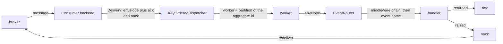
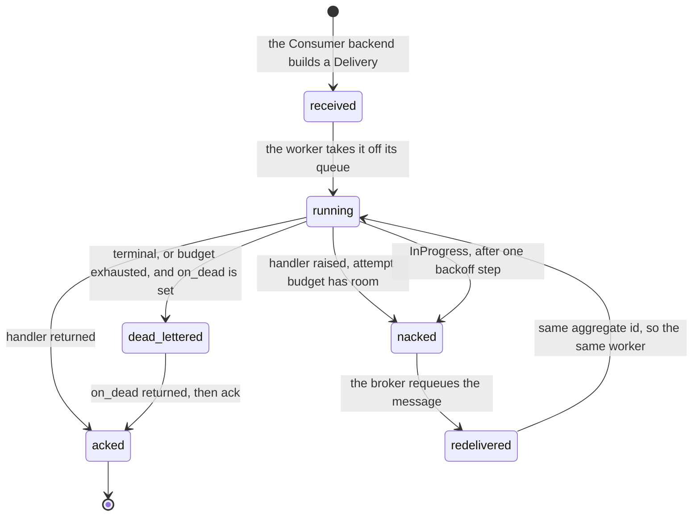

# Consuming events

The consume path: how a broker message reaches an event handler, and how the dispatcher settles it.

Four pieces sit between the broker and your code. A `Consumer` backend turns a message into a
`Delivery`, a `KeyOrderedDispatcher` picks the worker, an `EventRouter` picks the handler. The
dispatcher then acks, nacks or dead-letters that delivery by what the handler did.



## The pieces

| Piece | Source | Owns |
|---|---|---|
| `Consumer` | seam, `edax.broker` | poll one message, build a `Delivery`, run the submit loop |
| `Delivery` | `edax.dispatcher`, `edax::dispatcher` | the envelope plus `attempt` and the two settle handles |
| `KeyOrderedDispatcher` | `edax.dispatcher`, `edax::dispatcher` | worker selection, settlement, the attempt budget, dead-letter routing |
| `EventRouter` | `edax.router`, `edax::router` | the handler registry by event name and the middleware chain |

`Delivery` composes with the envelope rather than extending it. The ack token is per-delivery
transport state. It may be a Kafka offset, an Amazon Simple Queue Service (SQS) receipt, or a Rabbit
delivery tag. It is not part of the event, and most tokens are not stable across redelivery.

There is no `Consumer` trait in the Rust software development kit (SDK). Rust ships the in-memory
broker (`crates/edax/src/backend/broker.rs`) and expects a host adapter to call
`KeyOrderedDispatcher::deliver` itself; Python declares the seam as a `Protocol` with a
`_ConsumerLoop` mixin that supplies `run`.

## KeyOrderedDispatcher

The broker already routed the message to this process. `workers` is purely local parallelism. Each
worker owns one queue, and the worker for an event is

```
worker index = partition(aggregate_id, workers)
```

`partition` is the kernel's bucket function, `fnv1a32(aggregate_id) % n`. It is pure and stable, so
the same aggregate id always lands on the same worker for the life of the dispatcher. `workers` is
floored at 1, so `0` gives one worker rather than none.

**What the ordering guarantee is.** All events carrying one aggregate id run on one worker, one at a
time, in the order they were submitted. Events for different aggregate ids run in parallel, one
worker each.

**What it is not.**

- No order across aggregate ids. Two aggregates progress independently, and which finishes first is
  unspecified.
- The map is modulo the worker count, so several aggregate ids share a worker. A slow handler for
  one of them delays the others on that queue.
- The dispatcher preserves only the order it was *submitted* in. Per-key order upstream of that is
  the broker's contract.
- **Per-key order holds for successful deliveries only.** A nack requeues the delivery at the broker
  tail. Same-key deliveries already queued on that worker run first. So a nack reorders the key. The
  dispatcher does not police that; the handler must tolerate it.

A second `start` raises: a second task draining one queue would consume it concurrently and break
per-key order.

### Rust threads, Python tasks

| | Rust | Python |
|---|---|---|
| Worker | an OS thread per queue, `std::thread::spawn` | an `asyncio.Task` per queue |
| Queue | `std::sync::mpsc::sync_channel(depth)` | `asyncio.Queue(maxsize=max_queue)` |
| Backpressure | a bounded channel; the send blocks when full | `max_queue`, `submit` awaits when full |
| Configuration | `KeyOrderedDispatcher::builder(workers, handler).max_attempts(n).on_dead(f).build()` | keyword arguments on the constructor |
| Handler bound | `Fn(EventEnvelope) -> Result<(), Error> + Send + Sync` | any callable, sync or async |
| Crashing handler | `catch_unwind` keeps the worker alive; the panic settles as a nack | the worker logs and continues |
| Stop | `stop(self)` drops the senders, drains, joins | `await stop()`, idempotent, drains |
| Ambient unit of work | Rust has none; the host threads its own handle | the worker clears `_current_tx` so a handler cannot inherit the transaction of whoever started the dispatcher |

The Python worker clearing `_current_tx` is not housekeeping. A task copies its creator's context. A
dispatcher started inside `with_tx` would otherwise hand every handler that caller's transaction.
That happens long after the commit and from a second task, which the `Transactor` contract forbids.
A worker is its own unit-of-work boundary.

Submitting a bare envelope instead of a `Delivery` runs the handler and settles nothing — the
fire-and-forget path used by `examples/py/saga.py`.

## Settlement

`ack` settles **that message only**. The dispatcher acks in worker order, not fetch order: worker A
may finish offset 7 before worker B finishes 5.

> An offset-based backend must therefore track a per-partition **watermark** — the lowest offset still
> unsettled, or one past the highest delivered when nothing is unsettled, and commit that. A bare
> "commit the current position" acknowledges unsettled messages and loses them on restart
> The `Consumer.ack` contract states this; `KafkaConsumer.ack` implements it.

`nack` returns the message to the broker for another attempt: a seek, a negative ack, or a requeue.

The dispatcher settles each delivery once and only once — ack or nack, never both. In Rust settling
consumes the `Delivery`, so the other closure can never also run. There is one deliberate exception:
a raising `on_dead` leaves the delivery neither acked nor nacked, so the broker redelivers on its
session timeout and the sink gets another try.

Settlement is not a delivery guarantee. A crash after the handler ran and before the ack redelivers
the message, so delivery stays at-least-once and handlers must be idempotent.



## Ordering in practice

Two events for `acct-1` and one for `acct-2`, with the aggregate ids landing on different workers
(`test_dispatcher.py::test_different_aggregates_progress_on_different_workers` pins that they do).


## Retry and dead-letter

By default a raising handler nacks and the broker redelivers forever. Two settings bound that:
`max_attempts` and `on_dead`.

An **attempt** is one handler run of a delivery, counted as

```
attempt = max(Delivery.attempt, in-process counter) + 1
```. The in-process
counter is per worker and keyed by envelope id; it resets on restart, so a crash mid-retry grants a
fresh `max_attempts`. A broker-supplied `Delivery.attempt` is what makes the ceiling survive a
restart — neither in-tree backend reads one from its client, so both report `0`.

| Outcome of a handler run | `on_dead` set | `on_dead` unset |
|---|---|---|
| Returned | ack | ack |
| Raised, terminal error | `on_dead`, then ack — on the first attempt, whatever `max_attempts` says | nack, redelivered forever |
| Raised, transient error, attempt below `max_attempts` | nack | nack |
| Raised, transient error, attempt reaches `max_attempts` | `on_dead`, then ack | nack, redelivered forever |
| `max_attempts` is `0` | the ceiling is disabled; only terminal errors dead-letter | nack, redelivered forever |
| Raised `InProgress` | sleep one backoff step, then nack; the budget is untouched | same |

Terminal versus transient is the kernel's verdict, read through `err.terminal`. See
[errors.md](./errors.md).

**Dead-lettering needs `on_dead`.** Without a sink a dead delivery still nacks and comes back —
never a silent drop, but also never bounded. A terminal error dead-letters on the *first* attempt
only because retrying it would only repeat it; with no sink installed that same terminal error is
nacked and redelivered forever.

Rust hands the sink a `DeadLetter { envelope, attempt, failure }` where `failure` is a
`HandlerFailure::Error` or `HandlerFailure::Panic` carrying the unwind payload. A panic is
unclassified, so it counts as transient. A bug on one payload is exactly the poison message the
ceiling exists for. A single panic still cannot be told apart from a transient failure. Python
passes `on_dead(delivery, err)` instead.

### InProgress is contention, not a failed attempt

`InProgress` means another worker holds the idempotency claim for this key. That is contention, not
a failed attempt. Counting it would dead-letter a message whose holder is only slow. So the
dispatcher exempts it from the attempt budget. It waits one step of the kernel's backoff schedule,
then nacks. This is the one home for that rule; other pages link here.

`InProgress` never counts toward `max_attempts`. The ceiling is therefore the claim's time to live
(TTL), not the attempt budget. A crashed peer's claim blocks the key until that TTL expires.

The schedule is `min(100 * 2^step, 30000)` milliseconds, deterministic and without jitter so it is
identical across languages. The step is tracked per envelope id, separately from the attempt map.
Nacking at once instead would make the broker redeliver in a tight loop until the claim's dedup
window expires.

**The ceiling.** The wait blocks that worker, and therefore every aggregate id routed to it. That is
deliberate: skipping ahead is exactly what per-key ordering forbids. A pool with more workers
narrows the effect but cannot remove it. If one contended key must never hold up the rest, widen the
pool.

Both attempt maps grow by one entry per failing envelope id and shrink when that id is acked or
dead-lettered. Entries for nacked messages that never come back stay until the id is seen again.
Bound them with a time to live (TTL) or a least recently used (LRU) cache. That matters when a
broker-side dead-letter queue steals them under sustained failure.

## EventRouter

The read-side mirror of the `CommandBus`. No kernel is involved in routing: which worker handles an
event is already decided by `partition`.

```python
router = edax.EventRouter(idempotent_by_id(MemoryIdempotencyStore()))


@router.on("Deposited")
async def deposited(env: edax.Envelope) -> None: ...


bus = edax.KeyOrderedDispatcher(4, router.dispatch)
```

From `examples/py/event_handling.py:58`.

- **Registration is by event name.** `register(name, handler)`, or the `on(name)` decorator, which
  returns the bare function rather than the wrapped one.
- **A duplicate name raises `AlreadyRegistered`** — a wiring mistake at startup, not a runtime
  condition. `EventRouter.register` raises it in Python and returns `Error::AlreadyRegistered` in
  Rust.
- **Unhandled names.** An event with no registered handler goes to `on_unhandled`, which is wrapped
  in the chain like any handler, or is ignored if that is unset. An ignored event runs no
  middleware.

### The middleware chain

The router wraps middleware around every handler at `register` time, first middleware outermost,
exactly as on the `CommandBus`. Two middlewares `a` and `b` produce `>a >b handler <b <a`.

Because the chain is baked at registration, middleware must be added *before* the handlers it wraps.
Python takes it in the constructor; Rust offers `EventRouter::with` and the non-consuming
`add_middleware`.

### idempotent_by_id

The consume-path guard. It runs a handler at most once per event `id`, so a broker redelivery does
not repeat its side effect. The key is `env.id` and the hash is the kernel's `payload_hash` over the
raw `event.data` bytes.

| Redelivery meets | Result |
|---|---|
| a completed record | the handler is skipped and the delivery acked — no caller awaits an event handler's result, so the replay is silent |
| a claim held by another worker | `InProgress`, transient: the dispatcher waits a backoff step and nacks |
| a released claim after a transient failure | the handler runs again |
| a cached terminal failure | `CachedFailure`, itself terminal, so the dispatcher dead-letters the redelivery too |
| the same id with a different body | `PayloadMismatch` — an integrity error worth surfacing, not a duplicate |

Pinned as a branch table by `test_router.py::test_idempotent_by_id_branches`. Pinned end to end by
`test_router.py::test_redelivery_through_the_dispatcher_is_skipped_and_acked`.

**A worker has no ambient transaction to inherit.** The Python dispatcher clears `_current_tx` per
worker, and Rust has no ambient transaction at all. A handler that opens one internally opens it
*after* the claim was already taken. So `unit_of_work=` is the only way the guard gets a
transaction. It opens the transaction itself, in the right place. The claim then commits with the
handler's writes, and a rollback drops both. Rust's form is `idempotent_by_id_in(store, current)`,
where `current` hands each worker thread its own live handle.

What each mode guarantees is spelled out in [idempotency.md](./idempotency.md); how the handle is
published and joined is in [transactions.md](./transactions.md).

## Bounded queues

Both dispatchers bound each worker's queue. The default depth is 1024.

Python takes the depth as `max_queue`. `submit` awaits when the queue is full rather than growing
it. That is real backpressure onto the poll loop.

Rust takes the depth as `DispatcherBuilder::queue_depth` and uses
`std::sync::mpsc::sync_channel`. The send blocks when the queue is full, which applies the same
backpressure.

`0` is the explicit opt-in to an unbounded queue. Choose it only when you know the source is bounded
elsewhere. An unbounded queue plus a slow handler grows memory without limit.

## See also

- [idempotency.md](./idempotency.md) — what the guard claims, both modes, and every failure window.
- [transactions.md](./transactions.md) — `Transactor`, `current_tx`, `with_tx`, and
  `joins_transaction`.
- [errors.md](./errors.md) — the terminal/transient taxonomy the dispatcher branches on.
- [sagas.md](./sagas.md) — a `SagaRunner` plugged into the router as an event handler.
- [outbox.md](./outbox.md) — the other end of the wire, where a `Relay` publishes what is consumed
  here.
- [../backends/kafka.md](../backends/kafka.md) — the watermark commit and the seek-on-nack rules.
- [../backends/memory.md](../backends/memory.md) — `InMemoryBroker`, the rig these tests drive.
- [../guides/delivery-guarantees.md](../guides/delivery-guarantees.md) — the end-to-end matrix.
