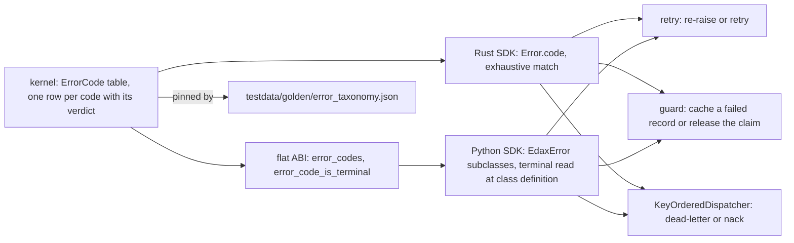
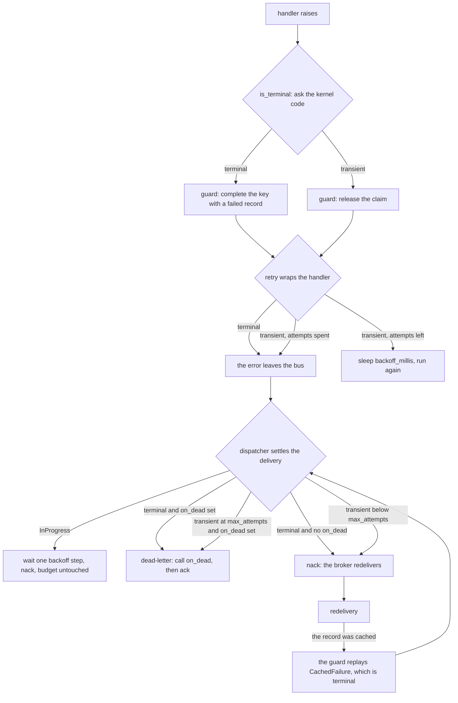

# Errors

The error taxonomy is a cross-language contract. One code per kind of failure. One verdict per code.
Three consumers branch on that verdict.

Every failure the toolkit reports carries a kernel `ErrorCode`. The code carries one decision —
whether the kind is **terminal** — and no software development kit (SDK) restates it. Terminality
decides what gets *persisted*: a terminal failure is cached under the idempotency key and replayed
forever after, a transient one releases the claim. Two SDKs may share one ledger and disagree on a
verdict. One then caches a failure the other would release. That is a durable replay inconsistency.



## The table

| Rust variant | Python exception | `ErrorCode` | Verdict | Who raises it | What branches on it |
|---|---|---|---|---|---|
| `Error::Concurrency { expected, stored }` | `ConcurrencyError` | `concurrency` | transient | `EventStore.append`, `ProjectionStore.save`, `SagaStore.save` on a version mismatch | `retry` re-runs; the guard releases the claim; the dispatcher nacks |
| `Error::Codec(String)` | `CodecError` | `codec` | terminal | codecs; see below | `retry` gives up at once; the guard caches a `failed` record; the dispatcher dead-letters at once |
| `Error::Store(String)` | `StoreError` | `store` | transient | any backend failure that is not a version conflict; also the Python default for an unknown wire code | `retry` re-runs; the guard releases; the dispatcher nacks |
| `Error::AlreadyRegistered(String)` | `AlreadyRegistered` | `already_registered` | terminal | `CommandBus.register`, `EventRouter.register`, the codec registry | nothing at runtime — it is a startup wiring error |
| `Error::BadHandle(String)` | `BadHandle` | `bad_handle` | terminal | a store handed a transaction handle it does not recognise: never begun, already settled, or another transactor's | the dispatcher dead-letters — retrying cannot rewire the store |
| `Error::PayloadMismatch(String)` | `PayloadMismatch` | `payload_mismatch` | terminal | the guard, when the key's stored hash differs from this payload's | the dispatcher dead-letters; the guard never re-runs the handler |
| `Error::InProgress(String)` | `InProgress` | `in_progress` | transient | the guard, when the winner holds the claim and has not completed | `retry` re-runs; the dispatcher waits one backoff step and nacks **without** burning an attempt |
| `Error::CachedFailure(String)` | `CachedFailure` | `cached_failure` | terminal | the guard, replaying a cached terminal failure | the dispatcher dead-letters instead of redelivering forever |
| `CommandBusError::NotFound(String)` | `HandlerNotFound` | `handler_not_found` | terminal | `CommandBus.dispatch` when no handler is registered | the dispatcher dead-letters — a redelivery finds the same registry |
| `CommandBusError::Handler(HandlerError)` | — the handler's own exception propagates | the wrapped error's code | the wrapped error's verdict | `CommandBus::dispatch` wrapping a failed handler | `is_terminal` recurses into the wrapped error |
| — a host's own error type | any exception that is not an `EdaxError` | none | transient (the default) | host code, a downstream client, a panic | everything treats it as worth retrying |

### Who raises `CodecError`

- a codec that cannot marshal or unmarshal an event.
- a command that will not serialize.
- an idempotency record that will not encode or decode.
- a stored hash outside the 64-bit range.
- a Python Kafka payload that will not decode; the consumer returns an `UndecodableDelivery` for it.

An `UndecodableDelivery` carries a handler that raises the terminal error. With a dead-letter sink
wired the dispatcher routes it there and acks it, so a payload that will not decode is never lost and
never crash-loops. Without a sink it nacks and comes back forever, as every dead delivery does — see
[consuming.md](./consuming.md). A sink that raises leaves the message unsettled and the consumer
running, so the broker redelivers and the sink gets another try.

`edax::Error` is `#[non_exhaustive]` and holds the eight rows above. `CommandBusError` holds only
the two ways a *dispatch* itself fails. Python has no `CommandBusError`: `HandlerNotFound` is raised
directly and a handler's exception propagates untouched.

The wire form between the native layer and a binding is `"<code>: <message>"`. `ErrorCode::tag`
builds it. `_edax.split_error` takes it apart, and it is the only place that does. Python's
`errors.from_runtime` calls `_edax.split_error` rather than splitting the string itself. On the
Python side `errors.mapped()` re-raises a native `RuntimeError` as its typed class.

## `is_terminal`, and who owns the verdict

The kernel's table is the single source of truth. Each row names a variant, a wire code and a
verdict. The table is a macro. The variant list, `ErrorCode::ALL`, `ErrorCode::as_str` and
`ErrorCode::is_terminal` cannot drift. `ErrorCode` is deliberately *not* `#[non_exhaustive]`: a new
code must be a compile error in every downstream `match` rather than a wildcard's silent default.

**Rust.** `Error::code()` is an exhaustive match from variant to code, and nothing more:

```rust
/// The kernel's code for this variant. Exhaustive: a new variant must name its code, and the
/// code carries the terminal / transient verdict — the SDK never restates that verdict itself.
pub fn code(&self) -> ErrorCode { /* ... */ }
```

`command::is_terminal` then classifies any boxed handler error. It downcasts to `edax::Error` and
asks its code. It downcasts to `CommandBusError` and either uses `ErrorCode::HandlerNotFound` or
recurses into the wrapped error. Otherwise it returns `false`. The only fall-through is an error
type the SDK does not own, such as a host's own error. That is transient. Transient is the safe
default under at-least-once.

**Python.** A class names its code and looks the verdict up from the kernel when the class is
defined:

```python
cls.code = code
# Raises for a code the kernel does not know: the import fails instead of a class carrying
# a verdict the kernel never pinned.
cls.terminal = _edax.error_code_is_terminal(code)
```

The check runs in both directions. A class naming a code the kernel does not know fails at class
definition; a kernel code with no class fails the import through
`_check_every_kernel_code_has_a_class()`. Neither direction can silently land on the transient
default.

`errors.is_terminal(e)` is then one attribute read:

```python
def is_terminal(e: BaseException) -> bool:
    return bool(getattr(e, "terminal", False))
```

A host subclass that names no code inherits its parent's code and verdict. It does not enter the
code table. The parent stays what a native code maps to.

### Why an unknown code defaults to transient

Both mistakes cost something, and the costs are not symmetric. Guessing transient and being wrong
redelivers a genuinely terminal failure forever. That is loud and visible in queue depth. The work
is still there once the code is mapped. Guessing terminal and being wrong dead-letters a transient
blip. The guard also caches a terminal failure under the key, so the record is written as `failed`.
Re-driving that key afterwards replays `CachedFailure` instead of re-running. That poisons the key
durably; recovery needs someone to delete the record by hand. A noisy loop is recoverable, a
poisoned key plus lost work is not.

`from_runtime` keeps the whole message, code included, when it cannot parse the code. Nothing is
then silently mislabeled as a concurrency conflict. An operator can still read the code off the log
line.


### Your own errors are transient unless you say otherwise

The fall-through matters more than it looks. `is_terminal` is `getattr(e, "terminal", False)` in
Python and a `false` return in Rust. **Every domain error a host defines is therefore transient by
default.** Transient is the safe side under at-least-once. A wrong terminal verdict drops work,
while a wrong transient one only repeats it. It is rarely what a business rule wants.

An insufficient balance will not become sufficient by running the handler again. Left transient,
`retry(3)` re-runs the rule three times. A `KeyOrderedDispatcher` nacks it until `max_attempts`
rather than dead-lettering on the first attempt. The guard releases the claim instead of caching the
failure, so every redelivery re-executes it.

Opt in:

```python
class InsufficientFunds(Exception):
    """Deterministic: running the handler again cannot change the answer."""

    terminal: ClassVar[bool] = True
```

Rust hosts get the same effect by returning an `edax::Error` whose code the kernel already
classifies, or by wrapping their own error in one.

Rule of thumb: if re-running the handler with the same input cannot produce a different outcome, the
error is terminal. Validation failures, business-rule violations and unknown identifiers are
terminal. Timeouts, deadlocks, and anything naming a dependency are not.

## What each consumer does with the verdict

| Consumer | Terminal | Transient |
|---|---|---|
| `retry` | return or re-raise at once, no attempt burned | sleep `backoff_millis` and run again, up to `attempts` |
| the guard | write a `failed` record under the key | release the claim so a retry or redelivery re-runs |
| `KeyOrderedDispatcher` | dead-letter on the **first** failed attempt, whatever `max_attempts` says | nack, until the `max_attempts`-th failed attempt |

**`retry`.** A terminal error cannot come out differently, so spending attempts and backoff on it
only delays the real outcome.

**The guard.** This is the verdict's durable consequence. A terminal failure is cached and every
later claimant replays it as `CachedFailure`; a transient one releases the claim. Two special cases.
A Python cancellation, a `BaseException`, always releases, because nobody is left to complete that
claim. A Rust panic also releases and keeps unwinding, because a panic is not a value a record can
replay faithfully. And when the ledger shares the guard's transaction, a terminal failure is *not*
cached at all — the record would roll back with everything else. See
[`./idempotency.md`](./idempotency.md).

**`KeyOrderedDispatcher`.** A terminal error dies on the first failure because retrying only repeats
it; a transient one is nacked until the attempt ceiling. Two details worth stating:

- `InProgress` is **exempt** from the attempt count. See
  [consuming](./consuming.md#inprogress-is-contention-not-a-failed-attempt).
- A panic is unclassified and therefore transient. A bug on one payload is exactly the poison
  message the ceiling exists for, but a single panic cannot be told from a transient one.

**A terminal failure only dead-letters when `on_dead` is set.** Without a sink, a dead delivery
still nacks. That is never a silent drop. The broker redelivers it. A sink that raises leaves the
delivery neither acked nor nacked, so the broker redelivers on its session timeout and the sink gets
another try.

## One failure, end to end



The loop closes on itself, and that is the point. A terminal failure that reached the ledger comes
back as `CachedFailure` on the redelivery. That is still terminal. The dispatcher dead-letters it on
its first attempt rather than nacking forever. A transient failure released the claim, so the
redelivery re-runs the handler for real.

## The golden vector

`testdata/golden/error_taxonomy.json` is the committed copy of the kernel's table: one row per code,
in the kernel's declaration order, with four fields.

```json
{
  "code": "cached_failure",
  "message": "codec error: invalid type: string, expected u64",
  "terminal": true,
  "wire": "cached_failure: codec error: invalid type: string, expected u64"
}
```

It pins three things:

1. **The code set and its order.** Nine codes today: `concurrency`, `codec`, `store`,
   `payload_mismatch`, `in_progress`, `cached_failure`, `handler_not_found`, `already_registered`,
   `bad_handle`. New codes append, so an existing row's position never moves.
2. **The verdict per code**, which is what an idempotency guard persists on.
3. **The `"<code>: <message>"` framing** every binding parses, with a realistic message per code.

It is generated from `ErrorCode::ALL` and checked from three sides. The flat application binary
interface (ABI) asserts that `error_codes()` and `error_code_is_terminal` are the kernel's own. The
Python suite asserts the committed rows match the kernel's code list. It asserts each class carries
the golden's verdict. It asserts each golden `wire` string parses back to that class, with the code
stripped off the message. The Rust SDK asserts every variant of both its error enums lands on the
side the table says.

Regenerate after an intentional change:

```
EDAX_REGEN=1 mise exec -- cargo test -p edax-core --test golden
```

A code that changes sides then fails in one obvious place. It does not flip a dead-letter into an
infinite redelivery. It does not flip a released claim into a poisoned key.

## See also

- [Commands](./commands.md) — where `retry` and the guard sit in the middleware chain.
- [Idempotency](./idempotency.md) — what a cached `failed` record means and every failure window.
- [Consuming](./consuming.md) — `KeyOrderedDispatcher`, `max_attempts` and `on_dead` in full.
- [Kernel: core](../kernels/core.md) — the `ErrorCode` table, backoff and the rest of the kernel.
- [Golden vectors](../kernels/golden-vectors.md) — the cross-language contract and how to regenerate
  it.
- [Delivery guarantees](../guides/delivery-guarantees.md) — how the verdict shapes the end-to-end
  guarantee.
