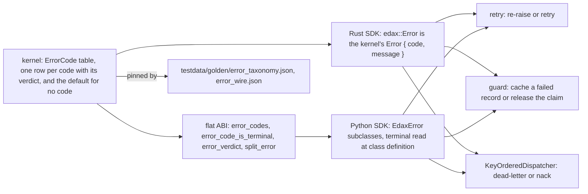
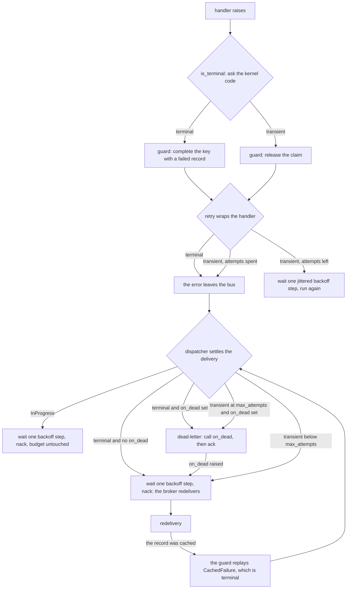

# Errors

The error taxonomy is a cross-language contract. One code per kind of failure. One verdict per code.
Three consumers branch on that verdict.

Every failure the toolkit reports carries a kernel `ErrorCode`. The code carries one decision,
whether the kind is terminal, and no software development kit (SDK) restates it. Terminality
decides what gets persisted: a terminal failure is cached under the idempotency key and replayed
forever after, a transient one releases the claim. Two SDKs may share one ledger and disagree on a
verdict. One then caches a failure the other would release. That is a durable replay inconsistency.



## The table

Rust has one error type for the whole toolkit: the kernel's `Error { code: ErrorCode, message }`,
re-exported as `edax::Error`. Every kernel function, every store and every SDK error is one of these,
so a failure renders one way everywhere: `Display` is the wire form `"<code>: <message>"`. A handler
returns any boxed error (`HandlerError`); a host marks its own business rejection terminal by wrapping
it in `edax::Terminal`.

| Rust | Python exception | `ErrorCode` | Verdict | Who raises it | What branches on it |
|---|---|---|---|---|---|
| `Error::concurrency(expected, stored)` | `ConcurrencyError` | `concurrency` | transient | `EventStore.append`, `ProjectionStore.save`, `SagaStore.save` on a version mismatch; a claim on a key another transaction holds | `retry` re-runs; the guard releases the claim; the dispatcher nacks |
| `Error::codec(..)` | `CodecError` | `codec` | terminal | codecs, every kernel refusal of a value; see below | `retry` gives up at once; the guard caches a `failed` record; the dispatcher dead-letters at once |
| `Error::store(..)` | `StoreError` | `store` | transient | any backend failure that is not a version conflict; also the Python class for an unknown wire code | `retry` re-runs; the guard releases; the dispatcher nacks |
| `ErrorCode::AlreadyRegistered` | `AlreadyRegistered` | `already_registered` | terminal | `CommandBus.register`, `EventRouter.register`, the codec registry, `Upcaster.step` | nothing at runtime: it is a startup wiring error |
| `Error::bad_handle(..)` | `BadHandle` | `bad_handle` | terminal | a store handed a transaction handle it does not recognise: never begun, already settled, or another transactor's; a nested `transaction`; `retry` inside an open transaction; a misconfigured store | the dispatcher dead-letters: retrying cannot rewire the store |
| `ErrorCode::PayloadMismatch` | `PayloadMismatch` | `payload_mismatch` | terminal | the guard, when the key's stored hash differs from this payload's | the dispatcher dead-letters; the guard never re-runs the handler |
| `ErrorCode::InProgress` | `InProgress` | `in_progress` | transient | the guard, when the winner holds the claim and has not completed | `retry` re-runs; the dispatcher waits one backoff step and nacks without spending an attempt |
| `ErrorCode::CachedFailure` | `CachedFailure` | `cached_failure` | terminal | the guard, replaying a cached terminal failure, or a stored record no reader can decode (`original_code` `codec`); the message is the original failure's wire form and `original_code` its code | the dispatcher dead-letters instead of redelivering forever |
| `ErrorCode::HandlerNotFound` | `HandlerNotFound` | `handler_not_found` | terminal | `CommandBus.dispatch` when no handler is registered (or, in Rust, one is registered for another command or result type) | the dispatcher dead-letters: a redelivery finds the same registry |
| `edax::Terminal(err)` | `Rejected`, or any exception with `terminal = True` | `rejected` | terminal | a host's own business rejection ("insufficient funds") | `retry` gives up at once; the guard caches it as `rejected`; the dispatcher dead-letters |
| any other error | any other exception | none | transient (the kernel's default) | host code, a downstream client, a panic | everything treats it as worth retrying |

Every row is a code of the kernel; the second column names the constructor where one exists, and
`Error::new(code, message)` builds any of them.

### Who raises `CodecError`

- a codec that cannot marshal or unmarshal an event.
- a command that will not serialize.
- a filter operand, a projection document or a saga state the SDK's one JSON encoder cannot encode.
  Python encodes all of them with msgspec, the encoder the command hash uses. A `datetime` or a
  `Decimal` that hashes in a command therefore also encodes in a filter. It does not order there:
  msgspec writes a `Decimal` as a string, so `Decimal("9.5")` sorts after `Decimal("10")`. It writes
  a `datetime` without a zero fraction, so a whole second sorts after a later half second. Store
  amounts as integer minor units and timestamps in the fixed-width UTC form
  [the filter kernel](../kernels/filter.md) names.
- an idempotency record that will not encode, or that the strict `decode_record` will not decode. A
  store reads the record holding a key with `decode_prior` instead, which never raises: an unreadable
  record replays as `CachedFailure` with `original_code` `codec`, in both SDKs.
- every kernel refusal. Examples: a batch that is not dense (`check_sequence_batch`), an upcast plan
  with a gap, a cursor that is not base64, an unknown error code.
- in Python, an argument the binding cannot convert: a negative or too-wide integer (`OverflowError`),
  a value of the wrong type (`TypeError`), a `str` holding a lone surrogate (`UnicodeError`).
  `errors.mapped()` turns each into `CodecError`, because each fails the same way on every retry.
- a Python Kafka payload that will not decode; the consumer returns an `UndecodableDelivery` for it.

An `UndecodableDelivery` carries the terminal error and never reaches a handler. With a dead-letter
sink wired the dispatcher routes it there and acks it, so a payload that will not decode is never
lost and never crash-loops. Without a sink it nacks after a backoff step and comes back, as every
dead delivery does; see [consuming.md](./consuming.md). A sink that raises nacks it the same way,
so the redelivery gives the sink another try and the consumer keeps running.

The wire form between the native layer and a binding is `"<code>: <message>"`, always the kernel's
`Error` rendered as is: no binding call site picks a code. `ErrorCode::tag` builds it.
`_edax.split_error` takes it apart, with the kernel's verdict attached, and nothing else does. Python's `errors.from_wire` calls `_edax.split_error` rather than splitting
the string itself. On the Python side `errors.mapped()` re-raises a native `RuntimeError` as its typed
class. Wrap the native call only: a `TypeError` from host code inside the block would be retyped too.

## `is_terminal`, and who owns the verdict

The kernel's table is the single source of truth. Each row names a variant, a wire code and a
verdict. The table is a macro, so the variant list, `ErrorCode::ALL`, `ErrorCode::as_str` and
`ErrorCode::is_terminal` cannot drift. `ErrorCode` is not `#[non_exhaustive]`: a new code must be a
compile error in every downstream `match`, never a wildcard's silent default.

**Rust.** An `edax::Error` carries its code as a field, so there is no mapping to keep in step.
`command::is_terminal` classifies any boxed handler error by its code: an `edax::Error`'s own,
`rejected` for an `edax::Terminal`, and none for anything else. It then asks the kernel,
`edax_core::verdict(code)`, which also owns the answer for no code. One function serves `retry`,
both idempotency guards and the dispatcher, so a verdict has one source. Event handlers return the
same `HandlerError` as command handlers, so a saga that dispatches a command returns the command's
error with `?` and the verdict reaches the dispatcher unchanged.

**Python.** A class names its code and looks the verdict up from the kernel when the class is
defined:

```python
cls.code = code
# Raises for a code the kernel does not know: the import fails instead of a class carrying
# a verdict the kernel never pinned.
cls.terminal = _edax.error_code_is_terminal(code)
```

The check runs in both directions. A class naming a code the kernel does not know fails at class
definition; a kernel code with no class fails the import through
`_check_every_kernel_code_has_a_class()`. Neither direction can silently land on the transient
default.

`errors.is_terminal(e)` then mirrors Rust's `command::is_terminal`. It takes the code the failure
carries and asks the kernel for that code's verdict:

```python
UNCLASSIFIED_IS_TERMINAL: bool = _edax.error_verdict("")


def is_terminal(e: BaseException) -> bool:
    code = _carried_code(e)
    return UNCLASSIFIED_IS_TERMINAL if code is None else _edax.error_code_is_terminal(code)
```

The carried code is an edax error's own, `rejected` for any other exception that declares
`terminal = True`, and none otherwise. `retry`, the guard, the dispatcher and the relay all start
from that one code, so no two of them can disagree. `errors.code_of(e)` is the code a terminal
failure is cached under.

A host subclass that names no code inherits its parent's code and verdict. It does not enter the
code table. The parent stays what a native code maps to. A subclass cannot restate `terminal`:
`class FlakyCodec(edax.CodecError): terminal = False` raises `TypeError` when it is defined. The
code decides, so a restated verdict would be silently ignored. Subclass `Rejected` for a terminal
failure, or raise your own exception for a transient one.

### Why an unknown code defaults to transient

The default is the kernel's (`edax_core::verdict(None)`, `_edax.error_verdict`).
`testdata/golden/error_wire.json` pins it with every negative case: an unknown code, no separator, a
colon without a space, an uppercase code, the empty string. No SDK states it for itself. The kernel
reads a string with no code it knows as a `store` failure (`Error::from_wire`). So the class and the
verdict come from one place, and Python raises `StoreError` for it.

The two possible mistakes cost different amounts. Guessing transient and being wrong redelivers a
terminal failure forever. That is loud and visible in queue depth. The work
is still there once the code is mapped. Guessing terminal and being wrong dead-letters a transient
blip. The guard also caches a terminal failure under the key, so the record is written as `failed`.
Re-driving that key afterwards replays `CachedFailure` instead of re-running. That poisons the key
durably; recovery needs someone to delete the record by hand. A noisy loop is recoverable, a
poisoned key plus lost work is not.

`from_wire` keeps the whole message, code included, when it cannot parse the code. Nothing is
then silently mislabeled as a concurrency conflict. An operator can still read the code off the log
line.

### Your own errors are transient unless you say otherwise

A host error carries no code, so it gets the kernel's default. Every domain error a host defines is
therefore transient by default. Transient is the safe side under at-least-once. A wrong terminal
verdict drops work, while a wrong transient one only repeats it. It is rarely what a business rule
wants.

An insufficient balance will not become sufficient by running the handler again. Left transient,
`retry(3)` re-runs the rule three times. A `KeyOrderedDispatcher` nacks it until `max_attempts`
rather than dead-lettering on the first attempt. The guard releases the claim instead of caching the
failure, so every redelivery re-executes it.

Opt in. In Python, raise `edax.Rejected`, subclass it, or declare the attribute on your own class:

```python
class InsufficientFunds(edax.Rejected):
    """Deterministic: running the handler again cannot change the answer."""


class OrderAlreadyShipped(Exception):
    terminal: ClassVar[bool] = True
```

In Rust, wrap the error in `edax::Terminal`:

```rust
Err(edax::Terminal::new(InsufficientFunds { balance, requested }).into())
```

The guard caches either as `rejected`, so a replay in any SDK names the code.

`examples/py/06_errors_and_retry.py` retries a transient error and stops at once on a `Rejected`
subclass. `examples/py/09_dead_letters.py` shows the same split in a dispatcher with `on_dead`.

Rule of thumb: if re-running the handler with the same input cannot produce a different outcome, the
error is terminal. Validation failures, business-rule violations and unknown identifiers are
terminal. Timeouts, deadlocks, and anything naming a dependency are not.

## What each consumer does with the verdict

| Consumer | Terminal | Transient |
|---|---|---|
| `retry` | return or re-raise at once, no attempt spent | wait one step of its `Pacing` and run again, up to `attempts` |
| the guard | write a `failed` record under the key | release the claim so a retry or redelivery re-runs |
| `KeyOrderedDispatcher` | dead-letter on the first failed attempt, whatever `max_attempts` says | nack, until the `max_attempts`-th failed attempt |

**`retry`.** A terminal error cannot come out differently, so spending attempts and backoff on it
only delays the real outcome.

**The guard.** Here the verdict is durable. A terminal failure is cached, its code beside its
message. Every later claimant replays it as `CachedFailure`, whose message is the original wire form
(`codec: bad payload`). A transient one releases the claim. Three special cases apply. A Python
cancellation, a `BaseException`, always releases, because nobody is left to complete that claim. A
Rust panic also releases and keeps unwinding, because a panic is not a value a record can replay
faithfully. When the ledger shares the guard's transaction, a terminal failure is not cached at all,
because the record would roll back with everything else. See [idempotency](./idempotency.md).

**`KeyOrderedDispatcher`.** A terminal error dies on the first failure because retrying only repeats
it; a transient one is nacked until the attempt ceiling. Two details:

- `InProgress` is exempt from the attempt count. See
  [consuming](./consuming.md#inprogress-is-contention-not-a-failed-attempt).
- A panic is unclassified and therefore transient. A bug on one payload is the poison message the
  ceiling exists for, but a single panic cannot be told from a transient one.

**A terminal failure only dead-letters when `on_dead` is set.** Without a sink, a dead delivery
still nacks after a backoff step, and the broker redelivers it. Nothing is dropped. A sink that
raises nacks the delivery the same way, so the redelivery gives the sink another try.
`KafkaConsumer.run` requires a sink, because on Kafka a nack rewinds and a dead delivery that keeps
coming back stalls its partition.

## One failure, end to end



The loop closes on itself. A terminal failure that reached the ledger comes back as `CachedFailure`
on the redelivery, which is still terminal. The dispatcher dead-letters it on
its first attempt rather than nacking forever. A transient failure released the claim, so the
redelivery re-runs the handler for real.

## The golden vector

`testdata/golden/error_taxonomy.json` is the committed copy of the kernel's table: one row per code,
in the kernel's declaration order, with four fields.

```json
{
  "code": "cached_failure",
  "message": "codec: invalid type: string, expected u64",
  "terminal": true,
  "wire": "cached_failure: codec: invalid type: string, expected u64"
}
```

It pins three things:

1. The code set and its order. Ten codes today: `concurrency`, `codec`, `store`,
   `payload_mismatch`, `in_progress`, `cached_failure`, `handler_not_found`, `already_registered`,
   `bad_handle`, `rejected`. New codes append, so an existing row's position never moves.
2. The verdict per code, which is what an idempotency guard persists on.
3. The `"<code>: <message>"` framing every binding parses, with a realistic message per code.

It is generated from `ErrorCode::ALL` and checked from three sides. The flat application binary
interface (ABI) asserts that `error_codes()` and `error_code_is_terminal` are the kernel's own. The
Python suite asserts the committed rows match the kernel's code list. It asserts each class carries
the golden's verdict. It asserts each golden `wire` string parses back to that class, with the code
stripped off the message. The Rust SDK asserts every code, a `Terminal` and an unclassified host error
land on the side the table says.

`testdata/golden/error_wire.json` is its companion: any wire string, the negative cases included, with
the code the kernel finds (`store` when it finds none), the message, and the verdict. Python asserts
`split_error`, `error_verdict` and `from_wire` against every row.

Regenerate after an intentional change:

```
EDAX_REGEN=1 mise exec -- cargo test -p edax-core --test golden
```

A code that changes sides then fails in one obvious place. It does not flip a dead-letter into an
infinite redelivery. It does not flip a released claim into a poisoned key.

## See also

- [Commands](./commands.md) — where `retry` and the guard sit in the middleware chain.
- [Idempotency](./idempotency.md) — what a cached `failed` record means and every failure window.
- [Consuming](./consuming.md) — `KeyOrderedDispatcher`, `max_attempts` and `on_dead` in full.
- [Kernel: core](../kernels/core.md) — the `ErrorCode` table, backoff and the rest of the kernel.
- [Golden vectors](../kernels/golden-vectors.md) — the cross-language contract and how to regenerate
  it.
- [Delivery guarantees](../guides/delivery-guarantees.md) — how the verdict shapes the end-to-end
  guarantee.
