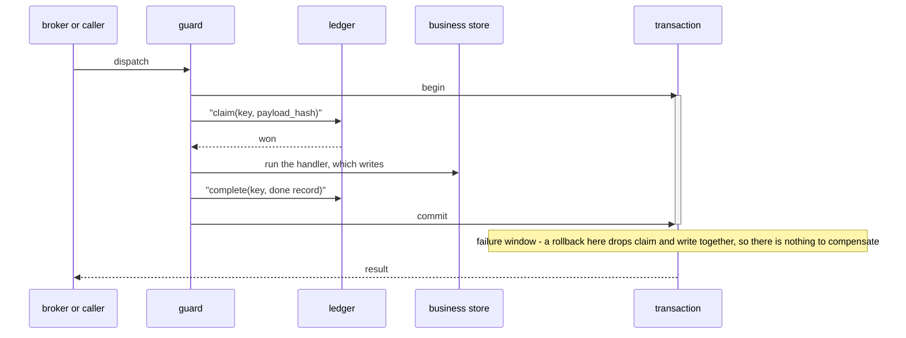
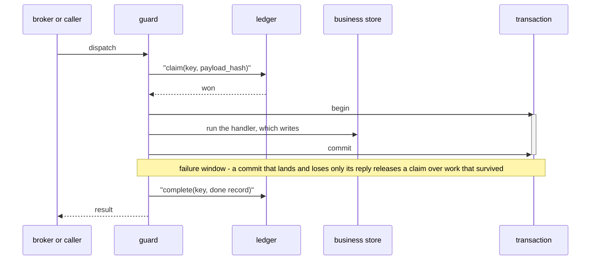
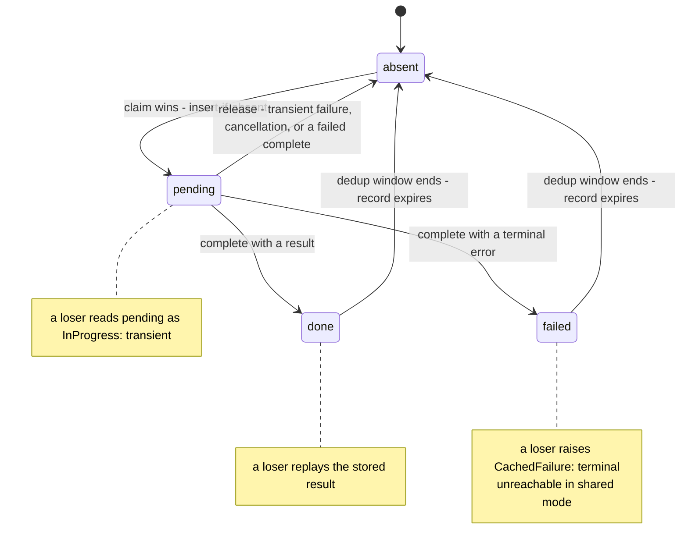

# Idempotency

The four guards, the two orderings they can run, and what the ledger holds after every failure.

A guard wraps a handler, claims a key in a ledger before the handler runs, and writes the outcome
after. A redelivery of the same key replays that outcome instead of running the handler again. What
the replay is *worth* depends on whether the claim and the handler's write commit together, which is
the whole subject of this page.

| Guard (Rust) | Path | Keys on | Hashes | Python equivalent |
|---|---|---|---|---|
| `idempotent(store, key)` | command | `key(&cmd)`, host-chosen; `None` bypasses | the whole command value, canonicalized | `edax.command.idempotent(store, key)` |
| `idempotent_in(store, key, current)` | command | same, plus a `Fn() -> Tx` handle provider | same | `edax.command.idempotent(store, key, unit_of_work=)` |
| `idempotent_by_id(store)` | consume | `env.id` | the raw `env.event.data` bytes | `edax.router.idempotent_by_id(store)` |
| `idempotent_by_id_in(store, current)` | consume | same, plus a `Fn() -> Tx` handle provider | same | `edax.router.idempotent_by_id(store, unit_of_work=)` |

The Rust guards live in `edax::command` and `edax::router`. The Python guards live in `edax.command`
and `edax.router`.

## The four guards

Both paths share one orchestration. Python routes both through `_guarded`; Rust routes both through
`guarded`. The guards differ only in how the key and the hash are derived and in what the caller
does with the result.

**Command path.** The key is whatever the host's key function returns. The hash covers the whole
command value. That is every instance field, including the one the key was read from. The kernel
serializes, canonicalizes and hashes it in `edax_cqrs::command_hash`. Routing metadata is not a
field. A Python command declares `type: ClassVar[str]`. A Rust command implements `command_type()`.
The type name stays out of the hash on both sides. Reusing a key with a different command value is a
`PayloadMismatch`.

**Consume path.** The key is `env.id`. The hash is the kernel's `payload_hash`, Fowler-Noll-Vo 1a
(FNV-1a) 64, over the raw `env.event.data` bytes. Those bytes are host-serialized, so they are not
canonicalized as JSON. Two events sharing an `id` with different bodies raise `PayloadMismatch`: an
integrity error worth surfacing, not a duplicate.

There is one behavioural difference. No caller awaits an event handler's result. A redelivery of a
completed event therefore returns nothing and skips silently. A command redelivery returns the
winner's cached value.

The seam is one Protocol in Python (`edax.command.IdempotencyStore`) and one trait in Rust
(`edax::IdempotencyStore<O>`, which carries the handle type as `type Tx`). `joins_transaction` is
Python-only; see [Rust parity](#rust-parity).

## The two modes

The Python guard picks the ordering from two facts: whether the host passed `unit_of_work`, and
whether the ledger declares `joins_transaction`. The flag is a declaration the guard branches on and
cannot detect; absent, the answer is `False`.

| `unit_of_work` | `joins_transaction` | Function | Ordering |
|---|---|---|---|
| not given | either | `_guarded_around_the_work` | `claim; run; complete` — all three enlist in the host's ambient `current_tx` if one is open |
| given | `True` | `_guarded_in_one_commit` | `begin; claim; run; complete; commit` |
| given | `False` | `_guarded_around_the_work` | `claim; begin; run; commit; complete` |

`MemoryIdempotencyStore` declares `True`; `RedisIdempotencyStore` declares `False`, because Redis
cannot enlist in another database's transaction.

A store that declares `True` **must** refuse a handle belonging to another database — raise
`BadHandle` rather than silently auto-commit. The guard skips its compensation on that store's word,
so a silent auto-commit would leave a `done` record for work that rolled back.

### Shared ledger: `begin; claim; run; complete; commit`



One atomic commit, so the rollback *is* the release. Every failure path in `_guarded_in_one_commit`
is a rollback that drops the claim with the work; the function writes no compensation at all.

Two consequences follow:

- A terminal failure is **not** cached. The record would roll back with everything else, so the key
  is freed. A later reuse of that key with a different payload is no longer caught as
  `PayloadMismatch`. The redelivery simply re-runs a deterministic failure, which left nothing
  behind.
- Losing the claim commits an empty transaction, which costs one round trip.

This mode is effectively-once for state in that database.

### Own ledger: `claim; begin; run; commit; complete`



Two independent commits, which no ordering can make atomic. This is at-least-once with a dedup
window the width of the ledger's retention. Every failure up to and including the commit releases
the claim by hand.

**Why `complete` runs after `commit`.** Consider the alternative ordering, `claim; begin; run;
complete; commit`, with a ledger that cannot join the transaction. It would write the `done` record
before the business commit. A crash in between then leaves a `done` record over work that never
landed. The redelivery replays a success that did not happen. The work is silently lost. Running
`complete` after the commit inverts the loss: the worst case is a claim released over work that did
land, so the redelivery repeats it. A repeat is recoverable by an idempotent handler; silent loss is
not.

`examples/py/event_idempotency.py` runs both modes and asserts the difference, including the
commit-lands-reply-lost window (`CommitLosesItsReply`).

```python
# examples/py/event_idempotency.py — shared unit of work
db = MemoryTransactor()  # one database for both participants
projections = MemoryProjectionStore(db)
guard = idempotent_by_id(MemoryIdempotencyStore(db), unit_of_work=db)
router = edax.EventRouter(guard)
router.register("Deposited", deposit_handler(projections, calls))
```

## The record lifecycle



The wire shape is the kernel's: `{"payload_hash", "result", "error", "pending"}`, read in the order
`pending` wins, then `error`, then `result`. A missing `pending` reads as `false`, so a record
written before the field existed reads as completed. A `null` result on a completed, non-failed
record is a **success whose value is null**, not "no result".

**What a rollback erases in shared mode.** The claim and the terminal record are staged in the same
transaction as the handler's writes. A rollback erases `absent -> pending`. It also erases whichever
of `pending -> done` or `pending -> failed` was staged. The key returns to `absent` with no trace.
That is why `failed` is unreachable there: `_guarded_in_one_commit` never writes it, and a record
written anyway would roll back with the failure that produced it.

**Expiry.** A record must outlive the longest window in which the same key can be redelivered —
broker retry plus client retry. Expiry inside that window turns a replay into a re-run.
`RedisIdempotencyStore` splits the window in two. `claim_ttl_ms` bounds how long a pending claim
blocks its key when the worker holding it dies. `ttl_ms` is the dedup window for a terminal record.
Pinned by `test_claim_after_ttl_expiry_wins_again` and
`test_a_pending_claim_expires_on_the_claim_ttl_not_the_record_ttl` in
`crates/edax-py/tests/test_redis.py`.

## The loser paths

A claimant that does not win reads the winner's record. The kernel classifies it. It checks the hash
first, then the state. The software development kit (SDK) only maps the verdict onto its own error
type.

| Verdict | Raised as | Class | What the caller does |
|---|---|---|---|
| `payload_mismatch` | `PayloadMismatch(key)` | terminal | dead-letter; the key was reused with a different payload |
| `in_progress` | `InProgress(key)` | transient | nack and let the broker redeliver; the winner has not settled |
| `failed` | `CachedFailure(error)` | terminal | dead-letter; the winner already failed deterministically |
| `succeeded` | returns the stored result, `None` included | — | replay |

The hash is checked before the state, so a mismatched payload is rejected even while the winner is
still in progress. The kernel's `outcome` decides that, pinned by `outcome_branches`.

**A loser must never release the winner's key.** Python's `_replay` raises and returns; it writes
nothing. Rust's `guarded` does the same on the `Claim::Prior` arm. An over-eager compensation there
would delete a live claim another worker is still working under. Pinned by
`test_losing_the_claim_never_releases_the_winners_key`.

**The one pre-claim exception.** A `claim` that *fails* is deliberately not compensated, even though
the insert may have landed and only its response been lost. Both SDKs' seams are fallible here —
Python's `claim` raises, Rust's returns `Result<Claim<O>, Error>` — and both guards propagate the
store's own verdict without releasing. The source comment gives the reasoning:

> The guard cannot tell "my insert landed and the response was lost" from "another claimant holds
> this key and the backend reported the contention", and releasing in the second case deletes the
> winner's live claim. A claim whose response was lost is settled by the store's retention instead.

So the asymmetry is deliberate. An orphan pending record costs `InProgress` until the claim's
retention expires. A wrong release costs a duplicate side effect under a claim someone else holds.
The guard takes the recoverable cost.

`InProgress` is not a failed attempt. See
[consuming](./consuming.md#inprogress-is-contention-not-a-failed-attempt).

## Every failure window

Rows 1 to 9 are the case table of `test_unit_of_work.py`, one case per window. "Runs" and "landed"
are counted across two dispatches of one key: the first, then its redelivery.

| # | Mode | What fails, when | Ledger holds after | Redelivery does | Runs | Work | Test |
|---|---|---|---|---|---|---|---|
| 1 | shared | nothing | `done`, committed with the write | replays the cached result | 1 | landed once | `shared_success_replays_instead_of_rerunning` |
| 2 | shared | handler, transiently | nothing — the rollback dropped the claim | re-runs the handler | 2 | rolled back both times | `shared_transient_failure_rolls_back_claim_and_work_so_the_redelivery_reruns` |
| 3 | shared | handler, terminally | nothing — the record would roll back, so it is never written | re-runs, fails the same way | 2 | rolled back both times | `shared_terminal_failure_is_not_cached_because_the_rollback_would_erase_it` |
| 4 | shared | commit, nothing landed | nothing | re-runs the handler | 2 | never landed | `shared_failed_commit_drops_the_claim_with_the_work` |
| 5 | own ledger | nothing | `done`, its own commit after the work's | replays the cached result | 1 | landed once | `split_success_replays_instead_of_rerunning` |
| 6 | own ledger | handler, transiently | nothing — the guard released the claim | re-runs the handler | 2 | rolled back both times | `split_transient_failure_releases_the_claim_so_the_redelivery_reruns` |
| 7 | own ledger | handler, terminally | `failed`, carrying the message | raises `CachedFailure`; the handler does not run | 1 | rolled back | `split_terminal_failure_is_cached_and_replays` |
| 8 | own ledger | commit, nothing landed | nothing — the guard released the claim | re-runs the handler | 2 | never landed | `split_failed_commit_releases_the_claim_so_the_work_is_not_lost` |
| 9 | own ledger | commit lands, its reply is lost | nothing; see below | re-runs and applies the work a **second** time | 2 | landed twice | `split_lost_commit_response_releases_a_claim_over_work_that_landed_so_it_runs_twice` |

In row 9 the guard released a claim over work that survived. It cannot tell a lost reply from a
commit that never happened.

Row 9 is the irreducible one. It is why an own ledger may never be called effectively-once. A
handler behind one must keep its own write idempotent. `EventStore.append` and
`ProjectionStore.save` already are, through their compare-and-set on version.

Windows outside that table, each pinned elsewhere:

| What fails, when | Ledger holds after | Redelivery does | Test |
|---|---|---|---|
| the command will not serialize | nothing — `CodecError` is raised before any claim | fails the same way, still without a claim | `test_idempotent_branches[unencodable_payload_is_terminal_before_any_claim]` |
| `claim` fails | unknown; see below | re-claims. If the insert had landed, `InProgress` until retention frees the key | `test_a_claim_that_raises_is_not_compensated` |
| `complete` fails after a success | nothing — `_complete_or_release` releases instead | re-runs the handler | `test_idempotent_branches[success_with_failing_complete_releases_the_claim]` |
| `complete` fails after a terminal failure | nothing — released, and the caller sees the handler's error, not the store's | re-runs the handler | `test_idempotent_branches[terminal_failure_with_failing_complete_shows_the_handlers_verdict]` |
| the handler's result will not serialize | nothing — terminal and released | re-runs the handler | `test_unserializable_result_is_terminal_and_releases_the_claim` |
| the dispatch is cancelled mid-handler | nothing — the `BaseException` branch releases | re-runs the handler | `test_cancellation_never_strands_a_pending_claim[cancelled_handler_releases_the_claim]` |
| the dispatch is cancelled mid-`complete` | nothing — released | re-runs the handler | `test_cancellation_never_strands_a_pending_claim[cancelled_complete_releases_the_claim]` |
| a Rust handler panics | nothing — released, and the panic keeps unwinding | re-runs the handler | `a_panicking_handler_releases_the_claim` |

When `claim` fails the ledger holds either nothing, or a pending record whose response was lost. The
guard deliberately does not compensate that, and the handler does not run. The Rust twin is
`a_failed_claim_is_reported_and_never_compensated`.

Python has no panic branch; its equivalent is the `BaseException` arm that catches cancellation.
Rust catches the unwind explicitly, because an unwinding handler would otherwise leave the key
pending with nobody left to settle it.

Two broker-level guarantees sit over all of this, asserted in both modes:

- A delivery that ends in a **nack** must leave its key free
  (`test_a_nack_releases_the_claim_so_the_redelivery_reruns`).
- A delivery that **acks** leaves a terminal record, and a redelivery inside the retention window
  replays it (`test_an_ack_keeps_the_claim_so_the_redelivery_is_skipped`).

One property runs over random histories in both SDKs. A key that reads back as a completed success
must have had its handler's write land at least once. Shared mode strengthens it to exactly one.
Pinned by `test_a_done_record_never_covers_work_that_did_not_land` and its Rust twin,
`a_done_record_never_covers_work_that_did_not_land`.

## Rules and constraints

**Nesting is refused.** Passing `unit_of_work` while a transaction is already open raises
`BadHandle` before the handler runs. A guard that opened a second unit of work inside the host's
would commit the claim independently of the writes it guards. That is the split-store failure inside
what looks like a shared store. `test_a_nested_unit_of_work_is_refused` pins it. Pass
`unit_of_work`, or open the transaction around the dispatch. Not both.

**Many SQL databases abort the transaction on the first failed statement.** Every statement after
that failure is refused. An attempt made inside such an aborted transaction cannot reach the data,
and the abort masks the real error. This page is the one home for that fact.

That is why `retry` placement depends on who owns the transaction.
[Commands](./commands.md#retry-placement) states the placement rule.

```python
# examples/py/command_handling.py:90 — no unit_of_work: idempotency outermost, retry inside.
bus = CommandBus(idempotent(MemoryIdempotencyStore(db), key=request_id_of), retry(3))
```

**Store contract clauses for a claim taken inside a transaction**:

- `claim` stays an atomic insert-if-absent inside a transaction. Implement it as `INSERT ... ON
  CONFLICT DO NOTHING`, `SET NX`, or a unique-key insert — never a read followed by a write.
- A loser must reach one of exactly **two** outcomes. The guard is correct under either.
- It **blocks** on the winner's uncommitted row and then reads it, reporting the holder's record.
  - it **fails**, which the backend must raise as `StoreError` — transient, so the guard nacks and
    the redelivery re-claims.
- A third outcome is a bug. Swallowing the failure and then reading under a stale snapshot finds no
  row. It reports a win and runs the handler twice.
- Which of the two outcomes a database gives depends on its isolation level. Establishing that is
  the backend author's job, and no durable backend ships here to establish it for you.
- The blocking wait must be bounded — a lock or statement timeout — and the expiry must also surface
  as `StoreError`. A claim is a remote call like any other.
- A backend that cannot block may instead return the holder's record as pending, which the guard
  reports as `InProgress`. The in-memory store does exactly that: it re-masks a holder's staged
  record as pending, because the holder may still roll back. Both outcomes are correct, so a caller
  must handle either.

**Record contents.** `payload_hash` is the kernel's **unsigned** 64-bit hash: persist it losslessly
as an unsigned integer, a `NUMERIC` or a string. A signed `BIGINT` reads every value at or above
`2**63` back as a negative integer. The SDK rejects that as a terminal `CodecError`. A transient
error there would redeliver forever. A `result` integer is exact within the `i64`/`u64` range and
comes back as a double outside it, so a wider integer travels as a string.

## What this is and is not

edax implements the **Idempotent Consumer** pattern: a dedup table beside the business change,
holding the key, the payload hash and the outcome.

It is **not** the transactional Inbox. The Inbox persists the message *body* and acks the broker
before processing, which decouples the handler from the broker. edax stores no message body, and the
guard runs synchronously in the delivery path, so the handler cannot be decoupled that way
(`examples/py/event_idempotency.py:16`).

**The ceiling.** In shared mode, database state in that one database can be effectively-once: the
claim and the write are one commit. Nothing outside that database is covered. An email, a text
message or a payment application programming interface (API) call is a second system. It has a
commit of its own. It needs its own idempotency key in that system, for example Stripe's
`Idempotency-Key`. The guard collapses the redeliveries it sees. It cannot withdraw a request that
already left.

In an own ledger the ceiling is lower still: at-least-once with a dedup window. [delivery
guarantees](../guides/delivery-guarantees.md) states what edax does and does not promise.

## Rust parity

`joins_transaction` and `unit_of_work=` are Python-only. Rust hosts publish a handle provider to
`idempotent_in` or `idempotent_by_id_in` instead. [Rust parity](./rust-parity.md) states the whole
difference.

## See also

- [transactions.md](./transactions.md) — the `Transactor` seam, `current_tx`, `with_tx` and
  `joins_transaction` from the transaction's side.
- [errors.md](./errors.md) — the terminal/transient taxonomy every branch above reads.
- [commands.md](./commands.md) — the `CommandBus`, the middleware chain and where `retry` sits.
- [consuming.md](./consuming.md) — how the dispatcher settles `InProgress`, a nack and a
  dead-letter.
- [../backends/redis.md](../backends/redis.md) — the cross-process ledger, its two time-to-live
  values (TTLs) and its fence.
- [../kernels/cqrs.md](../kernels/cqrs.md) — `command_hash`, `payload_hash`, `decide` and the
  record.
- [../guides/delivery-guarantees.md](../guides/delivery-guarantees.md) — where these guarantees sit
  end to end.
