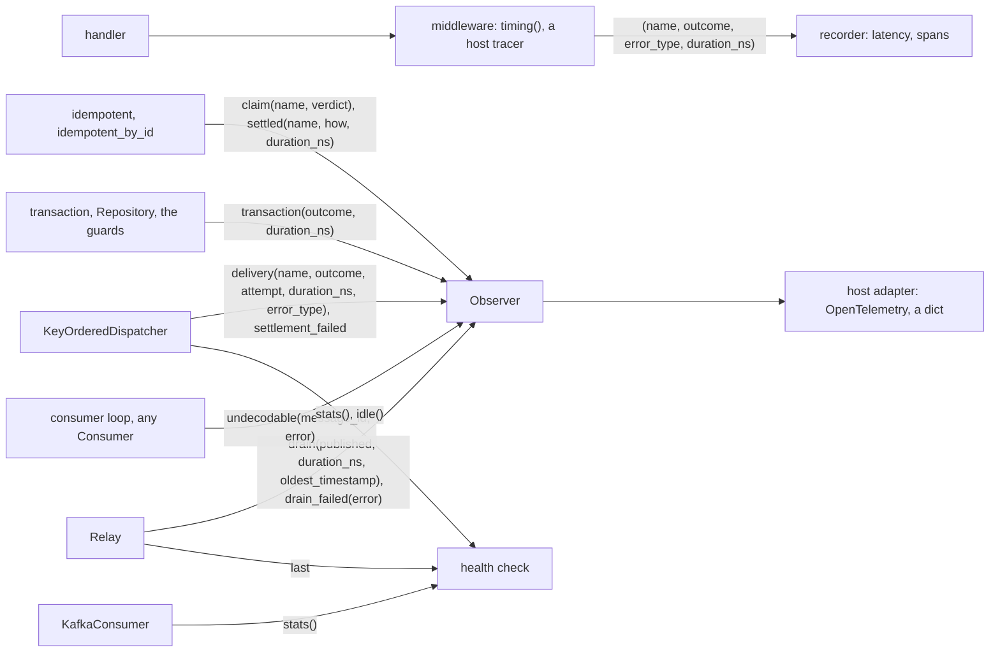

# Observability

What the software development kit (SDK) reports, where each signal is measurable, and how a host
exports it. edax ships no exporter and imports no telemetry library. It reports plain values through
two seams. The host owns the meter, the tracer and the labels.

The vocabulary is in `edax.observe`: the OpenTelemetry (OTel) metric names, the unit, the bucket
list and the outcome strings. Those names live there only; this page quotes them.



## Two seams, and why

A signal lives where it is measurable.

- Traces and handler latency live in the middleware that already wraps every handler.
  `observe.timing()` measures the numbers, and a host tracer opens the span. This is the only place
  command latency is measured; the `CommandBus` reports nothing on its own.
- Metrics of settlement, claims, transactions, drains and poison messages live in the `Observer`.
  The orchestration objects call it after the fact, with a `duration_ns`.

A completion callback runs after the handler returned, so a span opened there has no handler under
it. The handler's own instrumented calls (the database client, the broker client, an HTTP client)
already ended, and would attach to whatever span was current, or to none. A trace must start before
the handler, and only the middleware runs there. So traces belong in middleware, and the `Observer`
carries what is known only afterwards: how a claim ended, how a delivery settled, what a drain
published.

## The Observer

`edax.Observer` is a class of eight no-op methods. Subclass it and override what you export. Every
argument is a plain value. Where an exception is passed, it is for the log line; a metric adapter
labels it with `error_type(error)`, never with its message.

| Method | Reported by | Outcome set | Meaning |
|---|---|---|---|
| `claim(name, verdict)` | `idempotent`, `idempotent_by_id` | `CLAIM_VERDICTS`: `succeeded`, `in_progress`, `payload_mismatch`, `failed` | a dispatch lost the claim to a prior record |
| `settled(name, how, duration_ns)` | `idempotent`, `idempotent_by_id` | `SETTLEMENTS`: `completed`, `released`, `cached`, `refused` | the winner's claim reached its terminal state |
| `delivery(name, outcome, attempt, duration_ns, error_type)` | `KeyOrderedDispatcher` | `DELIVERY_OUTCOMES`: `ack`, `nack`, `dead`, `in_progress`, `sink_failed`, `stale`, `unsettled` | the dispatcher settled a delivery |
| `settlement_failed(name, event_id, error)` | `KeyOrderedDispatcher` | none | an ack or a nack raised after the handler ran |
| `transaction(outcome, duration_ns)` | `transaction`, `Repository`, the guards given a `unit_of_work` | `TRANSACTIONS`: `committed`, `rolled_back` | a unit of work ended |
| `drain(published, duration_ns, oldest_timestamp)` | `Relay` | none | a drain completed |
| `drain_failed(error)` | `Relay` | none | a drain raised |
| `undecodable(message_id, error)` | the consumer loop, for any `Consumer` | none | a poison message: a polled payload the serializer rejected |

### Method by method

Each entry says when the method fires, what its arguments mean, what to read from it, and what it
is not. Each outcome set is also a `Literal` type: `ClaimVerdict`, `Settlement`, `DeliveryOutcome`,
`TransactionOutcome`, `HandlerOutcome`. The hooks are annotated with it, and the tuple is `get_args`
of it, so a type checker catches a branch on a string the SDK never sends.

Hooks are synchronous. An `async def` hook returns a coroutine nobody awaits, so its metric would
vanish. The SDK closes that coroutine and logs an error naming the hook, and the measured work
carries on. Hand the value to a task or queue of your own instead.

The four methods that happen inside a handler take `name` first. It is the command type,
`cmd.type`, on the command bus, and the event name, `msg.name`, on the consume path. That is
the closed set the bus and the router register handlers under, so it is safe as a label.
`transaction`, `drain`, `drain_failed` and `undecodable` have no handler to name.

#### `claim(name, verdict)`: a dispatch lost the idempotency claim

A guarded dispatch asked the ledger for the claim on its key and found a record already there. It
lost. This fires once per losing dispatch, from `idempotent` and `idempotent_by_id`, before the
caller gets the cached result or the error. The `verdict` is the kernel's judgement of that prior
record, verbatim, so a second SDK cannot rename it.

| `verdict` | What the ledger held | What the caller gets |
|---|---|---|
| `succeeded` | the prior run completed | the cached result; the handler does not run |
| `in_progress` | another worker holds the claim right now | `InProgress`, transient |
| `payload_mismatch` | the same key with a different body | `PayloadMismatch`, terminal |
| `failed` | the prior run failed terminally, and that failure is the record | `CachedFailure` |

Read `succeeded` as the duplicate-request rate. Read `in_progress` as contention between workers.
Read `payload_mismatch` as a client reusing a key for a different request. Read `failed` as
clients retrying a request that can never succeed.

`claim` counts losers only. The dispatch that found no record, the winner, reports once, through
`settled`, when its claim ends.

#### `settled(name, how, duration_ns)`: the winner's claim ended

A guarded dispatch won the claim, ran, and its claim reached a terminal state. This fires once per
winning dispatch, after the ledger write that ends the claim, whether that write succeeded or not.
On a shared ledger that write is the commit, so `completed` is reported only once the commit has
landed; a failed commit reports `released`. The `how` says what the ledger holds now, and so what
the next dispatch of the same key will find.

| `how` | What happened | What the next dispatch finds |
|---|---|---|
| `completed` | the handler returned; the ledger holds its result | `succeeded` |
| `released` | the handler failed transiently, or the unit of work rolled back; the record is gone | no record; it runs the handler again |
| `cached` | the handler failed terminally; the failure is the record | `failed` |
| `refused` | the ledger would not take the compensating write (`complete` or `release` raised) | a stale record, `in_progress`, until the ledger's retention drops it |

`duration_ns` is how long the claim was held: winning it to settling it, handler and ledger writes
included. Read `released` as the transient failure rate and `cached` as the terminal one. Alert on
any `refused`: it is ledger trouble, and it blocks the key until retention.

Handler latency is `timing()` on the bus, which covers the replayed dispatches too. A guarded event
handler reports here and through `delivery`, one row for the claim and one for the broker.

#### `delivery(name, outcome, attempt, duration_ns, error_type)`: a broker delivery was settled

A `KeyOrderedDispatcher` worker ran the handler for one delivery and settled it. This fires once
per `Delivery`, after the ack, the nack or the dead-letter, even if that settlement raised.

| `outcome` | What happened | What the broker does |
|---|---|---|
| `ack` | the handler returned; acked | forgets the message |
| `nack` | the handler raised; nacked after one backoff step | redelivers it |
| `dead` | `on_dead` took it; acked | forgets it; the sink has it |
| `in_progress` | the handler raised `InProgress`: another worker holds the claim; nacked after one backoff step, no attempt spent | redelivers it |
| `sink_failed` | `on_dead` raised; nacked after one backoff step, the attempt recorded | redelivers it, and the sink gets another try |
| `stale` | the transport retired it (a nack rewound its partition, or a rebalance took the partition) before or while the handler ran; not settled | redelivers it behind the earlier event of its key |
| `unsettled` | the ack or the nack itself raised; neither landed | a log broker brings it back after a rebalance or a restart |

`nack` is a transient error below the `max_attempts` ceiling, or any error when no `on_dead` is
wired. `dead` is a terminal error on any attempt, or a transient one at the ceiling. A `stale` rate
follows the nack rate on a log broker: each nack retires the partition's queued copies. Its
`duration_ns` is `0` when the handler never ran.

`attempt` is which attempt this delivery was, from `1`, so a nack at the ceiling is told from a
first nack. Bucket it in a histogram at `1, 2, 3, 5, 10`; never label by it. `duration_ns` is the
handler alone, never the backoff wait, so the retry schedule does not skew a latency histogram over
it. `error_type` is what the handler raised, through `error_type()`, or `None` when it returned. It
splits nacks by cause. It also tells a `dead` on a terminal error, such as `codec`, from a `dead` at
the ceiling, where the label is the transient type that kept failing.

A bare message submitted without a `Delivery` fires nothing, because nothing settles it; time that
path with `timing()`. The settlement's own failure is `settlement_failed`.

#### `settlement_failed(name, event_id, error)`: the ack or the nack raised

The handler ran, and then the ack or the nack itself raised. The delivery is now neither acked nor
nacked. A log broker brings it back only after a rebalance or a restart. This fires at most once per
delivery, before `delivery` reports that same delivery as `unsettled`.

`event_id` is for the log line, never a label. `error` is the transport's exception; label by
`error_type(error)`. Read a non-zero rate as broker or commit trouble, not handler trouble: the
work itself finished. An idempotent handler absorbs the redelivery.

An `on_dead` that raises is a sink failure, reported as `delivery` with `sink_failed`, not here.

#### `transaction(outcome, duration_ns)`: a unit of work ended

A unit of work opened through `transaction` ended. This fires once per unit of work the SDK opened:
a `transaction` you called with an observer, a `Repository` that opened its own, or an idempotency
guard given a `unit_of_work`.

| `outcome` | What happened |
|---|---|
| `committed` | the body returned and the commit landed |
| `rolled_back` | the body raised or was cancelled, or the commit itself failed; nothing landed |

`duration_ns` is begin to end, commit included: the time the connection was held. Read the
`rolled_back` rate next to `error_type` from `timing()`, which names the cause.

A call that joined an ambient transaction fires nothing. The `transaction` that opened it reports
once for every participant, so one commit is one row.

#### `drain(published, duration_ns, oldest_timestamp)`: an outbox batch was published

A `Relay` drained one batch to completion: every row published or dead-lettered, and the batch
marked. This fires once per completed drain, an empty batch included.

`published` is the count of rows published, `0` for an empty outbox. The rows handed to `on_dead`
are `Relay.last.dead_lettered`. `duration_ns` is read to mark. `oldest_timestamp` is when the oldest
row in the batch was written, in Unix nanoseconds: an event's `recorded_at`, a command's `issued_at`.
It is `None` for an empty batch. Export it as a gauge and compute the lag at query time, your clock minus the value.
A batch that stays old is a relay that cannot keep up.

A drain that raised fires `drain_failed` instead.

#### `drain_failed(error)`: a drain raised before marking

A `Relay` drain raised in `unpublished`, `publish` or `mark_published`. When a row failed, the rows
before it are marked; the failing row and the rows behind it come back on the next drain, and
delivery stays at-least-once. This fires once per failed drain, before the drain waits its backoff
step and re-raises to the caller.

Label by `error_type(error)`. Read a sustained rate as a relay that is stuck, and pair it with the
`oldest_timestamp` gauge going stale.

#### `undecodable(message_id, error)`: a poison message

A consumer polled a message whose payload the serializer rejected. No handler sees it. The consumer
loop routes it to `on_dead` and acks it, or nacks it after a backoff step when no sink is wired or
the sink raises. This fires once per poisoned delivery, from the loop, for any `Consumer`.

`message_id` is the transport's own id, `topic/partition/offset` on Kafka, for the log line only.
`error` is the decode failure; label by `error_type(error)`. Read any count as a producer
publishing a shape this consumer cannot read: a contract problem, not a retry problem. The message
never reached a worker, so no `delivery` reports it.

#### `timing()` rows: handler latency

`timing()` is middleware, not an `Observer` method, and uses the same vocabulary. It hands its
recorder one row per handler call: `(name, outcome, error_type, duration_ns)`. `name` is the command
type or the event name. `outcome` is `ok` when the handler returned, `error` when it raised, with
`error_type` of the exception. `duration_ns` is the handler and everything inside the middleware
chain below `timing()`, so wire it outermost to include the guard, or inside the guard to exclude
it.

### Which signal answers which question

| Question | Signal |
|---|---|
| How many duplicate requests do we get? | `claim` with `succeeded` |
| Are workers fighting over the same key? | `claim` and `delivery` with `in_progress` |
| Are clients reusing keys for different requests? | `claim` with `payload_mismatch` |
| How often do handlers fail, and how? | `timing()` rows with `error`, by `error_type` |
| How often does a failure retry, and how often does it give up? | `delivery` with `nack` and `dead`, by `error_type` |
| How many attempts does a message need? | the `attempt` histogram on `delivery` |
| Is the broker or the commit failing after the work is done? | `settlement_failed`, and `delivery` with `unsettled` |
| Is the dead-letter route down? | `delivery` with `sink_failed` |
| Is the ledger healthy? | `settled` with `refused` |
| How long do we hold a database connection? | `transaction` |
| Is the outbox falling behind? | `drain` with `oldest_timestamp`, and `drain_failed` |
| Is a producer publishing something we cannot read? | `undecodable` |
| Are the workers keeping up right now? | `stats().queue_depth` and `in_flight`, below |

### Wiring

There is no default observer and no global. Pass one where you build the orchestration object, as
you pass `on_dead`:

```python
from edax import (
    CommandBus,
    EventRouter,
    KeyOrderedDispatcher,
    Relay,
    Repository,
    idempotent,
    idempotent_by_id,
    transaction,
)

observer = OtelObserver()  # yours; see the adapter below

repo = Repository(store, events, aggregates, observer=observer)
bus = CommandBus(idempotent(ledger, scope="accounts", observer=observer))
router = EventRouter(idempotent_by_id(ledger, unit_of_work=db, scope="balances", observer=observer))
dispatcher = KeyOrderedDispatcher(4, router.dispatch, on_dead=sink, observer=observer)
relay = Relay(store, producer.publish, observer=observer)

async with transaction(db, observer=observer):  # a unit of work you open yourself
    ...
```

A `Consumer` takes no observer. Its loop settles a poison message through the dispatcher and reports
it through the dispatcher's observer, so every adapter that follows the seam contract is covered.

`None`, the default, is the no-op `Observer`. The SDK guards every call: an observer that raises is
logged under `edax.observe`, and the dispatch, the drain or the settlement completes as if it had
not. A broken exporter never fails the work it measures.

## The cardinality rule

A metric adapter labels only by `name`, `verdict`, `how`, `outcome` and `error_type`. `name` is
the handler's registered command type or event name, a closed set. It never labels by `event_id`,
`message_id`, `key` or `aggregate_id`.

Every distinct label set is one time series in the metrics database. Each outcome set is a handful
of fixed strings. Event ids are one per message, forever. A counter labelled by event id creates a
new series per delivery, and a time-series database (TSDB) keeps every one of them in memory and on
disk. That is unbounded growth from a single line of adapter code. It reads as a memory leak in the
collector and a scrape that slows down week by week.

The `*_id` arguments the `Observer` receives exist for the log line. Put per-message ids on spans
and in structured logs, where one record costs one record. The `error_type` argument is passed
separately from the exception for the same reason: the message is unbounded, the type is not.

## error.type

`observe.error_type(e)` is the low-cardinality label for an exception. For an edax error it is the
kernel's wire code: `concurrency`, `store`, `codec`, `payload_mismatch`, `in_progress`,
`cached_failure`, `handler_not_found`, `already_registered`, `bad_handle`, `rejected`. For any other
exception it is the qualified class name, `builtins.ValueError` or
`asyncpg.exceptions.DeadlockDetectedError`, which is the OTel recommendation for a host exception.

```python
def error_type(e: BaseException) -> str:
    return getattr(e, "code", None) or f"{type(e).__module__}.{type(e).__qualname__}"
```

Terminal versus transient is not a telemetry concern. The kernel decides it, `is_terminal` reads it,
and the dispatcher and the guard act on it before the observer hears anything. The `dead` outcome
and the `cached` settlement already carry that verdict. See [errors.md](./errors.md).

## The pull surface

Four objects expose a snapshot for a health check or a gauge callback. The dispatcher, the relay
and the Kafka consumer answer from memory, on the loop's thread, with no locking.
`unpublished_count` queries the store.

| Read | Type | Fields |
|---|---|---|
| `KeyOrderedDispatcher.stats()` | `DispatcherStats` | `queue_depth: list[int]` one entry per worker; `in_flight: int` items taken off a queue and not yet settled; `attempts_tracked: int` and `contended_tracked: int`, the sizes of the two failure maps; `running: bool`, true only while every worker is alive; `workers_alive: int`; `handling: int` handlers running right now, which a rebalance waits on |
| `KeyOrderedDispatcher.idle()` | `bool` | every queue empty and `in_flight == 0` |
| `Relay.last` | `DrainStats`, or `None` until the first drain completes | `published: int`, `duration_ns: int`, `oldest_timestamp` (an `int`, or `None` for an empty batch), `dead_lettered: int`; a drain that raised leaves it |
| `await EventStore.unpublished_count()` | `int` | optional store method: committed unmarked outbox rows waiting now |
| `KafkaConsumer.stats()` | `dict[TopicPartition, PartitionStats]` | `unsettled: int` offsets delivered and not yet settled, retired ones included; `live: int` of those, the ones a handler may still settle; `max_delivered: int` the highest offset booked; `committed` the last watermark, `None` before the first commit |

The health checks a host builds from them:

- **Caught up.** `dispatcher.idle()` is `True` and every `PartitionStats.unsettled` is `0`. Use it
  as the readiness for a drain before shutdown.
- **Backpressure.** `sum(stats().queue_depth)` against `max_queue` times the worker count. A queue
  near its bound means `submit` is about to block the poll loop.
- **Outbox lag.** `relay.last.oldest_timestamp` against your clock, `edax.current_timestamp()` for
  the kernel's. The relay reports a timestamp, not an age, so it needs no clock of its own. Alert
  when the lag climbs across drains.
- **Outbox depth.** `await store.unpublished_count()` is how many rows are waiting now. `Relay.last`
  moves only when a drain completes. A relay that died, a publisher that is failing, and an idle
  system all leave it frozen. A depth that grows while `last` stands still is a stalled relay.
- **Failure maps.** `attempts_tracked` and `contended_tracked` grow by one per failing id and shrink
  when that id is settled. Steady growth means nacked ids that never come back.

`unpublished_count` is not declared on the `EventStore` Protocol. Read it with
`getattr(store, "unpublished_count", None)`, and declare `supports_unpublished_count = True` on your
`EventStoreContract` subclass so the conformance clause runs. `MemoryEventStore` implements it.
Without it, `oldest_timestamp` is the lag signal and depth is unavailable.

## Traces via extensions, and where request-scoped values go

Every message carries `extensions: dict[str, str]`, the edax context a reader acts on, beside the
application's own `metadata`. A W3C `traceparent` belongs in `extensions`. The flow ids do not: they
are fields of their own, `correlation_id` and `causation_id`. A host starts the event span from
`msg.extensions` on the consume path, so the span's parent is the span that saved the event. The
value rides `Repository.save(extensions=...)`, lands on the outbox row, survives the `Relay` and the
broker inside the message, and comes back on the delivered message unchanged. Kafka needs no
`traceparent` header for it. A command carries it the same way: `dispatch(cmd, extensions=...)`, or
`command_message(cmd, extensions=...)` for a command you publish.

```python
from opentelemetry import propagate

carrier: dict[str, str] = {}
propagate.inject(carrier)  # writes `traceparent` from the current span
await repo.save(account, extensions=carrier)
```

The W3C header names fit the kernel's [extension key rule](../kernels/event.md#three-tiers-of-fields).
A key outside it raises `CodecError` before the save writes.

A command field must be the same on every legitimate retry of one intent. The command's name and
instance fields are the idempotency hash. A value minted fresh per attempt hashes differently, meets
the stored record under the same key, and raises `PayloadMismatch` for a legitimate duplicate.
Everything else about the request goes beside the payload, on the message.

| Value | Where it goes | Why |
|---|---|---|
| the client's `Idempotency-Key` | `dispatch(cmd, idempotency_key=...)` | the message's `idempotency_key`, which the guard claims. The client sends one key per intent, so a retry repeats it |
| `traceparent` | `extensions` | edax context a reader acts on; fresh per attempt, so it would change the hash |
| an application value, such as a tenant or an actor | `metadata` | the application's own; edax never reads it |
| a server-minted request id | `originate(correlation_id=...)` | it roots the flow; every message the request causes carries it |
| the causing event's id and correlation, on a saga-emitted command | the command message | the kernel sets both when the saga runner writes the outbox row |

The command is the business intent; the extensions and metadata are the request. The split follows one
test: does a retry of the same intent produce the same bytes?

The same rule answers the inversion-of-control question. There is no dependency injection hook on
the `CommandBus`. Middleware is the seam: close over what a handler needs at registration, and read
the ambient transaction through `current_tx`. See [commands.md](./commands.md).

## What the host measures itself

The SDK cannot see some signals, because it never runs the code that produces them. The seams for
them exist, so each is a few lines in your application.

**Event age.** The time from the event's `recorded_at` to the moment a handler takes it. That is the
end-to-end latency of the consume path and the staleness of every read model. `timing()` measures
the handler; this middleware measures the wait before it. The clock is `edax.current_timestamp()`,
the kernel clock the memory store records with; a database store records with its own.

```python
def aged(record: Callable[[str, int], None]) -> EventMiddleware:
    def mw(next_: EventHandler) -> EventHandler:
        async def handler(msg: EventMessage) -> None:
            record(msg.name, edax.current_timestamp() - msg.recorded_at)  # nanoseconds
            result = next_(msg)
            if inspect.isawaitable(result):
                await result

        return handler

    return mw
```

**Stores.** The SDK never calls a `ProjectionStore`; your handlers do. The `EventStore` and the
`SagaStore` are yours too. Each is a `Protocol`, so a class that holds the real store and times
every method is a complete adapter. Label by method name and `error_type`. A `ConcurrencyError` on
`append` or `save` is the write conflict rate.

**Sagas.** `SagaRunner.on_event` is an event handler, so `timing()` on the router already times it,
and every command it emits runs through the bus counters. What it does not tell you is the
instance's fate: started, advanced, completed, or ignored. Wrap the `SagaStore` for `save` and
`delete` counts, or the `Saga` for `correlation_id` returning `None`.

**Replay length.** How many events a `Repository.load` replayed after the snapshot is the snapshot
health signal. Wrap `EventStore.load` and record `len(result)` per aggregate type.

**Kafka consumer lag.** The distance from `PartitionStats.committed` to the broker's end offset
needs a client call. Read it from the client, not from edax.

## OTel mapping

The messaging semantic conventions are Development stability. The names below are current at the
time of writing and are kept in `observe.py` rather than a golden file for that reason.

| edax signal | OTel instrument | Attributes |
|---|---|---|
| command handler latency (`timing` on the bus) | `INTERNAL` span; a host histogram if wanted | `edax.command.type`, `error.type`; no `messaging.*` |
| event handler latency (`timing` on the router) | `messaging.process.duration`, and a `process` span from `msg.extensions` | `messaging.system`, `messaging.operation.type=process`, `error.type` |
| `delivery(name, outcome, ..., error_type)` | `messaging.client.consumed.messages` counter, `messaging.process.duration` histogram | `messaging.destination.name=name`, `messaging.operation.type=process`, `edax.outcome`, `error.type` |
| `delivery(..., attempt, ...)` | histogram, `edax.delivery.attempt`, buckets `1, 2, 3, 5, 10` | `messaging.destination.name`, `edax.outcome` |
| `settlement_failed(name, ...)` | counter, `edax.settlement.failed` | `messaging.destination.name`, `error.type` |
| `claim(name, verdict)` | counter, `edax.claim.lost` | `edax.handler=name`, `edax.verdict` |
| `settled(name, how, ...)` | histogram, `edax.claim.held` | `edax.handler=name`, `edax.settlement` |
| `transaction(outcome, ...)` | histogram, `db.client.operation.duration`, or `edax.transaction` if the store is not a database | `edax.outcome` |
| `drain(published, duration_ns, ...)` | `messaging.client.sent.messages` counter, `messaging.client.operation.duration` histogram | `messaging.operation.type=send` |
| `drain(..., oldest_timestamp)` | gauge, `edax.outbox.oldest`, the timestamp in seconds; the lag is `now - value` at query time | — |
| `drain_failed` | counter, `edax.drain.failed` | `error.type` |
| `undecodable` | counter, `edax.undecodable` | `error.type` |
| `stats().queue_depth` | observable gauge, `edax.dispatcher.queue_depth` | — |

Commands are not messaging. A dispatch on the bus is an in-process call, and the messaging
conventions require a `messaging.system` value that has no honest answer for one. Use an `INTERNAL`
span with `edax.command.*` attributes. The consume and produce paths are messaging: `process` for a
delivery, `send` for a drain, `settle` for an ack or nack span if you open one.

OTel has no dedicated ack/nack metric. The outcome-labelled `delivery` counter is the standard shape
and covers acks, nacks, dead-letters, contention and the unsettled arm in one series per outcome.

Durations cross as nanoseconds. OTel histograms take seconds, so every adapter divides by `1e9`.
`DURATION_UNIT` is `"s"` and `DURATION_BUCKETS` is the OTel explicit bucket list for
`messaging.*.duration`, `0.005` to `10`.

## Copy-paste adapters

None of these ship, and edax imports none of their libraries. They live in your application, next
to your meter provider, and you may rename every instrument. Each block is complete.

### OpenTelemetry

```python
# yourapp/telemetry/otel.py

from opentelemetry import metrics

from edax import Observer
from edax.observe import (
    DURATION_BUCKETS,
    DURATION_UNIT,
    METRIC_CONSUMED_MESSAGES,
    METRIC_OPERATION_DURATION,
    METRIC_PROCESS_DURATION,
    METRIC_SENT_MESSAGES,
    error_type,
)

meter = metrics.get_meter("edax")
BUCKETS = list(DURATION_BUCKETS)
SYSTEM = {"messaging.system": "kafka"}  # yours

consumed = meter.create_counter(METRIC_CONSUMED_MESSAGES)
process = meter.create_histogram(
    METRIC_PROCESS_DURATION, unit=DURATION_UNIT, explicit_bucket_boundaries_advisory=BUCKETS
)
sent = meter.create_counter(METRIC_SENT_MESSAGES)
drains = meter.create_histogram(
    METRIC_OPERATION_DURATION, unit=DURATION_UNIT, explicit_bucket_boundaries_advisory=BUCKETS
)
attempts = meter.create_histogram(
    "edax.delivery.attempt", explicit_bucket_boundaries_advisory=[1, 2, 3, 5, 10]
)
claims_lost = meter.create_counter("edax.claim.lost")
claim_held = meter.create_histogram(
    "edax.claim.held", unit=DURATION_UNIT, explicit_bucket_boundaries_advisory=BUCKETS
)
settlement_failed = meter.create_counter("edax.settlement.failed")
transactions = meter.create_histogram(
    "edax.transaction", unit=DURATION_UNIT, explicit_bucket_boundaries_advisory=BUCKETS
)
outbox_oldest = meter.create_gauge("edax.outbox.oldest", unit=DURATION_UNIT)
drain_failed = meter.create_counter("edax.drain.failed")
undecodable = meter.create_counter("edax.undecodable")


class OtelObserver(Observer):
    def claim(self, name: str, verdict: str) -> None:
        claims_lost.add(1, {"edax.handler": name, "edax.verdict": verdict})

    def settled(self, name: str, how: str, duration_ns: int) -> None:
        claim_held.record(duration_ns / 1e9, {"edax.handler": name, "edax.settlement": how})

    def delivery(
        self, name: str, outcome: str, attempt: int, duration_ns: int, error_type: str | None
    ) -> None:
        attrs = {
            **SYSTEM,
            "messaging.destination.name": name,
            "messaging.operation.type": "process",
            "edax.outcome": outcome,
        }
        if error_type is not None:
            attrs["error.type"] = error_type
        consumed.add(1, attrs)
        process.record(duration_ns / 1e9, attrs)
        attempts.record(attempt, {"messaging.destination.name": name, "edax.outcome": outcome})

    def settlement_failed(self, name: str, event_id: str, error: BaseException) -> None:
        settlement_failed.add(
            1, {**SYSTEM, "messaging.destination.name": name, "error.type": error_type(error)}
        )

    def transaction(self, outcome: str, duration_ns: int) -> None:
        transactions.record(duration_ns / 1e9, {"edax.outcome": outcome})

    def drain(self, published: int, duration_ns: int, oldest_timestamp: int | None) -> None:
        attrs = {**SYSTEM, "messaging.operation.type": "send"}
        sent.add(published, attrs)
        drains.record(duration_ns / 1e9, attrs)
        if oldest_timestamp is not None:
            outbox_oldest.set(oldest_timestamp / 1e9)

    def drain_failed(self, error: BaseException) -> None:
        drain_failed.add(1, {**SYSTEM, "error.type": error_type(error)})

    def undecodable(self, message_id: str, error: BaseException) -> None:
        undecodable.add(1, {**SYSTEM, "error.type": error_type(error)})
```

### Tracing middleware

The span opens before the handler, so the handler's own instrumented calls nest under it.
`start_as_current_span` records the exception and sets the `ERROR` status by default; the middleware
adds only `error.type`, and re-raises so the guard and the dispatcher still see the failure.

```python
# yourapp/telemetry/tracing.py
import inspect

from opentelemetry import propagate, trace
from opentelemetry.trace import SpanKind

from edax import EventMessage
from edax.observe import error_type
from edax.router import EventHandler

tracer = trace.get_tracer("edax")


def traced(next_: EventHandler) -> EventHandler:
    async def handler(msg: EventMessage) -> None:
        parent = propagate.extract(msg.extensions)  # the `traceparent` saved with the event
        attrs = {"messaging.system": "kafka", "messaging.operation.type": "process"}
        with tracer.start_as_current_span(
            f"process {msg.name}", context=parent, kind=SpanKind.CONSUMER, attributes=attrs
        ) as span:
            try:
                result = next_(msg)  # sync or async, as any EventHandler may be
                if inspect.isawaitable(result):
                    await result
            except Exception as e:
                span.set_attribute("error.type", error_type(e))
                raise

    return handler
```

Wire it outermost, before the guard: `EventRouter(traced, idempotent_by_id(ledger, ...))`. The
command form is the same shape over `Middleware`, with `kind=SpanKind.INTERNAL`, the span named
after `cmd.type`, and `edax.command.type` in place of the `messaging.*` attributes. Pair either with
`timing()` next to it when you want the histogram as well as the span.

## See also

- [Commands](./commands.md) — the middleware chain `timing()` and a tracer plug into.
- [Consuming](./consuming.md) — the settlement arms behind every `delivery` outcome.
- [Idempotency](./idempotency.md) — what each `claim` verdict and `settled` state means for the
  record.
- [Outbox](./outbox.md) — the drain `Relay.last` describes.
- [Errors](./errors.md) — the taxonomy `error_type` reads its codes from.
- [kafka](../backends/kafka.md) — the watermark `PartitionStats` reports.
- `examples/py/14_observability.py` — an observer that prints the claim, settlement, transaction
  and drain signals, beside `timing()` and `Relay.last`, with no telemetry library.
