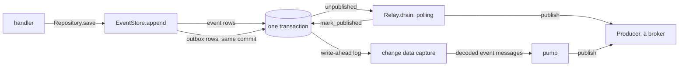
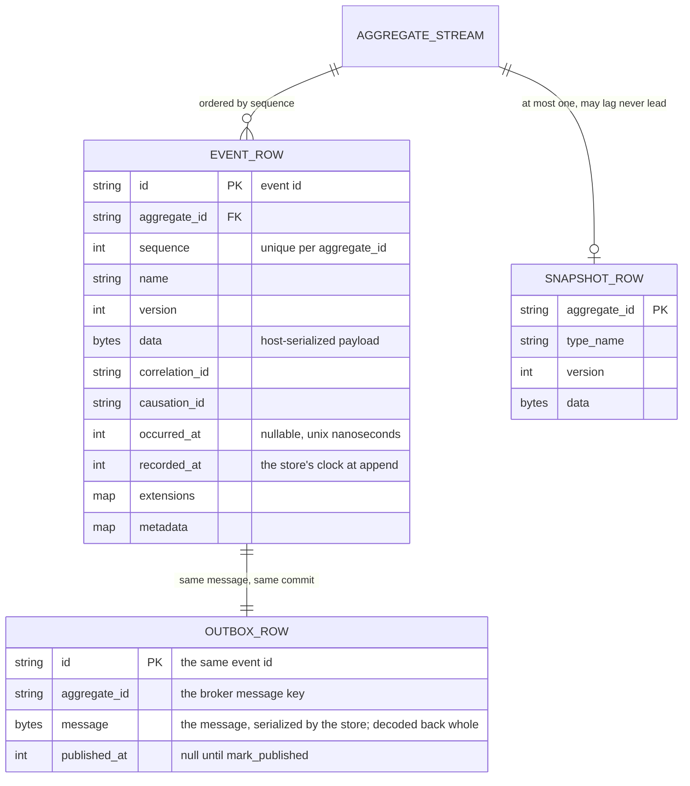
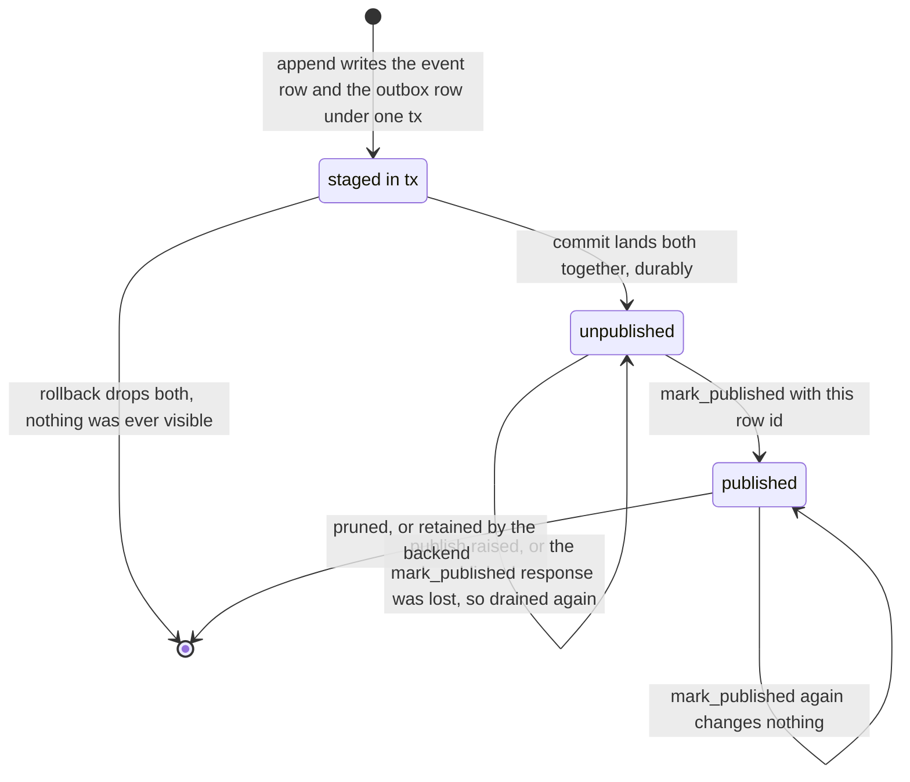
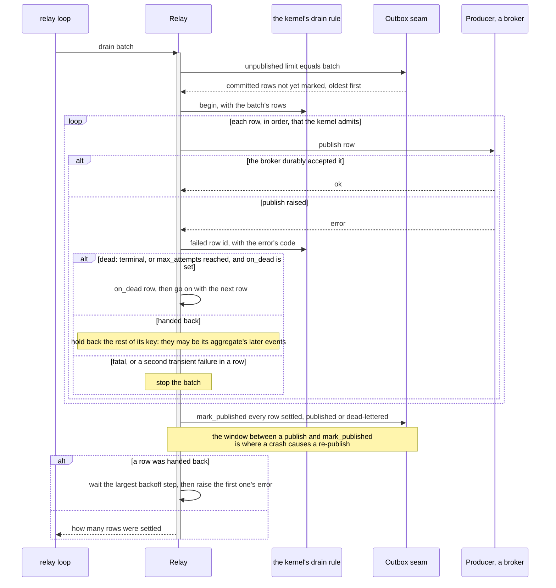
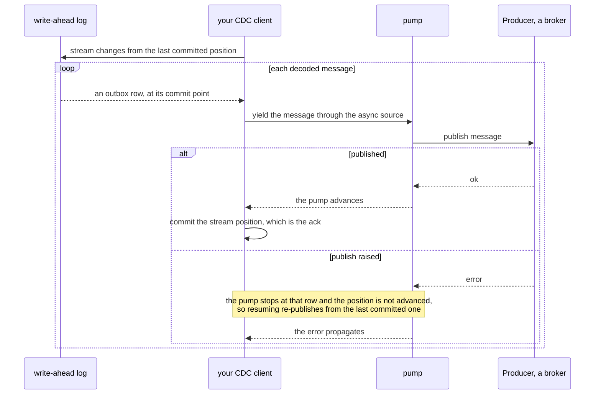

# The transactional Outbox

How `EventStore.append` writes to-publish rows beside the event rows, and how a `Relay` or a `pump`
gets them to a broker.

A service that changes state and publishes an event has two systems to write to. It cannot write to
both atomically. The transactional Outbox removes the second write from the critical path. The event
and its to-publish row commit together in one database transaction. A separate process moves the row
to the broker afterwards.



## Why a dual write cannot be made atomic

Write the row, then publish. The process dies in between: the state changed and nobody was told.
Publish, then write the row. The process dies in between: consumers acted on an event whose state
never committed. Reordering does not help, because there is no ordering of two independent commits
that survives a crash between them. Making them one commit needs a distributed transaction across a
database and a broker, which edax does not use and most brokers do not offer.

The outbox avoids it. There is only one commit, because the to-publish row is a database row
written by the same store, in the same transaction, as the state it announces.

`Outbox` (a Python `Protocol`, a Rust trait) is only the read side a `Relay` drains: `unpublished`
and `mark_published`. It is a port of its own, never a member of a write port. Every write port stages
its outbox rows in the caller's `tx`, and one object may implement both, as the memory stores do. A row
needs only an `id` to be marked by. Every outbox is written in the same transaction as the state it
announces:

| Outbox | Rows | Written by | Read through |
|---|---|---|---|
| the event outbox | `EventMessage`s | an `EventStore`'s `append` | the store's own `Outbox`, where it implements one |
| a saga's command outbox, one per saga name | `CommandMessage`s | the saga step's `save` or `complete` | `runner.outbox()`, a `SagaOutbox` |
| a command outbox, optional | `CommandMessage`s | `Repository.save(..., commands=[...])`, through `CommandOutbox.enqueue` under the save's `tx` | the backend's `Outbox` |

So no backend can split the state write and the to-publish write across two systems by accident. A
command outbox enforces it; see [its refusals](../backends/README.md#commandoutbox). See [commands](./commands.md#three-routes-for-a-command) for when to send a command
through one.

The remaining gap is the publish itself, which is still a separate step and therefore still
at-least-once. That gap is bounded and recoverable: the row is durable, so a redelivery is a
duplicate, never a loss.

## Choosing public events

Every appended domain event gets an event-outbox row. The host's `publish` callback can select
which events leave the service and translate them into a public contract. Returning successfully
without sending deliberately consumes that row when the relay marks it published.

For translated events, keep public IDs and payloads stable across retries. Preserve the tenancy,
lineage, and ordering promised by the public contract. Await durable publication before returning;
a mapping or send failure must raise so the relay can apply its failure policy.

Use a separate public event stream or outbox when the public contract needs independent retention
or a persisted transformation. Publishing domain events directly remains valid when those events
already form the intended public contract.

## Stored shapes



`EVENT_ROW` and `SNAPSHOT_ROW` mirror `EventMessage` and `Snapshot`. `OUTBOX_ROW.message` is the
message in whatever form the store keeps it, not the broker's wire form. `unpublished` hands back the
structured message, every field intact, and the producer encodes it at publish time. The store stamps
`recorded_at` with its own clock when it appends, and `load` and `unpublished` return that value. The
outbox row's primary key is the same event id as the event row's; that shared id is what a consumer deduplicates on
after a redelivery. The id is unique store-wide: an `append` carrying an id the store already holds
is refused with `CodecError` and writes nothing. Without that, two rows share an id, and marking the
first published prunes the second before it was ever sent. The primary key gives it on SQL; the
in-memory store checks it (`EventStoreContract.test_an_event_id_already_stored_is_refused`).

A snapshot may lag the stream but never lead it (`test_a_snapshot_leading_the_stream_is_refused`,
`test_the_latest_snapshot_wins`). [Aggregates](./aggregates.md#snapshots) covers the rule and how
`Repository.load` treats a snapshot as a cache.

`published_at IS NULL` is one shape for a polling relay on a SQL database, not a requirement. The in-memory adapter instead prunes a row from
the outbox when it is marked. The outbox then holds only unpublished rows. `unpublished` becomes a
bounded prefix scan rather than a filter over a growing log.

## The row lifecycle



`unpublished` returns only committed rows, oldest commit first, and at minimum one aggregate's
rows in `sequence` order. A row staged inside an open transaction is not a row to publish; the
in-memory store enforces that by reading the outbox outside any transaction token at all.

### mark_published is idempotent

The `EventStore` contract (`edax.store`) requires `mark_published` to be idempotent and durable, and
to run outside any `tx`, as `unpublished` does. Rust's `Outbox::mark_published` says the same.
Idempotent means three things, and all three are tested:

| Call | Must do |
|---|---|
| ids already marked | nothing, no raise |
| ids the store never saw, such as a change-data-capture drain marking rows by id | nothing, no raise |
| an empty id list | nothing, no raise |

None of the three may touch the rows still waiting to publish.

The relay's own acknowledgement can be lost. The relay publishes a batch, calls `mark_published`,
and the response never arrives. It has no way to tell "the mark landed" from "the
mark did not land". So it re-drains, publishes the same rows again, and marks them again. Both
repeats must be harmless: the second publish is caught downstream by the dedup on `msg.id`, the
second mark is caught by idempotence here.

## Relay.drain — polling



```python
published = await edax.Relay(store, events.publish).drain()
```

`examples/py/07_outbox_relay.py` drains this way. `drain` publishes one batch, of
`edax.outbox.DEFAULT_BATCH` rows unless you pass `batch`, and returns how many rows it settled.
`unpublished(limit)` takes its page size from the relay, never from a default of its own. The Python
`Relay` is generic in its row type, `Relay[EventMessage]` or `Relay[CommandMessage]`, as Rust's is. To keep draining, run the relay's own loop rather than writing one:

```python
stop = asyncio.Event()
task = asyncio.create_task(relay.run(idle_s=1.0, stop=stop))  # set `stop` (or cancel) to end it
```

`run` drains back to back while rows flow. After a drain that settled nothing, it waits `idle_s` or
until `stop`. After a failed drain it goes again: that drain already waited its own backoff step and
reported to the observer. So one bad row never ends the relay. A fatal failure does
(`edax.is_fatal`: a refused credential or topic, the `bad_handle` code). The row goes back uncounted
and never to `on_dead`, and `run` raises the error, because every row would fail alike. A Rust host
looping on `drain` stops on `edax::is_fatal` the same way. Rust's `Relay::drain(batch, publish)`
takes the publish closure per call instead of at construction. `publish` there is synchronous, so
wrap it in your async runtime for a network transport. Both relays drain any `Outbox`: the event
store's, a command outbox, and one saga's command outbox, `runner.outbox()` (see [sagas.md](./sagas.md)).

**What `drain` needs from the store**

| Requirement | Why |
|---|---|
| `unpublished` returns committed rows only | a staged row may still roll back |
| oldest commit first, one aggregate's rows in `sequence` order | per-key ordering downstream |
| rows stay until `mark_published` | a crash mid-batch re-delivers rather than drops |
| `mark_published` is idempotent and durable | the acknowledgement itself can be lost |
| row ids are unique | `mark_published` by id must not prune a row that was never sent |

**What `drain` needs from the `Producer`**

| Requirement | Why |
|---|---|
| `publish` returns only after a durable broker ack | returning early lets the row be marked before the message exists: a lost event |
| `publish` raises on failure, never swallows | the relay hands the row back and retries it |
| the message key is the kernel's [ordering key](../kernels/event.md#the-ordering-key) | a broker that orders per key delivers one aggregate's messages in order |

Read the `Producer` seam in `edax.broker`. The relay calls `publish` serially, so an adapter need
not be thread-safe or reentrant.

### A row that fails

The relay promises order per key, and only per key. A row's key is its tenant and its
[ordering key](../kernels/event.md#the-ordering-key): an event's aggregate, or a command's aggregate or
own id. That is the order a broker that partitions by key delivers in, and the order the
[delivery guarantees](../guides/delivery-guarantees.md) promise. A drain promises no order between keys.

A drain marks every row it settled, also when a later row fails, so a row that went out is not
published again. A failing row holds back the rows behind it of its own key for the rest of the drain,
because they may be its aggregate's later events. Every other key goes on. Which rows a drain
publishes is the kernel's drain rule (`edax_event::Drain`, pinned by
`testdata/golden/relay_drain.json`), the same in both SDKs. Whether a failed row is handed back or
dead-lettered is the retry policy inside it (`edax_event::Retries`), the one the `KeyOrderedDispatcher`
runs, keyed by row id:

| The publish failure | `on_dead` set | Result |
|---|---|---|
| terminal (an over-size message, a codec error) | yes | dead-lettered and marked; its key's later rows go out in the same drain |
| transient, at the `max_attempts`-th failure of that row | yes | dead-lettered and marked |
| transient, below the ceiling (or `max_attempts=0`) | either | handed back with its key; the other keys go on |
| a second transient failure, with no successful publish since the first | either | handed back (or dead-lettered at the ceiling), and the drain stops: the broker is likely down. It waits that row's step and raises its error even when the sink took every failed row |
| terminal | no | handed back with its key and a growing wait, on every drain |
| `InProgress` (a guarded command another dispatcher holds) | either | handed back with its key, without spending an attempt |
| fatal (`edax.is_fatal`) | either | handed back uncounted; the drain stops and raises at once, with no wait |
| `on_dead` itself raises | either | handed back with its key; the next drain gives the sink another try |

A drain that handed rows back waits the largest backoff step among them, then raises the first
one's error. So one poison row cannot stall the outbox: without a sink it holds back its own key
only, and with `on_dead` wired it moves aside. The growing wait keeps a host's drain loop from
spinning on it. `relay.last.dead_lettered` counts the rows a drain moved aside.

**The sink takes a `DeadLetter`.** It carries the row as `message`, the `attempt` that killed it and
the publish error as `failure`, the same value a `KeyOrderedDispatcher` sink takes. In Rust a relay sink borrows
them, `DeadLetter<&R, &HandlerError>`.

**The sink is at-least-once too.** A drain marks a dead-lettered row with the rows it published. When
that `mark_published` fails, the next drain reads the row again and hands it to `on_dead` again. A
sink deduplicates by row id, as a downstream consumer does.

**Why a second transient failure stops the drain.** A transient failure is usually the transport's,
not the row's: the broker is down for every key. Publishing the rest of the batch would spend each
row an attempt, dead-letter the whole batch after `max_attempts` drains, and wait a send timeout per
row. Two in a row, with no publish between them, read as that outage. Contention, a terminal
failure and a dead letter the sink took are the row's own, so they neither count nor reset that pair.
The stop always waits and raises, so `Relay.run` reports the outage and paces its loop, even with
`max_attempts=1`, where the sink takes every failed row.

**What per-key order does not cover.** `unpublished` returns the oldest rows first. When one held-back
key fills a whole batch, no other key gets a turn until it clears or moves aside. Wire `on_dead`, or
raise the batch size. Two keys that share one broker key, such as a coarser key function, can reorder
relative to each other, and nothing promises their relative order.

### A store that fails

When the relay's own store fails in `unpublished` or `mark_published`, the drain waits before it
re-raises too. The first failure waits step 0 of the backoff schedule, and each failure in a row
waits one step more. A drain whose store calls succeed starts that count over. So `Relay.run`, or a
host loop over `drain`, neither spins on a store that is down nor hammers it. The event loop stays
free for the dispatcher and the transport's heartbeats. A failed `mark_published` leaves its rows
unmarked, so the next drain publishes them again: at-least-once, as above.

**Run one relay per store.** The `Outbox` contract does not lease rows. Two relays would read
the same rows and double-publish. For N relays, make `unpublished` claim rows. Use a row lock that
skips rows already locked and is held until `mark_published`, or a `leased_until` column.

Overlapping drains of one relay take turns: the Python `Relay` holds an `asyncio.Lock`, the Rust
`Relay` a `Mutex`, so a timer and a "drain now" cannot double-publish. That lock is per relay, not per
store. It does not help across processes.

**A dispatcher `submit` is not a valid `publish`.** It only enqueues the message. A crash
between the enqueue and the handler loses the event, which turns the outbox into at-most-once.
`publish` must return only after the transport durably accepted the event.

## pump — fed from change data capture

Change data capture (CDC) reads the database's own write-ahead log. `append` already wrote the
outbox row inside the transaction, so a log consumer sees that row when the transaction commits,
with no polling and no second query.



```python
async def wal() -> AsyncIterator[Any]:
    for i in (1, 2, 3):
        yield build_message("acct", "Tick", i, id=f"e{i}")


published: list[str] = []
assert await pump(wal(), lambda msg: published.append(msg.id)) == 3
assert published == ["e1", "e2", "e3"]
```

`test_store.py` pins that. `pump` publishes every message from the source until the source ends,
and returns how many.

**What `pump` needs from the store**: almost nothing. `unpublished` and `mark_published` may be
no-ops, and row retention is yours to manage. What it needs instead is a `source`: an async iterable
of `EventMessage`, decoded from the log with your `Serializer`.

**What `pump` needs from the `Producer`**: the same three guarantees `Relay` needs. `publish` may be
sync or async in both cases.

There is no `mark_published` in this mode. The stream position is the acknowledgement, so commit
it in your CDC client only after `pump` has passed the row. A raising `publish` stops the pump;
resume from the last committed position for at-least-once. The branch table pins that behaviour:
publishing `e1, e2, e3` with a failure on `e2` leaves `["e1", "e2"]` attempted, raises, and returns
no count.

### Choosing between them

| | `Relay.drain` | `pump` |
|---|---|---|
| trigger | your polling loop | the database's write-ahead log |
| latency | one poll interval | the commit itself |
| needs from the store | `unpublished` plus `mark_published` | neither |
| acknowledgement | `mark_published` by row id | the CDC stream position |
| concurrency | one relay per store, unless `unpublished` leases rows | whatever your CDC client supports |
| row retention | handled by `mark_published` | yours |

Use one of the two. A store fed to change data capture implements no `Outbox` at all, and still meets
the `EventStore` contract.

## How deep is the backlog

`Relay.last` is the lag of the drain that finished. It stands still when the relay does, so a dead
relay and an idle system read the same from outside. The number that separates them is the depth of
the outbox, and an outbox may offer it as a `CountedOutbox`:

```python
async def unpublished_count(self) -> int:
    """Committed unmarked rows waiting, outside any transaction."""
```

It is optional. Check it with `isinstance(outbox, CountedOutbox)`. `OutboxContract` runs the clause
that checks it for an outbox that is one, with no flag to set. `MemoryEventStore` and
`MemoryCommandOutbox` implement it.

In SQL it is `SELECT count(*) FROM outbox WHERE published_at IS NULL`. On a large table prefer an
estimate or a partial index over an exact scan on every scrape: the alert reads a trend, not a
number. The depth is the correctness lag of every downstream projection and saga, so it belongs in
the same dashboard as consumer lag.

## At-least-once publication

The same message can reach the broker more than once. Three windows produce it:

| Window | What happens |
|---|---|
| a crash between `publish` and `mark_published` | the row is still unpublished; the next drain publishes it again |
| a lost `mark_published` response | the relay cannot tell; it re-drains and re-publishes |
| a CDC client resuming from an uncommitted position | the log replays from there |

Publishing twice is correct behaviour. The other order, mark first and publish after, turns a
duplicate into a lost event, which no downstream can recover. edax picks the recoverable failure, in
both modes.

What catches the duplicate is downstream, never the relay:

- consumers deduplicate by `msg.id`, or drop a stale `sequence` with `is_stale`. A command consumer
  deduplicates by the idempotency key.
- the idempotency guard claims the event id before the handler runs; see
  [idempotency](./idempotency.md).
- [delivery guarantees](../guides/delivery-guarantees.md) states what that adds up to, end to end.

## Worked example

`examples/py/07_outbox_relay.py` saves two events, fails one drain while the broker is down, then
drains again. The rows wait out the outage and go out once, oldest first:

```python
account = await repo.load("acct-1")
account.apply(Deposited(100), Deposited(50))
await repo.save(account)  # the events and their outbox rows, in one commit

try:
    await Relay(store, broker_down, pacing=fast).drain()  # raises; every row stays
except ConnectionError:
    ...

relay = Relay(store, publish)
await relay.drain()  # publishes both rows, in order
```

`examples/py/17_kafka.py` drains the outbox into a `KafkaProducer` and consumes the topic with a
`KafkaConsumer`. With `EDAX_KAFKA_BOOTSTRAP` unset it runs the same shape on `MemoryBroker`, which is
both `Producer` and `Consumer`.

`examples/py/05_idempotent_commands.py` shows the other half: only committed events reach the
outbox. A dispatch that replayed from the idempotency ledger, and one rejected for a payload
mismatch, append nothing. The example asserts the stream ends at version 1, so the outbox holds one
row.

## See also

- [Aggregates](./aggregates.md) — `Repository.save`, which is what calls `append`.
- [Transactions](./transactions.md) — the unit of work the event rows and outbox rows share.
- [Idempotency](./idempotency.md) — the guard that catches the redelivered message.
- [Delivery guarantees](../guides/delivery-guarantees.md) — the end-to-end matrix.
- [Consuming](./consuming.md) — `KeyOrderedDispatcher`, the other end of a published event.
- [Kafka backend](../backends/kafka.md) — a real `Producer` behind `Relay`.
